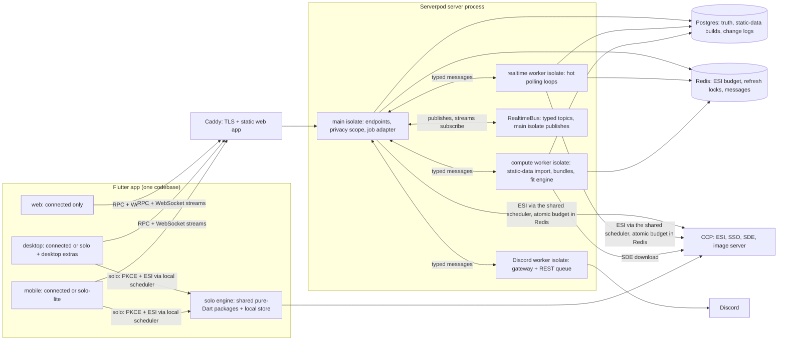

# Kaname Architecture

The current system shape. Change designs read this first. Detail lives in the ADRs (`docs/adr/`) and in change designs. No product code exists yet. This is the target shape that milestones build towards, and each change design checks it against the code as it lands.

## System triage

- **T1 Components:** yes. One server process (main isolate plus realtime, Discord and compute worker isolates), Postgres, Redis, Caddy, one app on six platforms, a desktop solo engine, external CCP services and Discord.
- **T2 State:** yes. Postgres truth, an encrypted token vault, side-by-side static-data builds, per-user change logs, local stores on devices.
- **T3 Concurrency:** yes. Recurring jobs, hot polling loops, a rate-limit scheduler, realtime fan-out, background bundle swaps.
- **T4 Boundaries:** yes. The ESI spec and compatibility date, the SDE format, Serverpod RPC and streams, the sync protocol, the client data bundle, the FitEngine FFI/WASM ABI, cross-isolate messages.
- **T5 Volume:** yes. Corp assets (hundreds of thousands of rows), call logs, change logs, event logs, killmails, static-data builds.
- **T6 Risk:** yes. OAuth tokens, members' private data, ISK amounts, the EULA boundary.

## Components

| Component | Responsibility | Owns (state) | Talks to via (contract) |
|---|---|---|---|
| App (Flutter) | All UI on six platforms; offline cache of own data and org records only (ADR 0006); presentation state (ADR 0010) | Local store, the static-data bundle in use | Server via Serverpod RPC and streams; nothing else when connected (ADR 0005) |
| Solo engine | Personal modules without a server (desktop solo, mobile solo-lite) | Device tokens, local copies of the member's data | ESI and SSO directly, through the same scheduler and job code with an in-process adapter (ADR 0007, ADR 0009) |
| Server main isolate | Endpoints, capabilities, privacy scope, future-call adapter for jobs, sync change log | Postgres data, token vault | Postgres, Redis, CCP services through the scheduler, workers via messages (ADR 0009) |
| Realtime worker | Location, fleet and killmail loops, within the loop bounds (ADR 0007) | In-memory loop state only | ESI via the scheduler; reports changes to the main isolate as typed replies, and the main isolate publishes them on the RealtimeBus (only the main isolate publishes, ADR 0014); events reach subscribers through the delivery scope |
| RealtimeBus | Fan-out of server events to client streams on typed, versioned topics (ADR 0008, ADR 0014) | Subscriptions only, per stream | Serverpod messages with local scope while one instance runs; every delivery passes its topic's public or scoped delivery scope |
| Discord worker | Gateway, role and nickname sync, message delivery | Per-route Discord queues | Discord REST and gateway; bus events through the privacy scope |
| Compute worker | Static-data import, client bundle builds, fit-engine calls | Static-data builds and their bundles | Postgres; CCP's SDE download; FitEngine over FFI; typed replies to the main isolate |
| Shared packages (pure Dart) | Domain model and rules, static data, ESI client and scheduler, SSO, sync, job logic behind the job-runner interface, FitEngine interface | None | Imported by server, app and solo engine (ADR 0003) |
| FitEngine adapter | Fit calculations | None | EVEShipFit engine over FFI or WASM (ADR 0011) |
| Caddy | TLS termination, static web app | Certificates | HTTP to the server |

## State ownership

| State | Sole writer | Lifetime | Invalidation / rebuild | Authoritative copy |
|---|---|---|---|---|
| Users, characters, groups, policies, org records | Server main isolate | Install lifetime; soft delete | Owner-hash and affiliation checks | Postgres |
| Character data on a server | Server (the character's one token holder) | Per policy retention | Sync recipes re-pull from ESI | Postgres; ESI upstream |
| Character data in solo | Device (the character's one token holder) | Until handed over or deleted | Local sync recipes | Device local store; ESI upstream |
| Refresh tokens | Token vault (server or device), single-flight per character | Until revoked or dead | New token saved as soon as CCP returns it; a crash before the save means re-login (ADR 0007) | Encrypted in Postgres or on the device; key outside the database |
| Static-data builds | Whichever job holds the static-data lock: the importer, the check job's switch (compute worker) and the rollback job | Active, previous and at most one staged; at most three at any moment | New build imported side by side, switched atomically; rollback swaps active and previous (ADR 0004) | Postgres per build; CCP's SDE upstream |
| Client data bundle (server) | Check job and bundle repair on the compute worker, under the static-data lock (solo: local builder) | One per stored build, removed with its build | A missing, failed or other-format active bundle is rebuilt by the next check, start or 60-second repair (ADR 0013) | Postgres `sde_bundle` and `sde_bundle_bytes` |
| Announced bundle and its served bytes | `BundleAnnouncer` in the server main isolate, one refresh at a time | Process lifetime; at most the announced and previous bundles held | Re-read at start, after each check and repair reply, and every 60 s; published on the RealtimeBus | Derived from `sde_build` and `sde_bundle` |
| Client data bundle (device) | `StaticDataNotifier` in the app, one save at a time | Until the next save replaces it | Downloaded when the announced build and hash differ from the bundle the device holds (it keeps only its current one), swapped in at a safe point, then saved whole | Server's stored bundle |
| Rate buckets, governor tier, negative cache | Scheduler code in each calling isolate, through one atomic check-and-spend | Rolling 15-minute window; backoff caps | Reservation before send; response headers correct it | Redis (server) or memory (solo) |
| Per-user change log | Server sync layer | Bounded by compaction (set in M4) | Clients resync from a snapshot | Postgres |
| Collaborative event logs | Server realtime layer | Per object | Gap → client resync | Postgres |
| Offline cache on clients | App sync layer | Own data and org records until invalidated; other members' data in memory only | Server stream invalidation | Server |

## Boundaries and contracts

- **ESI:** OpenAPI 3.1 spec at one pinned compatibility date. The generated client and route catalogue are regenerated only by a deliberate bump PR with contract tests (ADR 0007).
- **SSO v2:** confidential web flow for the server, PKCE for devices. JWTs are checked offline against CCP's JWKS.
- **SDE:** CCP's build-numbered JSONL. Known columns are typed and the full record is kept as JSON. Never generated code (ADR 0004).
- **Client data bundle:** one gzip JSON Lines file per static-data build, with a major and minor format version; readers accept any minor of a major they know (ADR 0013).
- **Server ↔ app:** Serverpod `.spy.yaml` models and endpoints through the generated client, plus one plain HTTP route beside it: `GET /static-data/bundle/<build>/<sha256>` for the client data bundle (ADR 0013). Additive-first schema changes; a server refuses to start on a database from a newer version.
- **Sync protocol:** per-user change log with sequence; field-level merge for personal records (ADR 0008). Defined in M4 and versioned with the server.
- **Cross-isolate messages:** typed, serializable models (ADR 0009). Workers reach Postgres through their own per-job connections from a typed start message (ADR 0012).
- **FitEngine:** Kaname's Dart interface. The pinned engine is reached over its C ABI or WASM build (ADR 0011).
- **Discord:** bring-your-own bot per install; OAuth2 account linking.
- **Desktop to game client:** read-only log files and window position and size only (ADR 0002).

## Resource bounds and failure visibility

| Flow / store | Bound | At the bound | On failure | Who finds out |
|---|---|---|---|---|
| ESI calls | Per-group buckets per (app, character) and the per-connection error limit | Governor spaces, then stops; call recorded "not sent" | Error and negative-cache entries; TQ pause | Limits screen and call log (member; admins see totals per ADR 0006) |
| Hot polling loops | Online, opted-in characters only; a minimum interval per loop; a capped share of each bucket (numbers set in M11 and M17) | Loop slows to its floor; other priorities keep their share | Loop restarts; tracking shows stale | Tracking indicator; admin health page |
| Dead refresh token | — | — | Token marked dead (revoked, or lost in a crash before save), never retried | Member (in-app and Discord DM if linked); member audit |
| Static-data import | Active, previous and at most one staged build; at most three at any moment, the one being imported included | The staged build removed before an import writes; the old previous removed by a switch | Active build untouched; import result recorded | Admin and solo settings page |
| ESI call log | 7 days | Rotated out | — | Admin health page |
| Corp asset tables | Hundreds of thousands of rows | Filtering, grouping and totals in SQL; virtualised grid (M0 spike) | — | — |
| Discord queue | Discord's per-route limits; queue cap set in M6 | Queued and retried with dedupe; behaviour at the cap set in M6 | Worker status shown | Admin health page |
| Realtime event log | Per object; compaction set in M16 | Snapshot plus tail | Gap → resync | Client indicator |
| Server footprint | One instance; ≤500 members and ≤2,000 characters on 2 vCPU / 4 GB | — | Structured logs, `/metrics` | Admin health page |

## In-force ADRs

Accepted, not superseded. Proposed ADRs are drafts and are not listed.

| ADR | Decision | Supersedes |
|---|---|---|
| [0001](../docs/adr/0001-stack-platforms-and-deployment.md) | Serverpod + Postgres + Redis, one Flutter app, Docker Compose; one server instance in 1.0 | — |
| [0002](../docs/adr/0002-licence-clean-room-and-eula-boundary.md) | AGPL-3.0, clean room, non-commercial, read-only EULA boundary | — |
| [0003](../docs/adr/0003-pub-workspace-and-vertical-modules.md) | Root pub workspace, pure-Dart shared packages, vertical compiled-in modules | — |
| [0004](../docs/adr/0004-static-data-is-data.md) | SDE is data, never code; side-by-side import, atomic live swap | — |
| [0005](../docs/adr/0005-run-modes-and-one-token-holder.md) | Connected, solo and solo-lite modes; one token holder per character | — |
| [0006](../docs/adr/0006-privacy-in-the-data-access-layer.md) | Privacy scope on every outbound path; own data only offline; scopes follow policy | — |
| [0007](../docs/adr/0007-esi-access-platform.md) | Generated ESI client, atomic budget scheduler and governor, encrypted token vault, SSO v2 | — |
| [0008](../docs/adr/0008-sync-and-realtime.md) | Change-log sync with field merge; streams over one RealtimeBus; per-object event logs | — |
| [0009](../docs/adr/0009-server-process-and-isolates.md) | One process; main, realtime, Discord and compute isolates; pure-Dart jobs behind a runner | — |
| [0010](../docs/adr/0010-flutter-app-state.md) | Riverpod 3 in the presentation layer only, no codegen or persist | — |
| [0011](../docs/adr/0011-fit-engine-behind-an-interface.md) | Kaname `FitEngine` interface over EVEShipFit's pinned engine | — |
| [0012](../docs/adr/0012-worker-isolate-access.md) | Workers reach Postgres through their own per-job connections; the bus is settled by ADR 0014 (workers send typed replies, only the main isolate publishes); Redis, vault and privacy scope still open (R56) | — |
| [0013](../docs/adr/0013-client-data-bundle.md) | One versioned gzip JSON Lines bundle per SDE build, public data only, served by build and hash; same builder on server and device | — |
| [0014](../docs/adr/0014-realtime-bus-topics.md) | RealtimeBus topics typed and versioned, public or scoped, local delivery first, only the main isolate publishes | — |
