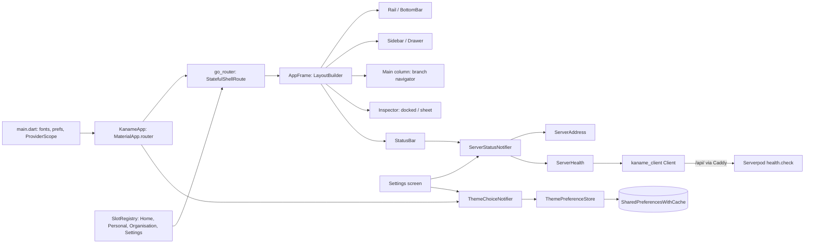
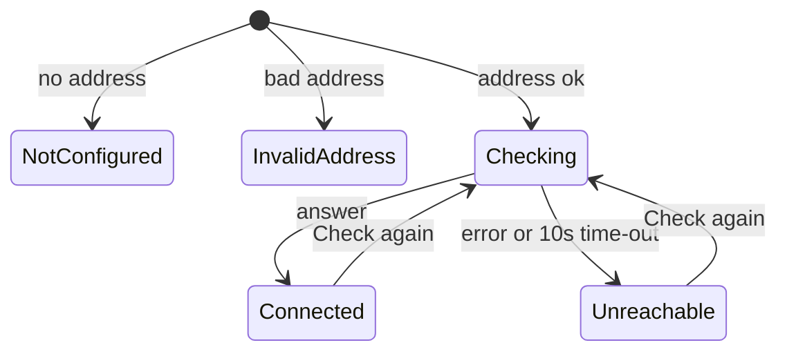
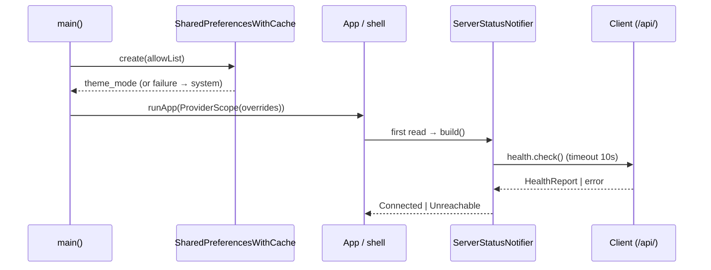

# Design

## Triage

| Trigger | Applies? | Evidence |
|---|---|---|
| T1 Components (new component, or 3+ with directed relationships) | yes | New shell frame, router, slot registry, settings, and server-connection components in the app, calling the server through Caddy (`deploy/Caddyfile:12-14`). |
| T2 State (persistent state, caches, 3+ state machine) | yes | Persisted theme choice (new on-device state); the server status is a five-state machine. |
| T3 Concurrency (background work, workers/isolates, async, retries) | yes | Async health call with a time-out, single-flight and user-triggered re-check; async preference load and save. |
| T4 Boundaries (data format, migration, shared interface, IPC, external) | yes | The slot registry is the contract every later module uses. A stored preference key and values, a build-time config key, and the generated client contract (`server/kaname_client/lib/src/protocol/client.dart:39-40`). |
| T5 Volume (grows without a fixed bound) | no | Fixed slot list, one preference key, one health call at a time. |
| T6 Risk (security, money, data loss, unrecoverable user data) | no | No sign-in, tokens or user data. The health answer carries no secrets by spec (`server/kaname_server/lib/src/health/health_endpoint.dart:13-16`). The UI must still not echo exception text (spec). |

TIER: FULL

## Context

- The app is a placeholder. `main` registers font licences, then runs `KanameApp` (`app/lib/main.dart:8-12`), and `MaterialApp` uses the Ember light and dark themes on `ThemeMode.system` with `themeAnimationDuration: Duration.zero` (`app/lib/main.dart:21-28`). The rewrite keeps both (DESIGN.md's "What Kaname changes"). The app depends only on `flutter`, `cupertino_icons` and `kaname_ember_ui` (`app/pubspec.yaml:11-15`).
- `kaname_ember_ui` exports the themes, focus ring, fonts and generated tokens (`app_packages/kaname_ember_ui/lib/kaname_ember_ui.dart:6-9`). The shell sizes and motion exist as tokens: top bar 44, status bar 28, rail 52, sidebar 268, inspector 352 (`.../generated/ember_tokens.dart:511-523`), and `EmberMotion.panel` 200ms with `panelEase` (`.../generated/ember_tokens.dart:533-538`). Breakpoints are not tokens: DESIGN.md's Layout section sets 1080 and 760.
- The generated client is `Client(String host, {..., connectionTimeout, ...})` (`server/kaname_client/lib/src/protocol/client.dart:43-55`), and `client.health.check()` returns `HealthReport` (`.../client.dart:39-40`). `HealthReport` holds `version`, `postgres` and `redis` (`server/kaname_server/lib/src/health/health_report.spy.yaml`). The server bounds each dependency check to 2s (`server/kaname_server/lib/src/health/health_endpoint.dart:9`).
- Caddy strips `/api/` before the server (`deploy/Caddyfile:12-14`), so the web client's host is `<origin>/api/`. `mise run stack:up` builds the web app and starts the stack (`mise.toml:189-195`). The CI `stack` job runs it plus the server-side stack tests (`.github/workflows/ci.yml:148-184`); no browser test exists.
- The shared analysis options carry no generated-code exclusion for the app (`analysis_options.yaml:11-16`, `app/analysis_options.yaml:6-15`). The server excludes its generated code (`server/kaname_server/analysis_options.yaml`), the precedent for D7.
- ADR 0010 sets Riverpod 3 in presentation only, no codegen or persist, go_router, and a project guide. ADR 0003 sets vertical modules under `app/lib/modules/<module>/`. ADR 0005 says a connected app talks only to its server.

## Decisions

### D1: Feature-first app layout

- **Choice:** `app/lib/shell/` (frame, router, slot registry), `app/lib/settings/`, `app/lib/server/` (address resolution, health), `app/lib/modules/<slot>/` (Home, Personal and Organisation placeholders) and `app/lib/l10n/`. Each feature splits into `ui/`, `logic/` (Riverpod providers and notifiers) and `data/` (plain Dart) where it has them. `main.dart` only wires.
- **Rejected:** a layer-first `ui/`, `logic/` and `data/` at the top, because it cuts across ADR 0003's vertical modules and scatters each module over three trees.
- **Reversal cost:** medium (moving files touches imports)
- **Important:** yes. It binds future changes: every module follows the layout.
- **Chosen by:** user

### D2: StatefulShellRoute with one branch per destination

- **Choice:** go_router `StatefulShellRoute.indexedStack`, with one `StatefulShellBranch` per registered slot and one for Settings. The branches are built from the registry (S1). The shell builder receives the `StatefulNavigationShell` and selects with `goBranch`. Paths: `/home`, `/personal`, `/organisation`, `/settings` and `/settings/licences`. `/` redirects to `/home`. A top-level `redirect` sends any location no route matches to `/not-found`. That route lives in a hidden branch that the registry does not list and the rail and bottom bar do not show; it renders inside the frame with no destination selected, so the not-found page keeps the shell; `errorBuilder` is not used for it. On the web, `main()` calls `usePathUrlStrategy()` (from `flutter_web_plugins`, SDK) and the build keeps base href `/`, so `/settings` is a real path; Caddy's single-page-app fallback already serves `index.html` for it (`deploy/Caddyfile:37-41`).
- **Rejected:** a plain `ShellRoute` with one nested navigator, because each switch rebuilds the destination and loses its state, against DESIGN.md's Centre Holds rule. Rejected too: an `errorBuilder` that wraps `AppFrame` itself, because it gives the frame a second entry point. Rejected too: hash URLs (`/#/settings`), because deep links would need hash paths.
- **Reversal cost:** medium
- **Important:** yes. It binds future changes: modules add routes under their branch.
- **Chosen by:** user (the not-found redirect and path URLs were decided by the owner after design review round 1)

### D3: Health through a plain-Dart interface and one notifier

- **Choice:**
  - `data/`: an abstract `ServerHealth` interface (`Future<HealthReport> check()`) with a `ClientServerHealth` adapter over `Client.health`, and a `ServerAddress` resolver.
  - `ServerAddress` returns a sealed `ServerTarget`: `ConfiguredServer(Uri)`, `NoServer`, or `InvalidServer(String raw)`.
  - `logic/`: a Riverpod `Notifier<ServerStatus>`. `ServerStatus` is sealed: `NotConfigured`, `InvalidAddress`, `Checking(previous?)`, `Connected(HealthReport)` and `Unreachable`.
  - `ClientServerHealth` builds the `Client` with `connectionTimeout: Duration(seconds: 10)`. This limits opening the connection and makes the client give up waiting for an answer after 10s, but it does not abort the HTTP request underneath. The notifier's `Future.timeout` of 10s is a backstop of the same kind. The notifier owns single-flight over its logical call: `check()` returns the in-flight future when one runs. Against a server that accepts but never answers, each "Check again" after a time-out can leave at most one more abandoned request open per press, until the server, Caddy, the OS or the browser closes it. Requests are user-triggered only, so this stays small; aborting requests would be a new decision. It maps every failure to `Unreachable` and logs it with `debugPrint` only in debug builds.
  - Widgets switch over `ServerStatus` exhaustively.
- **Rejected:** a `FutureProvider` that calls the client in presentation, because it has no typed not-configured or invalid states, gives weaker single-flight, and its tests need the real client.
- **Reversal cost:** low
- **Important:** yes. It binds future changes: the pattern the guide teaches for server calls.
- **Chosen by:** user (the client time-out was decided by the owner after design review round 1)

### D4: Custom Ember shell widgets in the app

- **Choice:** one `AppFrame` built with `LayoutBuilder` on the window width:
  - wide: >1080;
  - medium: 761-1080;
  - narrow: ≤760.
- It uses the Ember size tokens and `EmberMotion.panel` and `panelEase`, reading `MediaQuery.disableAnimationsOf` to collapse motion to zero. The rail item, bottom-bar item, top bar, status bar, sidebar, inspector panel and overlay sheet are small widgets in `app/lib/shell/ui/`. The inspector's open state lives in a shell `Notifier`. The main column stays one mounted subtree across breakpoints (keyed), so it is never rebuilt from scratch.
- **Rejected:** Material `NavigationRail` and `NavigationBar` themed toward Ember, because their indicator, label and minimum sizes fight the 52px rail and the accent-soft item. Rejected too: the same widgets placed in `kaname_ember_ui` now, because they would carry routing and slot behaviour before a second consumer settles their API.
- **Reversal cost:** low
- **Important:** yes. It changes what users see.
- **Chosen by:** user

### D5: Build-time server address key `KANAME_SERVER_URL`

- **Choice:** desktop and mobile read `String.fromEnvironment('KANAME_SERVER_URL')`. Only `main()` reads `kIsWeb`, `kDebugMode`, `String.fromEnvironment` and `Uri.base`. It passes them to `ServerAddress` as explicit inputs (`isWeb`, `isDebug`, the raw define and the base `Uri`), so every rule below is a plain unit test. Empty means `NoServer`. A value that `Uri.tryParse` rejects, or that has no `http` or `https` scheme or no host, is `InvalidServer`. A missing trailing slash is added. On the web (`kIsWeb`) the target is the `Uri.base` origin plus `/api/`. One exception: debug builds on the web honour the key when it is set, so `flutter run -d chrome` without Caddy can reach a development server. Profile and release web builds always ignore it.
- **Rejected:** an unprefixed `SERVER_URL`, because it can collide with other defines and does not name the project. Rejected too: the resolver reading the platform globals itself, because the web and debug rules could not be unit-tested.
- **Reversal cost:** low (but scripts and docs will use it)
- **Important:** yes. It is a config key.
- **Chosen by:** user (the injected inputs were decided by the owner after design review round 1)

### D6: Theme choice in SharedPreferencesWithCache, read before runApp

- **Choice:** `SharedPreferencesWithCache.create` with `allowList: {'kaname.theme_mode'}`. It stores `'system'`, `'dark'` or `'light'`. `main()` creates it before `runApp`, reads the value into a `ThemeChoice` enum (unknown or missing becomes `system`), and overrides the provider so the first frame is right. A plain-Dart `ThemePreferenceStore` interface wraps it (fake in tests). The settings `Notifier` applies a choice at once, then saves. A failed save leaves the choice applied and raises a one-shot "not saved" snackbar. If `create` itself throws, the app starts on System with a fallback store whose every save fails: the choice applies for the session, and the "not saved" snackbar appears on each change.
- **Rejected:** `SharedPreferencesAsync` read after the first frame, because the first frame can show the wrong theme, against the spec. Rejected too: an in-memory fallback whose saves look successful, because the user would never learn that the choice is lost at restart.
- **Reversal cost:** medium (stored key and values must stay readable)
- **Important:** yes. It is a stored data format.
- **Chosen by:** user (the failing fallback was decided by the owner after design review round 1)

### D7: Commit the gen-l10n output

- **Choice:** `app/l10n.yaml` sets `arb-dir: lib/l10n`, `template-arb-file: app_en.arb`, `output-dir: lib/l10n/generated` and no synthetic package. `pubspec.yaml` sets `flutter: generate: true`. The generated Dart is committed and added to `app/analysis_options.yaml` excludes; it stays format-checked. A `l10n:check` mise task regenerates into a temporary directory and fails on a difference. It joins `check` and CI.
- **Rejected:** generating at build with the output ignored, because every analyze, test and CI step would need a generation step first.
- **Reversal cost:** low
- **Important:** yes. It binds future changes: every UI string follows it.
- **Chosen by:** user

### D8: Prove the stack criterion with an [evidence] task

- **Choice:** the agent runs `mise run stack:up`, loads the web app in a headless browser and records the evidence note `openspec/changes/app-shell/evidence/stack-web-health.md`. The note holds the commands, the status-bar and Settings → Server text shown, and the request to `/api/` seen by the browser. Widget tests cover the logic with fakes. The existing CI `stack` job keeps covering Caddy → server.
- **Rejected:** a CI end-to-end browser job, because of the minutes per PR, a browser-driver dependency and fragility. Rejected too: widget tests only, because the real path is never exercised.
- **Reversal cost:** low
- **Important:** no
- **Chosen by:** user

### D9: App version from package_info_plus

- **Choice:** Settings → About reads the version and build number with `package_info_plus` (`PackageInfo.fromPlatform()`), through a plain-Dart `AppVersionSource` interface, with a fake in tests. It is read once, in `main()` before `runApp`, beside the preferences. A failure shows "unknown" and does not block start.
- **Rejected:** a `--dart-define` version (a local `flutter run` shows "unknown" unless the define is passed); a version constant generated from `pubspec.yaml` (one more generator and staleness check).
- **Reversal cost:** low
- **Important:** yes. It adds a dependency.
- **Chosen by:** user

### Decision summary

| # | Decision | Choice | Rejected | Reversal cost | Important | Chosen by |
|---|---|---|---|---|---|---|
| S1 | Module slots | Registry; Home, Personal, Organisation + Settings | All 19 disabled; Home + Settings only | low | yes | user |
| S2 | Reaching the server | Web same-origin `/api/`; build-time address elsewhere; status bar + Settings | Address field in Settings; web only | low | yes | user |
| S3 | Settings contents | Theme (persisted), Server, About | Theme in memory; no theme choice | low | yes | user |
| S4 | Mobile navigation | Bottom nav + sidebar drawer, recorded deviation | Drawer only; bottom nav only | medium | yes | user |
| S5 | Inspector depth | Open/close, overlay ≤1080, no stretch | Full signature; static column | low | yes | user |
| S6 | Localisation | gen-l10n now, English only | Hard-coded English | medium | yes | user |
| S7 | Riverpod guide location | `docs/guides/riverpod.md`, linked from AGENTS.md | app/README; inside AGENTS.md | low | no | user |
| S8 | Non-goals | No SSO, address UI, palette, content, local store, solo, stretch | Add empty command palette | low | no | user |
| S9 | Look criterion check | `[user]` task in this change | Judge at M0 close | low | yes | user |
| D1 | App layout | Feature-first, `ui/` `logic/` `data/` per feature | Layer-first | medium | yes | user |
| D2 | Router | `StatefulShellRoute.indexedStack`, branch per destination; `/not-found` redirect; path URLs | Plain `ShellRoute`; `errorBuilder` frame; hash URLs | medium | yes | user |
| D3 | Health flow | `ServerHealth` interface + `Notifier<ServerStatus>` (sealed); client `connectionTimeout` 10s + notifier backstop | `FutureProvider` on client | low | yes | user |
| D4 | Shell widgets | Custom Ember widgets in app, `LayoutBuilder` | Themed Material; in ember_ui | low | yes | user |
| D5 | Config key | `KANAME_SERVER_URL`; debug-web override; inputs injected from `main()` | `SERVER_URL`; resolver reads globals | low | yes | user |
| D6 | Theme storage | `SharedPreferencesWithCache`, key `kaname.theme_mode`, read before `runApp`; failing-save fallback | `SharedPreferencesAsync`, lazy; silent in-memory fallback | medium | yes | user |
| D7 | l10n output | Committed, analysis-excluded, `l10n:check` | Generated at build | low | yes | user |
| D8 | Stack proof | `[evidence]` task with headless browser | CI e2e job; widget tests only | low | no | user |
| D9 | App version | `package_info_plus` behind `AppVersionSource`, read before `runApp` | Build define; generated constant | low | yes | user |

## Assumptions

- **A1:** The pinned Flutter 3.47.9 gen-l10n accepts `output-dir` inside `lib/` without a synthetic package, and `flutter: generate: true` triggers it on `pub get`. Not checked because no l10n setup exists in the repo yet. Depends on it: D7 and the l10n task group (verified first in that group).
- **A2:** The Serverpod 4.1 client works on Flutter web with an `http://<origin>/api/` host and needs a trailing slash. The Caddy → server path under `/api/` is already exercised by the server-side stack tests run in the CI `stack` job (`.github/workflows/ci.yml:177-180`); the browser side is not. Not checked because no web call exists yet. Depends on it: D5, the evidence task.
- **A3:** `shared_preferences`, `go_router`, `flutter_riverpod`, `intl` and `package_info_plus` resolve with the pinned SDK and pass `mise run licences` (BSD-3 or MIT). Not checked because they are not added yet. Depends on it: the dependency task (a licence failure stops it and returns to the owner).
- **A4:** `SharedPreferencesWithCache.create` works on all six targets, including the web through `localStorage`. Not checked because it is runtime-only. Depends on it: D6 and the `[user]` look check.

## Carried constraints

- **C1:** Every module registers exactly one slot in the registry, with a unique id and route path; the registry refuses duplicates at startup. Kind: invariant. Destination: spec: specs/app-shell/spec.md → Requirement: Module slots come from one registry
- **C2:** The stored theme key is `kaname.theme_mode` with values `system`, `dark` or `light`. Unknown values read as `system`; a future change must keep reading these. Kind: invariant. Destination: doc comment: app/lib/settings/data/theme_preference_store.dart ThemePreferenceStore
- **C3:** `KANAME_SERVER_URL` is a build-time stand-in until a connect flow exists (M2/M4). Profile and release web builds ignore it and always use their own origin's `/api/`; only debug web builds honour it. Kind: deliberate gap. Destination: doc comment: app/lib/server/data/server_address.dart ServerAddress
- **C4:** Domain and data code in `app/lib/**/data/` never imports Riverpod; providers live in `logic/` only (ADR 0010). Kind: invariant. Destination: ADR 0010
- **C5:** `themeAnimationDuration: Duration.zero` stays on the app's `MaterialApp`. Kind: invariant. Destination: doc comment: app/lib/app.dart KanameApp
- **C6:** Inspector stretch and inspector content are deferred to the first module that needs them. Kind: deliberate gap. Destination: doc comment: app/lib/shell/ui/inspector_panel.dart InspectorPanel
- **C8:** `shared_preferences` holds UI preferences only (allow-listed keys); it is never a local store or cache for member or org data (ADR 0005/0006, R32). Kind: invariant. Destination: doc comment: app/lib/settings/data/theme_preference_store.dart ThemePreferenceStore
- **C9:** The bottom bar is sized for the M0 slots; what it does past about five slots is a deliberate gap for the first change that registers a fifth module. Kind: deliberate gap. Destination: doc comment: app/lib/shell/ui/bottom_bar.dart ShellBottomBar
- **C10:** The shell stays a `StatefulShellRoute`, never a plain `ShellRoute`, so destinations keep their state (Centre Holds). Kind: rejected alternative. Destination: doc comment: app/lib/shell/logic/router.dart buildRouter
- **C11:** Branches build lazily, with no `preload`, so cost grows only with visited destinations. Kind: invariant. Destination: doc comment: app/lib/shell/logic/router.dart buildRouter
- **C7:** UI errors from server calls never show exception text, hosts or ports; they map to typed states. Kind: invariant. Destination: spec: specs/app-server-connection/spec.md → Requirement: An unreachable server is shown without internal detail

## Diagrams (FULL)

Components (T1, T4):

Server status machine (T2):

Start-up and health sequence (T3):

## State & Ownership (FULL)

| State | Owner (sole writer) | Lifetime | Invalidation / rebuild | Authoritative copy |
|---|---|---|---|---|
| Theme choice | `ThemeChoiceNotifier` | Device, across restarts | User changes it; unknown stored value reads as System | On-device preference `kaname.theme_mode` |
| Server status | `ServerStatusNotifier` | App session | Re-check on user request; rebuilt at start | Server's answer at the last check |
| Server target | `ServerAddress` (computed once) | Build / page origin | Fixed per build (non-web) or origin (web) | Build define or `Uri.base` |
| Inspector open | Shell `InspectorNotifier` | App session | User toggles | In memory |
| Current destination | go_router | Session; the URL on the web | Navigation | Router location |
| Slot registry | Static const list in `shell/logic` | Compile time | Code change | Source |

## Failure & Visibility (FULL)

| Component | Fails / dies mid-operation → | Recovery | Retry safe? | Who finds out |
|---|---|---|---|---|
| Health call | Network error, time-out, unexpected response → `Unreachable` | User presses "Check again" | yes (read-only) | User (status bar, Settings) |
| Address resolution | Bad define → `InvalidAddress` | Rebuild with a valid address | n/a | User (Settings → Server) |
| Preference read | `create` throws → System with a failing-save store; value unknown → System | Next start tries again | yes | User ("not saved" snackbar on the next change); unknown value: nobody needs to, the default is shown |
| Preference save | Throws → choice applied for the session | Next change saves again | yes | User (snackbar "not saved") |
| Slot registry | Duplicate id or path → `StateError` at startup | Code fix | n/a | Developer (tests fail; app fails before first frame) |
| Unknown route | Redirect to `/not-found`, rendered in the frame | Link to Home | n/a | User |
| App version read | `PackageInfo` throws → "unknown" | Next start | yes | User (About shows unknown) |

## Resource Bounds (FULL)

| Queue / buffer / cache / transfer | Bound | At the bound | Timeout | At 10x / 100x |
|---|---|---|---|---|
| Health calls in flight | 1 logical call (single-flight). Abandoned requests after a time-out are not aborted; at most one more per user "Check again" against a server that never answers | Extra presses join the running call | 10s client wait, 10s notifier backstop | Unchanged: user-triggered only |
| Preference cache | 1 key (allowList) | Other keys refused by the plugin | n/a | n/a |
| Branch navigators | One per registered slot plus one hidden not-found branch (5 in M0) | n/a | n/a | 19 modules = 19 branches; indexedStack keeps the visited ones alive. Lazy branch build (no `preload`) keeps cost to visited ones. |

## Flow & State Gaps (FULL)

- **Check again during a check:** joins the in-flight call (single-flight). The button shows the busy state.
- **Answer arrives after the user has left Settings:** the notifier is app-scoped (kept alive), so the status bar shows it.
- **Breakpoint change with the inspector open:** the open state lives in the notifier, so the inspector re-renders as docked or as a sheet. The main subtree is keyed and stays mounted. A drawer open at narrow width closes when the window widens.
- **Opener gone when the inspector closes:** focus falls back to the main column's focus node (spec).
- **Theme saved, app killed before the save completes:** the next start reads the old value. Accepted; the user sets it again.
- **OS brightness change while the choice is System:** `MaterialApp.themeMode` is system, so it follows on the next frame.
- **Server version changes between checks:** the newest answer replaces the old one; no history is kept.

## Mechanism Ledger (FULL)

| Mechanism | Built? | Why (harm nobody catches / expensive later) | Evidence that would change the call |
|---|---|---|---|
| Single-flight health call | yes | Cheap, and double presses would race to set the status | — |
| 10s client time-out | yes | Without it a hung server leaves "Checking" forever and nobody knows | — |
| Periodic health polling | no | No harm caught late: the user can check again; polling costs battery on mobile | A module needing live server state (M4 sync) |
| Automatic retry with backoff | no | Read-only status; the user retries | Owner feedback at the look check |
| Registry duplicate guard | yes | Two modules on one path would shadow each other silently | — |
| l10n staleness check | yes | Stale generated files would compile but show old text | — |
| Preference schema version | no | One key, three values, unknown → System | A second preference with structure |
| Error reporting service | no | No telemetry in M0; debug log only | An owner decision on telemetry |

## Risks / Trade-offs

- [The web origin's `/api/` fails under `flutter run -d chrome` (no Caddy)] → the debug-only override in D5. app/README documents `flutter run -d chrome --dart-define=KANAME_SERVER_URL=http://127.0.0.1:8080/`. The self-host stack and release builds always use the origin.
- [Custom shell widgets drift from Ember] → widget tests assert the token sizes, the focus ring and semantics; the `[user]` look check judges the rest.
- [Bottom navigation deviates from the kit] → recorded in DESIGN.md's "What Kaname changes".
- [Six new dependencies (`flutter_riverpod`, `go_router`, `shared_preferences`, `package_info_plus`, `flutter_localizations`, `intl`)] → notices regenerated and the licence check run in the same task; a failure goes back to the owner.
- [A Riverpod 3 or go_router API differs from the docs read] → implementers check Context7 or find-docs before writing; the guide cites the versions pinned in the lockfile.

## ADRs

- **In force, constraining this change:** 0003 (vertical modules, workspace), 0005 (connected app talks only to its server), 0006 (no offline cache), 0010 (Riverpod in presentation, go_router, the guide).
- **To record during apply:** none. The slot contract and the layout are captured in specs, the guide and doc comments; none of them supersede an ADR.

## Open Questions

- Icons for Home, Personal and Organisation (Material Symbols outlined, or Ember monograms). This does not change specs or tasks; it is settled at the `[user]` look check.
