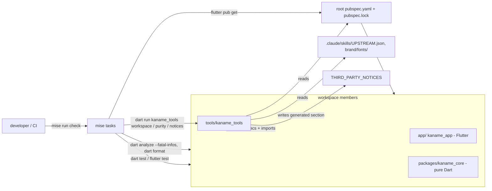
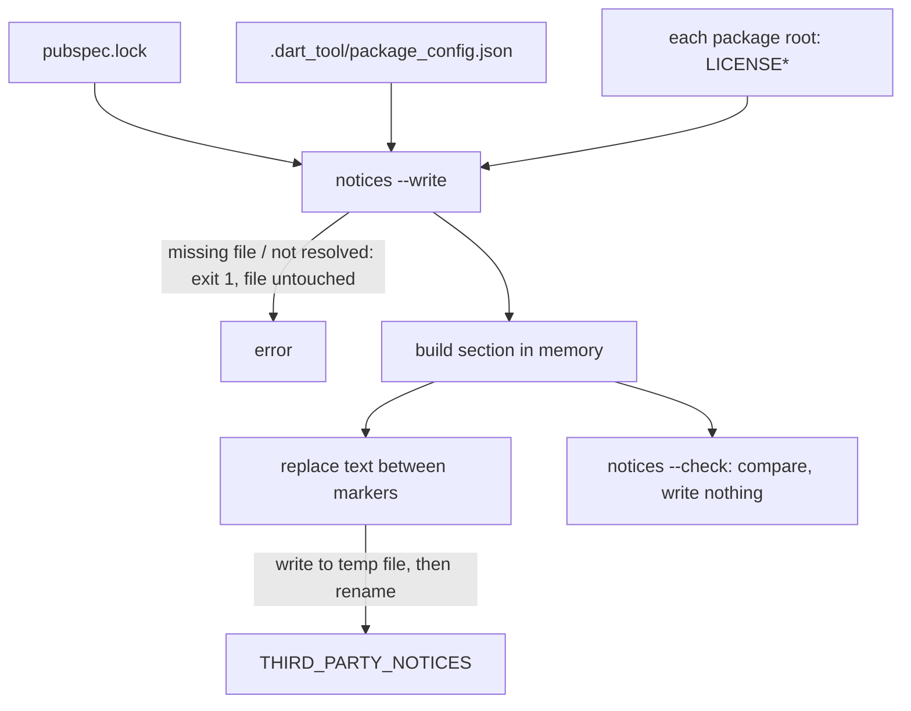

# Design

## Triage

| Trigger | Applies? | Evidence |
|---|---|---|
| T1 Components (new component, or 3+ with directed relationships) | yes | New packages `kaname_app`, `kaname_core`, `kaname_tools` and the root workspace; mise tasks drive the tools, which read the workspace. |
| T2 State (persistent state, caches, 3+ state machine) | yes (borderline) | `THIRD_PARTY_NOTICES`'s generated section is a committed artifact derived from `pubspec.lock`, with one writer. No runtime state. |
| T3 Concurrency (background work, workers/isolates, async, retries) | no | One-shot CLI commands, run in sequence by mise. No background work. |
| T4 Boundaries (data format, migration, shared interface, IPC, external) | yes | The workspace layout and naming rule bind every later package; the notices file's marker format is read by `ci-matrix`'s staleness check. |
| T5 Volume (grows without a fixed bound) | no | Inputs are the workspace's own files and one lockfile; both grow only with the project's dependency count. |
| T6 Risk (security, money, data loss, unrecoverable user data) | no | No user data or secrets. Licence compliance is covered by T4's notices contract. |

TIER: FULL

## Context

- ADR 0003 sets one root pub workspace holding the server, the app, pure-Dart shared packages, `ember_ui`, and `tools/` (`docs/adr/0003-pub-workspace-and-vertical-modules.md:12-16`), and leaves exact package names to this change (`…:17`). Tasks run through mise, not melos (`…:20`). Pure-Dart packages must not import Flutter or Serverpod, guarded by an analysis rule or test (`…:23`).
- ADR 0003 also asks `repo-scaffold` to confirm the workspace claim against the scaffold the pinned Serverpod CLI generates (`…:9`). The CLI is a package-local dev dependency (`docs/adr/0001-stack-platforms-and-deployment.md:17`; `mise.toml:4-5`) and no server package exists yet, so this change runs the pinned CLI once in a scratch directory outside the repository (task 1.1) and records the result as evidence.
- Pub workspaces (Dart docs, `/dart-lang/site-www` `tools/pub/workspaces.md`, fetched through Context7 on 2026-11-14): the root `pubspec.yaml` lists member paths under `workspace:`; each member declares `resolution: workspace` and an SDK constraint of at least `^3.6.0`; `pub get` anywhere writes a single root `pubspec.lock` and `.dart_tool/package_config.json` and deletes members' own; `dart pub workspace list` lists the members.
- The toolchain is Flutter 3.47.9 with Dart 3.13.7 (`mise.toml:9`; `mise exec -- flutter --version` on 2026-11-14 reports Dart 3.13.7). Existing tasks are `spec:validate` and `spec:list` only (`mise.toml:17-23`).
- The Flutter SDK's licences are in two files (checked in the pinned SDK installed by mise on 2026-11-14): the root `LICENSE` is Flutter's own 25-line BSD-3-Clause notice; `bin/cache/pkg/sky_engine/LICENSE` (29,844 lines) aggregates the notices of the engine's bundled third-party components. Neither file is in this repository.
- `.gitignore` already ignores `.dart_tool/`, `build/` and Flutter's ephemeral folders (`.gitignore:2,6,10-11`).
- ADR 0002 fixes the clean-room rule (`docs/adr/0002-licence-clean-room-and-eula-boundary.md:13`), the EULA boundary (`…:15`), and requires CI to fail on non-AGPL-compatible licences and `THIRD_PARTY_NOTICES` to list every bundled dependency (`…:16`).
- Vendored assets: ten skill sources, each with its licence file, in `.claude/skills/UPSTREAM.json:6-147`; the Serverpod source records two licence files, `LICENSE.serverpod` (SSPL-1.0) and `repository_license` `LICENSE.serverpod-root` (BSD-3-Clause), and the owner approved redistribution with both notices (`…:68,94-96`).
- Tracked Dart files outside any future workspace member exist: `brand/flutter/ember_theme.dart` and `brand/flutter/ember_tokens.dart` (`git ls-files '*.dart'`), plus examples inside vendored skills under `.claude/skills/`. They must stay unmodified and do not resolve as part of the workspace. Fonts: Geist and Literata under OFL 1.1, with licence texts `OFL-geist.txt` and `OFL-literata.txt` (`brand/fonts/OFL-NOTICE.md:5-9`).
- Commit rules today: author and committer are the owner, ending with exactly one KintsugiBot `Co-authored-by` trailer (`AGENTS.md:61`). Specwright puts its `Specwright-Task` trailers before `Co-authored-by` (`.claude/skills/specwright-commit/SKILL.md:46`).
- Scope decisions S1-S9 are in proposal.md.

## Decisions

### D1: Lint set

- **Choice:** One root `analysis_options.yaml` including `package:lints/recommended.yaml`, with `strict-casts`, `strict-inference` and `strict-raw-types`, plus a short project list of extra rules (`always_declare_return_types`, `prefer_final_locals`, `prefer_final_in_for_each`, `unawaited_futures`, `directives_ordering`, `public_member_api_docs` for shared packages). `app/` includes `package:flutter_lints/flutter.yaml` on top of the same strict modes and extras. Each package under `packages/` has its own `analysis_options.yaml` that includes the root file and adds `public_member_api_docs`; other members inherit the root file. The root file sets `analyzer: exclude:` for `.claude/**`, `brand/**`, `**/build/**` and `**/.dart_tool/**`. The format check runs only on workspace member directories (`app/`, `packages/`, `tools/`, and later `app_packages/` and `server/`), never on `.`; the `kaname_tools workspace` command prints that directory list so the task stays in step with the workspace.
- **Rejected:** `very_good_analysis` because it brings a large third-party rule set whose upgrades churn; `lints/core` only because it misses too much.
- **Reversal cost:** low
- **Important:** yes, binds future changes (every package must pass it)
- **Chosen by:** user

### D2: Checks as a pure-Dart CLI package

- **Choice:** `tools/kaname_tools`, a pure-Dart workspace member with an executable `kaname_tools` and subcommands `workspace` (membership, placement, naming, required files), `purity`, and `notices` (`--write` / `--check`). Built on `package:args` CommandRunner; filesystem access goes through a small injected interface, so unit tests run on in-memory fixture trees. mise tasks call `dart run kaname_tools <cmd>`. Package discovery (for `workspace`) lists `pubspec.yaml` files under `app/`, `app_packages/`, `packages/`, `server/` and `tools/` without following symlinks, and skips `build/`, `.dart_tool/`, `**/flutter/ephemeral/`, `**/.symlinks/` and `.plugin_symlinks/`. `notices --check` alone owns the vendored-source coverage check (D9).
- **Rejected:** shell scripts because they are hard to unit-test and need bash on the Windows CI runner; an analyzer plugin for purity because it adds a second mechanism on a newer API for a check a CLI does reliably.
- **Reversal cost:** low
- **Important:** yes, binds future changes (later checks extend this package)
- **Chosen by:** user

### D3: Notices cover every locked package

- **Choice:** The generated section lists every package in the root `pubspec.lock`, dev-only ones included.
- **Rejected:** only the runtime closure of shipped packages, because computing it means walking every package's pubspec, and a mistake under-reports silently.
- **Reversal cost:** low
- **Important:** yes, binds future changes (the format `ci-matrix` checks)
- **Chosen by:** user

### D4: Placeholder app

- **Choice:** Replace `flutter create`'s counter with one `MaterialApp` screen that shows "Kaname" and one widget test. No theme, routing or state management (those come in `ember-theme` and `app-shell`).
- **Rejected:** keeping the counter template, because it brings code and a test that `app-shell` then deletes.
- **Reversal cost:** low
- **Important:** yes, changes behaviour users see (what the app shows)
- **Chosen by:** user

### D5: SDK constraints pinned to the toolchain

- **Choice:** Every pubspec declares `sdk: ^3.13.0`; Flutter packages also declare `flutter: ">=3.47.0"`.
- **Rejected:** the workspace minimum `^3.6.0`, because it buys compatibility nobody uses and gates newer language features.
- **Reversal cost:** low
- **Important:** yes, binds future changes
- **Chosen by:** user

### D6: Package kind decided by folder

- **Choice:** `packages/` and `tools/` hold pure-Dart packages only; shared Flutter packages live in `app_packages/`. The purity check applies to every member under `packages/` and `tools/` and has no exemption list.
- **Rejected:** an allowlist inside the tool, because it is one more list to keep in step; treating any package that declares Flutter as exempt, because an accidental Flutter dependency would then pass silently.
- **Reversal cost:** medium (moving a package touches its imports and the workspace list)
- **Important:** yes, binds future changes (`ember-theme` places `kaname_ember_ui` in `app_packages/`)
- **Chosen by:** user

### D7: Formatter page width

- **Choice:** Dart's default of 80; no formatter setting.
- **Rejected:** 100 or 120 via `formatter.page_width`, because they differ from every upstream example and vendored skill for little gain.
- **Reversal cost:** low (one reformat commit)
- **Important:** no
- **Chosen by:** user

### D8: Who signs off

- **Choice:** Every commit, agent-made ones included, carries one `Signed-off-by: Nikolay Bochev <309868+sh1ny@users.noreply.github.com>` line, matching the author, placed in the final trailer block after any `Specwright-*` trailers and before the single KintsugiBot `Co-authored-by` trailer. Owner and agent commits write the line explicitly into the message file; they never use `git commit -s`, which would append it after `Co-authored-by`. AGENTS.md's commit rules say so; CONTRIBUTING keeps `git commit -s` as the example for outside contributors.
- **Rejected:** a second sign-off line for KintsugiBot, because a bot cannot certify origin.
- **Reversal cost:** low
- **Important:** yes, changes behaviour users see (commit format)
- **Chosen by:** user

### D9: Notices file format

- **Choice:** Plain text. Hand-written sections first, then a generated section between two fixed marker lines:
  `===== BEGIN GENERATED: pub dependencies (mise run notices) =====` and `===== END GENERATED: pub dependencies =====`. Inside: an index with one line per package (`name version source licence-ref`), sorted by name, then each distinct licence text once under its id (`L1`, `L2` … in order of first use), with LF line endings and the text trimmed of trailing whitespace. SDK packages get the ref `flutter-sdk`, with no text copied; its note names both the Flutter SDK's root `LICENSE` and `bin/cache/pkg/sky_engine/LICENSE`, which holds the notices for the engine and its bundled third-party components. The licence file is the first of `LICENSE`, `LICENSE.md`, `LICENSE.txt`, `COPYING` (case-insensitive) in the package root resolved through `.dart_tool/package_config.json`. `--check` also checks vendored-source coverage: each `UPSTREAM.json` source's `repository` URL and every licence file it records (`license`, and `repository_license` where present) appear in the hand-written sections, and each `brand/fonts/OFL-*.txt` file is named there. It reports every gap, not only the first.
- **Rejected:** full text per package, because the file grows to thousands of mostly identical lines; a separate generated file, because it means two files to ship.
- **Reversal cost:** medium (`ci-matrix` reads it)
- **Important:** yes, binds future changes (format contract)
- **Chosen by:** user

### Decision summary

| # | Decision | Choice | Rejected | Reversal cost | Important | Chosen by |
|---|---|---|---|---|---|---|
| S1 | Packages created | Root, `app/`, `kaname_core` (+ guard) | All stubs; core only | low | yes | user |
| S2 | Naming | `kaname_` prefix; `packages/`, `app_packages/`, `tools/`, `server/` | Short names; flat top level | medium | yes | user |
| S3 | Contributor sign-off | DCO | None; CLA | medium | yes | user |
| S4 | Vulnerability channel | GitHub private reporting only | Plus email; email only | low | yes | user |
| S5 | Notices scope | Hand-written vendored + generated deps | Vendored only; fully generated | low | yes | user |
| S6 | App identifier | `io.github.sh1ny.kaname` | Owner domain; `org.kaname` | high | yes | user |
| S7 | Community files | PR template only | Issue forms + CoC; none | low | yes | user |
| S8 | DCO enforcement | CI step in `ci-matrix` | DCO App; docs only | low | yes | user |
| S9 | Theme package name | `kaname_ember_ui` | `ember_ui` exception; `kaname_ui` | medium | yes | user |
| D1 | Lint set | `lints/recommended` + strict modes + extras | very_good_analysis; core only | low | yes | user |
| D2 | Check implementation | Dart CLI `tools/kaname_tools` | Shell; analyzer plugin | low | yes | user |
| D3 | Notices dependency scope | Every locked package | Runtime closure | low | yes | user |
| D4 | Placeholder app | Minimal screen + widget test | Counter template | low | yes | user |
| D5 | SDK constraints | `^3.13.0`, Flutter `>=3.47.0` | `^3.6.0` | low | yes | user |
| D6 | Flutter package placement | By folder (`app_packages/`) | Allowlist; Flutter-dependency exemption | medium | yes | user |
| D7 | Page width | 80 | 100; 120 | low | no | user |
| D8 | Sign-off | Owner only, before `Co-authored-by` | Owner + KintsugiBot | low | yes | user |
| D9 | Notices format | Marked section, deduplicated texts | Full text each; separate file | medium | yes | user |

## Assumptions

- **A1:** `flutter pub get` at the root resolves a workspace whose members include both a Flutter app and pure-Dart packages, and `dart analyze` at the root covers every member and honours the root `analyzer: exclude:` list for the non-member Dart files under `.claude/` and `brand/`. Not checked because the workspace does not exist yet; the docs say a workspace may contain Flutter packages but do not show this exact mix. Depends on it: tasks 2.1, 2.4. Fallback: run analysis per member directory.
- **A5:** The root `pubspec.lock` does not list the workspace's own members. Not checked because no workspace exists yet. Depends on it: the notices generator; if members do appear, it skips every package whose root is a workspace member.
- **A2:** `dart run kaname_tools <cmd>` from the root runs a workspace member's executable. Not checked for the same reason. Depends on it: tasks 4.x, 5.x. Fallback: `dart run tools/kaname_tools/bin/kaname_tools.dart`.
- **A3:** The pinned Serverpod 4.1 CLI's scaffold uses `resolution: workspace` in its packages. Not checked because the CLI is not installed; task 1.1 checks it and records the result. Depends on it: `serverpod-skeleton` (not this change); a negative result is reported to the owner before 1.1 is ticked.
- **A4:** `flutter create --platforms web,windows,linux,macos,android,ios` on Linux generates all six platform folders. Not checked because no project exists yet. Depends on it: task 2.2.

## Carried constraints

- **C1:** Every package has the `kaname_` prefix and sits in the folder of its kind (`app/`, `packages/`, `app_packages/`, `tools/`, `server/`). Kind: invariant. Destination: spec: specs/workspace-layout/spec.md → Requirement: Packages follow the placement and naming rule
- **C2:** Packages under `packages/` and `tools/` never depend on or import Flutter or Serverpod; Flutter packages go to `app_packages/`. Kind: invariant. Destination: spec: specs/workspace-layout/spec.md → Requirement: Shared packages stay pure Dart
- **C3:** The generated notices section lies between fixed marker lines, which `ci-matrix`'s staleness check reads; text outside them is never rewritten. Kind: invariant. Destination: spec: specs/third-party-notices/spec.md → Requirement: The dependency section is generated from the lockfile
- **C4:** No exemption list in the purity check; an allowlist was rejected. Kind: rejected alternative. Destination: doc comment: tools/kaname_tools/lib/src/purity.dart `PurityCheck`
- **C5:** SDK packages are referenced, not copied, in the notices, because `sky_engine`'s LICENSE, which aggregates the engine's third-party notices, is very large. Kind: deliberate gap. Destination: doc comment: tools/kaname_tools/lib/src/notices.dart `NoticesGenerator`
- **C6:** CI enforcement is deliberately left to `ci-matrix`: the DCO sign-off check, running `notices --check` in CI, and the licence-compatibility check. Until then CONTRIBUTING does not claim automated enforcement. Kind: deliberate gap. Destination: spec: specs/third-party-notices/spec.md → Requirement: A stale dependency section is detectable

## Diagrams (FULL)

Components (T1):

Notices data flow (T4):

## State & Ownership (FULL)

| State | Owner (sole writer) | Lifetime | Invalidation / rebuild | Authoritative copy |
|---|---|---|---|---|
| `pubspec.lock` | `pub get` (through the resolve task) | Committed | Re-resolve on any pubspec change | The committed file |
| Generated notices section | `kaname_tools notices --write` | Committed | Rerun after every resolve that changes the lockfile; `--check` detects staleness | Derived from `pubspec.lock` |
| Hand-written notices sections | People (reviewed edits) | Committed | Edited when vendored assets change; `notices --check` flags missing sources | The committed file |
| Workspace member list | Root `pubspec.yaml` (reviewed edits) | Committed | Edited when a package is added | The committed file |

## Failure & Visibility (FULL)

| Component | Fails / dies mid-operation → | Recovery | Retry safe? | Who finds out |
|---|---|---|---|---|
| `notices --write` | Killed before rename: the file is unchanged (write to temp, then rename) | Rerun | yes | Developer (non-zero exit) |
| `notices --write` | Licence file missing or not resolved: exit 1, names the package or says to resolve first, file untouched | Fix or resolve, rerun | yes | Developer |
| `notices --write` | Marker lines missing, duplicated or out of order: exit 1, file untouched | Restore the markers | yes | Developer |
| `workspace` / `purity` | Unreadable or invalid pubspec: exit 1 naming the file | Fix the file | yes | Developer; CI once `ci-matrix` runs it |
| `check` task | Any sub-check fails: exits non-zero, sub-check output names the failure | Fix and rerun | yes | Developer; CI |

## Resource Bounds (FULL)

| Queue / buffer / cache / transfer | Bound | At the bound | Timeout | At 10x / 100x |
|---|---|---|---|---|
| Files scanned by `purity` | Dart files under `packages/` and `tools/` (tens now) | Linear scan, no cache | None needed | 10x and 100x (thousands of files) still finish in seconds |
| Licence texts held by `notices` | One per locked package, deduplicated (~tens now, a few hundred at most) | All in memory | None | 100x packages is a few MB of text, still fine |

## Flow & State Gaps (FULL)

- **Lockfile changed, notices not regenerated:** `--check` fails and names the packages; `ci-matrix` runs it in CI. Until then, the `check` task runs it locally.
- **Resolve not run on a fresh clone:** `notices` and the tasks that need `.dart_tool` exit with a message to run the resolve task first.
- **New package added without a workspace entry:** `pub get` ignores it; the `workspace` check finds every `pubspec.yaml` under the package folders per D2's discovery rule (no symlinks followed; build, `.dart_tool`, ephemeral and plugin-symlink folders skipped) and fails on unlisted ones.
- **Two developers regenerate notices on different lockfiles:** the merge conflicts in the generated section; regenerate after merging the lockfile.

## Mechanism Ledger (FULL)

| Mechanism | Built? | Why (harm nobody catches / expensive later) | Evidence that would change the call |
|---|---|---|---|
| Purity check (pubspec deps + import scan) | yes | A Flutter import in a shared package breaks the server and the solo engine only when they land; ADR 0003 requires a guard | — |
| Workspace membership/naming check | yes | An unlisted package silently resolves outside the lockfile | — |
| Symlink/build-folder skip in package discovery | yes | Flutter plugin symlink trees hold `pubspec.yaml` files and would fail the check after the first plugin | — |
| Analyzer exclude + member-only format scope | yes | Vendored and brand Dart files would fail analysis or be reformatted | — |
| Required-files check (LICENSE, notices, CONTRIBUTING, SECURITY, PR template) | yes | Cheap; a removed policy file would go unnoticed | — |
| Atomic notices write (temp + rename) | yes | A half-written notices file could be committed | — |
| Notices `--check` mode | yes | `ci-matrix` needs it; staleness is otherwise invisible | — |
| Licence compatibility classification (SPDX) | no | Belongs to `ci-matrix`'s licence check | — |
| Caching of scans | no | Inputs are small | Check task over 10 s locally |
| Analyzer plugin for purity | no | CLI check is enough (D2) | Contributors repeatedly hitting the guard late |

## Risks / Trade-offs

- [The Serverpod CLI scaffold does not use workspace resolution (A3)] → task 1.1 checks it before any package is written; a mismatch goes to the owner as a planning question before `serverpod-skeleton`.
- [`flutter create` output for six platforms is large and partly template code] → keep it as generated, apart from the identifiers and the placeholder screen; it is tooling output, not copied product code.
- [`public_member_api_docs` slows early work on shared packages] → applied only to `packages/`, where the API is shared; easy to relax later (D1, low reversal cost).
- [The roadmap's exit criterion and `ember-theme` line still say `ember_ui`] → proposal records the rename (S9); the `ember-theme` proposal uses `kaname_ember_ui`.

## ADRs

- **In force, constraining this change:** 0001 (toolchain pinned through mise, package-local Serverpod CLI), 0002 (clean room, EULA boundary, notices and licence check), 0003 (root pub workspace, pure-Dart shared packages, mise not melos, names set here), 0010 (no state management here; `app-shell` adds Riverpod).
- **To record during apply:** none. ADR 0003 delegates the names and layout to this change; they live in the `workspace-layout` spec.

## Open Questions

- Which extra lint rules beyond D1's list are worth adding can be settled when real code lands; adding a rule does not change the specs.
