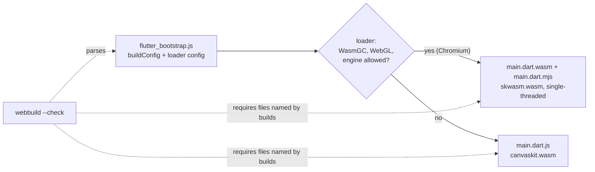

# Design

## Triage

| Trigger | Applies? | Evidence |
|---|---|---|
| T1 Components (new component, or 3+ with directed relationships) | no | No new component. The build task, the checker, Caddy and the browser loader already exist and keep their relationships. |
| T2 State (persistent state, caches, 3+ state machine) | no | No stored state. The build output is regenerated on every build. |
| T3 Concurrency (background work, workers/isolates, async, retries) | no | Single-threaded skwasm is forced. Nothing new runs concurrently. |
| T4 Boundaries (data format, migration, shared interface, IPC, external) | yes | The checker reads Flutter's generated `_flutter.buildConfig` (an external format), and the bootstrap's loader configuration becomes a checked contract. |
| T5 Volume (grows without a fixed bound) | no | The build output is fixed per build. |
| T6 Risk (security, money, data loss, unrecoverable user data) | no | No data and no new origin. The self-contained check still applies. |

TIER: FULL

## Context

Read proposal.md for the why and the scope decisions (S1–S6).

- **Build commands.** The local build compiles with `flutter build web --release --no-web-resources-cdn` (`mise.toml:143-146`) and then runs `webbuild --check app/build/web` (`mise.toml:148-150`). `build:web` chains the two (`mise.toml:133-141`). CI's web matrix entry repeats the compile command (`.github/workflows/ci.yml:77`) and runs `mise run webbuild:check` for the web target (`.github/workflows/ci.yml:107-109`). `ci_workflow_test.dart` asserts that flag and step (`tools/kaname_tools/test/ci_workflow_test.dart:299-310`) and that `stack:up` goes through `build:web` (`tools/kaname_tools/test/ci_workflow_test.dart:597-608`). The spike already builds with `--wasm --release --no-web-resources-cdn` (`mise.toml:164-167`) and runs the same checker on its output (`mise.toml:169-171`). Its bootstrap sets `forceSingleThreadedSkwasm` from a `?threads=` query switch, so its benchmark can run a multi-threaded row (`spikes/kaname_grid_spike/web/flutter_bootstrap.js:18-35`).
- **Checker.** `WebBuildChecker.check` reads `flutter_bootstrap.js` and joins three lists of problems (`tools/kaname_tools/lib/src/webbuild.dart:43-62`). `_buildConfig` already parses the JSON object assigned to `_flutter.buildConfig` (`webbuild.dart:153-168`), and `_checkLocalEngine` pattern-matches it (`webbuild.dart:64-83`). `_fallbackSetting` and `_checkFallbackAddress` show the existing pattern for a loader setting that must be present (`webbuild.dart:37-40`, `110-131`). The class doc comment leaves the headers decision to "a report recommends `--wasm`" change (`webbuild.dart:18-22`).
- **Build config format and loader behaviour.** The `builds` layout of a `--wasm` build's `_flutter.buildConfig`, the loader's default allow list and its multi-threading warning condition are taken from generated, ignored build output and from Flutter's docs; see A4 and A5. Flutter's docs confirm `forceSingleThreadedSkwasm`, `wasmAllowList` (default: Chromium only) and the fallback to the dart2js/CanvasKit build (Context7, `/flutter/website`, `platform-integration/web/initialization.md` and `wasm.md`).
- **Bootstrap.** `app/web/flutter_bootstrap.js:9-16` passes only `fontFallbackBaseUrl` and the service worker version to `_flutter.loader.load`.
- **Caddy.** The web build is served by `file_server` with the single-page-app fallback `try_files {path} /index.html` (`deploy/Caddyfile:38-42`). Caddy adds no header directives anywhere in the file (`deploy/Caddyfile:8-43`). The image is pinned `caddy:2@sha256:…` (`deploy/compose.yaml:106`), and the build is mounted read-only at `/srv` (`deploy/compose.yaml:113-114`).
- **Stack tests.** `server/kaname_client/test/stack/stack_test.dart` requests paths through Caddy with the `http` helper, for example in the fallback-font test (`stack_test.dart:179-198`). The helper returns only status, MIME type and a body decoded as strict UTF-8 (`server/kaname_client/test/stack/support/stack_support.dart:174-178`). It cannot show response headers, and it would throw on a binary `.wasm` body.
- **Command text.** The `--check` help, the command description and the success line describe only the self-contained rule (`webbuild.dart:198-204`, `214-216`, `233`).
- **App code.** No `dart:html`, `dart:js`, `dart:js_util` or `package:js` import exists under `app/`, `app_packages/` or `packages/` (grep, 2026-11-18).

## Decisions

### D1: Keep Flutter's default wasm allow list

- **Choice:** Leave `wasmAllowList` unset. Chromium-based browsers get skwasm, while Firefox, Safari and unknown engines get the dart2js/CanvasKit build.
- **Rejected:** Allowing gecko and webkit: untested here (the spike ran Chrome only), and Flutter keeps them off by default. Allowing gecko only: the same lack of evidence.
- **Reversal cost:** low (one loader setting)
- **Important:** yes, it changes behaviour users see (which renderer each browser runs)
- **Chosen by:** user

### D2: Force single-threaded skwasm in the bootstrap, and check it

- **Choice:** `app/web/flutter_bootstrap.js` sets `forceSingleThreadedSkwasm: true`. A new `webbuild --check --single-threaded` option makes the check scan the built bootstrap for `forceSingleThreadedSkwasm` used as an object key (quoted or not, followed by `:`). It fails unless at least one such key exists and every one has the literal value `true`; a missing key, `false` or a variable value each fail with a message saying skwasm could start multi-threaded. An occurrence counts as a key only when it is not preceded by `.` or an identifier character and is followed, after an optional closing quote and whitespace, by `:`. Property reads in the inlined loader, including one inside a conditional such as `a?e.forceSingleThreadedSkwasm:b`, are not keys and are ignored; the checker's tests include a fixture with both forms (A6). `webbuild:check` (local, CI and the stack, through `build:web`) passes the option. The spike's `build:spike:check` does not, so its `?threads=` switch and multi-threaded benchmark row keep working (review round 1, owner's choice). Because the mode is forced, the loader logs no multi-threading warning.
- **Rejected:** Requiring the setting on every checked build: it breaks `build:spike` and `bench:spike`, whose multi-threaded row is how the crash in C1 gets reproduced. Changing the spike to force single-threaded too: it loses that row. Relying on the missing COOP/COEP headers only: a self-hoster's proxy that adds them would silently enable the multi-threaded mode that crashed in the spike. Setting `suppressMultithreadingWarning` only: it hides the warning but leaves the mode to the headers.
- **Reversal cost:** low (remove the setting, add the headers, relax the check)
- **Important:** yes, it binds future changes (a checked loader contract)
- **Chosen by:** user

### D3: Decide "wasm build" from the parsed build config

- **Choice:** Extend the checker with a wasm-build check over the already-parsed `_flutter.buildConfig`. It requires a `builds` entry with `compileTarget` `dart2wasm` and `renderer` `skwasm` that names `mainWasmPath` and `jsSupportRuntimePath`, and an entry with `compileTarget` `dart2js` and `renderer` `canvaskit` that names `mainJsPath`. Every named file must exist in the output, and the skwasm entry must come before the CanvasKit entry, because the loader takes the first build the browser supports. Each problem gets its own message, naming the missing build or file, or saying the loader would never choose skwasm. This check runs on every build, the spike's included (its `--wasm` output passes).
- **Rejected:** Checking for fixed file names (`main.dart.wasm`, `.mjs`, `.js`) only: it misses a config that does not list a build, and it ties the check to names Flutter may change.
- **Reversal cost:** low
- **Important:** yes, it binds future changes (it reads an external format, and every web build must pass it)
- **Chosen by:** user

### D4: Prove headers and content types with stack tests

- **Choice:** Extend the stack support helper (`stack_support.dart`) so a request can return response headers and leave a non-text body undecoded. Then add stack tests (tag `stack`, run by the CI `stack` job). They assert that `index.html`, `flutter_bootstrap.js` and `main.dart.wasm` carry no COOP/COEP header, that `main.dart.wasm` is `application/wasm`, that `main.dart.mjs` has a JavaScript content type, and that a missing `.wasm` path is not served as `application/wasm`.
- **Rejected:** A one-off curl check recorded as evidence: a later Caddy or image bump could change the types unnoticed.
- **Reversal cost:** low
- **Important:** no
- **Chosen by:** user

### D5: One agent browser run recorded as evidence

- **Choice:** During apply, after asking the owner (heavy job, PC may be under load), run headless Chrome for Testing once against the stack's build, with `--log-net-log` and a screenshot. The default load must fetch `main.dart.wasm` and `skwasm.wasm`, render a first screen, and log no multi-threading warning. The CanvasKit fallback runs against a scratch copy of the build whose bootstrap adds `renderer: "canvaskit"`, served by `kaname_tools serve --no-isolation`. That load must fetch `main.dart.js` and `canvaskit.wasm` and render. Both results, as file lists and screenshots, are committed under the change's `evidence/`. Nothing is added to CI, and the product bootstrap gets no query switch.
- **Rejected:** Adding a `?renderer=` query switch to the product bootstrap for testing: it is product code that serves tests only. Relying on the owner's M1 check alone: it would not show the fallback at all. A `[user]` task: it blocks the archive on the owner.
- **Reversal cost:** low
- **Important:** no
- **Chosen by:** user

### Decision summary

| # | Decision | Choice | Rejected | Reversal cost | Important | Chosen by |
|---|---|---|---|---|---|---|
| S1 | Threads and headers | `--wasm`, no COOP/COEP, single-threaded skwasm | Multi-threaded with headers; CanvasKit only | low | yes | user |
| S2 | Wasm in the check | Check requires a wasm build | Check unchanged | low | yes | user |
| S3 | Spec home | New `web-build` capability | Extend `ember-ui`; `self-host-stack` | low | yes | user |
| S4 | Wasm tests | Build and check only | CI wasm test job; local task | low | yes | user |
| S5 | Deploy scope | Notes only, Caddyfile unchanged | Caddy compression | low | no | user |
| S6 | Renderer in UI | None | About line | low | yes | user |
| D1 | Allow list | Flutter default (Chromium only) | gecko + webkit; gecko only | low | yes | user |
| D2 | Thread mode | Force single-threaded in bootstrap; checked by an opt-in `--single-threaded` option the product tasks pass | Required for every build; change the spike; headers only; suppress warning only | low | yes | user |
| D3 | Wasm detection | Parse `buildConfig.builds`, check named files and skwasm-before-CanvasKit order, on every build | Fixed file names; order left unchecked | low | yes | user |
| D4 | Stack proof | Extend the stack helper; stack tests for headers and types | One-off curl evidence | low | no | user |
| D5 | Browser proof | One headless Chrome run, committed evidence | Query switch; owner check only; `[user]` task | low | no | user |

## Assumptions

- **A1:** Caddy's `file_server` in the pinned image serves `.wasm` as `application/wasm` and `.mjs` with a JavaScript type. Not checked because the stack was not started during planning. Depends on it: D4, and its stack tests settle it. If either type is wrong, the fix is a Caddy `header` rule for that extension, which goes back to the owner because it changes S5.
- **A2:** The app and its dependencies compile with `dart2wasm` on Flutter 3.47.9. Not checked because the planning step builds nothing. Depends on it: every build task. The first apply task runs the build, and a failure stops apply and goes to the owner.
- **A3:** A forced `renderer: "canvaskit"` in a scratch bootstrap loads the same dart2js build that a browser without WasmGC would get. Not checked because it is the run itself. Depends on it: D5.
- **A4:** A `--wasm` build on the pinned Flutter writes `"builds":[{"compileTarget":"dart2wasm","renderer":"skwasm","mainWasmPath":"main.dart.wasm","jsSupportRuntimePath":"main.dart.mjs"},{"compileTarget":"dart2js","renderer":"canvaskit","mainJsPath":"main.dart.js"}]` into `_flutter.buildConfig`. Observed in the spike's ignored build output on 2026-11-18, so it cannot be cited. Depends on it: D3. The checker's tests use this layout as a fixture, and the first apply task confirms it on the product build.
- **A5:** The pinned Flutter's generated `flutter.js` defaults `wasmAllowList` to `{blink: true, gecko: false, webkit: false, unknown: false}`, refuses skwasm without WasmGC or WebGL, and logs the multi-threading warning only when the page is not cross-origin isolated and neither `forceSingleThreadedSkwasm` nor `suppressMultithreadingWarning` is set. Observed in the spike's ignored generated `flutter.js` and consistent with Flutter's docs, but generated output cannot be cited. Depends on it: D1, D2, D5. D5's browser run confirms it.
- **A6:** The pinned Flutter's generated `flutter.js`, which `{{flutter_js}}` inlines into the built bootstrap, reads `forceSingleThreadedSkwasm` only as a property and never writes it as an object key. Not cited because the loader is generated, ignored output. Depends on it: D2. If it is wrong, `webbuild --check --single-threaded` fails on every product build. The first apply build confirms it, and a failure goes back to the owner with the matching loader text.

## Carried constraints

- **C1:** Multi-threaded skwasm stays off until the spike's crash (`RuntimeError: memory access out of bounds` in `skwasm.wasm`) is reproduced and resolved upstream. Enabling it means removing `forceSingleThreadedSkwasm` from the product bootstrap, dropping `--single-threaded` from `webbuild:check` and adding COOP/COEP to `deploy/Caddyfile`, all together. The spike's check deliberately omits `--single-threaded`, so its multi-threaded benchmark row can reproduce the crash. Kind: deliberate gap. Destination: doc comment: tools/kaname_tools/lib/src/webbuild.dart WebBuildChecker
- **C2:** Firefox and Safari get CanvasKit because Flutter's default allow list excludes them. Widening `wasmAllowList` needs a measured run on those browsers first. Kind: deliberate gap. Destination: doc comment: app/web/flutter_bootstrap.js `_flutter.loader.load`
- **C3:** App code must compile for both dart2wasm and dart2js, because both builds ship from one output. Kind: invariant. Destination: spec: specs/web-build/spec.md → Requirement: The web build is skwasm with a CanvasKit fallback

## Diagrams (FULL)

T4: what the browser loads from one build output.

## State & Ownership (FULL)

| State | Owner (sole writer) | Lifetime | Invalidation / rebuild | Authoritative copy |
|---|---|---|---|---|
| `app/build/web/` build output | `flutter build web` via `build:web:compile` | Until the next build | Rebuilt by every build task | The output of the last build, checked by `webbuild --check` |
| Loader configuration | `app/web/flutter_bootstrap.js` (hand-written template) | Source-controlled | Edited by changes only, checked on every build | The committed template |

## Failure & Visibility (FULL)

| Component | Fails / dies mid-operation → | Recovery | Retry safe? | Who finds out |
|---|---|---|---|---|
| wasm compile | Non-zero exit, `build:web` stops before the check | Fix the incompatible code or dependency | yes | Developer (task output), CI web job red |
| `webbuild --check` | Non-zero exit naming each missing build, file or setting | Rebuild with `--wasm`, restore the bootstrap setting | yes | Developer, CI web job red, `stack:up` stops before Compose |
| Caddy content types | A browser refuses to compile `.wasm` or import `.mjs`, and the app does not start on skwasm | A Caddy header rule (back to the owner, A1) | yes | Stack tests in the CI `stack` job |
| Browser loader | Skwasm unavailable → JS build chosen, by design | None needed | n/a | Nobody, by design. The renderer is not shown in the UI (S6), and D5's evidence records both paths once |

## Resource Bounds (FULL)

| Queue / buffer / cache / transfer | Bound | At the bound | Timeout | At 10x / 100x |
|---|---|---|---|---|
| Web build output (both builds plus engines) | Fixed per build, larger than today because of the added wasm build | n/a | n/a | App code growth grows `main.dart.wasm` and `main.dart.js`. Uncompressed serving (S5) makes first load slower. Compression is the recorded follow-up |
| CI web job time | `timeout-minutes: 45` (`.github/workflows/ci.yml:72`) | Job fails | 45 min | dart2wasm and dart2js both run, so a slower job is expected but far from the limit |
| Browser downloads per load | One build's entry point plus one engine | n/a | Browser default | Unchanged by volume |

## Flow & State Gaps (FULL)

- **Partial build.** An interrupted `flutter build` can leave a stale or partial output. The check names every missing file, and `build:web` always rebuilds before checking.
- **Stale service worker.** A browser with the old CanvasKit-only build cached by Flutter's service worker gets the new build on the next version change. The service worker version is already templated (`app/web/flutter_bootstrap.js:13-15`). No new behaviour.
- **Proxy adds headers.** Covered by D2: the forced single-thread setting wins.

## Mechanism Ledger (FULL)

| Mechanism | Built? | Why (harm nobody catches / expensive later) | Evidence that would change the call |
|---|---|---|---|
| Wasm-build check (D3) | yes | A silent regression to CanvasKit-only would only show as slower scrolling that nobody measures | — |
| Forced single-thread check (D2, product tasks only) | yes | A dropped setting plus a header-adding proxy would bring back an intermittent crash nobody traces | Upstream fix for the crash (C1) |
| Stack tests for types and headers (D4) | yes | A wrong type breaks skwasm start-up for every self-hoster, and CI would not notice | — |
| Caddy compression | no | A performance gain, not a correctness issue (S5) | Measured first-load times on a self-host |
| Wasm test run of app tests | no | No web-specific code exists yet (S4) | First `dart:js_interop` or `package:web` code in the app |
| Renderer indicator in UI | no | S6 | Support requests that need it |

## Risks / Trade-offs

- [The dart2wasm compile fails on a dependency] → The first apply task builds before anything else. A failure goes to the owner with the error (A2).
- [The pinned Caddy serves a wrong type] → The stack tests catch it. The fix is a header rule, decided with the owner (A1).
- [CanvasKit stays slow for Firefox and Safari users] → Accepted (D1). D5's CanvasKit run and the owner's M1 check decide whether the fallback needs work. C2 records how to widen the allow list.
- [The build output roughly doubles] → Accepted. Compression is a recorded follow-up (S5).

## ADRs

- **In force, constraining this change:** ADR 0001 (one Flutter app for all platforms; Caddy serves the static web app in the Compose stack). The self-contained rule this change keeps is the `ember-ui` requirement "The web build loads no engine or font files from third-party hosts", not an ADR.
- **To record during apply:** none. Renderer and threading are build settings with low reversal cost, carried by the spec and the doc comments (C1–C3), not an ADR.
