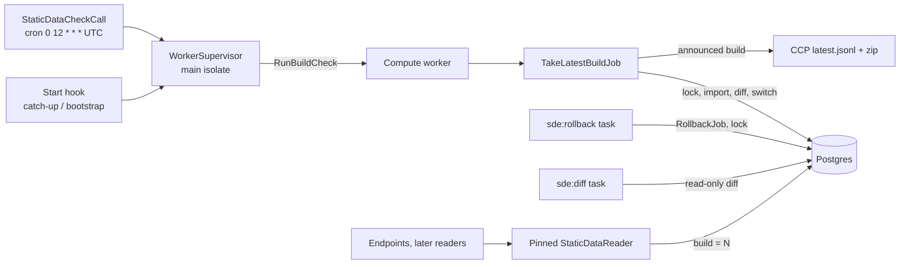
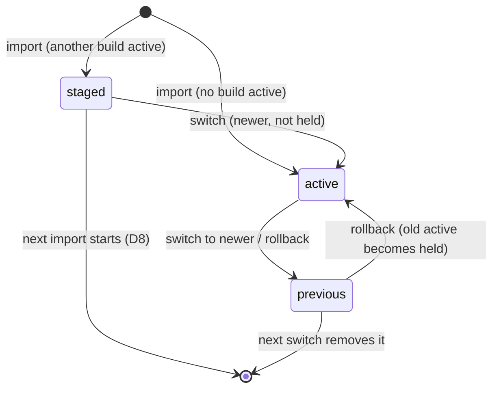
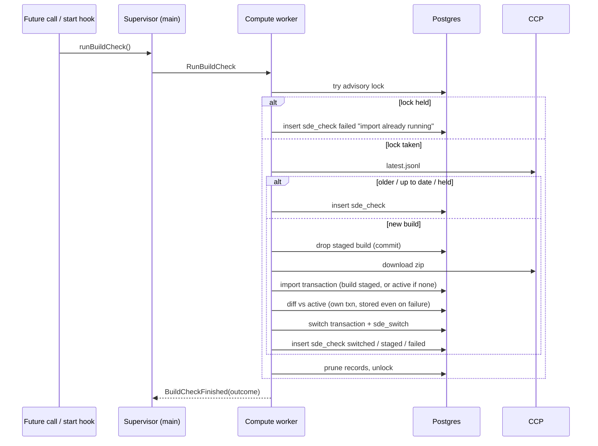

# Design

## Triage

| Trigger | Applies? | Evidence |
|---|---|---|
| T1 Components (new component, or 3+ with directed relationships) | yes | A new recurring future call on the main isolate drives the supervisor, which drives a new check job on the compute worker; a new pinned reader sits between endpoints and Postgres. |
| T2 State (persistent state, caches, 3+ state machine) | yes | Build states become `staged`/`active`/`previous` plus a hold; there are new `sde_check`, `sde_switch` and `sde_build_diff` tables. |
| T3 Concurrency (background work, workers/isolates, async, retries) | yes | A daily future call, a start catch-up, the development tasks and in-flight readers all race with the switch. |
| T4 Boundaries (data format, migration, shared interface, IPC, external) | yes | Migration, new cross-isolate messages, the stored diff report format, the reader interface, CCP's `latest.jsonl`. |
| T5 Volume (grows without a fixed bound) | yes | Diffs over builds of about a million rows; the check and switch records. |
| T6 Risk (security, money, data loss, unrecoverable user data) | no | Static data can always be imported again from CCP; no credentials are added. |

TIER: FULL

## Context

The scope and decisions are in proposal.md (S1–S7). The code they build on:

- **Build state.** `sde_build` holds `build`, `state` and a nullable unique `activeMarker` that allows at most one active row (`server/kaname_server/lib/src/static_data/sde_build.spy.yaml:11-21`). The pure-Dart `BuildState` has only `staged` and `active` (`packages/kaname_static_data/lib/src/static_data_store.dart:24-30`).
- **Importer.** `ImportSdeJob` takes the lock itself, skips a build that is already stored (`packages/kaname_static_data/lib/src/import_sde_job.dart:254`, `:267`), and picks `active` only when no build is active (`:282-284`). Its carried constraint C6 hands every other activation and the `previous` state to this change (`:101-106`).
- **Staged removal.** `commitBuild` deletes every other staged build inside the import transaction, before inserting the build row (`server/kaname_server/lib/src/static_data/postgres_static_data_store.dart:397-413`; interface contract `static_data_store.dart:158-169`).
- **Lock and limits.** The store takes `pg_try_advisory_lock` (`postgres_static_data_store.dart:262`) and sets a five-minute `statement_timeout` (`:197`).
- **Raw records.** A raw record's `key` holds `_key` for integer-keyed files and is empty otherwise (`server/kaname_server/lib/src/static_data/sde_record.spy.yaml:2`, `:12`).
- **Start.** The start hook checks for an active build through the ORM and, when none is active, asks the supervisor to import CCP's latest build (`server/kaname_server/lib/src/static_data/static_data_start_hook.dart:124-137`). The supervisor's only request is `runImport` (`server/kaname_server/lib/src/workers/worker_supervisor.dart:158-164`).
- **Worker messages.** The only request type is `RunImport`, under a sealed `WorkerRequest`/`WorkerReply` pair (`server/kaname_server/lib/src/workers/worker_messages.dart:114-143`, `:159`).
- **Jobs.** The pure-Dart `Job`/`JobRunner` interfaces are in `packages/kaname_core/lib/src/job.dart:8-21`.
- **Future calls.** No future call exists in the server yet (a grep for `FutureCall` in `server/kaname_server/lib` outside generated code finds none). The server pins Serverpod 4.1.2 (`server/kaname_server/pubspec.yaml:18`). How that version schedules recurring calls is recorded in A5, because its source is outside this repository.
- **Development task.** `mise run sde:import` is the existing pattern for a task that runs a job in its own process (`mise.toml:247-248`, `server/kaname_server/tool/sde_import.dart`).

## Decisions

### D1: Build states and the hold live on `sde_build`

- **Choice:** add `previous` to `SdeBuildState` and `BuildState`. Add a nullable unique `previousMarker`, which allows at most one previous build the same way `activeMarker` allows one active build, and a `held` boolean (default false). At rest the database enforces one active and one previous build. "At most one staged" is kept by the code, because the import removes the staged build first (D8).
- **Rejected:** a one-row pointer table with the active, previous and held build numbers. It lost because the state would live in two places (the pointer table and `sde_build`), and every reader and the diff would have to join them.
- **Reversal cost:** medium (a migration and the store's SQL).
- **Important:** yes, because it binds future changes: it is the stored data format.
- **Chosen by:** user

### D2: One pipeline job on the compute worker: check, import, diff, switch

- **Choice:** a new pure-Dart `TakeLatestBuildJob` in `kaname_static_data` runs on the compute worker. It takes the static-data lock once and holds it for every step:
  1. Read CCP's announced build.
  2. Decide the outcome (`older`, `up to date`, `held`, or import/switch).
  3. When the build is not stored, import it under the held lock. `ImportSdeJob`'s body moves into a lock-free `importBuild` step that both jobs call; `ImportSdeJob` keeps its lock-taking wrapper for the development task.
  4. Compare the new build with the active one (D4).
  5. Switch in one transaction on the worker's connection.

  A staged build newer than the active build and not held, such as one left by a failed switch, is diffed when it has no stored diff and then switched, without importing it again. A separate `RollbackJob` takes the same lock and swaps the active and previous builds in one transaction. That transaction sets `held` on the build it rolls back from and clears `held` on the build it makes active. The switch transaction:
  1. clears `activeMarker` and `previousMarker`;
  2. deletes the old previous build's rows from every typed table and `sde_record`, its `sde_build_diff` rows and its `sde_build` row;
  3. sets the old active build to `previous`;
  4. sets the new build to `active`;
  5. clears `held` on every build older than the new one;
  6. inserts the `sde_switch` record.
- **Rejected:** switching on the main isolate through the ORM after the worker returns. It lost because the lock is a session lock on the worker's connection (ADR 0012), so an import could start between the import and the switch, or the lock would have to be held across isolates.
- **Reversal cost:** low (the job is internal to the package and the worker).
- **Important:** yes, because it binds future changes: the settings page's "update now" and rollback drive these jobs.
- **Chosen by:** user

### D3: Reads pin a build number per request

- **Choice:** the server's reader reads the active build number once, when the request starts (`SELECT build FROM sde_build WHERE state = 'active'`), and adds `build = N` to every query. When a lookup finds no row, the reader checks the `sde_build` row of N. If that row is gone, it throws `BuildNoLongerStored(N)`; if no build is active at pin time, it throws `NoActiveBuild`. A missing id inside a stored build returns `null`.
- **Rejected:** a REPEATABLE READ transaction per request. It lost because every reading request would hold a transaction and a pool connection for its whole length, and a long request would hold back vacuum of the removed build's rows.
- **Reversal cost:** medium (every later reader is written against the pinned interface).
- **Important:** yes, because it binds future changes: every server-side static-data reader.
- **Chosen by:** user

### D4: Diffs run in SQL on the worker connection

- **Choice:** per typed table, a `FULL OUTER JOIN` of the two builds on `sdeId`. Rows on one side only are added or removed. Rows on both sides whose `raw` jsonb differ are changed; jsonb equality ignores key order (A1). For changed rows of typed tables, `jsonb_each` on both sides counts the changed top-level fields. `sde_record` rows are classified per record, never per file, because the importer sets `key` record by record (`packages/kaname_static_data/lib/src/sde_ingest.dart:169-174`) and rejects repeated keys only in typed files (`:98`, `:154-155`). Records whose non-empty key occurs exactly once in that file on each side are paired on `(file, key)` and compared as typed rows are. All other records are compared per file as multisets of `(key, record)`: records with an empty key, and records whose key repeats on either side. The multiset comparison counts each distinct pair on each side, so its added and removed counts can never be multiplied by a join. These records are never counted as changed, and only non-empty keys are listed. Keys are listed up to D11's cap per file and kind; the counts are always complete. The report is stored in a new `sde_build_diff` row (`fromBuild`, `toBuild`, `createdAt`, `outcome`, `failureReason`, `report` as `SdeJson` jsonb), inserted in its own transaction before the switch.
- **Rejected:** streaming both builds through Dart sorted by key. It lost because it moves about two million rows through the worker per diff, for portability that solo does not need yet (solo's local store can implement the same `StaticDataDiffer` interface its own way).
- **Reversal cost:** medium (the stored report format is read by `static-data-settings`).
- **Important:** yes, because it binds future changes: the report's data format.
- **Chosen by:** user

### D5: Checks in `sde_check`, switches and rollbacks in `sde_switch`

- **Choice:** two new tables. `sde_check` holds `checkedAt`, `latestBuild?`, an `outcome` enum (`upToDate`, `switched`, `held`, `older`, `staged`, `failed`) and `failureReason?`. `sde_switch` holds a `kind` enum (`forward`, `rollback`; `switch` is a Dart reserved word), `fromBuild?`, `toBuild`, `at`, an `outcome` (`succeeded`, `failed`) and `failureReason?`. The newest 100 rows of each are kept, pruned at the end of each job as `sde_import` is. The start catch-up reads the newest `sde_check` row.
- **Rejected:** one `sde_build_event` table with a kind column. It lost because most of its columns would be nullable, and each kind would have its own rules about which columns are set.
- **Reversal cost:** low
- **Important:** yes, because it binds future changes: `static-data-settings` shows these records.
- **Chosen by:** user

### D6: The daily check is a cron future call

- **Choice:** the schedule is declared in pure Dart in `kaname_static_data`, next to the job (ADR 0009: recurring jobs and their schedules live in the job packages). `DailyBuildCheckSchedule` holds the cron expression `0 12 * * *` (UTC) and `catchUpDue(lastCheckStartedAt, hasActiveBuild, now)`. A catch-up is due when no build is active, or when no check has started since the most recent 12:00 UTC at or before `now`. The server turns that declaration into a Serverpod `StaticDataCheckCall` future call. In `run`, after starting the supervisor, the hook:
  1. publishes the supervisor, and the server's log sink that the call logs the answer through, to `staticDataRuntime`, a holder in `server/kaname_server/lib/src/static_data/` that is not exported from the package's public library, and that the future call reads (tests set it and reset it with its `@visibleForTesting` `reset()`); Serverpod's generated code creates future-call instances, so constructor injection is not available;
  2. cancels the identifier `kaname-sde-daily-check` and schedules `callRecurring(identifier: ...).cron(schedule.cron)` once, because Serverpod adds a row on every schedule (A5);
  3. waits for the worker and decides the catch-up only once `supervisor.ready` has completed, then runs the job at once when `catchUpDue` says so, reading the newest `sde_check` row's `checkedAt`. The 12:00 UTC run does not wait for the worker (C9), so a run that comes while the worker starts is dropped; deciding after `ready` makes the catch-up see that day (PR review, round 1).

  `checkedAt` is the time the check job started. The call's body sends the request with `supervisor.runBuildCheck`, which runs `TakeLatestBuildJob` on the compute worker, and returns at once: it awaits neither `supervisor.ready` nor the job's answer. The answer is logged when it arrives, through the log sink in `staticDataRuntime`, which outlives the call's session. No request queue is added: the call holds nothing, so there is no new state to own or bound. Serverpod 4.1.2's shutdown drains running future calls before it runs the shutdown task that stops the worker (A6), so a call that awaited the worker would hold shutdown for a whole patch-day import, or for ever while the supervisor keeps retrying a worker that fails to start (`server/kaname_server/lib/src/workers/worker_supervisor.dart:43-51`). The supervisor already answers at once when no worker runs ("worker not running") and fails every pending request when it stops (`worker_supervisor.dart:173-178`, `:185-200`), so the call logs such an answer and the next cron run or the start catch-up covers the day. When the holder is empty (any role or run mode without the start hook), it logs and returns. Because the hook runs after `pod.start()` (`server/kaname_server/lib/server.dart:12-13`) and detached (`server/kaname_server/lib/src/static_data/static_data_start.dart:46`), an overdue 12:00 row may be cancelled or may run before the holder is set. Either way the catch-up rule covers that day. This replaces the hook's direct first import: bootstrap is just a check that finds no active build.
- **Rejected:** a timer on the compute worker. It lost because a restart loses it, nothing claims the run, and an overdue run is never caught up. A call that awaits the job's answer (pre-ship review round 2) lost because Serverpod drains running future calls before it stops the worker, so shutdown would wait for a whole import, and a worker that never starts would hang it.
- **Reversal cost:** low
- **Important:** yes, because it binds future changes: it is the first recurring future call and the job-adapter pattern for ADR 0009.
- **Chosen by:** user

### D7: Rollback and diff development tasks run in their own process

- **Choice:** `mise run sde:rollback` runs `RollbackJob`, and `mise run sde:diff -- <a> <b>` runs the differ in compute-only mode, storing nothing and printing the report. Each runs in its own process against the development database, as `sde:import` does (`server/kaname_server/tool/`), and both need the development server running for its embedded Postgres. Rollback takes the static-data lock and fails at once with "import running" when the lock is held. The diff task takes no lock, because it only reads stored builds. It runs all its queries in one `REPEATABLE READ READ ONLY` transaction, so a switch in the server during the task cannot change what it compares, and it fails with "build not stored" when a build is missing in that snapshot.
- **Rejected:** sending the request through the running server. It lost because it needs an admin endpoint or a local control channel, which belong to `static-data-settings`.
- **Reversal cost:** low
- **Important:** no
- **Chosen by:** user

### D8: The import drops the staged build in its own committed transaction first

- **Choice:** under the lock and before the long import transaction, the import deletes any staged build (its rows, diffs and `sde_build` row) and commits. `commitBuild` no longer deletes staged builds. A failed import therefore leaves the old staged build gone (spec), and autovacuum can reclaim its rows while the import runs.
- **Rejected:** deleting the staged build at the start of the import transaction. It lost because a failed import would roll the delete back, which contradicts S6's "replaces", and four builds' tuples would be on disk until the import commits.
- **Reversal cost:** low
- **Important:** yes, because it changes behaviour users see: a failed import loses the staged build.
- **Chosen by:** user

### D9: The reader looks up a type or a solar system by id

- **Choice:** `StaticDataReader` in `kaname_static_data` has `pinActiveBuild()`, which returns a `PinnedBuild` with `build`, `type(int id)` and `solarSystem(int id)`. Each lookup returns a typed row with its raw JSON, or `null`. The server implements it through the Serverpod ORM in the main isolate; an in-memory fake serves tests. `client-data-bundle` adds search and the other tables.
- **Rejected:** lookups for every typed table now. It lost because that is more surface to keep in step before anything reads it.
- **Reversal cost:** low (additive).
- **Important:** yes, because it binds future changes: it is the shape later readers extend.
- **Chosen by:** user

### D10: A failed diff does not block the switch

- **Choice:** when the comparison fails, its transaction rolls back, an `sde_build_diff` row with outcome `failed` and the reason is stored, and the switch goes ahead. The diff task can compare the pair later.
- **Rejected:** blocking the switch until a diff succeeds. It lost because a bug in the diff would stop every update, although the import's own checks already passed.
- **Reversal cost:** low
- **Important:** yes, because it changes behaviour users see.
- **Chosen by:** user

### D11: Up to 1,000 keys per file and kind

- **Choice:** the report lists up to 1,000 keys per file and per kind (added, removed, changed), with a `truncated` flag; counts are always complete.
- **Rejected:** 100 keys (a balance patch would show only counts); no cap (megabytes of jsonb per report on a large patch).
- **Reversal cost:** low
- **Important:** yes, because it binds future changes: the report format.
- **Chosen by:** user

### Decision summary

| # | Decision | Choice | Rejected | Reversal cost | Important | Chosen by |
|---|---|---|---|---|---|---|
| S1 | How a switch starts | Auto-switch after a newer import | Config key now; manual only | low | yes | user |
| S2 | Rollback | Rollback job + dev task, rolled-back build held | No hold; keep previous only | low | yes | user |
| S3 | Diff report content | Counts, keys and changed fields; stored for every build switched to; dev task for any pair | Counts only; full record diffs; compare every import (review round 1) | medium | yes | user |
| S4 | Daily check timing | 12:00 UTC future call + start catch-up when no check since the last 12:00 UTC | Every 24 h from start; configurable time; catch-up after 24 h (review round 1) | low | yes | user |
| S5 | Read path | Pinned server-side reader, no client endpoint | Reader + active-build endpoint | medium | yes | user |
| S6 | Storage bound | Active, previous, ≤1 staged; import replaces staged; older builds not imported | Two builds at rest | medium | yes | user |
| S7 | Non-goals | Notice/bundle and settings UI deferred | Pull "update now" in | low | no | user |
| D1 | State storage | Enum `previous` + `previousMarker` + `held` | One-row pointer table | medium | yes | user |
| D2 | Where the switch runs | One worker pipeline job under one lock hold | Switch on main isolate | low | yes | user |
| D3 | Pinning | Build number pinned per request | REPEATABLE READ per request | medium | yes | user |
| D4 | Diff engine | SQL joins on the worker connection, stored jsonb report | Streaming in Dart | medium | yes | user |
| D5 | Records | `sde_check` + `sde_switch` (kind `forward`/`rollback`) tables | One event table | low | yes | user |
| D6 | Scheduling | Pure-Dart schedule in `kaname_static_data`; server cron future call that hands the request to the worker and returns, cancel-then-schedule, holder for the supervisor, catch-up since the last 12:00 UTC | Worker timer; cron only in the server hook (review round 1); a call that awaits the job (pre-ship round 2) | low | yes | user |
| D7 | Dev tasks | Own process, like `sde:import` | Through the server | low | no | user |
| D8 | Staged removal | Own committed transaction before the import | Inside the import transaction | low | yes | user |
| D9 | Reader surface | Type and solar system by id | Every typed table | low | yes | user |
| D10 | Diff failure | Switch anyway, failure recorded | Block the switch | low | yes | user |
| D11 | Key cap | 1,000 keys per file and kind | 100; no cap | low | yes | user |

## Assumptions

- **A1:** Postgres `jsonb` equality ignores object key order, because jsonb stores keys normalised. This was not checked in this repository's code: it is Postgres behaviour. Depends on it: D4, and the spec scenario "Records that differ only in key order". The diff tests prove it on the embedded Postgres.
- **A2:** Serverpod future-call execution is on by default when the config has no `futureCall` key (`config/*.yaml` sets none), and in the monolith role the scanner runs due calls. This was not checked beyond the scheduling skill's documentation. Depends on it: D6; an integration test schedules the call and sees it run. Nothing depends on an overdue row running after a start: the catch-up rule covers that case (D6).
- **A3:** A diff of two builds of about a million rows each fits in the five-minute statement timeout. This was not checked because no live build has been diffed yet. Depends on it: D4; the opt-in live test measures it. If it does not fit, the per-table queries are split by key range.
- **A4:** Deleting a whole build inside the switch transaction keeps readers unblocked, because Postgres uses MVCC and readers take no row locks. This was not checked under load. Depends on it: D2; the switch test reads during a switch.
- **A5:** In Serverpod 4.1.2, `FutureCallManager.scheduleFutureCall` inserts a new row on every call, with no dedupe by identifier. A recurring call inserts its next run when an instance claims the current one, and cron times are computed in UTC. The author read this in the package source (`lib/src/server/future_call_manager/future_call_manager.dart` and `cron.dart` of serverpod 4.1.2), but it cannot be cited because that source is outside this repository. Depends on it: D6 and C2. A test that schedules twice after cancelling shows one pending row.
- **A6:** In Serverpod 4.1.2, `Serverpod.shutdown` first runs its request-receiving shutdown tasks, one of which is `FutureCallManager.stop`, which drains the future calls that are running; only then does it run `experimental.shutdownTasks`, where the supervisor's stop is registered (`server/kaname_server/lib/src/static_data/static_data_start.dart`). The author read this in the package source (`lib/src/server/serverpod.dart` `shutdown`, `lib/src/server/tasks/task_manager.dart` and `lib/src/server/future_call_manager/future_call_manager.dart` `stop` of serverpod 4.1.2), which is outside this repository. Depends on it: D6 and C9. If it is wrong, a call that awaited the worker would merely delay shutdown less; the hand-off is correct either way.

## Carried constraints

- **C1:** Every server-side static-data read goes through the pinned reader and filters by the pinned build. No query may read "the active build" by joining on state in the middle of a request. Kind: invariant. Destination: spec: specs/static-data-builds/spec.md → Requirement: A request reads one build from start to end
- **C2:** Serverpod 4.1.2 adds a future-call row on every schedule. The daily check must be cancelled by its identifier before it is scheduled, or each restart adds another daily run. Kind: invariant. Destination: doc comment: server/kaname_server/lib/src/static_data/static_data_start_hook.dart StaticDataStartHook
- **C3:** Auto-update is always on. `static-data-settings` adds the toggle as a stored setting, and the check job must then stage instead of switching when it is off. Kind: deliberate gap. Destination: doc comment: packages/kaname_static_data/lib/src/take_latest_build_job.dart TakeLatestBuildJob
- **C4:** A build imported by the `sde:import` development task stays staged even when it is newer than the active build. The check switches only to CCP's announced build. "Update now from a local zip" in `static-data-settings` must switch it. Kind: deliberate gap. Destination: doc comment: packages/kaname_static_data/lib/src/take_latest_build_job.dart TakeLatestBuildJob
- **C5:** `sde_record` rows are classified per record, never per file: a non-empty key that occurs exactly once on each side is paired and compared; every other record (empty key, or a key repeated on either side) is compared as a multiset of `(key, record)` per file, giving added and removed counts only, never "changed". Kind: invariant. Destination: doc comment: packages/kaname_static_data/lib/src/build_diff.dart BuildDiffReport
- **C6:** Rollback is only reachable through the development task. Staging and production get it with `static-data-settings`. Kind: deliberate gap. Destination: doc comment: packages/kaname_static_data/lib/src/rollback_job.dart RollbackJob
- **C7:** Every switch and rollback takes the static-data advisory lock and changes build states in one transaction on that lock's connection, inside a job. None runs through the main isolate's ORM, which is the path `static-data-settings` must not take for "update now" or rollback. The settings page sends a request to the compute worker instead. Kind: rejected alternative. Destination: doc comment: packages/kaname_static_data/lib/src/static_data_store.dart StaticDataStore
- **C8:** The daily schedule (cron and catch-up rule) is declared once in `kaname_static_data`. The server and, later, solo desktop only adapt it to their own scheduler. Kind: invariant. Destination: doc comment: packages/kaname_static_data/lib/src/daily_build_check_schedule.dart DailyBuildCheckSchedule
- **C9:** The daily check's future call hands the request to the compute worker and returns at once; it never awaits `supervisor.ready` or a job's answer, because Serverpod drains running future calls before the worker is stopped (A6), so a waiting call would hold the server's shutdown for a whole import, or for ever while the worker fails to start. Later future calls that drive worker jobs follow the same rule. Kind: rejected alternative. Destination: doc comment: server/kaname_server/lib/src/static_data/static_data_check_call.dart StaticDataCheckCall

## Diagrams (FULL)

Components (T1):

Build states (T2):

Check pipeline (T3, T4):

## State & Ownership (FULL)

| State | Owner (sole writer) | Lifetime | Invalidation / rebuild | Authoritative copy |
|---|---|---|---|---|
| `sde_build` rows (state, markers, held) | Whichever job holds the static-data lock: `TakeLatestBuildJob` on the worker, `RollbackJob` and `ImportSdeJob` in the development tasks | Until removed by a switch (previous) or the next import (staged) | Re-import from CCP | Postgres |
| Typed rows and `sde_record` rows of a build | The import step under the lock; deleted by the switch or the staged drop, under the lock | As the build | Re-import | Postgres; CCP upstream |
| `sde_build_diff` rows | `TakeLatestBuildJob` under the lock | Until either build is removed | Rerun through the diff task (printed, not stored) | Postgres |
| `sde_check` rows | `TakeLatestBuildJob` (a "lock held" failure is inserted without the lock, as `skipped` import records are) | Newest 100 | — | Postgres |
| `sde_switch` rows | `TakeLatestBuildJob` and `RollbackJob` under the lock | Newest 100 | — | Postgres |
| Daily future-call row | The start hook (cancel, then schedule); Serverpod reschedules it on each claim | Install lifetime | Cancelled and scheduled again on every start | Postgres (`serverpod_future_call`) |
| A request's pinned build number | The pinned reader | One request | — | Memory |

## Failure & Visibility (FULL)

| Component | Fails / dies mid-operation → | Recovery | Retry safe? | Who finds out |
|---|---|---|---|---|
| CCP unreachable during a check | No import; `sde_check` `failed` | The next day's check, or a start after the next 12:00 UTC (D6 catch-up) | yes | Server log and `sde_check` (settings page later) |
| Import step | Import transaction rolls back; the staged build is already dropped (D8) | Next check imports again | yes | `sde_import` and `sde_check` `failed` |
| Diff | Its transaction rolls back; a `failed` diff row is stored; the switch goes ahead (D10) | Diff task by hand | yes | `sde_build_diff` outcome, log |
| Switch transaction | A statement fails: the transaction rolls back, the old active build keeps serving and the new build stays staged. If Postgres itself is gone, nothing can be recorded there | The next check switches without importing again | yes (idempotent: the same staged build) | Statement failure: `sde_switch` `failed`, `sde_check` `staged`, log. Postgres gone: log only |
| Worker crash mid-job | Postgres ends the session: open transactions roll back and the lock is released (ADR 0012); the supervisor restarts the worker | The next check; the stale `running` import record is swept as today | yes | Supervisor log, `sde_import` "worker crashed" |
| Future call fails, the worker is down, or the holder is empty | The call sends the request and returns at once; the answer is logged when it arrives: a `BuildCheckFinished`, or a `WorkerError` ("worker not running" at once while the worker is down, "worker stopped" when the supervisor stops); with no supervisor the call logs and returns. The next cron run is already scheduled (Serverpod schedules it at claim, A5) | The next day, or the start catch-up | yes | Server log |
| Reader's build removed mid-request | `BuildNoLongerStored(N)` thrown | The client retries and pins the new build | yes | The caller (error), log |
| Rollback task | Fails with "no previous build" or "import running"; its transaction rolls back on any other error | Run it again | yes | Task exit code and message, `sde_switch` |

## Resource Bounds (FULL)

| Queue / buffer / cache / transfer | Bound | At the bound | Timeout | At 10x / 100x |
|---|---|---|---|---|
| Stored builds | At most 3 at any moment (active, previous, and one staged or importing) | The staged build is dropped before an import writes (D8) | — | Size per build grows with the SDE; the count stays fixed |
| Diff query per table | Two builds of one table | Keys are listed up to 1,000 per file and kind (D11) | 5 min `statement_timeout` per statement | 10x rows: A3's split by key range |
| `sde_build_diff` rows | One per (from, to) pair whose builds are both stored, at most 2 | Removed with their builds | — | Fixed |
| Report size | Counts plus at most 3,000 keys per file, plus changed-field counts | Truncated flag | — | Fixed by the cap |
| `sde_check`, `sde_switch` rows | Newest 100 each | Pruned at job end | — | Fixed |
| Future-call rows | One pending daily row (cancel-then-schedule) | — | — | Fixed |
| Switch transaction | Deletes one whole build (about a million rows) | — | 5 min per statement | 10x: one statement per table, each within the timeout; A4 |
| Daily CCP traffic | One `latest.jsonl` read a day; a zip only when a new build exists | — | Existing `SdeLimits` | Fixed |

## Flow & State Gaps (FULL)

- **Partial completion:** import done but switch failed: the staged build is newer and not held, so the next check diffs it if no stored diff exists and switches without importing again. Diff failed: the switch happens and the failure is recorded (D10).
- **Concurrent operations:** every writer takes the advisory lock, and a job that cannot take it records and stops (check: `failed` "import already running"; rollback: "import running"). The future call and the start catch-up can fire together. One takes the lock, and the other records `failed` "import already running" and does no harm.
- **Stale reads:** a request pinned to build N keeps reading N while N is previous. Two switches later N is gone and the request fails explicitly (spec). A daily cadence makes this practically unreachable.
- **Out of order:** CCP announcing an older build than the active one gives `older`, with no import. A local import of a newer build stays staged (C4).
- **Restart mid-operation:** Postgres rolls back the open transaction and releases the lock. The existing sweep marks the `running` import record `interrupted`. The next start's catch-up (no check since the last 12:00 UTC) or the next cron run finishes the work. An overdue 12:00 row is either cancelled by the hook or runs before the holder is set and only logs (D6); the catch-up covers that day. When a cron run and the catch-up do overlap, the lock keeps them apart.
- **Rollback then CCP still announces the held build:** `held`. Rolling back twice re-activates the newer build and holds the older one (spec: a rollback holds the build it rolled back from).
- **A staged build with no active build** cannot occur: an import stores a build as active whenever none is active (`import_sde_job.dart:282-284`), and nothing else removes the active build. A staged build is switched only when it is CCP's announced build, newer than the active build and not held.

## Mechanism Ledger (FULL)

| Mechanism | Built? | Why (harm nobody catches / expensive later) | Evidence that would change the call |
|---|---|---|---|
| Cancel-then-schedule of the daily call | yes | Without it each restart adds a daily run (A5) | Serverpod deduping by identifier |
| Start catch-up when no check has started since the last 12:00 UTC | yes | A server stopped over 12:00 UTC, even briefly, would miss the day's patch | — |
| Holder for the supervisor read by the future call | yes | Serverpod creates future-call instances, so without it the call cannot reach the worker | Serverpod accepting call instances built by the app |
| `BuildNoLongerStored` check on an empty lookup | yes | Otherwise a removed build reads as "id not found", silently wrong | — |
| Unique `previousMarker` | yes | Two previous builds would break the storage bound unnoticed; it is a stored format, expensive later | — |
| Retrying the switch without re-importing | yes | Otherwise a staged build would be downloaded and imported again for nothing | — |
| Grace delay before removing the old previous build | no | Pinned requests would need to outlive a whole day's cycle to hit it | Requests that run for hours (exports, reports) |
| Auto-update toggle | no | Deferred to `static-data-settings` (C3) | — |
| Notifying apps of a switch | no | `client-data-bundle` | — |
| Splitting the diff by key range | no | A3 not yet disproven | The live diff exceeds the statement timeout |
| Partitioned build tables | no | Whole-build deletes are measured by the live test (sde-import D2) | Delete timing in minutes |

## Risks / Trade-offs

- [The switch transaction deletes a whole build and may run long] → Readers are unaffected (A4). The live test measures it, and partitioning stays the noted fallback.
- [The diff on a real build is slow] → The live test measures it (A3). Splitting by key range is the fallback, and a failed diff never blocks the switch.
- [Auto-switch takes a bad CCP build live without review] → The rollback task plus the hold. The settings page adds the toggle (C3).
- [The future-call body depends on the supervisor existing] → It logs and returns without one. Only the monolith role in non-test run modes schedules the call.
- [The call returns before the check ends, so Serverpod's record of the call says nothing about the check's outcome] → The outcome is in `sde_check` and the server log. In exchange the call never holds the future-call concurrency limit (1 by default) or the server's shutdown for the length of an import.

## ADRs

- **In force, constraining this change:** 0004 (side-by-side builds, atomic switch, one previous build, daily check), 0009 (compute worker, jobs behind a runner, future calls as the server adapter), 0012 (worker-owned connections, the static-data advisory lock).
- **To record during apply:** none. The pinned-read rule is a spec requirement (C1). In the architecture's state-ownership table, the static-data builds row changes to "active, previous and at most one staged; at most three at any moment" and names the switch job as a writer. The architecture's resource-bounds row for the static-data import is updated the same way.

## Open Questions

None.
