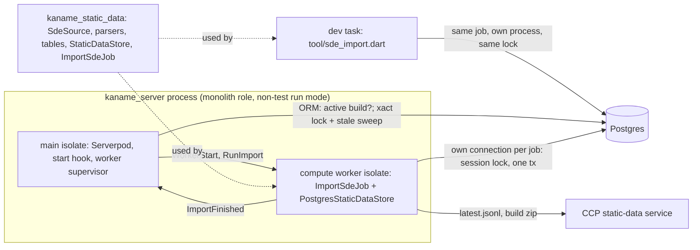
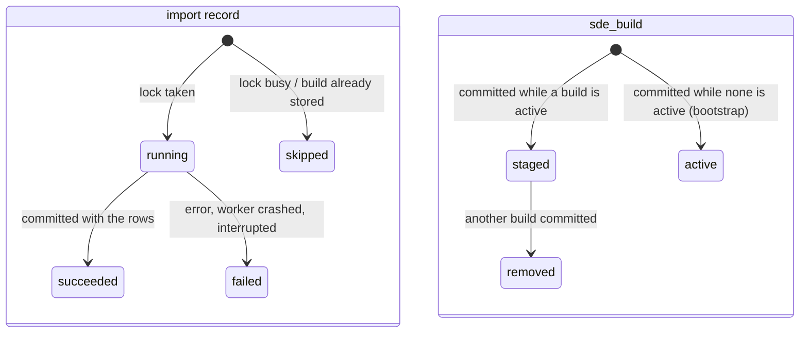

# Design

## Triage

| Trigger | Applies? | Evidence |
|---|---|---|
| T1 Components (new component, or 3+ with directed relationships) | yes | New compute worker isolate, new `kaname_static_data` package, main isolate, Postgres and CCP's SDE service. The server today only builds and starts Serverpod (`server/kaname_server/lib/server.dart:4-7`). |
| T2 State (persistent state, caches, 3+ state machine) | yes | New tables for builds, typed rows, raw records and import records; a build's state (staged, active); an import's state (running, succeeded, failed, skipped). |
| T3 Concurrency (background work, workers/isolates, async, retries) | yes | Import on a worker isolate while endpoints serve; worker restart with backoff; one import at a time across the server and the dev task. |
| T4 Boundaries (data format, migration, shared interface, IPC, external) | yes | CCP's JSONL SDE format, a migration, cross-isolate messages, the job-runner interface, the storage interface solo will implement. |
| T5 Volume (grows without a fixed bound) | yes | A build is about a million rows. Import records grow with each attempt. |
| T6 Risk (security, money, data loss, unrecoverable user data) | yes | The worker gets database credentials. A downloaded zip is untrusted input (size, zip bomb). |

TIER: FULL

## Context

- **Server today:** `run` constructs `Serverpod` and starts it, with nothing else (`server/kaname_server/lib/server.dart:4-7`). The stack's migration step runs the same `main` in the maintenance role (`server/kaname_server/bin/main.dart:5-10`), so start-time work and the worker must check the role.
- **Database config:** in development, Postgres is embedded, started by Serverpod and reached on a configured host and port (`server/kaname_server/config/development.yaml:26-33`). Amended during apply (group 4): Serverpod 4.1.2's embedded Postgres, used in development and test, listens on a Unix socket only, and the configured port names the socket file, not a TCP port. A worker reaches the same database as the main isolate through that socket; staging and production use an external Postgres over TCP.
- **Why not a Serverpod `Session` in the worker:** see A7 (Serverpod's own source, outside this repository).
- **Packages:** `kaname_core` is pure Dart and holds only `productName` (`packages/kaname_core/lib/kaname_core.dart:1-9`). Packages under `packages/` must not depend on Flutter or Serverpod (`openspec/specs/workspace-layout/spec.md:46-47`). The server depends only on `serverpod` (`server/kaname_server/pubspec.yaml:10-11`).
- **Tasks:** `mise run test` runs the pure packages' tests and not the server's (`mise.toml:81-89`). The server's tests need Redis and run through `test:server` (`mise.toml:241-258`).
- **ADRs:**
  - ADR 0004 sets the rules this change implements (`docs/adr/0004-static-data-is-data.md:12-18`).
  - ADR 0009 puts the import on the compute worker (`docs/adr/0009-server-process-and-isolates.md:25`), requires typed cross-isolate messages and worker restarts (`:30-31`), leaves R56 open (`:27`), and adds no locks on top of the future-call claim (`:21`).
  - ADR 0008 builds the bus on Serverpod's message system (`docs/adr/0008-sync-and-realtime.md:20`), which is why this change leaves the bus out of ADR 0012.
- Scope: see proposal.md (S1–S6).

## Decisions

### D1: Workers own their Postgres connections, one per job (settles R56's Postgres part; becomes ADR 0012)

- **Choice:** at spawn, the main isolate sends the worker a typed start message with the resolved Postgres settings: host, port, database, user, password and TLS flag (amended during apply: or the Unix socket path, for the embedded Postgres of development and test). Its `toString` redacts the password. The worker opens its own `package:postgres` connection at the start of each job and closes it at the end, so a Postgres restart affects only the jobs running at that moment.
  - Job code depends only on Kaname interfaces, here `StaticDataStore`. The server implements it with plain SQL; solo will implement it on its local store.
  - Tables are still declared in `.spy.yaml`, so Serverpod migrations own the schema, and the main isolate reads them with the ORM.
  - ADR 0012 records the rule for Postgres only: a worker reaches Postgres through connections it opens itself, per job, from a typed start message, behind Kaname interfaces; never through a Serverpod `Session` and never by copying rows through the main isolate.
  - Redis, the vault, the privacy scope and the bus stay open in R56. ADR 0008 builds the bus on Serverpod's message system, so the first worker that publishes (the realtime worker, M11) settles them and reconciles them with ADR 0008.
- **Rejected:**
  - Proxying through the main isolate: every row of a million-row build would be copied across isolates and written by the endpoint isolate, which ADR 0009 keeps free of long work.
  - An unstarted `Serverpod` in the worker: it depends on internals, and its constructor's `exit(1)` would end the server process (A7).
  - One long-lived connection with reconnect: more state in the worker for no gain at one job a day.
  - Settling the bus in this change: a job that publishes nothing gives no evidence for it.
- **Reversal cost:** medium. Job code sees only the interface, so swapping the server implementation stays inside `kaname_server`.
- **Important:** yes - binds future changes (every worker follows ADR 0012).
- **Chosen by:** user (the narrowing to Postgres and per-job connections were chosen in review round 1)

### D2: One table set with a build column; at most one staged build

- **Choice:** each typed file gets one table declared in `.spy.yaml` with a `build` column and the SDE id. A unique index on (build, SDE id) sits next to Serverpod's own `id` key (A3). Builds are removed by deleting their rows. A successful import removes every other staged build, older or newer, in its own commit, so at rest there is the active build and at most one staged build.
  - Typed tables: `sde_category`, `sde_group`, `sde_type`, `sde_market_group`, `sde_meta_group`, `sde_dogma_attribute`, `sde_dogma_attribute_category`, `sde_dogma_effect`, `sde_dogma_unit`, `sde_type_dogma`, `sde_region`, `sde_constellation`, `sde_solar_system`.
  - `sde_build` holds the build number, the state (`staged` or `active`) and the import time. Only one `active` row can exist (A3).
  - `sde_import` holds the import records.
- **Rejected:**
  - LIST partitions per build: they are created at runtime, outside Serverpod's migrations, and the migration check could fail on them.
  - A Postgres schema per build: no ORM, and every query has to pick a schema.
  - Refusing builds older than the newest stored one: it would stop the dev task from re-importing an older zip on purpose.
- **Reversal cost:** high. Every reader and `sde-build-switch` build on it. Evidence that would settle it: the timing of a whole-build delete in the opt-in live test; if it takes minutes, revisit partitions.
- **Important:** yes - high reversal cost; binds future changes (data format).
- **Chosen by:** user (replacing any staged build was chosen in review round 1)

### D3: One transaction per import under a session advisory lock

- **Choice:** the job opens its connection and takes `pg_try_advisory_lock` on a fixed static-data key before anything else, and holds it until the job ends.
  - **Lock busy:** another import runs, in this server or in the dev task. The job writes a `skipped` record ("import already running") and stops.
  - **Lock taken:** the job first marks every other `running` record `failed` ("interrupted"), because no other import can be live while it holds the lock. Then it writes its own `running` record, resolves and downloads the build, and writes every row, its `sde_build` row, the removal of other staged builds and its record's `succeeded` outcome in one transaction.
  - **Failure:** any error rolls the transaction back, and the job then sets its record to `failed` outside it.
  - **Bounds on a stuck connection:** the connection sets `idle_in_transaction_session_timeout` (5 min) and TCP keepalives. They bound a dead connection only inside the import transaction. During the download, which runs outside any transaction, a leaked but open socket would hold the lock until the process exits (A5).
  - **ADR 0012** records why this lock is allowed despite ADR 0009's "no extra locks": it guards writers outside any future-call claim (the dev task). Postgres also releases it with the session, so it has no stale-lock failure.
- **Rejected:**
  - Committing in batches under an `importing` build plus cleanup: crash cleanup needs its own code and tests, and readers would have to filter out half-written builds.
  - Owner ids on import records: they need process ids that survive restarts, and the lock already tells which records are live.
- **Reversal cost:** low. It is internal to the importer.
- **Important:** no
- **Chosen by:** user (the session lock and the record rules were chosen in review round 1)

### D4: Raw JSON in typed tables, plus one generic table

- **Choice:** every typed table has a `raw` column with the full record. Files outside the typed set, new files included, go to `sde_record` (build, file, line, key, record). The key holds `_key` for integer-keyed files and is empty otherwise. In `.spy.yaml`, `raw` and `record` are a hand-written `SdeJson` wrapper class around `Map<String, Object?>`, registered under `extraClasses`, with `serializationDataType: jsonb`, so the column is `jsonb` (A8). `SdeJson` lives in `kaname_core`, which has no dependencies, because the server and the generated client must both depend on an `extraClasses` package (`.claude/skills/serverpod-models/references/custom-serialization.md:5`). `kaname_client` gains a dependency on `kaname_core`, and the client and app never pull in the importer, `archive` or `http`.
- **Rejected:** a generic table for every record, with typed tables holding typed columns only. Typed data would be stored twice.
- **Reversal cost:** medium (stored format).
- **Important:** yes - binds future changes (data format).
- **Chosen by:** user

### D5: Download to a capped temp file

- **Choice:** the CCP source reads `latest.jsonl`, then downloads `eve-online-static-data-<build>-jsonl.zip` to a temp directory owned by the server process (the system temp directory; the server has no data directory yet). Caps from Resource Bounds apply. Entries are read one at a time and lines are parsed one at a time. The temp directory is deleted in a `finally`, whatever the outcome. A local zip goes through the same reader.
- **Rejected:** downloading into memory. The whole zip would sit in the worker on a 4 GB host.
- **Reversal cost:** low
- **Important:** no
- **Chosen by:** user

### D6: Hand-written Dart tables: known files, known ids, R38 fields

- **Choice:** `kaname_static_data` holds three hand-written const lists:
  - `knownFiles`: every file CCP ships today, each marked typed, required or plain. A file outside it is new; a listed file absent from a build is missing.
  - `knownIds`: name, id and expected kind (category, group, type, dogma attribute, dogma effect and so on). It starts with only the ids M1 code uses.
  - `industryLogisticsFields`: file, field path and the purpose it serves.

  All three are checked on every import, and the results go into the import report.
- **Rejected:**
  - A table seeded by a migration: ids could change without the code that uses them.
  - A YAML asset: it needs a parser and validation of its own.
  - Measuring new and missing files against the previous successful import: the first import would have no baseline.
- **Reversal cost:** low
- **Important:** no
- **Chosen by:** user (`knownFiles` was chosen in review round 1)

### D7: New package `packages/kaname_static_data`

- **Choice:** the package holds the source, parsing and checking code, and the storage interface:
  - `SdeSource` with CCP and local-zip implementations (`archive`, `http`);
  - the line reader and typed record parsers;
  - the three tables (D6) and the drift and bad-record detection;
  - `StaticDataStore` with an in-memory fake;
  - `ImportSdeJob`.

  `kaname_core` gets the job-runner interface (`Job`, `JobRunner`), the versioned worker message base types and `SdeJson` (D4). Postgres code lives in `kaname_server`. A `test:static_data` task joins `mise run test`.
- **Rejected:** everything in `kaname_core`. A later split would touch every import, and solo would pull static-data code into every core user.
- **Reversal cost:** low
- **Important:** no
- **Chosen by:** user

### D8: Start-time import and worker start: monolith role, non-test run modes

- **Choice:** the worker supervisor and the start hook run only in the monolith role and in the development, staging and production run modes. In the maintenance step and the test run mode no worker exists, and tests spawn one explicitly. After `pod.start()`:
  - the supervisor spawns the compute worker;
  - the start hook tries the static-data lock in a short transaction (`pg_try_advisory_xact_lock`, which conflicts with D3's session lock on the same key). If it gets the lock, it marks stale `running` records `failed` ("interrupted"); if not, an import is live and the hook leaves them alone;
  - it looks for an `active` build through the ORM. When there is none, it sends the worker `RunImport(source: ccpLatest)`.

  The future-call adapter arrives with the daily check in `sde-build-switch`. The dev task `mise run sde:import -- <zip>` (`server/kaname_server/tool/sde_import.dart`) runs the same `ImportSdeJob` in its own process against the development database, under the same lock. It needs the development server running, because Serverpod starts the embedded Postgres (`server/kaname_server/config/development.yaml:26-27`). While the server's own start-time import holds the lock, the dev task records `skipped` ("import already running"). Staging and production have no local-zip path in this change (C10).
- **Rejected:**
  - A one-off future call: it builds the future-call adapter before anything recurring needs it.
  - A config key: it would pre-empt `static-data-settings`' auto-update setting.
  - A worker in every run mode: integration tests that start the server would carry a worker they do not use.
- **Reversal cost:** low
- **Important:** yes - changes behaviour users see (a first start downloads the SDE).
- **Chosen by:** user (the worker's start rule was chosen in review round 1)

### D9: Synthetic fixtures in CI, real build opt-in

- **Choice:** test fixtures are small hand-written JSONL zips in CCP's format, built by a test helper from Dart literals. They cover:
  - every typed file and the `_sde` record;
  - a new file and a new field;
  - a wrong-typed field and a missing typed file;
  - a missing known file, a missing `_sde` record, an integer-keyed file and an empty file;
  - an invalid JSON line, a duplicate key, a keyless record and a truncated zip.

  An opt-in test tagged `sde-live`, excluded from CI, imports CCP's latest build. With `--r38-report`, the dev task writes `docs/static-data/r38-field-check.md` from the import record.
- **Rejected:** committing a trimmed real build. That redistributes CCP data in a public repository and needs the owner's approval.
- **Reversal cost:** low
- **Important:** yes - chosen on weak evidence: real field names are confirmed only by the opt-in run (A1).
- **Chosen by:** user

### D10: Worker restart with backoff

- **Choice:** the supervisor in the main isolate spawns the worker with `onExit` and `onError` ports. On an unexpected exit it logs the worker's name and reason. It then terminates the dead worker's Postgres backends (amended during apply, because A5 is false): each job reports its connection's backend pid and start time to the main isolate in a typed message, and the supervisor calls `pg_terminate_backend` on those that still match pid and start time, which releases the lock. It does the same on a server stop. It then retries the static-data try-lock (as in D8) every 1 s for up to 30 s, because Postgres releases the dead worker's session lock only once it notices the closed socket. When it gets the lock, it marks the `running` record `failed` ("worker crashed"). If the lock is still held after 30 s, it leaves the record for the next lock holder, which marks it "interrupted". It restarts the worker after 1 s, doubling up to a 60 s cap, with no limit on attempts. The delay resets after 5 minutes of uptime. The import is not resent: the next server start or `sde-build-switch`'s daily check retries it.
- **Rejected:** giving up after 5 failures (imports would stay off until a manual restart). Also rejected during apply: relaxing the spec to accept "interrupted" after a crash (the record would stay `running` until the next import, and during the download the lock would never be freed).
- **Reversal cost:** low
- **Important:** no
- **Chosen by:** user (backoff and retry window); agent (backend termination, added during apply while the owner was away, for owner review)

### D11: The build number comes from the zip's `_sde` record

- **Choice:** the file holding the `_sde` record (`_sde.jsonl`, A9) is a required file. Its build number names the build. For a CCP download it must equal the number `latest.jsonl` gave, otherwise the import fails ("build number mismatch"). Without it, the import fails ("no build number").
- **Rejected:** falling back to the number in CCP's zip file name. A renamed local zip would import under a wrong number.
- **Reversal cost:** low
- **Important:** yes - binds future changes (the required-file set).
- **Chosen by:** user (review round 1)

### D12: Bad records are skipped and reported

- **Choice:** the importer skips and reports a record when:
  - the line is not valid JSON;
  - it is a typed-file record whose key is missing or of the wrong type;
  - it is a typed-file record whose key the importer has already seen in that file. The importer keeps a set of seen keys per typed file, about 50k ints at most.

  The import goes on. The report lists up to 100 skipped records per file, with line and reason, and the count per file. A required file whose every line is skipped counts as missing.
- **Rejected:** failing the import on any bad record. One CCP data glitch would block that whole build.
- **Reversal cost:** low
- **Important:** yes - changes behaviour users see (what an import accepts).
- **Chosen by:** user (review round 1)

### D13: A source scan test enforces "no generated ids"

- **Choice:** a test in `kaname_static_data` fails in either of two cases:
  - Dart source in the workspace's packages, outside `knownIds`, declares an integer constant, or an enum value with an integer, whose name matches a type, group, category, attribute or effect id pattern;
  - a tool or build hook reads SDE input to write `.dart` files.

  It is a heuristic; PR review is the backstop.
- **Rejected:** a review rule only (no test would catch a regression).
- **Reversal cost:** low
- **Important:** no
- **Chosen by:** user (review round 1)

### D14: Only imports are one at a time on the compute worker

- **Choice:** the lock (D3) limits imports. The worker handles each request in its own async task, so later job kinds (bundle builds, fit-engine calls) are not blocked by an import, and each sets its own bound in its own change.
- **Rejected:** one request in flight per worker. Bundle builds and fit calls would be skipped for up to 2 h during an import.
- **Reversal cost:** low
- **Important:** no
- **Chosen by:** user (review round 1)

### Decision summary

| # | Decision | Choice | Rejected | Reversal cost | Important | Chosen by |
|---|---|---|---|---|---|---|
| S1 | How an import starts | Server start with no active build; dev task with a local zip | Container command; tests and dev only | low | yes | user |
| S2 | Activation | Bootstrap only | Stage only | low | yes | user |
| S3 | Typed set | The 13 files M1 needs; the rest raw | Every file; types and systems only | medium | yes | user |
| S4 | R38 check | Per import plus a committed report | One-off report; per import only | low | yes | user |
| S5 | R56 record | New ADR 0012 (Postgres part) | Design only; supersede ADR 0009 | medium | yes | user |
| S6 | Source | CCP download or local zip (tests and the dev task; production local zip in `static-data-settings`) | CCP only | low | yes | user |
| D1 | Worker Postgres access | Worker-owned connection per job; bus and the rest left open | Proxy via main; Serverpod in worker; long-lived connection | medium | yes | user |
| D2 | Layout | One table set with a build column; at most one staged | Partitions; schema per build; refusing older builds | high | yes | user |
| D3 | Atomicity and locking | One transaction under a session advisory lock taken first | Batches plus cleanup; owner ids | low | no | user |
| D4 | Raw JSON | `SdeJson` (in `kaname_core`) jsonb `raw` column plus generic `sde_record` | Generic table for all | medium | yes | user |
| D5 | Download | Capped temp file, streamed reading | In memory | low | no | user |
| D6 | Known files, ids and R38 fields | Hand-written Dart tables | Seeded table; YAML; previous import as baseline | low | no | user |
| D7 | Package | New `kaname_static_data` | Inside `kaname_core` | low | no | user |
| D8 | Start path and worker start | Typed message; monolith role; non-test run modes | Future call; config key; worker in all modes | low | yes | user |
| D9 | Test data | Synthetic fixtures plus opt-in live test | Trimmed real build | low | yes | user |
| D10 | Worker restart | Backoff 1 s to 60 s, unlimited; the dead worker's Postgres backends are terminated (added during apply) | Give up after 5; accepting "interrupted" after a crash | low | no | user (backoff); agent (backend termination, for owner review) |
| D11 | Build number | `_sde` record required | File-name fallback | low | yes | user |
| D12 | Bad records | Skip and report | Fail the import | low | yes | user |
| D13 | No-codegen check | Source scan test | Review rule only | low | no | user |
| D14 | Worker concurrency | Only imports one at a time | One request per worker | low | no | user |

## Assumptions

- **A1:** CCP's JSONL field names for the typed files (for example `groupID`, a localised `name` object, `published`, `volume`, `marketGroupID` on types) match the form the parsers expect. Not checked because no build is downloaded during planning. Depends on it: D2's typed columns, D9 and tasks 3.3 and 3.4. The opt-in live test (task 8.2) confirms it, and any mismatch is fixed before the PR.
- **A2:** The declared R38 field list covers what M18 and M22 need: types' volume, capacity, portion size and packaged volume; blueprint activities with materials, products, skills, time and probability; reprocessing materials; planet schematics; stargates and system positions. Not checked because those milestones are unplanned. Depends on it: D6, task 3.6.
- **A3:** Serverpod 4.1 `.spy.yaml` tables cannot declare a composite primary key, so a unique index on (build, SDE id) sits next to `id`. They may also not declare a partial unique index; in that case the one-active-build rule is a unique index on a nullable `activeMarker` column, set only on the active row. The models skill shows composite unique indexes (`.claude/skills/serverpod-models/SKILL.md:158-160`) but says nothing on partial indexes. Depends on it: D2, task 2.1.
- **A4:** `archive` 4.x reads a zip from a file one entry at a time without loading the whole archive, and `package:postgres` 3.x runs parameterised multi-row inserts. Not checked against the packages' docs yet. Depends on it: D5, task 3.2. Fallback: extract each entry to the temp directory, within the entry caps, and read the extracted file line by line.
- **A5:** When an isolate exits, the Dart VM closes its sockets, so Postgres aborts its open transaction and releases its session lock. **Checked during apply (task 6.4): false.** After `Isolate.kill`, the worker's backend stayed `idle in transaction` with the lock held until the 5-minute `idle_in_transaction_session_timeout`; an idle connection (download phase) has no bound at all. Resolved by D10's backend termination (amended during apply): the worker reports each job connection's backend pid and start time, and on an unexpected exit or a stop the supervisor terminates those backends, which releases the lock at once. Task 6.4's crash test kills the worker during the download and during the transaction and asserts the lock is released and the record reads "worker crashed".
- **A6:** A build is about one million rows, its zip is under 300 MB, and it unpacks to under 2 GB. Not checked because no build is downloaded. Depends on it: Resource Bounds' caps; the live test logs the real numbers.
- **A7:** In Serverpod 4.1.2, `Serverpod.createSession` builds an `InternalSession` on the instance's own server and database pool. The constructor creates that pool from config and calls `exit(1)` on any initialisation error, which ends the whole process. Checked by reading the `serverpod` package source in the local pub cache, which is outside this repository and cannot be cited here. Depends on it: D1's rejection of an unstarted `Serverpod` in the worker.
- **A8:** In Serverpod 4.1.2, a field of a serializable class (here an `extraClasses` wrapper) can be stored as `jsonb` with `serializationDataType: jsonb`. Checked in the `serverpod_cli` and `serverpod_database` package sources in the local pub cache (outside this repository); the models skill lists `extraClasses` (`.claude/skills/serverpod-models/references/custom-serialization.md:5`). Depends on it: D4, task 2.1. If generation rejects it, the column falls back to Serverpod's default JSON text and C4's contract test pins that type.
- **A9:** The JSONL zip holds the `_sde` record (the same record as `latest.jsonl`'s `sde` entry, with the build number) in a file named `_sde.jsonl`. Not checked because no build is downloaded during planning. Depends on it: D11, task 3.2; the live test confirms the file and field names.

## Carried constraints

- **C1:** Worker isolates reach Postgres only through connections they open themselves, per job, from a typed start message, behind Kaname interfaces; never through a Serverpod `Session` and never by copying rows through the main isolate. How workers reach other shared services is governed by C2. Kind: invariant. Destination: ADR 0012
- **C2:** How a worker reaches Redis, the vault, the privacy scope and the bus is still open (R56). The first worker that publishes settles it and reconciles it with ADR 0008; proxying through the main isolate over typed messages (ADR 0009) remains a candidate. Kind: deliberate gap. Destination: ADR 0012
- **C3:** The static-data advisory lock stays, despite ADR 0009's "no extra locks": it guards writers outside any future-call claim, and Postgres releases it with the session. Kind: invariant. Destination: ADR 0012
- **C4:** The worker's SQL writes tables that Serverpod migrations own; the column names and types in `PostgresStaticDataStore` must match the `.spy.yaml` models, and a contract test enforces it. Kind: invariant. Destination: doc comment: server/kaname_server/lib/src/static_data/postgres_static_data_store.dart PostgresStaticDataStore
- **C5:** No Dart code, enum or constant is generated from SDE content; ids code needs go in `knownIds`. Kind: invariant. Destination: spec: specs/static-data-import/spec.md → Requirement: No code is generated from SDE content
- **C6:** The importer activates a build only when none is active. `sde-build-switch` owns every other activation, must add a `previous` build state for ADR 0004's rollback build, and must prove the bound of three stored builds again. Kind: deliberate gap. Destination: doc comment: packages/kaname_static_data/lib/src/import_sde_job.dart ImportSdeJob
- **C7:** The start-time import and the worker never run in the test run mode or the maintenance role. Kind: invariant. Destination: spec: specs/server-workers/spec.md → Requirement: The server runs a compute worker isolate
- **C8:** Partitions per build were rejected because runtime partitions sit outside Serverpod migrations. Revisit only if a whole-build delete is too slow. Kind: rejected alternative. Destination: doc comment: server/kaname_server/lib/src/static_data/postgres_static_data_store.dart PostgresStaticDataStore
- **C10:** Staging and production installs have no local-zip import path in this change; `static-data-settings` adds one (update now from a local zip). Kind: deliberate gap. Destination: doc comment: packages/kaname_static_data/lib/src/import_sde_job.dart ImportSdeJob
- **C9:** Only imports are one at a time on the compute worker; each later job kind (bundle builds, fit calls) sets its own bound. Kind: invariant. Destination: doc comment: server/kaname_server/lib/src/workers/compute_worker.dart ComputeWorker

## Diagrams (FULL)

Components (T1):



Build and import states (T2):



Import sequence (T3, T4):

```mermaid
sequenceDiagram
  participant M as main isolate
  participant W as compute worker
  participant C as CCP
  participant P as Postgres
  M->>P: try xact lock; if taken, mark stale running → failed (interrupted)
  M->>P: active build? (ORM)
  P-->>M: none
  M->>W: RunImport(ccpLatest)
  W->>P: connect; try session lock (busy → insert skipped, stop)
  W->>P: mark other running → failed (interrupted); insert own running record
  W->>C: GET latest.jsonl
  C-->>W: build N
  W->>P: build N stored? (yes → record skipped, stop)
  W->>C: GET build N zip → temp file (capped)
  W->>W: read _sde record; check equals N
  W->>P: BEGIN
  loop each entry, each 500-line batch
    W->>P: INSERT typed rows / sde_record rows
  end
  W->>P: insert sde_build(N, active|staged); delete other staged builds; record → succeeded; COMMIT
  W->>P: prune records beyond 100; unlock; close
  W-->>M: ImportFinished(N, outcome)
```

## State & Ownership (FULL)

| State | Owner (sole writer) | Lifetime | Invalidation / rebuild | Authoritative copy |
|---|---|---|---|---|
| Typed rows and `sde_record` rows of a build | `ImportSdeJob` holding the static-data lock (compute worker or dev task) | Until replaced while staged, or removed by `sde-build-switch` | Re-import the build | Postgres; CCP upstream |
| `sde_build` rows and their state | `ImportSdeJob` holding the lock (insert, bootstrap activation, removing other staged builds); `sde-build-switch` later owns switching | As above | — | Postgres |
| `sde_import` records | Whoever holds the static-data lock: the job (its own record, the stale sweep, pruning beyond 100), the start hook's sweep, the supervisor's crash mark | Newest 100 | — | Postgres |
| Downloaded zip | `CcpSdeSource` in the running job | One import | Deleted in `finally` | Temp directory |
| Worker isolate | Worker supervisor (main isolate) | Server lifetime; restarted on exit | Restart with backoff | — |
| Worker Postgres connection | The running job | One job | Closed at job end | — |
| `knownFiles`, `knownIds`, `industryLogisticsFields` | Developers, by reviewed PR | Code | — | `kaname_static_data` source |

Several components write `sde_import`, but only while holding the static-data lock, so writes never overlap. A `running` record whose import is live is never touched, because its job holds the lock.

## Failure & Visibility (FULL)

| Component | Fails / dies mid-operation → | Recovery | Retry safe? | Who finds out |
|---|---|---|---|---|
| CCP unreachable or download cut | Job fails before the transaction; temp file deleted | Next server start (later: daily check) | yes | Import record `failed` with reason; log |
| Corrupt zip, oversized download or entry, missing or mismatched `_sde` | Job fails; nothing written | Same | yes | Import record names the cap, entry or numbers |
| Missing required file | Transaction rolled back | Next build | yes | Import record names the missing files |
| Bad records, drift, missing known id or file, missing R38 field | Import goes on | — | — | Import report; log summary at `warning` |
| Postgres lost during a job | Transaction aborted by Postgres; job fails | Next job opens a new connection | yes | Log with worker name; record stays `running` until the next lock holder marks it `interrupted` |
| Worker isolate crash | Supervisor terminates the worker's backends: transaction aborted, lock released (A5 is false; D10 amended) | Supervisor restart with backoff (D10) | yes | Log with worker name; record `failed` ("worker crashed"); admin health page once it exists |
| Server stop mid-import | Transaction aborted | Start hook or next job marks `interrupted` | yes | Import record |
| Worker never starts | No imports | Supervisor backoff | yes | Log at `error` each attempt |
| Dev task and server import together | Second cannot take the lock | — | yes | Second record `skipped` ("import already running") |

## Resource Bounds (FULL)

| Queue / buffer / cache / transfer | Bound | At the bound | Timeout | At 10x / 100x |
|---|---|---|---|---|
| Download | 1 GiB on disk | Abort, `failed` ("download exceeds 1 GiB") | 30 min overall; 60 s with no bytes | Cap well above A6; at 10x a real build would hit it and be reported, not crash |
| Uncompressed entry | 4 GiB per entry, 8 GiB total (zip-bomb guard) | Abort, `failed` naming the entry | — | As above |
| JSONL line | 16 MiB | The record is skipped as bad (D12) | — | — |
| Seen-key set per typed file | One int per record of the file (types: about 50k) | — | — | At 100x, a few tens of MB; acceptable, revisit if a typed file grows past 1M records |
| Skipped-record list in the report | 100 per file, plus a count | Further ones only counted | — | Constant |
| Insert batch | 500 rows, or 32 Mi characters of source lines, held in memory (amended during apply: 500 lines of up to 16 MiB each did not bound memory) | Flush, then continue | Statement timeout 5 min | Memory stays constant; time grows linearly |
| Whole import | One at a time (lock) | Second request `skipped` | 2 h, then `failed` ("timed out") and rollback | 10x rows: tens of minutes; within the cap |
| Builds stored | At rest: active plus at most one staged; during an import, one more | Other staged builds deleted in the import's commit | — | Disk use ≈ 3 builds, about 3× A6's size in Postgres |
| `sde_import` records | Newest 100 | Older ones deleted by the job | — | Constant |
| Worker connections | One per running job; imports are one at a time | — | `idle_in_transaction_session_timeout` 5 min; TCP keepalives | — |
| Restart backoff | 1 s to 60 s | Stays at 60 s | — | — |

## Flow & State Gaps (FULL)

- **Partial import:** impossible by D3: no row of an uncommitted build is visible or left behind, and `succeeded` commits with the rows.
- **Concurrent imports:** the lock admits one; the other is `skipped`, also between the server and the dev task. The lock is taken before the download.
- **Same build imported twice:** the job checks `sde_build` for build N before downloading, under the lock; the result is `skipped`.
- **Older build than active:** imported side by side and staged, never activated; it replaces any other staged build. `sde-build-switch` decides what to do with it.
- **Restart mid-import:** the transaction is aborted. The start hook (or the next job) takes the lock and marks the `running` record `interrupted`; then, with no active build, the server queues a new import.
- **Crash between commit and reply:** the record already says `succeeded`, because it committed with the rows, so the supervisor finds no `running` record to mark.
- **`latest.jsonl` changes during a download:** the job uses the number it read first; the zip URL and the `_sde` check pin that build.
- **Stale reads:** nothing reads static data in this change besides the bootstrap check; readers arrive with later changes and read only `active`.

## Mechanism Ledger (FULL)

| Mechanism | Built? | Why (harm nobody catches / expensive later) | Evidence that would change the call |
|---|---|---|---|
| Session advisory lock, taken before the download | yes | The dev task and the server can import into the same database; two writers would race on `sde_build`, and records of a live import would be swept | — |
| Stale `running` sweep under the lock | yes | A crash or stop leaves `running` forever otherwise | — |
| `idle_in_transaction_session_timeout` and keepalives | yes | If A5 is wrong, a dead socket inside the transaction holds the lock and every import is `skipped` with nobody noticing. They do not cover the download phase (A5) | A5 failing in task 6.4 |
| Download, entry and line caps | yes | Untrusted input on a 4 GB host; an oversized zip would take the server down | — |
| Worker restart with backoff | yes | ADR 0009 requires it; without it imports stop silently | — |
| Supervisor termination of a dead worker's backends | yes | A killed isolate does not close its sockets (A5 checked false), so its lock would stay held for 5 min in a transaction and indefinitely during the download | Dart closing isolate sockets on exit |
| Supervisor lock retry window (30 s) | yes | Without it the crash mark rarely runs, and the record stays `running` until a restart | — |
| Contract test of worker SQL against `.spy.yaml` | yes | Column drift between hand SQL and the migration would only show at runtime | — |
| Source scan test for generated ids | yes | A later change could add id constants unnoticed | — |
| Checksum of the download | no | CCP publishes none known; TLS covers transport, and parse errors fail the import | CCP publishing hashes |
| Retry within one import | no | The next start (later the daily check) retries; in-import retries add states | Frequent transient CCP failures in logs |
| Redis, vault and bus clients in the worker | no | The importer needs only Postgres; left open in R56 | The first worker that publishes |
| Batched commits with cleanup | no | D3 | A build too large for one transaction |
| Future-call adapter | no | Nothing recurring yet (D8) | `sde-build-switch` |

## Risks / Trade-offs

- [The real SDE differs from the synthetic fixtures (A1, A9)] → the opt-in live test runs before the PR (task 8.2), and its numbers go in the PR.
- [A long transaction holds one connection and grows WAL] → the worker's connection is outside the main pool; the live test logs the duration and size.
- [Credentials cross into the worker] → only in an in-process message, never logged; the start message's `toString` redacts the password, and a test asserts it.
- [A first start without internet holds no static data] → the import record says why. In development the dev task imports a local zip; staging and production get a local-zip path with `static-data-settings` (C10).
- [Deleting a staged build is slow (D2)] → measured in the live test; C8 records the alternative.

## ADRs

- **In force, constraining this change:** 0001 (Serverpod and Postgres), 0002 (clean room: synthetic fixtures, no copied data), 0003 (pure-Dart packages), 0004 (static data is data), 0008 (the bus, left out of ADR 0012), 0009 (process and isolates).
- **To record during apply:** 0012 "Worker isolate access" (D1, C1–C3). It fills the Postgres part of ADR 0009's open item without superseding it, and records the lock's reconciliation with ADR 0009. It is added to the architecture index. Strategy row R56 is updated to show the Postgres part settled and the rest still open.

## Open Questions

- The exact typed columns per file follow CCP's real field names (A1); they change no spec, approach or task.
