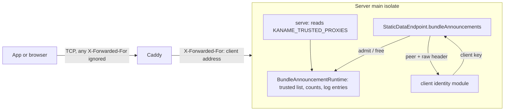
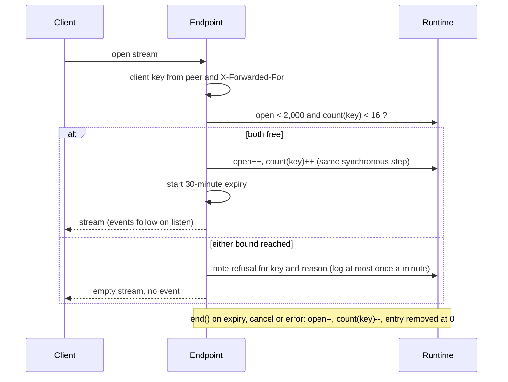

# Design

## Triage

| Trigger | Applies? | Evidence |
|---|---|---|
| T1 Components (new component, or 3+ with directed relationships) | yes | A new client-identity module, used by the endpoint and configured by server start-up; Caddy → server trust in the stack. |
| T2 State (persistent state, caches, 3+ state machine) | yes | New in-memory state: per-client open-stream counts and per-client refusal-log entries in the announcement runtime. Nothing persistent. |
| T3 Concurrency (background work, workers/isolates, async, retries) | yes | The admission check (`server/kaname_server/lib/src/static_data/static_data_endpoint.dart:78`) and the count (`:129`, in `onListen`) are separate steps, so concurrent subscriptions may pass the check before any counts (A2); streams have a timer-driven end (`:143-146`). |
| T4 Boundaries (data format, migration, shared interface, IPC, external) | yes | A new server setting (`KANAME_TRUSTED_PROXIES`), a trust contract with the proxy's `X-Forwarded-For` header, and a Compose network contract. |
| T5 Volume (grows without a fixed bound) | yes | Maps keyed by client address grow with the number of distinct clients unless bounded. |
| T6 Risk (security, money, data loss, unrecoverable user data) | yes | An unauthenticated denial-of-service bound and header-spoofing resistance. |

TIER: FULL

## Context

See proposal.md for the why and the owner's scope decisions.

- The announcement stream needs no sign-in: `server/kaname_server/lib/src/static_data/static_data_endpoint.dart:18-19`.
- Its only bound is the server-wide count: `server/kaname_server/lib/src/static_data/static_data_endpoint.dart:78-84` refuses with an empty stream once `openStreams >= maxStreams`, logging one warning per refusal (`:79-82`). It also refuses, with a warning each time, when the server runs no announcer (`:63-69`) or the topic's delivery scope is refused (`:70-77`). `maxStreams` defaults to 2,000 (`server/kaname_server/lib/src/static_data/bundle_announcement_runtime.dart:8`, `:33`).
- The count rises only when the stream is listened to (`server/kaname_server/lib/src/static_data/static_data_endpoint.dart:127-129`), not when the check passes (`:78`). It falls in `end()` (`:111-115`), which runs on expiry (`:143-146`) and on cancel (`:149`). `end()` does nothing unless the stream is open (`:112`), and `onListen` always subscribes to the bus, arms the expiry and schedules the first send (`:132-147`).
- Each stream lives 30 minutes on the runtime's clock: `server/kaname_server/lib/src/static_data/static_data_endpoint.dart:13`, `:143-146`.
- Tests change `maxStreams` and read `openStreams` through the process-wide runtime (`server/kaname_server/lib/src/static_data/bundle_announcement_runtime.dart:31-36`, `server/kaname_server/test/integration/static_data/bundle_stream_test.dart:489`, `:665`), and the fixtures restore it with `reset()` (`server/kaname_server/lib/src/static_data/bundle_announcement_runtime.dart:43-52`, `server/kaname_server/test/integration/static_data/bundle_stream_test.dart:966-968`, `:1013`). Two tests open many streams from one test client: the stalled-reader test opens 1,999 through one TCP proxy (`server/kaname_server/test/integration/static_data/bundle_stream_test.dart:486-497`), and the 2,000-stream test opens 2,000 (`:643`). A per-client bound refuses both unless the tests can raise it.
- Server start-up already refuses to start on a bad setting, by throwing before `pod.start()`: `server/kaname_server/lib/server.dart:28-36`, `:48`.
- The app handles a refusal already. A stream that ends without an event goes to `_streamEnded` (`app/lib/static_data/logic/static_data_sync.dart:226-228`), which waits and resubscribes (`:242-247`). The wait starts at 5 seconds, doubles to at most 5 minutes (`:66-71`, `:244`), and resets only on an event (`:252-253`). The existing test `stream failures resubscribe after 5 s then 10 s` is at `app/test/static_data/static_data_notifier_test.dart:229`.
- The self-host stack runs Caddy in front of the server, with `/api/*` and `/v1/websocket` proxied to `server:8080` (`deploy/Caddyfile:26-28`, `:39-41`; bare `/api` is answered by Caddy with a 404, `:29-32`), and only Caddy publishing a port, on 127.0.0.1 (`deploy/compose.yaml:106-112`). Caddy's configuration sets no `trusted_proxies` (`deploy/Caddyfile:3-20`). The server's environment is set at `deploy/compose.yaml:89-91`. The Compose configuration test checks published ports at `tools/kaname_tools/test/compose_config_test.dart:198-218`.
- Other unauthenticated paths already have their own bounds: bundle downloads (`openspec/specs/client-data-bundle/spec.md:168-169`) and status reads (`openspec/specs/static-data-admin/spec.md:71-72`, `:106-107`).

## Decisions

### D1: A client is its address, or the nearest untrusted forwarded address behind a trusted proxy

- **Choice:** the client is the connection's peer address. When the peer is a trusted proxy, the server reads every `X-Forwarded-For` value on the request (all header lines, joined by commas, from the raw header so a malformed value is not a parse failure), walks the entries from right to left, skips trusted proxies, and takes the first untrusted one. Repeated header lines are joined, in the order they arrive, by a virtual comma: nothing is copied. The walk scans from the end of the last line backwards, across lines, for at most 2 KiB counting separators, and reads at most the rightmost 20 entries. An entry counts only when both of its boundaries (a separator, the start of the first line, or the end of the last line) lie within that budget; a fragment cut by the budget is ignored. The header gives no usable address when it is missing or empty, when an entry that is not an IP address comes before an untrusted one, when every entry is trusted, or when no untrusted entry is within those 2 KiB and 20 entries; the client is then the peer's own address, with a warning naming the peer through the refusal-log limiter (D6). Accepted entry forms are bare IPv4, `IPv4:port`, bare IPv6, `[IPv6]` and `[IPv6]:port`; a bare IPv6 entry is never read as having a port. An IPv4-mapped IPv6 address is normalised to IPv4 before it is matched against trusted addresses and ranges and before it is bucketed (D3). Trust matches the whole normalised address against a listed address or range; the /64 grouping applies only to client keys, so a trusted IPv6 host never makes its /64 neighbours trusted. A connection whose peer address is unknown is never trusted, and all such connections count as one `unknown` client. The walk assumes every trusted proxy appends the address it received the connection from, so the rightmost untrusted entry is the one a trusted hop wrote. A proxy that passes a caller's header through without appending lets the caller choose its bucket; it must not be configured as trusted. Caddy appends by default (A3); the README states this obligation for any other proxy (C6). The edge cases (all trusted, syntax, mapped matching, line order, the 20-entry cap) were put to the owner after design-review round 1, and the 2 KiB read, whole-address trust matching and the `unknown` client after round 2; the owner chose each on 2026-11-23.
- **Rejected:** trusting any loopback or private peer with no setting, because it is spoofable whenever the server port is reachable on a LAN. The socket address alone, because behind Caddy every client shares one address. The leftmost entry, because the client writes it. For an all-trusted header, the leftmost entry, because the fallback for every other unusable header is the proxy's own address, and one rule is easier to reason about.
- **Reversal cost:** medium (a security contract that operators configure against)
- **Important:** yes, because it binds future changes (a trust contract) and changes what users see.
- **Chosen by:** user

### D2: Trusted proxies come from `KANAME_TRUSTED_PROXIES`, and a bad entry stops start-up

- **Choice:** server start-up reads `KANAME_TRUSTED_PROXIES` from the process environment once, in `serve()` before `pod.start()`, as a comma-separated list of IP addresses and CIDR ranges with whitespace trimmed. Unset or empty means no trusted proxy. An IPv4-mapped range written in IPv6 form (such as `::ffff:172.30.0.0/120`) is invalid, and its error says to write the range as IPv4 (owner's choice after design-review round 2). The first invalid entry stops start-up with an error that names it, in the way the pool-size check stops it (`server/kaname_server/lib/server.dart:31-36`). The parsed list goes into the announcement runtime, which tests replace.
- **Rejected:** a custom section in Serverpod's config YAML. The image bakes its config directory in (`deploy/server.Dockerfile:80`, `server/kaname_server/config/production.yaml:7-25`), so an operator's own list would need a mounted override file or a rebuilt image, while the stack already passes per-install values through the environment (`deploy/compose.yaml:24-29`, `:89-91`). Skipping an invalid entry with a warning, which silently drops trust, so all clients behind a proxy would share one bucket.
- **Reversal cost:** medium (a config key operators set)
- **Important:** yes, because it is a config key.
- **Chosen by:** user

### D3: IPv4 counts whole, IPv6 counts by /64

- **Choice:** the client key is the full IPv4 address, or the IPv6 /64 prefix. An IPv4-mapped IPv6 address (`::ffff:a.b.c.d`) counts as its IPv4 address.
- **Rejected:** the exact address for both families, because one host with a /64 can rotate through addresses and hold all 2,000 streams.
- **Reversal cost:** low
- **Important:** yes, because it changes what users see (who shares a bucket).
- **Chosen by:** user

### D4: 16 streams per client, a fixed constant

- **Choice:** `defaultMaxStreamsPerClient = 16`, held in the runtime next to `maxStreams` so tests can change it. There is no setting. In-process tests all connect from 127.0.0.1, so the runtime also holds the function that turns a stream session into a client key: production uses the client-identity module (D7), and tests that need several clients replace it to assign a key per test client. Production wiring of that function is proven by the direct WebSocket test (scenario "Direct connection") and the stack scenarios. The two saturation fixtures (the 1,999-stream stalled-reader test and the 2,000-stream test) keep the per-client limit above the global one (2,001) during setup and keep their health and fan-out assertions. The 2,000-stream fixture sends its refused subscription under a second client key, checks that key holds no stream, and so checks "Stream limit" as written. The stalled-reader fixture's extra subscription keeps the same key, and its key holds 1,999 under a limit of 2,001, so only the global bound can refuse it. The two bounds together are checked by a separate test that keeps the default per-client limit, lowers the global bound to 32, admits 16 subscriptions under each of two client keys, and checks that a third key's subscription is refused (scenario "Global bound still applies").
- **Rejected:** 8, which is tight for a household or office of several apps and tabs behind one address. 32, which lets 63 addresses fill the pool instead of 125. A setting, which adds a config key with no known operator need.
- **Reversal cost:** low
- **Important:** yes, because it changes what users see.
- **Chosen by:** user

### D5: Places are taken at admission

- **Choice:** the endpoint checks both bounds and takes both places in one synchronous step when it admits the subscription, before returning the stream. It marks the stream open and starts the 30-minute expiry then, so the stream's life runs from admission. Bus fan-out reaches only streams being listened to; the realtime-bus delta says so in the delivery requirements. The 20-second first-event limit runs from subscribing, as in the main spec, because the generated client measures from there; it relies on Serverpod listening to the returned stream promptly (A6). The owner first chose to run it from listen (after design-review round 2), then restored it to subscribing after round 8, when the review showed that the client measures from subscription and that pongs keep a quiet stream from timing out, so "from listen" would have weakened the client-visible promise. A stream listened to late has no time promise of its own: it sends the current bundle as soon as it is listened to. `end()` frees both places once. `onListen` acts only on a stream that is still open: it subscribes to the bus and schedules the first send. On a stream that has already ended, it subscribes to nothing and closes the stream at once, so a late listener gets no event and adds no bus listener. Until it is listened to, an admitted stream is only a held reservation: it has no bus listener and receives nothing, so a publish in that time is not replayed; its first send, once listened to, is the current announcement. A stream that Serverpod never listens to is ended by its expiry, which frees its places. Cancel before listen cannot happen, because cancel needs a listener. Admission and its accounting live in the runtime (`admit` returning a reservation, `release`). The tests go through the production endpoint method: they call it repeatedly and keep the returned streams unlistened, then check refusal at the per-client cap, and at the global cap for a client below its own cap. So a regression that moves admission into `onListen` fails them, whatever Serverpod's scheduling (A2).
- **Rejected:** ending a stream nobody has listened to within 20 seconds, which adds a second timer per stream for a case the 30-minute expiry already bounds. Keeping the count in `onListen` and accepting the overshoot, because, if Serverpod listens after asynchronous work (A2), concurrent opens all pass the check before any of them counts, and that overshoot defeats both bounds. Admission-time accounting is correct whether or not that gap exists.
- **Reversal cost:** low
- **Important:** yes, because it changes what users see (exactly which subscriptions are refused).
- **Chosen by:** user

### D6: Refusals are logged at most once per client and reason per minute

- **Choice:** the runtime keeps, per pair of client key and reason, the time of the pair's last warning and its refusals since then. The reasons are `client limit`, `server limit`, `no announcer`, `topic needs the privacy scope` (the delivery-scope resolver's reason), and `no usable forwarded header` for the proxy fallback (D1). A refusal of a pair with no warning in the last minute writes a warning at once, naming the client and reason and giving the refusals since the pair's previous warning, then resets the count. Any other refusal only adds to the count. Every minute here is elapsed time from a monotonic clock: `ServerClock` gains `elapsed()`, backed in production by a `Stopwatch` started with the clock, and faked in tests; wall-clock changes do not move it. A new pair is tracked when the map holds fewer than 4,096 pairs. Pairs are kept in order of their last warning (an insertion-ordered map; a pair moves to the end only when it writes a warning). When the map is full, the refusal looks only at the first pair, which has the oldest warning, and drops it if that warning is more than a minute old. If no room is freed, it counts under one `other clients` entry, outside the 4,096, which follows the same once-a-minute rule and names no client; its warning gives `refusals and fallbacks of every reason`, since its one total covers them all. There is no timer and no sweep. A client that stops being refused never has its last suppressed count reported; that is an accepted gap (C9). Each refusal does constant work.
- **Rejected:** one warning per refusal, as now, because a client that loops on refused subscriptions writes a log line per attempt with no backoff of its own. Pruning with no cap, because a client that rotates addresses grows the map without bound. A sweep that reports every suppressed count within a minute (the owner's choice after design-review round 1), because its clock, trigger and retention rules had edge cases of their own (round 2). The owner chose this simpler cooldown after round 2 (2026-11-23), under the proportionate-guarantees rule.
- **Reversal cost:** low
- **Important:** yes, because it changes what operators see in the log.
- **Chosen by:** user

### D7: The client-identity module is separate from the endpoint

- **Choice:** a pure-Dart module under `server/kaname_server/lib/src/network/` parses the trusted-proxy list and turns a peer address and the raw `X-Forwarded-For` values into a client key. It has no Serverpod dependency, so unit tests cover it without a server. The endpoint is the only caller in this change. Every refusal assertion in the tests requires the stream to complete normally with zero events and zero errors, and checks that the client's other streams are still live.
- **Rejected:** parsing inside the endpoint, which ties the logic to Serverpod sessions and makes it harder to reuse when another endpoint needs a per-client bound (S1 leaves that for later).
- **Reversal cost:** low
- **Important:** no
- **Chosen by:** user

### Decision summary

| # | Decision | Choice | Rejected | Reversal cost | Important | Chosen by |
|---|---|---|---|---|---|---|
| S1 | Scope | Per-client limit on the announcement stream only | General per-client limit on every unauthenticated call | low | yes | user |
| S2 | App on refusal | App unchanged; a client-static-data scenario and a test pin its backoff | Status polling while refused; a "refused" wire signal; a doc comment only | low | yes | user |
| S3 | Self-host stack | Pinned subnet, dynamic range excluding a fixed Caddy address, server trusts only Caddy; README notes | Server only; trusting the whole subnet; no `ip_range` | low | yes | user |
| D1 | Client identity | Peer address; behind a trusted proxy, the rightmost untrusted entry within the last 2 KiB and 20 entries; proxy's address when none; whole-address trust; unknown peer never trusted | Trust private ranges; socket only; leftmost entry | medium | yes | user |
| D2 | Trusted-proxy setting | `KANAME_TRUSTED_PROXIES`, empty by default, an invalid entry (including a mapped IPv6-form range) stops start-up | Serverpod YAML section; skip invalid entries; accept mapped ranges | medium | yes | user |
| D3 | Address grouping | IPv4 whole, IPv6 /64, mapped IPv4 as IPv4 | Exact address for both | low | yes | user |
| D4 | Per-client limit | 16, fixed constant | 8; 32; a setting | low | yes | user |
| D5 | Counting point | Both places taken at admission; the 30-minute life starts then, the first-event limit runs from subscribing; an ended stream never starts | Count on listen, accept the overshoot; end streams unlistened after 20 s | low | yes | user |
| D6 | Refusal logging | Once per client and reason per minute with the count since the previous warning; 4,096 pairs, then `other clients`; no sweep | One warning per refusal; no cap; a reporting sweep | low | yes | user |
| D7 | Module boundary | Pure-Dart client-identity module | Parsing inside the endpoint | low | no | user |

## Assumptions

- **A1:** A stream session's request is the WebSocket upgrade request, so it carries the connection's peer address and headers: Serverpod 4.1.2 builds `MethodStreamSession` with the request (`session.request`), and Relic (locked at `relic` 2.0.0-rc.4 with `relic_core` 2.0.0, `pubspec.lock`) is expected to expose the peer as `Request.connectionInfo.remote`. Not checked against repository code, because both are in the pub cache, outside the repository. Depends on it: D1, D5. Its gates: a direct WebSocket test against the server, whose untrusted loopback peer sends an `X-Forwarded-For` that must be ignored (scenario "Direct connection"), and the stack scenarios for the trusted Caddy path.
- **A2:** Serverpod may listen to the returned stream only after asynchronous work in its stream manager, so concurrent opens could pass a check made at call time before any `onListen` runs. Not checked against repository code (Serverpod source is in the pub cache). Depends on it: nothing in the choice, since D5 is correct either way. D5's tests call the production endpoint method and keep the returned streams unlistened, so they prove admission before listen without relying on it.
- **A3:** Caddy's `reverse_proxy`, with no `trusted_proxies`, ignores an incoming `X-Forwarded-For` and sets it to the connection's peer address. Not checked against repository code: Caddy is outside the repository. It is Caddy's documented default, which is corroboration only. Depends on it: S3. The stack test that sends a different `X-Forwarded-For` with each of 17 subscriptions from the host checks it end to end.
- **A4:** Connections to a port that Docker publishes on 127.0.0.1 reach the container from the Docker network's gateway address, through Docker's userland proxy. Not checked: it depends on the host's Docker settings. Depends on it: the `Local client through Docker's gateway` scenario only. If a host preserves 127.0.0.1 instead, that address is not trusted either and the outcome is the same. The stack test does not depend on it: its second client runs in a container on the stack network, with an address that is neither Caddy's nor the host's.

- **A5:** The size of a WebSocket upgrade request's headers is bounded by Dart's HTTP server before the endpoint runs. Not checked: it is in the Dart SDK, outside the repository. Depends on it: none. The endpoint's own work is bounded regardless, because it reads only the last 2 KiB of the raw header lines and at most 20 entries (D1).
- **A6:** Serverpod listens to the stream an endpoint returns promptly, within the same handling of the open message, so a first event within 20 seconds of subscribing is possible for every admitted subscription. Not checked against repository code: Serverpod's stream manager is in the pub cache. Depends on it: the realtime-bus first-event promise. Gate: two tests (owner's choice after the design review, 2026-11-23: "Add the test", and "Just as long as it doesn't become another timeout that's flaky"; Chosen by: user). Neither waits on real time. An endpoint-level test on the runtime's injected fake clock proves the timing: the first send comes before 20 s of fake time after subscribing, also with the first state read held. That bound is below the generated client's idle timeout of about 40 s, recorded in `announcement_stream_probe_test.dart`. A generated-client test asserts only order and occurrence: admitted, then listened to, then a first event received, for 1 and for 16 concurrent subscriptions. It has no wall-clock budget, only a generous suite-level timeout as a hang guard. The existing generated-client startup test (`server/kaname_server/test/integration/static_data/bundle_stream_test.dart:164-176`) is unchanged.

## Carried constraints

- **C1:** Only a trusted proxy's `X-Forwarded-For` is read, and it is read from right to left. Reading the leftmost entry or trusting private ranges lets a client choose its own bucket. Kind: rejected alternative. Destination: spec: specs/realtime-bus/spec.md → Requirement: A client is identified by its network address
- **C2:** Both bounds are taken in the same synchronous step as their check, and freed only by the stream's single `end()`. A stream that has ended never subscribes to the bus or sends, even if it is listened to later. Moving either count to `onListen` reopens the concurrent overshoot. Kind: invariant. Destination: doc comment: server/kaname_server/lib/src/static_data/static_data_endpoint.dart StaticDataEndpoint.bundleAnnouncements
- **C3:** The per-client count map holds only clients with at least one open stream, so it is bounded by the 2,000 global cap. An entry that reaches zero is removed. Kind: invariant. Destination: doc comment: server/kaname_server/lib/src/static_data/bundle_announcement_runtime.dart BundleAnnouncementRuntime
- **C4:** The self-host stack's server trusts only Caddy's fixed address, which stays outside the network's dynamic range. Kind: invariant. Destination: spec: specs/self-host-stack/spec.md → Requirement: The stack's server trusts only Caddy as proxy
- **C5:** The per-client bound does not stop a client that controls many addresses (many IPv4 addresses or many /64s). It limits one address to under 1% of the pool. Kind: deliberate gap. Destination: doc comment: server/kaname_server/lib/src/static_data/bundle_announcement_runtime.dart defaultMaxStreamsPerClient
- **C6:** Caddy trusts no forwarded header, and is meant to be a public deployment's edge. Every trusted proxy must append the address it received the connection from to `X-Forwarded-For`; one that passes a caller's header through must not be trusted. A proxy or tunnel that an operator puts in front of Caddy writes the address of the client it received the connection from, and Caddy then appends the front proxy's address, which is Caddy's own peer, so the server receives the chain `client, front proxy` and the server must trust both hops: the front proxy's address goes into Caddy's `trusted_proxies` and into the server's `KANAME_TRUSTED_PROXIES` beside Caddy's. The shipped default stays Caddy-only. The server side of that chain is pinned by the scenario "Chain of trusted proxies". The README gives the operator two checks for such a route, in order. Before trusting the front proxy, they check that Caddy sees the proxy's own address as its peer, distinct from the Docker gateway. Then, with both trust lists configured and the route not yet public, they check end to end that after one real client fills its 16 places through the front proxy, a second client still receives announcements, and that a forwarded header sent by either client changes neither client's bucket. The project ships no such topology, so the check is the operator's. The front proxy must reach Caddy over a route Caddy can tell apart from other callers: the proxy joins the stack network with a fixed address outside the dynamic range, distinct from Caddy's and the gateway's, and the operator repeats both checks after any network or address change. Only then may that address be added to Caddy's `trusted_proxies`. A separate Caddy port is not enough, because Caddy's trust list applies to every listener and both ports would see the same gateway address. Otherwise every user shares one bucket, and adding the shared Docker gateway would trust every local caller. Kind: deliberate gap. Destination: doc comment: deploy/Caddyfile global options block (the README repeats it for operators)
- **C7:** While refused, the app learns the announced build only from the stream: it keeps its bundle, backs off and sends no other request to find the build. Kind: rejected alternative (status polling). Destination: spec: specs/client-static-data/spec.md → Requirement: The app follows the announced bundle while connected
- **C8:** The forwarded-header walk reads only the last 2 KiB of the raw header lines, counting separators, and at most 20 entries; a fragment cut by the budget is never parsed as an entry. This keeps a subscription's work constant. Kind: invariant. Destination: doc comment: server/kaname_server/lib/src/network/client_identity.dart clientKeyFor
- **C9:** The refusal log is rate-limited per client and reason with a bounded map and no timer. The suppressed count of a client that stops being refused is never reported, and a pair evicted to make room loses any count it had not yet reported, even if its last refusal was recent. The counts are a guide, not a complete tally. Kind: deliberate gap. Destination: doc comment: server/kaname_server/lib/src/static_data/bundle_announcement_runtime.dart BundleAnnouncementRuntime.noteRefusal
- **C10:** Only the announcement stream has a per-client limit, and the limit of 16 has no operator setting. Other unauthenticated calls rely on their own bounds. Kind: rejected alternative. Destination: doc comment: server/kaname_server/lib/src/static_data/bundle_announcement_runtime.dart defaultMaxStreamsPerClient

## Diagrams (FULL)

Components and trust (T1, T4):

Admission sequence (T3):

## State & Ownership (FULL)

| State | Owner (sole writer) | Lifetime | Invalidation / rebuild | Authoritative copy |
|---|---|---|---|---|
| Trusted-proxy list | `serve()` at start-up (tests through the runtime) | Process | Read again at the next start | `KANAME_TRUSTED_PROXIES` |
| Global open count | The endpoint's admission and `end()` | Process | Starts at 0 on start | Runtime memory |
| Per-client open counts | The endpoint's admission and `end()` | While a client has an open stream | Entry removed at 0; all gone on restart | Runtime memory |
| Refusal-log entries | The endpoint's refusal path (`noteRefusal`) | Until dropped to make room once the map is full, at least a minute after the pair's last warning | Dropped lazily when the map is full; gone on restart | Runtime memory |

All of it lives in the main isolate, where every endpoint call runs, so there is one writer per piece of state and no cross-isolate sharing.

## Failure & Visibility (FULL)

| Component | Fails / dies mid-operation → | Recovery | Retry safe? | Who finds out |
|---|---|---|---|---|
| Start-up reading the setting | Invalid entry: the server does not start | The operator fixes the variable | yes | The operator, from the start-up error naming the entry |
| Client identity | Trusted proxy sends no usable header: falls back to the proxy's address | Proxy configuration fixed | yes | The operator, from a warning naming the proxy (rate-limited like refusals) |
| Admission | A client at its limit or the pool full: refused | The app resubscribes with backoff (5 s to 5 min) | yes | The operator, from the rate-limited warning; the app user sees the existing "stream down" state |
| A stream never listened to | Keeps its places until expiry | Expiry ends it at 30 minutes | n/a | Nobody needs to: the place is freed |
| Server restart | All counts and log entries are lost | Apps resubscribe; counts start at 0 | yes | Nobody needs to |

## Resource Bounds (FULL)

| Queue / buffer / cache / transfer | Bound | At the bound | Timeout | At 10x / 100x |
|---|---|---|---|---|
| Open announcement streams | 2,000 in all | Refused, empty stream | 30-minute life each | Unchanged: the cap does not scale with load |
| Streams per client | 16 | Refused, empty stream | 30-minute life each | A client with 10x addresses holds 10x streams, up to the global cap (C5) |
| Per-client count map | One entry per client with an open stream, so at most 2,000 | Cannot exceed: admission is refused first | Entry removed when its last stream ends | Same bound |
| Refusal-log map | 4,096 pairs, plus one `other clients` entry | New pairs count under `other clients` | A pair can be dropped once its last warning is over a minute old and room is needed | At most 4,097 warnings a minute; constant work per refusal |
| Trusted-proxy list | The variable's length, read once | n/a | n/a | n/a |
| `X-Forwarded-For` walk | The last 2 KiB of the raw lines and at most the rightmost 20 entries; stops at the first untrusted one | No untrusted entry within the bound: the proxy fallback | n/a | Constant per subscription, whatever the header size (A5 not relied on) |

## Flow & State Gaps (FULL)

- **Concurrent opens:** settled by D5. The check and the taking of places happen in one synchronous step on the main isolate, so no interleaving between them is possible.
- **Partial completion:** a stream admitted but never listened to holds its places until its expiry (D5).
- **Listened to late, but before expiry:** the stream is still open. Its first send starts as soon as it is listened to; the 20-second promise, which runs from subscribing, depends on A6 (D5).
- **Listen after expiry:** the expiry has freed the places and closed the stream. A late `onListen` sees the stream ended, subscribes to nothing and closes it at once, so no event is sent and no bus listener is added (D5).
- **End racing admission:** `end()` runs once per stream, guarded by its open flag (`server/kaname_server/lib/src/static_data/static_data_endpoint.dart:111-113`), so a place is never freed twice. With D5 the flag is set at admission, not in `onListen`.
- **Client changes address mid-stream:** the stream stays counted for the address it was admitted under, and is freed under that key.
- **Restart mid-operation:** counts start at 0, and apps resubscribe.
- **Out-of-order events:** not affected. Admission does not change the order of announcements.

## Mechanism Ledger (FULL)

| Mechanism | Built? | Why (harm nobody catches / expensive later) | Evidence that would change the call |
|---|---|---|---|
| Per-client count with admission-time reservation | yes | The issue's hole; the concurrent overshoot defeats any check made before counting | n/a |
| Trusted-proxy parsing with right-to-left walk | yes | Without it the stack's own Caddy makes every client one client; a wrong walk is a spoofing hole | n/a |
| Rate-limited refusal log | yes | A looping client writes one line per attempt with no backoff, filling the log store unnoticed | n/a |
| Per-client limit on other unauthenticated calls | no | They hold nothing for 30 minutes and have their own bounds (S1) | A finding that one of them can be exhausted by one client |
| Bound by account or token | no | The stream needs no sign-in by design | Sign-in arriving for the stream (M2 onwards) |
| Configurable per-client limit | no | No operator need known (D4) | An operator report of legitimate users refused behind one address |
| Global rate limit on subscription attempts | no | Refusals are cheap: no bus listener, no timer, an empty stream, and constant log bookkeeping (D6) | Profiling that shows refused opens costing measurable CPU |

## Risks / Trade-offs

- [Many legitimate users behind one address (carrier-grade NAT, an office) are refused past 16 streams] → Each app holds one stream, so 16 covers a household or a small office. Refused apps keep their bundle and back off to 5 minutes. A report from the field would revisit D4.
- [An operator puts a CDN or tunnel in front of Caddy without a route Caddy can tell apart, or without adding it to Caddy's `trusted_proxies`] → Every user shares one bucket. The deploy README separates the shipped loopback stack from a public deployment and states the condition (C6).
- [An operator sets `KANAME_TRUSTED_PROXIES` to a range that clients can reach directly] → Those clients can choose their bucket. The README says to list only proxy addresses that clients cannot reach the server through.
- [The fallback warning for a trusted proxy with no usable header repeats] → It is rate-limited with the refusal log entries (D6).
- [The pinned subnet overlaps an operator's existing Docker network or VPN] → The README explains how to change the subnet, the dynamic range and Caddy's address together, and the Compose configuration test keeps them consistent.

## Accepted gaps after the design review

The design review ran eight rounds on OMP. Every round returned REVISE, each with fewer and narrower findings. After round 8 the owner stopped the loop (2026-11-23: "Stop now: apply Q1, record gaps, write tasks") under the proportionate-guarantees rule. Round 8's Critical finding is resolved by the owner's Q1 answer (the first-event limit runs from subscribing; D5, A6), and its three Moderate findings are fixed (D4's per-test client keys, the cutoff and twenty-entry scenarios, and a fixed front-proxy address). The review did not re-check those fixes; these gaps are accepted. (The owner later chose to test A6 rather than accept it as a gap: "Add the test", 2026-11-23, Chosen by: user; see A6 and tasks 3.6 and 3.7.)

- **No ninth review round.** The round-8 fixes and the Q1 change have not been reviewed. The owner may ask for another review before apply.
- **Custom front-proxy topologies are the operator's to check.** No such topology ships. The README's two checks (before trusting the proxy, then end to end before going public, repeated after any network change) are the guard (C6).
- **Refusal-log counts are a guide** (C9): the suppressed counts of clients that stop, or of evicted pairs, are never reported.
- **A full refusal log's oldest-pair lookup is bounded, not one step** (pre-ship round 6, F1; the owner waived it as an accepted gap, 2026-11-23). D6 looks only at the oldest pair, which it finds as the map's first entry. On the Dart VM a removed entry leaves a deleted slot that iteration skips until the map compacts its backing array, so with 4,096 pairs tracked during a refusal flood a lookup can step over a bounded number of deleted slots.

## ADRs

- **In force, constraining this change:** ADR 0008 and ADR 0014 (the RealtimeBus and its topics; delivery is unchanged), ADR 0001 (stack and deployment; Caddy as the edge).
- **To record during apply:** none. The trust rule is recorded in the realtime-bus and self-host-stack specs, and no decision binds other modules beyond them.
