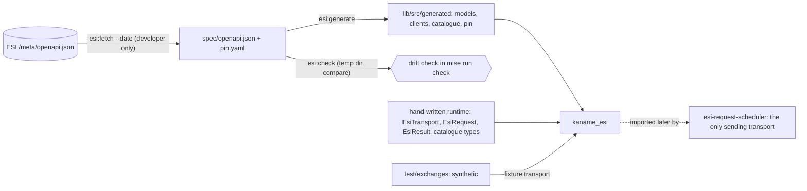
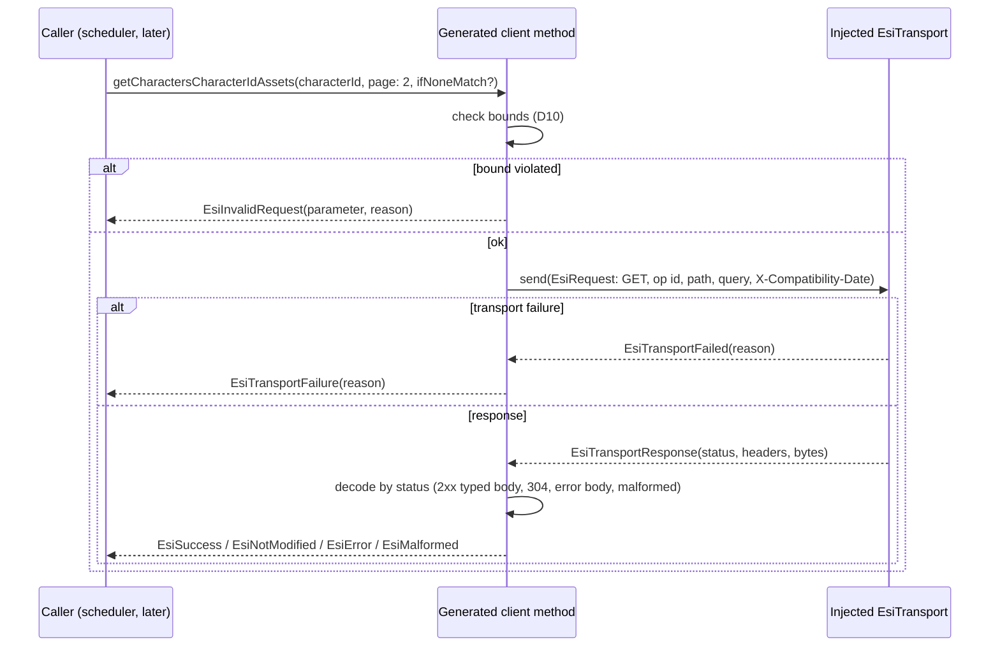

# Design

## Triage

| Trigger | Applies? | Evidence |
|---|---|---|
| T1 Components (new component, or 3+ with directed relationships) | yes | New package `kaname_esi` and a new generator in `kaname_tools`. The generator reads the snapshot and writes the package; the scheduler and every later module will import the package. No `packages/kaname_esi` exists today (`pubspec.yaml:7-16`). |
| T2 State (persistent state, caches, 3+ state machine) | no | The snapshot, pin file and generated code are committed files, written only by the developer's deliberate fetch and generate. The client holds no state between calls. |
| T3 Concurrency (background work, workers/isolates, async, retries) | no | One async `send` per call with no retry, queue or timer. Retries, budgets and timeouts belong to `esi-request-scheduler`. The fetch is one blocking download with a timeout. |
| T4 Boundaries (data format, migration, shared interface, IPC, external) | yes | CCP's external ESI OpenAPI format, the pin file format, the transport interface the scheduler will implement, and the catalogue every later change reads. |
| T5 Volume (grows without a fixed bound) | no | One snapshot (about 0.5 MB) and generated code sized by the pinned spec (208 operations, 324 schemas). A bump replaces both, so nothing accumulates. |
| T6 Risk (security, money, data loss, unrecoverable user data) | no | No tokens, no user data and no network in the client. The licence question is settled by S1 (owner). |

TIER: FULL

## Context

- Proposal: `proposal.md` (why, scope, S1–S8).
- ADR 0007 requires a generated client and route catalogue from ESI's spec at one pinned compatibility date, a bump as one PR with a spec diff and contract tests, the compatibility date "pinned in one place", and modules that never call ESI directly (`docs/adr/0007-esi-access-platform.md:13-15`, `:48`, `:51`).
- ADR 0003: pure-Dart shared packages in `packages/`, generators in `tools/` (`docs/adr/0003-pub-workspace-and-vertical-modules.md:12-16`). Packages under `packages/` and `tools/` may not use Flutter or Serverpod; the purity check enforces this (`tools/kaname_tools/lib/src/purity.dart:12-23`, `:46-47`). Its web-safe list also bans `dart:io`, `dart:ffi` and `dart:isolate` in `lib/` (`tools/kaname_tools/lib/src/purity.dart:50-60`).
- Generator precedent: the tokens generator renders the whole output in memory, formats it with `DartFormatter` (`tools/kaname_tools/lib/src/tokens_render.dart:47-48`), and its check compares the rendered text with the committed file and writes nothing (`tools/kaname_tools/lib/src/tokens.dart:88-101`). The l10n check generates into a system temp directory (`tools/kaname_tools/lib/src/l10n.dart:50`). Commands are registered on one runner (`tools/kaname_tools/lib/src/cli.dart:52-61`) and go through a `FileSystem` interface with read, write, rename and delete (`tools/kaname_tools/lib/src/file_system.dart:32-59`).
- `kaname_tools` depends on `args`, `dart_style`, `path` and `yaml` (`tools/kaname_tools/pubspec.yaml:12-16`). `crypto` is already in the lockfile through `kaname_static_data_bundle` (`packages/kaname_static_data_bundle/pubspec.yaml:9-11`), so the fetch can hash with it without adding a package to the lockfile.
- Generated-code precedent: the server excludes `lib/src/generated/**` from analysis while it stays format-checked (`server/kaname_server/analysis_options.yaml:1-8`). Shared packages add `public_member_api_docs` (`packages/kaname_core/analysis_options.yaml:1-6`).
- `mise run check` runs workspace, purity, analyze, format:check, tokens:check, l10n:check, test, notices:check and licences in order (`mise.toml:315-327`); CI runs it on three OSes (`.github/workflows/ci.yml:38-49`, `:66-67`).
- The notices check requires each vendored source's URL and licence paths as whole tokens in the hand-written sections (`tools/kaname_tools/lib/src/notices.dart:170-176`, `:334-361`).
- The live spec (fetched 2026-11-23, not committed): OpenAPI 3.1.0, `info.version` `2026-11-19`; 208 operations (173 GET, 21 POST, 7 PUT, 7 DELETE); 324 component schemas; `X-Compatibility-Date` is a required header parameter whose enum holds only the date; 171 operations have `x-rate-limit` {group, max-tokens, window-size}, 37 do not; 145 have OAuth2 scopes; 34 have `x-required-roles`; 3 use `x-pagination: cursor`, and 38 take a `page` query parameter with an `X-Pages` response header; all 39 `oneOf` schemas are unions of single-key objects with a `title`; formats in use are int32, int64, double, date, date-time and uuid; request bodies are JSON only; parameters are in path, query or header (by reference).

## Decisions

### D1: Values the pinned spec does not list

- **Choice:** tolerant decoding. A string in an enum position with an unlisted value decodes to an explicit `unknown` case holding the string. A `oneOf` object with exactly one key that names no listed variant decodes to an `unknown` case holding the object. Undeclared object fields are ignored. Everything else that differs from the schema is a malformed response: a missing required field, a wrong JSON type (a number in an enum position included), a `oneOf` object with zero or several keys, and a listed variant's key whose payload does not match that variant (clarified after review round 1, within the owner's choice).
- **Rejected:** strict decoding that fails the whole response on an unlisted value, because CCP adds enum values (such as notification types) without a new date, and one new value would fail every call to that route.
- **Reversal cost:** medium (every consumer switches over the generated enums and unions).
- **Important:** yes, because it binds future changes: the shape of every generated enum and union.
- **Chosen by:** user (2026-11-23)

### D2: Result shape

- **Choice:** every call returns a sealed `EsiResult<T>` and never throws for HTTP outcomes. The cases are success (typed body or none, status, `ETag`, `Expires`, `Last-Modified`, page count), not modified, ESI error (status, parsed message when present), malformed (status, JSON path, reason), invalid request (parameter, reason) and transport failure (the transport's reason). Pagination is per call: page and cursor are parameters, the page count is on the success. Loops belong to the scheduler.
- **Rejected:** typed exceptions for non-2xx and parse failures with the plain body on success, because failure paths become invisible to the type system and AGENTS.md asks for sealed states and exhaustive switches.
- **Reversal cost:** medium.
- **Important:** yes, because it binds future changes: the contract every caller handles.
- **Chosen by:** user (2026-11-23)

### D3: int64 fields

- **Choice:** map int64 and int32 to Dart `int`. The doc comment on the package library states that on the web `int` is exact only up to 2^53, and that the client is not used on the web (ADR 0005: web is connected-only and the server holds tokens).
- **Rejected:** `Int64` from `package:fixnum` or `BigInt` everywhere, because it burdens every module for a platform that never runs the client.
- **Reversal cost:** medium.
- **Important:** yes, because it binds future changes: every generated ID type.
- **Chosen by:** user (2026-11-23)

### D4: Reading the spec

- **Choice:** a hand-written reader in `kaname_tools` for exactly the OpenAPI subset the snapshot uses: local `$ref`, object, array, scalar types, `["T","null"]` nullable types, enum, `oneOf` of single-key objects, the six formats above, path, query and header parameters, JSON request bodies, and the `x-` extensions the catalogue needs. Any other construct fails generation and names its JSON path. Descriptive keys (`description`, `title`, `examples`, `x-enum-descriptions` and the like) are read for doc comments or ignored.
- **Rejected:** a third-party OpenAPI parser package, because it adds a dependency and a licence check and still needs Kaname's own mapping, with no fail-closed guarantee on constructs it accepts silently.
- **Reversal cost:** low.
- **Important:** yes, because it binds future changes: what a date bump may bring without generator work.
- **Chosen by:** user (2026-11-23)

### D5: Route catalogue form

- **Choice:** a generated Dart const table of `EsiRoute` values keyed by operation id, with a second const map keyed by method and path template. A route without `x-rate-limit` carries `EsiRateGroup.none`, a distinct case of a sealed type, not a null group. Cache facts are nullable fields, absent when the spec states none.
- **Rejected:** a JSON catalogue resource parsed at runtime, because it adds a load path and a parse failure mode with no benefit when the catalogue only changes with a regeneration.
- **Reversal cost:** low.
- **Important:** yes, because it binds future changes: the scheduler and call log read it.
- **Chosen by:** user (2026-11-23)

### D6: Contract fixture coverage

- **Choice:** Kaname-written exchange files in three sets (inbound tests assert result cases and decoded values; outbound tests assert captured requests for cursors and bodies), conforming, negative (malformed) and forward-compatibility (unlisted values), that cover every listed construct and response kind at least once (about 15–20 operations). Inbound tests assert their exact result case and decoded values; outbound cursor and body tests assert the captured request. So a bump that changes an asserted behaviour fails its test. A generated coverage test runs over all 208 operations: each has a catalogue entry and a client method, and each method, called with placeholder arguments, sends the fixture transport the concrete path the test computes independently from the snapshot's template (refined after review round 1).
- **Rejected:** a hand-written exchange for each of the 208 operations, because it is large to write and to keep current on every bump while adding little over construct coverage.
- **Reversal cost:** low.
- **Important:** yes, because it binds future changes: what each bump must update.
- **Chosen by:** user (2026-11-23)

### D7: Headers the client sets

- **Choice:** always `X-Compatibility-Date` from the generated pin constant. `If-None-Match` and `Accept-Language` are optional per call. Never `X-Tenant` (ESI defaults to tranquility), `User-Agent`, `Authorization` or `If-Modified-Since`: those belong to the transport that the scheduler and token vault supply.
- **Rejected:** the client sets every header, including `User-Agent` and `Authorization`, from parameters, because it would spread install identity and tokens into every call site.
- **Reversal cost:** low.
- **Important:** yes, because it binds future changes: the split of duties with the scheduler's transport.
- **Chosen by:** user (2026-11-23)

### D8: Fetch and file layout

- **Choice:** `esi:fetch` downloads with `dart:io`'s `HttpClient` (no new HTTP dependency) under a 60-second timeout. It refuses a spec whose `info.version` or `X-Compatibility-Date` enum differs from the requested date. It writes each file to its own uniquely named temporary file and renames it into place, the snapshot first and the pin last, then re-reads both from disk and fails on a hash mismatch; a passing re-read does not guard against a later write (refined after review round 2). Files: `packages/kaname_esi/spec/openapi.json` (the bytes as served, so the hash matches the download) and `packages/kaname_esi/spec/pin.yaml` (`date`, `source`, `sha256`). The hash uses `crypto`, already in the lockfile. Generated code goes in `packages/kaname_esi/lib/src/generated/`, excluded from analysis like the server's and kept formatter-clean.
- **Rejected:** `package:http` in `kaname_tools`, because it is a new dependency for one GET.
- **Reversal cost:** low.
- **Important:** yes, because it binds future changes: the pin file format and the bump procedure.
- **Chosen by:** user (2026-11-23)

### D9: Transport interface

- **Choice:** a hand-written `EsiTransport` interface with one method, `Future<EsiTransportOutcome> send(EsiRequest request)`. `EsiRequest` is an immutable value: method, operation id, the request target (a relative `Uri` holding the filled path and query, percent-encoded exactly once by the client), headers and an optional JSON body as bytes. The transport resolves the target against `https://esi.evetech.net` and never re-encodes it (refined after review round 2). `EsiTransportOutcome` is sealed: a response (status, headers with lower-cased names, body bytes) or a failure (reason). The operation id lets the scheduler find the catalogue entry without parsing paths. Call identity is bound on the transport instance (D13), never in `EsiRequest`.
- **Rejected:** taking an `http.Client`-like object that the scheduler wraps, because it couples the generated client to an HTTP library's types and invites a direct network path.
- **Reversal cost:** medium.
- **Important:** yes, because it binds future changes: `esi-request-scheduler` implements it.
- **Chosen by:** user (2026-11-23)

### D10: Request checks before sending

- **Choice:** the client checks inputs against the bounds the spec states for parameters and bodies (`minItems`, `maxItems`, `minimum`, `maximum`, enum). A violation returns an invalid-request result naming the parameter, and nothing is sent.
- **Rejected:** no client-side checks, because a 400 from ESI spends the shared error limit that ADR 0007 protects.
- **Reversal cost:** low.
- **Important:** yes, because it changes behaviour callers see: some calls return without reaching the transport.
- **Chosen by:** user (2026-11-23)

### D11: Package guards

- **Choice:** `kaname_esi` joins `PurityCheck.webSafePackages`, so its `lib/` imports no `dart:io`, `dart:ffi` or `dart:isolate`. It has no runtime dependencies at all, and a test in the package asserts that its pubspec lists none. A second test walks every import, export, part and conditional-import URI under `lib/`, generated files included. It allows only `dart:core`, `dart:async`, `dart:convert`, `dart:collection`, `dart:math`, `dart:typed_data` and URIs that resolve inside `kaname_esi/lib/` (relative, or `package:kaname_esi/`). So `dart:html`, `dart:js_interop`, other workspace packages and relative paths leaving `lib/` all fail, even with the pubspec unchanged (allowlist after review round 1, widened to the whole URI graph after round 2). Together these enforce "no network of its own" mechanically.
- **Rejected:** relying on review alone, because nothing would stop a later change from adding an HTTP client to the package.
- **Reversal cost:** low.
- **Important:** yes, because it binds future changes: what the package may depend on.
- **Chosen by:** user (2026-11-23; allowlist confirmed after review rounds 1 and 2)

### D12: Generated code layout

- **Choice:** under `lib/src/generated/`: one models file and one client file per spec tag, plus `catalogue.dart` and `pin.dart` (the date constant). The package library `lib/kaname_esi.dart` exports them with the hand-written runtime. Dart names derive from schema names and operation ids in Dart style (`UpperCamelCase` types, `lowerCamelCase` methods and fields). Any collision fails generation and names both sources. Doc comments come from the spec's descriptions, so `public_member_api_docs` would hold even though the folder is not analysed.
- **Rejected:** one generated file holding everything (tens of thousands of lines; slow to review and diff in a bump PR).
- **Reversal cost:** low.
- **Important:** yes, because it binds future changes: the import surface every module uses.
- **Chosen by:** user (2026-11-23)

### D13: Call identity on the transport

- **Choice:** the generated client carries no caller identity. Whoever supplies the transport binds the call context: in `esi-request-scheduler`, one transport per context (for example `transportFor(character, priority)`), with a cheap client built on it per context. `EsiRequest` stays wire data plus the operation id, so tokens never sit in requests and D9's signature is unchanged. Concurrent calls stay isolated because each context has its own transport instance.
- **Rejected:** an `EsiCallContext` parameter (character id or none, priority) on every generated method, forwarded in `EsiRequest`, because it puts scheduling concerns into 208 signatures and moves identity into a value any caller can build.
- **Reversal cost:** medium (the scheduler's API is built on it).
- **Important:** yes, because it binds future changes: how `esi-request-scheduler`, `esi-token-vault` and `esi-sso` attach tokens, budgets and priorities.
- **Chosen by:** user (2026-11-23, after review round 1)

### Decision summary

| # | Decision | Choice | Rejected | Reversal cost | Important | Chosen by |
|---|---|---|---|---|---|---|
| S1 | Pinned spec source | Commit the snapshot with a CCP notice; publishing basis recorded | Hash only, download at generation | low | yes | user |
| S2 | Route coverage | All 208 operations | Allowlist per module; GET only | low | yes | user |
| S3 | Recorded responses | Synthetic exchanges, no CCP data | Live recordings of public routes | low | yes | user |
| S4 | Network boundary | Injected transport, none of its own | Plain HTTP transport now | medium | yes | user |
| S5 | Compatibility date | 2026-11-19 | 2025-12-16 | low | yes | user |
| S6 | Package placement | `packages/kaname_esi`; `kaname_tools esi` | Separate generator package; inside `kaname_core` | medium | yes | user |
| S7 | Generated output | Committed, with `esi:check` in `check` | `build_runner` at build time | low | yes | user |
| S8 | Date bump | `esi:fetch -- --date`, pin file, CI never fetches | Manual download | low | yes | user |
| D1 | Unlisted values | Tolerant `unknown` for unlisted enum strings and single-key variants; other mismatches malformed | Strict failure | medium | yes | user |
| D2 | Result shape | Sealed `EsiResult`, never throws | Exceptions | medium | yes | user |
| D3 | int64 | Dart `int`, web limit documented | `Int64`/`BigInt` | medium | yes | user |
| D4 | Spec reader | Hand-written, fail-closed subset | Third-party parser | low | yes | user |
| D5 | Catalogue form | Generated const table, explicit no-group case | Runtime JSON | low | yes | user |
| D6 | Fixture coverage | Three fixture sets with exact assertions, plus a generated 208-operation concrete-path test | One exchange per operation | low | yes | user |
| D7 | Client headers | Compatibility date always; ETag and language optional | Client sets all headers | low | yes | user |
| D8 | Fetch and layout | `dart:io` fetch with date check; files under `packages/kaname_esi/spec/` | `package:http` | low | yes | user |
| D9 | Transport | `send(EsiRequest)` returning a sealed outcome; client encodes the target once | `http.Client`-like object | medium | yes | user |
| D10 | Request checks | Check spec bounds, send nothing on violation | Let ESI answer 400 | low | yes | user |
| D11 | Package guards | Web-safe purity, zero dependencies, URI allowlist over imports, exports, parts and conditionals | Review only | low | yes | user |
| D12 | Code layout | Per-tag files plus catalogue and pin | One file | low | yes | user |
| D13 | Call identity | Bound on the transport instance per call context | `EsiCallContext` parameter on every method | medium | yes | user |

## Assumptions

- **A1:** The SDK's `dart format` (Dart 3.13.7) and the `dart_style` package version locked for `kaname_tools` produce the same output, so generated code passes `format:check`. Not checked because the generated files do not exist yet; the tokens generator relies on the same pairing. Depends on it: D8, D12, the generation task group.
- **A2:** `DartFormatter` formats the largest generated file (the biggest tag's models) in a few seconds, so `esi:check` stays a quick part of `mise run check`. Not checked because nothing is generated yet. Depends on it: S7.
- **A3:** ESI serves the same bytes for the same compatibility date until CCP edits that date's spec, so a re-fetch of the pinned date normally reproduces the hash. Not checked because it describes CCP's future behaviour. Depends on it: none (the fetch always writes the hash of what it got, and only the snapshot in the repository feeds generation).

## Carried constraints

- **C1:** The client never sends on its own: every request leaves through an injected `EsiTransport`, `kaname_esi` has no runtime dependencies, and every import, export, part and conditional URI in its `lib/` is one of the six allowed `dart:` libraries or stays inside `kaname_esi/lib/`. Kind: invariant. Destination: spec: specs/esi-client/spec.md → Requirement: The transport is the only way out
- **C2:** The compatibility date lives only in `spec/pin.yaml` and the generated `pin.dart`; no other code may state it. Kind: invariant. Destination: spec: specs/esi-client-generation/spec.md → Requirement: One pinned spec snapshot
- **C3:** `int` is exact only up to 2^53 on the web; the client is not meant for web builds (ADR 0005). Kind: deliberate gap. Destination: doc comment: packages/kaname_esi/lib/kaname_esi.dart library
- **C4:** The generator supports only the OpenAPI subset of D4 and fails closed on anything else; widening it is a deliberate generator change in the bump PR. Kind: invariant. Destination: doc comment: tools/kaname_tools/lib/src/esi_spec.dart EsiSpecReader
- **C5:** Routes without `x-rate-limit` carry `EsiRateGroup.none`; the catalogue states the spec's facts and leaves their budget meaning to the scheduler. Kind: deliberate gap. Destination: doc comment: packages/kaname_esi/lib/src/catalogue_types.dart EsiRateGroup
- **C6:** `User-Agent`, `Authorization`, `If-Modified-Since` and `X-Tenant` are the transport's headers, never the generated client's. Kind: invariant. Destination: doc comment: packages/kaname_esi/lib/src/transport.dart EsiTransport
- **C7:** Contract fixtures are Kaname-written and hold no data copied from ESI (S3). Kind: invariant. Destination: spec: specs/esi-client/spec.md → Requirement: Contract tests over recorded exchanges
- **C8:** Call identity (character, token, budget, priority) is bound on the transport instance by whoever supplies it, never carried in `EsiRequest` or the generated methods. Kind: invariant. Destination: spec: specs/esi-client/spec.md → Requirement: Call identity stays with the transport

## Diagrams (FULL)

T1, components and build-time flow:

T4, one call across the transport boundary:

## State & Ownership (FULL)

| State | Owner (sole writer) | Lifetime | Invalidation / rebuild | Authoritative copy |
|---|---|---|---|---|
| `spec/openapi.json` | `kaname_tools esi fetch`, run by a developer | Until the next bump PR | Replaced whole by a fetch | The committed snapshot |
| `spec/pin.yaml` | `kaname_tools esi fetch`, written after the snapshot | Same as the snapshot | Rewritten by each fetch | The committed pin; the hash ties it to the snapshot |
| `lib/src/generated/**` | `kaname_tools esi generate` | Until the snapshot or generator changes | Regenerated whole; `esi:check` detects drift | The snapshot plus the generator (the files are derived) |
| Contract exchange files | Developers, by hand | Until a bump changes the schemas they cover | Edited in the bump PR when a contract test fails | The committed files |

## Failure & Visibility (FULL)

| Component | Fails / dies mid-operation → | Recovery | Retry safe? | Who finds out |
|---|---|---|---|---|
| `esi fetch` | Download error, timeout, wrong date, or a crash between the snapshot rename and the pin write | Nothing is replaced on a download error or wrong date. After a crash the snapshot is new but the pin is old, and `esi:check` fails on the hash. Rerun the fetch. | yes | The developer (exit code and message); CI via `esi:check` if committed half-done |
| `esi generate` | Unsupported construct, name collision, or a crash while writing | Rendered fully in memory first and written only when all files render; a crash mid-write leaves a partial set that `esi:check` reports. Rerun generate. | yes | The developer; CI via `esi:check` |
| `esi check` | Temp directory not writable | Exits non-zero naming the error | yes | The developer and CI |
| Generated client at runtime | The transport fails, or the body does not decode | Returns a sealed failure result; never throws | Caller's choice (the scheduler's in the next change) | The caller; the call log in `esi-call-log` |

## Resource Bounds (FULL)

| Queue / buffer / cache / transfer | Bound | At the bound | Timeout | At 10x / 100x |
|---|---|---|---|---|
| Spec download | One response held in memory; the spec is about 0.5 MB today; the fetch refuses a body over 16 MB | Refused, files unchanged | 60 s | 5 MB and 50 MB: 5 MB fits; at 50 MB the cap refuses, which is a deliberate look at the cap |
| Generated output in memory during generate and check | All files for one snapshot, a few MB of text | — | none (local CPU) | 10x operations: tens of MB of text and a slower check (A2); 100x is beyond any plausible ESI |
| Decoded response | One response body, held by the caller | No cap in the client; the scheduler's transport bounds reads | The transport's | The scheduler bounds bodies; the client adds no buffer of its own |

## Flow & State Gaps (FULL)

- **Partial fetch:** the snapshot is written to a temp file and renamed; the pin is written after it. A crash leaves new snapshot plus old pin, and `esi:check` fails on the hash until the fetch is rerun.
- **Partial generate:** all files render in memory before any write. A crash during writes leaves a mixed set that `esi:check` names.
- **Stale generated code after a bump:** `esi:check` fails (spec scenario "Snapshot bumped without regenerating").
- **Concurrent runs:** two developers' fetches meet as a merge conflict in the PR, which is the normal git path. Two fetches at once in one checkout can leave a snapshot from one and a pin from the other. Example order: A renames its snapshot; B writes snapshot and pin and passes its re-read; A writes its pin. A's re-read finds B's snapshot under A's pin and A fails, and `esi:check` rejects the pair until a fetch is rerun. B's earlier pass is no guarantee against A's later write. No lock (owner, after review round 1).
- **Pin date edited by hand:** generate and check compare the pin's date with the snapshot's `info.version` and `X-Compatibility-Date` enum before rendering, and refuse a mismatch.
- **Out-of-order or concurrent calls:** the client holds no state, so concurrent calls are independent.
- **Spec changed by CCP under the same date (A3):** a later re-fetch would show a hash change in its PR; nothing changes until someone fetches.

## Mechanism Ledger (FULL)

| Mechanism | Built? | Why (harm nobody catches / expensive later) | Evidence that would change the call |
|---|---|---|---|
| Hash in the pin, checked by `esi:check` | yes | A hand-edited snapshot would otherwise generate a client CCP never published, unnoticed | — |
| Date check on fetch | yes | A wrong-date spec would silently move the contract | — |
| Notices check of the ESI entry's licence name, URL and proprietary notice | yes | A bump that drops the attribution would otherwise pass (review round 2) | — |
| Pin-date check in generate and check | yes | A hand-edited pin date would make the client send a date whose contract it does not implement, unseen by the hash check (review round 1) | — |
| Post-write hash re-read in fetch | yes | Two interleaved fetches would otherwise both report success; the writer whose pin lands last against the other's snapshot fails | — |
| Hash check before parsing in generate and check | yes | A same-date edit to the snapshot would otherwise feed a usable catalogue from unpinned bytes (review round 2) | — |
| Lock file for fetch and generate | no | The post-write re-read and `esi:check` already report an interleaved pair; a lock adds stale-lock handling | Repeated contention in practice |
| `dart:` import allowlist test | yes | A browser-network import would pass the web-safe deny list | — |
| Fail-closed spec reader (D4) | yes | A construct read wrongly yields a client that mis-decodes, found only in production | — |
| Request bound checks (D10) | yes | 400s spend the shared error limit (ADR 0007) | Owner chose it |
| Zero-dependency and web-safe guard (D11) | yes | A later HTTP import would open a path around the scheduler that review could miss | — |
| Retry or timeout in the client | no | The scheduler owns sending, timeouts and retries | — |
| Response caching or ETag store in the client | no | The scheduler owns caching | — |
| JSON Schema validator for fixtures | no | The generated decoder already rejects a non-conforming fixture as malformed, which the contract test reports | A fixture that decodes but still breaks the schema |
| Network fetch in CI to detect new dates | no | Bumps are deliberate (S8); CCP's changelog is the trigger | Missed bumps that cause real breakage |

## Risks / Trade-offs

- [The licence does not expressly allow redistributing the spec] → The owner chose S1 knowing this, with the basis recorded in S1. The CCP notice names the CCP material (the snapshot and the generated folder's copied descriptions), the licence and its URL and CCP's proprietary notice, and the notices check enforces each (review round 2). README already states CCP's developer licence (`README.md:36`).
- [The SDK formatter and the `dart_style` package diverge (A1)] → `esi:check` and `format:check` both run in `check`, so a divergence fails CI at once; the tokens generator already relies on the same pairing.
- [Generated code is excluded from analysis, so a generator bug could ship analyzer-invalid code] → The package's own tests compile against it, and the drift check plus contract tests run in `check`. The exclusion only drops lints, not compile errors in tests.
- [Tolerant decoding hides schema changes CCP makes without a date] → Contract tests fail on the next bump; unknown cases stay visible to callers through exhaustive switches.
- [Large generated surface to review in a bump PR] → Per-tag files (D12) keep diffs local.

## ADRs

- **In force, constraining this change:** 0007 (generated client, pinned date, bump PR, one place for the date, no direct calls), 0003 (workspace and package placement), 0005 (one token holder; web connected only, supporting D3), 0002 (clean room and licence).
- **To record during apply:** none. Every binding choice here applies ADR 0007 inside one package.
