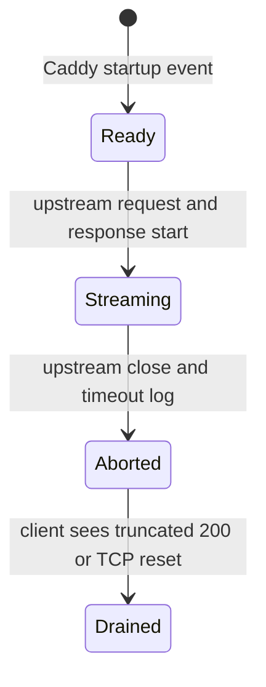
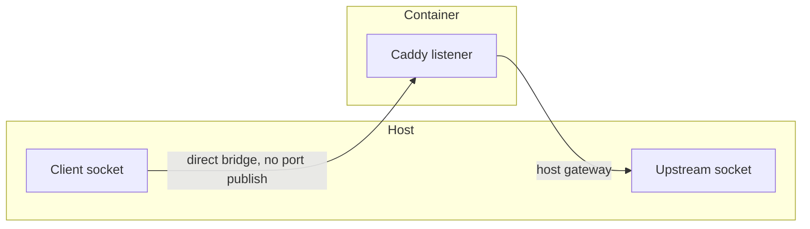

# Design

## Triage

| Trigger | Applies? | Evidence |
|---|---|---|
| T1 Components | Yes | Test client, Caddy container and upstream stub (`server/kaname_client/test/stack/caddy_idle_test.dart:49–69,86–103,111–140`). |
| T2 State | Yes | Fixture progresses from readiness to response start to upstream close to downstream drain (`server/kaname_client/test/stack/caddy_idle_test.dart:60–70,110–166`). |
| T3 Concurrency | Yes | Response writes and socket close callbacks race while the client is paused (`server/kaname_client/test/stack/caddy_idle_test.dart:51–77,131–147`). |
| T4 Boundaries | Yes | Docker fixture and real TCP sockets (`server/kaname_client/test/stack/caddy_idle_test.dart:49–50,86–103,111–119`). |
| T5 Volume | No | One response, currently capped at 1 GiB (`server/kaname_client/test/stack/caddy_idle_test.dart:50,64–70`). |
| T6 Risk | No | The fixture uses synthetic bytes and a scratch configuration (`server/kaname_client/test/stack/caddy_idle_test.dart:50,64–70,80–85`). |

TIER: FULL

## Context

The fixture publishes a Docker port and submits a request with paused client reads; its 3-minute upstream-close guard starts after flushing the request (`server/kaname_client/test/stack/caddy_idle_test.dart:86–109,131–147`), independently of the upstream sending headers and body (`server/kaname_client/test/stack/caddy_idle_test.dart:60–70`). Caddy is configured to apply a positive 1-minute idle limit per write (`deploy/Caddyfile:27–38`); the fixture uses the pinned image (`deploy/compose.yaml:112`, `server/kaname_client/test/stack/caddy_idle_test.dart:21–26,98–101`) to cover the existing bundle proxy requirement (`openspec/specs/client-data-bundle/spec.md:168–169`). The old test only consults its upstream request count after closure and removes its stand-alone Caddy container without collecting that container's logs (`server/kaname_client/test/stack/caddy_idle_test.dart:49–59,105,144–150`). The stack job runs on Ubuntu, and its failure log collection targets the Compose stack, not the idle fixture (`.github/workflows/ci.yml:148–151,179–186`).

### Reproduced locally

Using the pinned Caddy image and the original socket topology and write loop in a temporary instrumented fixture, the baseline completed 20 writes of 1 MiB before stalling. Caddy reported `writing: write tcp …: i/o timeout`; upstream reset and downstream end arrived about 61 seconds after the request. With a deliberate 130-second delay before starting the body, the client request still reached the upstream immediately, 25 writes completed once the body began, the original 3-minute guard expired at about 181 seconds, and Caddy timed out and closed both legs at about 191 seconds. This reproduces the failure message with a healthy Caddy and isolates the request-relative guard as the cause in that experiment.

### Not reproduced

The exact timing or socket behavior of original CI job 138314885986 is unknown. Its log contained the upstream guard error but no per-fixture Caddy logs, admission or byte counts; a different runner passed the same SHA. The local delay is a controlled substitute for late response/backpressure, not a claim about how long the original CI runner took or whether it observed a reset. The new probe must diagnose either missing backpressure or a missing close.

## Decisions

### D1: Bound the real TCP path

- **Choice:** Use the pinned Caddy image and shipped configuration with the stub's port substituted. Connect directly to its IPv4 address on the native Linux Docker bridge without publishing a port. Bound Caddy's TCP autotuning in its own namespace and clamp the harness's receiving and sending socket buffers with Linux socket options. Stream a bounded body large enough to fill the path, reusing a fixed chunk. Existing Compose tests continue to use the published port.
- **Rejected:** Bound only the Dart endpoints on the published-port path; a Docker relay can keep draining independently. An unbounded body would make the test dependent on the runner's capacity and hide a fixture bug.
- **Reversal cost:** low.
- **Important:** yes (the original runner's network behavior was not observed).
- **Chosen by:** agent (handed back by coordinator).

### D2: Establish cause and minimum duration without an upper correctness deadline

- **Choice:** Enable `debug` and route-local `verbose_logs` in the scratch config only. A dedicated Caddy container handles one download. Use its matched `writing to downstream` and `wrote to downstream` records around the same failing `Write`; require >30 seconds between those Caddy timestamps, not timestamps from the Dart observer, the request, or the response producer. Require a downstream `write tcp … i/o timeout`, followed in Caddy's trace by `closed response body from upstream` with no error and its incomplete-response abort. Independently latch upstream EOF/reset and that trace, in either delivery order, before reading a single downstream byte. A normal downstream EOF must expose a 200 and partial content; an actual TCP reset may discard the prefix, so require the trace's upstream 200 and earlier successful downstream writes and assert the client did not receive the whole body. Verify the adapted production listener's explicit 1-minute idle setting. In a separate scratch-config control with the idle timer disabled, use the upstream TCP sender's Linux `TCP_INFO` advertised window to observe downstream backpressure reaching the upstream: wait for a zero peer window with unsent body bytes while the upstream is still open and Caddy is writing. Then resume reads and require the entire body. The state observation has no fixed sample count or duration; only the outer watchdog can fail a hang. The control is not a retry, and the primary probe's configuration keeps the original policy.
- **Rejected:** Dart callback timestamps (a scheduler delay can make an immediate Caddy timeout look long), unrelated terminal outcomes (can match even if the proxy already dropped upstream), OS syscall/packet tracing (privileged tooling and increased fixture complexity), and a replacement Caddy build. Elapsed time has no upper correctness assertion; the positive minimum remains the one wall-clock exception.
- **Reversal cost:** low.
- **Important:** yes (exception to the task's general no-real-time test rule).
- **Chosen by:** agent (handed back by coordinator).

### Decision summary

| # | Decision | Choice | Rejected | Reversal cost | Important | Chosen by |
|---|---|---|---|---|---|---|
| S1 | Milestone | M1 maintenance | M2 | Low | No | User |
| S2 | Scope | Real-Caddy test and diagnostics | Longer waits, substitute proxy, production changes | Low | No | User |
| D1 | Transport | Bounded direct bridge | Published-port buffering | Low | Yes | Agent |
| D2 | Evidence | Matched Caddy write trace, actual closes and no-timeout control | Dart timestamps, terminal join alone, privileged tracing, custom binary | Low | Yes | Agent |

## Assumptions

- **A1:** The GitHub-hosted Ubuntu job permits host access to the native bridge and namespaced TCP sysctls. The sysctls were verified on the local Linux daemon; the equivalent hosted execution must pass in PR CI. Depends on D1.
- **A2:** Confirm the pinned Caddy's scratch `verbose_logs` trace shows the paired downstream-write and upstream-body-release records before relying on them. Separately adapt both scratch cases against the same stub port and compare their effective JSON: the primary listener must encode the explicit positive deadline, the control must encode explicit negative disablement (not omission or zero), and after normalizing that one field the configurations must match. Confirm the actual control still drains fully after backpressure; full delivery alone does not prove timer disablement. Depends on D2.

## Carried constraints

- **C1:** Use a direct bridge path with bounded socket buffers and require native Linux Docker with host bridge access and namespaced TCP sysctls. The log and socket events are independently latched; do not depend on their delivery order. No client reads in the primary probe until both upstream termination and the timeout trace. Kind: invariant. Destination: doc comment: `server/kaname_client/test/stack/caddy_idle_test.dart` library.
- **C2:** The explicit production deadline, matched Caddy write duration and timeout-induced upstream body release, and observed close on each socket are independent assertions; the outer watchdog is never an expected result. Kind: invariant. Destination: doc comment: `server/kaname_client/test/stack/caddy_idle_test.dart` library.
- **C3:** The drain control verifies effective idle-timer disablement, then waits for an open upstream with unsent body data and a zero advertised receive window before resuming downstream reads; resumption must deliver the full body. Kind: invariant. Destination: doc comment: `server/kaname_client/test/stack/caddy_idle_test.dart` library.

## Diagrams (FULL)

### Components (T1)


### Fixture stages (T2)



### Close ordering (T3)

```mermaid
sequenceDiagram
  participant Client
  participant Caddy
  participant Stub
  Client->>Caddy: Request; no reads
  Caddy->>Stub: Forward request
  Stub->>Caddy: Headers and body; record write progress
  Caddy->>Client: Downstream write fills bounded buffers
  Caddy-->>Stub: Close on timeout
  Note over Client,Caddy: Harness observes Caddy timeout before reading
  Caddy-->>Client: Truncated response and EOF, or reset
```

### Docker boundary (T4)



## State & Ownership (FULL)

| State | Owner | Lifetime | Invalidation / rebuild | Authoritative copy |
|---|---|---|---|---|
| Fixture process, address and log tail | Test harness and Docker (process lifecycle) | One test | Stop and confirm removal after diagnostics | Docker inspection and log stream |
| Admission, writes started/completed and socket end | Upstream callbacks | One request | Discard with test | Stub's counters and peer end events |
| Receive gate and body-byte count | Test client | One request | Discard with test | Socket subscription and received HTTP bytes |
| Idle deadline | Pinned Caddy | One downstream write at a time | Replaced by Caddy on subsequent writes | Adapted Caddy setting and native timeout error |

## Failure & Visibility (FULL)

| Component | Fails / dies mid-operation | Recovery | Retry safe? | Who finds out |
|---|---|---|---|---|
| Docker/Caddy | Missing readiness, wrong config, unsupported Docker bridge or sysctls, or process exit | Fail with stage and logs; pre-register removal by name, stop and drain the Docker CLI within the subprocess budget, remove the container and verify it is absent before deleting scratch. Report the name, retained scratch and cleanup error if absence cannot be confirmed. | No automatic retry | CI output |
| Upstream | Wrong request, missing progress, unexpectedly full body in timeout case, or unrelated socket error | Fail with stage and write counters | No | CI output |
| Client | Wrong HTTP response, missing close, or unexpected body count | Fail with partial byte count and Caddy logs; only ECONNRESET can substitute for EOF and may discard unread bytes | No | CI output |

## Resource Bounds (FULL)

| Resource | Bound | At the bound | Timeout | At 10× / 100× |
|---|---|---|---|---|
| TCP queues | Caddy TCP receive/send autotuning maxima of 128 KiB each; host requests 64 KiB for upstream send and client receive (Linux can double these) | Transport backpressure | Shipped idle timeout in primary case only | Fixed limits independent of runner defaults |
| Test traffic | One 8 MiB response per case; reuse one 32 KiB write chunk and retain at most 8 KiB of HTTP prefix | Full delivery is a primary-case failure; separately required in the draining control | One outer watchdog per case | No additional requests in flight |
| Diagnostics and subprocesses | At most 16 KiB per log record, 32 retained records, 1 MiB local Docker log rotation; read events incrementally | Oversized records fail; evict oldest diagnostics only. After termination is requested, deadline covers CLI exit and both output pipes together; terminate CLI and cancel pending reads before the final deadline. | 10-minute test watchdog. Allow 30 seconds per cleanup subprocess including exit and both pipes, reserving the final 5 seconds for forced termination and pipe cancellation. | Bounded harness memory; no periodic logging |

## Flow & State Gaps (FULL)

A connect attempt cannot precede Caddy's ready record. Track the most recent pending write and cumulative bytes from the only request; the paired record supplies both the native write error and the end timestamp. Caddy's body-close trace follows that specific write return and precedes its abort trace. Upstream socket delivery and log delivery are independent; neither is used as a timestamp for the other. The timeout-disabled control changes the timer only in its own scratch config, waits for an upstream zero-window sample with unfinished body data while Caddy is writing, then drains and proves the same fixture can complete. The primary probe's normal EOF must have a valid truncated 200; if the kernel reports ECONNRESET instead it can discard unread bytes, so the already-verified Caddy 200 and write progress prove forwarding occurred. Neither probe tears down sockets to manufacture an expected event. Ownership of any partial container startup begins before running Docker; teardown prints retained diagnostics on failures and removes the container before deleting its scratch config.

## Mechanism Ledger (FULL)

| Mechanism | Built? | Why | Evidence that would change the call |
|---|---|---|---|
| Bridge path and explicit socket bounds | Yes | Removes uncontrolled buffering from the test's causal path. | A supported runner without a native bridge requires a different bounded path. |
| Caddy debug trace and bounded diagnostic tail | Yes | The in-process write, body-close and abort trace distinguishes late backpressure and client write timeout from other disconnects; transport closes remain separate. | Stable machine-readable Caddy event API. |
| Timeout-disabled drain control | Yes | Changing only the deadline and later releasing the client must allow the same path to complete instead of releasing upstream unconditionally. | An observable causal cancellation signal independent of the native logs. |
| Negative-control mutations during task verification | Yes | Show missing policy and early write expiry are rejected even with delay before the body; no mutation is shipped. | None. |
| Test retries, production overrides, or custom Caddy build | No | Can hide failure or stop exercising the shipped proxy. | None for this fixture. |

## Risks / Trade-offs

The probe assumes native Linux Docker, matching CI; it does not replace the Compose published-port tests. A future pinned Caddy upgrade that changes its debug events requires updating the probe rather than accepting arbitrary disconnects. Caddy's JSON event timestamps share its clock; a system clock step can invalidate their difference. Measuring the same Caddy write excludes startup, time before the body and Dart callback delivery; descheduling while the write is in progress is included. The lower bound is a regression check, not a performance target.

## ADRs

- **In force, constraining this change:** none beyond the existing bundle-download requirement.
- **To record during apply:** none; production behavior and architecture are unchanged.
