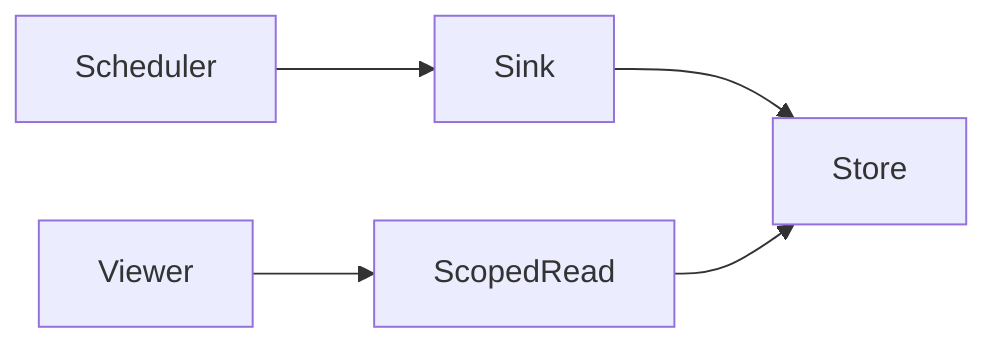
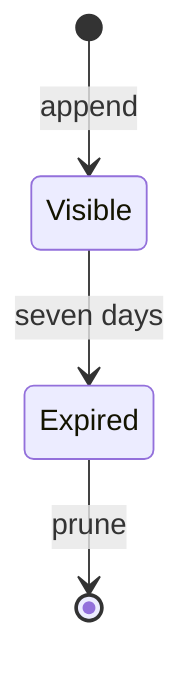
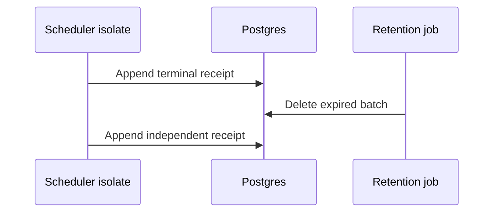
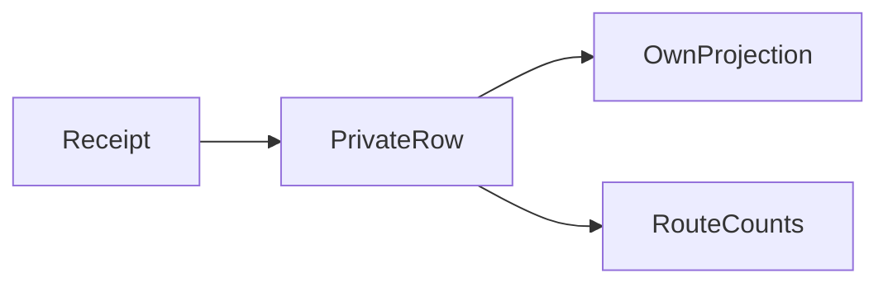

# Design

## Triage

| Trigger | Applies? | Evidence |
|---|---|---|
| T1 Components | Yes | Scheduler, call-log store and scoped reader. |
| T2 State | Yes | Seven-day history. |
| T3 Concurrency | Yes | Concurrent calls and pruning. |
| T4 Boundaries | Yes | Typed scheduler event and database migration. |
| T5 Volume | Yes | Call volume accumulates during the retention window. |
| T6 Risk | Yes | Fields and read predicates enforce character privacy. |

TIER: FULL

## Context

The scheduler resolves the canonical operation, owner and rate group before admission (`packages/kaname_esi_scheduler/lib/src/scheduler.dart:212-253`). Admission and bearer acquisition return explicit refusals, and the sender can fail without or with a response head (`packages/kaname_esi_scheduler/lib/src/scheduler.dart:254-316`). Response observation validates cost and handles an upstream-supplied rate group (`packages/kaname_esi_scheduler/lib/src/scheduler.dart:399-437`). Server composition uses the native runtime with Redis (`server/kaname_server/lib/src/esi/server_esi_runtime.dart:61-81`); solo composes with in-process state (`packages/kaname_esi_scheduler/lib/native.dart:22-35`). Server startup does not wire an identity provider (`server/kaname_server/lib/server.dart:24-61`).

## Decisions

### D1: Typed terminal receipt

- **Choice:** derive route and bucket only from the catalogue. Write closed outcome, numeric metadata and trusted numeric member/character attribution for authenticated calls; unattributed private rows are not releasable. Public operations are always unattributed, even when a principal was supplied. Unknown operation IDs produce no row. Use monotonic elapsed time, UTC record time, zero cost for definitely unsent, and null for unknown actual cost. The sink receives neither request nor response nor exception.
- The principal's typed member ID comes from the trusted composition's persisted character-to-member association, not RPC input. The authorization generation changes if membership changes. Until `esi-sso` supplies that association, private rows lacking trusted attribution are not released.
- **Rejected:** persist raw transport diagnostics and redact afterward; secrets can occur in any of those inputs.
- **Reversal cost:** medium.
- **Important:** yes, binds the sink contract.
- **Chosen by:** agent.

### D2: Store and expire at the holder

- **Choice:** the server token-holder composition appends to one server-only Postgres table through short-lived internal sessions using the existing pool. Worker composition takes the shared sink interface; the first production ESI worker binds it to its own job-owned connection under ADR 0012 and C8. Worker transaction integration and its SQL compatibility tests are outside this change (S2). Native solo uses the same receipt contract and an explicitly supplied local sink; the general solo database stays in M4 (ADR 0005). Server newest-first pages are keyed by timestamp and ID; a single scheduled prune removes expired rows in batches. Reads never rely on the prune having run.
- **Rejected:** place retained history in shared Redis admission state; scheduler recovery and history would become coupled.
- **Reversal cost:** medium.
- **Important:** yes, binds stored shape.
- **Chosen by:** agent.

### D3: Scoped queries, not post-filtered rows

- **Choice:** own rows require both the acting member stored at dispatch and a currently owned character. A new owner cannot read a previous owner’s records. Admin counts qualify each private route on distinct recorded member IDs, not characters, with a threshold of at least five. Unattributed authenticated rows contribute nothing. Public catalogue operations can be summarized without the threshold. At UTC midnight plus one minute release counts for the previous five complete UTC days. Hold the previous window until release; even its oldest row is then less than seven days old, so the cutoff never changes released totals. Do not accept caller-selected periods or subgroups.
- **Rejected:** fetch unscoped rows or grant admins raw access; neither enforces ADR 0006 at data access.
- **Reversal cost:** medium.
- **Important:** yes, binds the privacy interface.
- **Chosen by:** agent.

### Decision summary

| # | Decision | Choice | Rejected | Reversal cost | Important | Chosen by |
|---|---|---|---|---|---|---|
| S1 | Delivery | Data access only; `esi-sso` exposes app reads | Premature remote RPC | Low | Yes | User |
| S2 | Worker integration | Shared receipt seam; first ESI worker binds its job-owned connection | Synthetic worker integration and SQL compatibility tests | Low | Yes | User |
| D1 | Capture | Allowlisted terminal receipt | Redaction | Medium | Yes | Agent |
| D2 | Store | Holder-local sink; server Postgres | Redis history | Medium | Yes | Agent |
| D3 | Read | Query predicates and fixed route aggregates | Unscoped rows | Medium | Yes | Agent |

## Assumptions

None.

## Carried constraints

- **C4:** The admin projection is a fixed snapshot of the previous five complete UTC days, released one minute after UTC midnight, qualified on distinct trusted members, with no caller-selected period or subgroup. Kind: invariant. Destination: spec: specs/esi-call-log/spec.md → Requirement: Privacy-scoped call-log reads
- **C5:** No remote read without genuine viewer identity; no key-based fallback. Kind: deliberate gap. Destination: spec: specs/esi-call-log/spec.md → Requirement: Privacy-scoped call-log reads
- **C1:** Only allowlisted metadata crosses the scheduler-to-log seam. Kind: invariant. Destination: spec: specs/esi-call-log/spec.md → Requirement: Secret-free scheduler history
- **C2:** An expired row is unreadable before cleanup. Kind: invariant. Destination: spec: specs/esi-call-log/spec.md → Requirement: Seven-day retention
- **C3:** No M2 admin privilege widens individual reads. Kind: invariant. Destination: spec: specs/esi-call-log/spec.md → Requirement: Privacy-scoped call-log reads
- **C6:** Until `esi-sso` supplies a trusted character-to-member association, authenticated rows without it are excluded from own-row reads and private route qualification. Kind: deliberate gap. Destination: spec: specs/esi-call-log/spec.md → Requirement: Privacy-scoped call-log reads
- **C7:** Worker ESI composition does not create a Serverpod session or open its own database connection. Kind: deliberate gap. Destination: doc comment: server/kaname_server/lib/src/esi/server_esi_runtime.dart ServerEsiRuntime.open
- **C8:** A database append uses its own short transaction, never a caller or job transaction, so its shared lock ends with the append. Kind: invariant. Destination: doc comment: packages/kaname_esi_scheduler/lib/src/scheduler.dart EsiCallLogSink

## Diagrams (FULL)

T1 — modules:

T2 — row lifetime:

T3 — ordering:

T4 — stored and delivered shapes:

## State & Ownership (FULL)

| State | Owner | Lifetime | Invalidation / rebuild | Authority |
|---|---|---|---|---|
| Receipt | Calling scheduler | One outcome | No replay | Terminal generated result and wire metadata |
| Row | Holder log store | Seven days visible | Expiry predicate and prune | Store |
| Read grant | Trusted caller | One read | Resolve again before next read | Caller’s identity and capability source |

## Failure & Visibility (FULL)

| Component | Failure | Recovery | Retry safe? | Who finds out |
|---|---|---|---|---|
| Append | Store unavailable or process exits | Report a fixed diagnostic code; do not change the ESI result | No replay of an uncertain insert | Operator |
| Prune | Interrupted or unavailable | Next sweep uses current cutoff | Yes, delete only expired IDs | Operator, fixed diagnostic |
| Read | Missing viewer or store unavailable | Deny or propagate a typed unavailable error | Yes | Caller |

## Resource Bounds (FULL)

| Resource | Bound | At the bound | Timeout | At 10x / 100x |
|---|---|---|---|---|
| Append | No unbounded queue; cap in-flight writes per isolate | Reject diagnostic write, report fixed failure code | Database statement bound | Log may be incomplete without stalling ESI |
| Individual read | Fixed maximum page size and keyset cursor | Return next cursor | Database statement bound | Indexed range scan |
| Aggregate | Five complete UTC days; exclusive lock only at barrier, never during the range query | Suppress small cohorts | Database statement bound | Query may fail unavailable rather than exposing partial totals |
| Delete | Fixed-size batches; no overlapping sweeps | Continue in later sweeps | Database statement bound | Reads stay filtered while backlog drains |

## Flow & State Gaps (FULL)

On usable HTTP outcomes, collect the generated decoder’s terminal classification through a receipt on poll and non-poll calls. Non-poll admission settlement is unchanged; on polls reuse the existing decode settlement (`packages/kaname_esi_scheduler/lib/src/scheduler.dart:327-349`). Stage a detached, bounded append after settlement so a database failure never changes the ESI result or causes a replay. Internal status probes are separate public calls (`packages/kaname_esi_scheduler/lib/src/scheduler.dart:267-273,477-491`). Only include rows in admin totals once their recording UTC day has ended; in-flight work is recorded at outcome time, never backdated to dispatch.

In Postgres the insert rejects a receipt after ten seconds using `clock_timestamp()` after acquisition of a shared transaction-scoped advisory lock. A statement timeout bounds the operation. The aggregate reader acquires that lock exclusively in a barrier transaction and commits before issuing the range query as a separate read-committed statement; on lock timeout fail unavailable. The barrier waits out every eligible pre-midnight append. Once grace ends, no novel prior-day receipt can pass the insert predicate. Using five days keeps the oldest row at most six days plus one minute old at rollover.

## Mechanism Ledger (FULL)

| Mechanism | Built? | Why | Evidence to change the call |
|---|---|---|---|
| Allowlisted event | Yes | Prevents cross-layer secret exposure by construction | None while ADR 0007 applies |
| Indexed retention and reads | Yes | Avoid unbounded pages and expired reads | Measured database plans |
| Durable queue and rollups | No | Diagnostics do not justify another source of truth | Measured loss or unacceptable aggregate workload |
| Generic sharing or remote adapter | No | No trusted production viewer integration yet | Subsequent identity and sharing changes |

## Risks / Trade-offs

Diagnostic persistence is best effort on storage or process failure; never turn a completed ESI call into a retry. A route total does not imply users may filter that total by person or compare arbitrary subsets.

## ADRs

- **In force:** ADRs 0005, 0006, 0007, 0012 and 0016.
- **To record during apply:** none.
