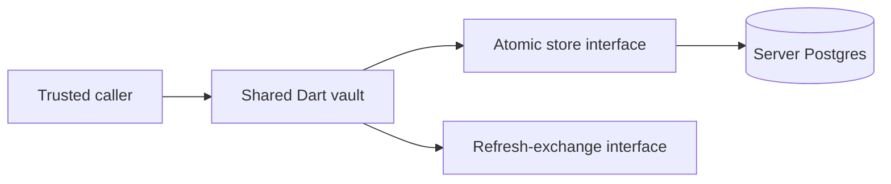
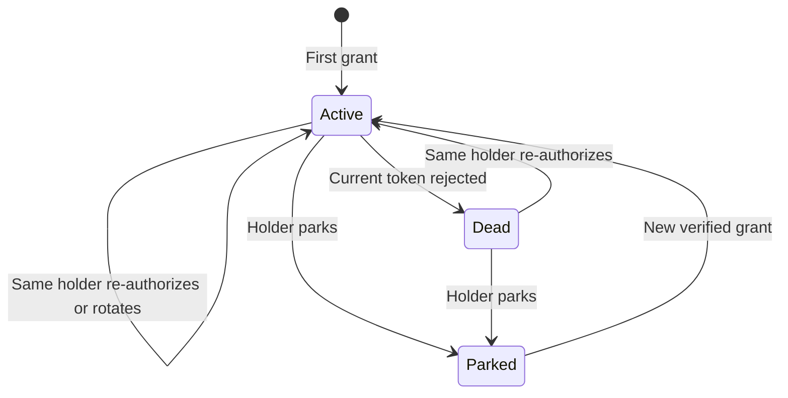
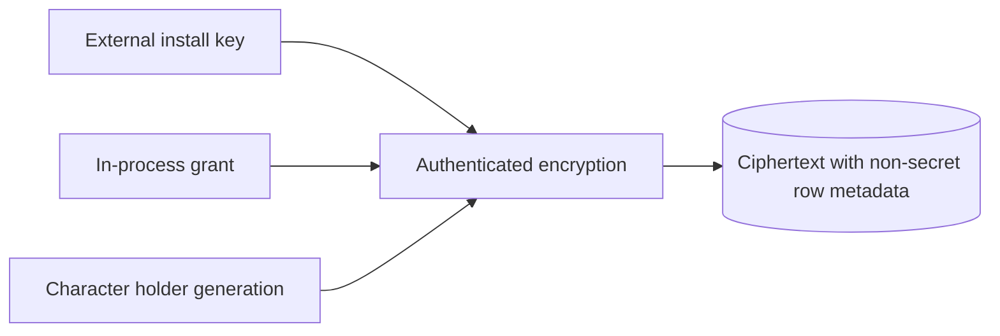

# Design

## Triage

| Trigger | Applies? | Evidence |
|---|---|---|
| T1 Components | Yes | New vault, Postgres adapter, and refresh-exchange seam. `packages/kaname_esi_scheduler/lib/src/scheduler.dart:10-34` already exposes the bearer-consumer seam. |
| T2 State | Yes | New durable holder, authorization, encrypted credential and refresh lease (ADR 0005 and 0007). |
| T3 Concurrency | Yes | Independent callers and expired refresh attempts (ADR 0007). |
| T4 Boundaries | Yes | Postgres schema, key configuration, reusable Dart interface and OAuth refresh outcomes. |
| T5 Volume | Yes | One durable record per distinct character; no history of credential versions. |
| T6 Risk | Yes | Credential disclosure and remote rotation before a local commit. |

TIER: FULL

## Context

- The scheduler consumes a caller-bound bearer callback and non-secret authorization generation; re-authorization must change that generation (`packages/kaname_esi_scheduler/lib/src/scheduler.dart:10-34`). It invokes the callback after admission, waits up to two seconds, and maps null/timeout to `invalidContext` with no ESI send (`packages/kaname_esi_scheduler/lib/src/scheduler.dart:189-211`). `esi-sso` must perform potentially slow refresh before scheduling the ESI request, then use a read-only vault bearer lookup in the callback to recheck the binding and expiry. The pre-refresh caller handles typed busy, re-login and unavailable; the callback maps a refusal to `null`. Callback timeout doesn't cancel the underlying future, but the lookup has no refresh or save to abandon. No scheduler or call-log edits here.
- The server already uses a transaction-scoped, non-waiting Postgres lock plus ORM writes (`server/kaname_server/lib/src/static_data/sweep_running_imports.dart:30-40,43-56`). The vault uses the same pattern with its own per-character namespace, not the static-data key.
- ADR 0005 assigns credentials to the server in Connected and a device in Solo; it forbids local fallback and requires parking/revocation before handoff (`docs/adr/0005-run-modes-and-one-token-holder.md:14-26`). It defers the general local store until M4 (`docs/adr/0005-run-modes-and-one-token-holder.md:31-31`). ADR 0007 supplies refresh and recovery ordering (`docs/adr/0007-esi-access-platform.md:35-40`). Worker vault access remains open (`docs/adr/0012-worker-isolate-access.md:19-19`, `docs/adr/0016-esi-scheduler-shared-state.md:16-16`). See proposal for scope.

## Decisions

### D1: Shared vault, one authoritative record

- **Choice:** Add `packages/kaname_esi_vault`, independent of Serverpod, Flutter and HTTP. The server implements its short per-character read/mutate transaction seam in `server/kaname_server/lib/src/esi/` against a server-only `.spy.yaml` table with unique character ID. Store holder kind and opaque install identifier, authorization generation, status, nullable encrypted credential, refresh fence and nullable lease deadline. The package is reusable against a native store implementing the same atomic contract; native storage, login and handoff wiring are not invoked here. The production server adapter uses a fresh internal session per transaction; no session across the exchange and no worker key-distribution rule.
- **Rejected:** An in-memory server row or per-mode vault logic: the first loses the only credential on restart, the second can drift from the exclusion/rotation rules.
- **Reversal cost:** medium. **Important:** yes (durable schema and seam). **Chosen by:** agent.

Calls through the vault are trusted in-process: an authorization handle is a holder/generation fence, not identity proof or an RPC capability. The holder/status read returns only metadata and allows a caller to observe the generation (`0` if unclaimed). Activation takes the verified character, intended holder, grant and expected generation; it succeeds for that generation when unclaimed, parked, or already owned by the same holder. Park and replacement invalidate previous handles by incrementing generation; park deletes the encrypted credential. Dead retains the holder and generation, but deletes the credential; a fresh verified grant can replace it. A stale handle cannot install, park, refresh or resolve a newer authorization. For different stores, `esi-sso` must establish which authority applies, quiesce old consumers before acknowledging park, and never switch to a locally held bearer because the authority is unreachable. The vault cannot recall a bearer already returned to a trusted caller.

### D2: Authenticated credential envelope and separate key

- **Choice:** Use the Dart `cryptography` package's XChaCha20-Poly1305 AEAD with a fresh 24-byte random nonce per seal, a versioned nonce/ciphertext/tag envelope and associated data binding the version, character, holder kind/ID and generation. The envelope contains the refresh token and any current access token/expiry; access is encrypted too so multiple vault instances can reuse one committed bearer without an unvalidated plaintext cache. Follow the existing Serverpod secret lookup pattern (`server/kaname_server/lib/src/esi/server_esi_runtime.dart:23-32`): validate canonical Base64 for exactly 32 random key bytes from `pod.getPassword('esiVaultKey')`. This separate key can be provided through Serverpod's environment or secret file. Bad/missing keys throw a fixed classification with no input attached; no automatic key or reuse of the scheduler secret.
- **Startup:** This change supplies the server factory but does not call it during server startup, so current deployments and stack CI need no vault key. Server tests inject a synthetic key via the configuration seam; they do not read `passwords.yaml`. This change documents backup and recovery; the first startup consumer wires the deployment inputs (C10).
- **Rejected:** Plain bearer caches per instance could survive parking or re-authorization; using the Serverpod service secret couples backups and exposure between unrelated purposes. An independently generated random install key is small and gives a clear recovery contract.
- **Reversal cost:** medium. **Important:** yes (stored format and operator configuration). **Chosen by:** agent.

Never pass plaintext to storage, logging, or diagnostics. Map store, cipher and refresh-port errors to an allowlisted result without forwarding an exception or trace. Trusted adapters must not log their own payloads. Open vault sessions with logging disabled (A1); SQL parameters contain metadata/ciphertext only. Missing/wrong key or invalid envelope is not a dead token. Back up the key separately from the database; restore the matching key before using a restored DB. No key rotation or fallback key list.

### D3: Short transactions, one lease and compare-and-save rotation

- **Choice:** Use a per-character PostgreSQL transaction try-lock even for a missing row. Encode positive `int64` character IDs into two signed `int4` keys by setting the sign bit of the high half and mapping the low half to signed `int4`. Use the distinct PostgreSQL advisory key space in A2, leaving the single-`bigint` static-data locks unchanged (`server/kaname_server/lib/src/static_data/static_data_lock.dart:6-17`). Commit lease acquisition and its monotonically increasing fence before sending; release the database connection while waiting. While a lease is live other refreshes and mutations get busy. Both bearer paths first take a lock-free snapshot and check holder/generation/AEAD/expiry. A read-only lookup starts no exchange; the refresh-capable path takes the try-lock only if a refresh is needed and rechecks under it. No in-process plaintext cache, heartbeat, or queue.

Acquisition and holder mutations use try-locks. Finishing an already sent exchange takes the same transaction lock with a short bounded wait, not a try-lock: even a competitor briefly checking the live lease must not cause the in-hand rotation to be discarded. A finish timeout leaves the row unconfirmed and returns unavailable without publishing the bearer.
- **Rejected:** Hold a Postgres transaction open during an upstream exchange: scarce pool slots would wait on an unrelated service and a stale-lease recovery path would have no legitimate production execution. A Redis+Postgres split would require cross-store fencing without reducing persistent state.
- **Reversal cost:** medium. **Important:** yes (concurrent credential access). **Chosen by:** agent.

The exchange seam takes the current refresh token and classifies rotated or unrotated success, definitive `invalid_grant`, and temporary failure. Success may omit a replacement refresh token; retain the one used in that case. For any success re-read under the character lock and compare the active holder/generation and plaintext refresh token against the exact token presented. If they match and this attempt still owns the fence, save the result and clear the lease. If they match but its fence was superseded, save only a genuinely different replacement refresh token, preserving the committed bearer and any current lease. This salvage changes the credential from under the newer fence, but never publishes a bearer from the obsolete attempt. If the token already changed, a response using the old token cannot overwrite it; a still-current attempt can clear only its own lease. Only definitely committed operations can release a bearer. Keep a valid rotation even if the returned bearer is unusable. Apply the dispatch safety margin in Resource Bounds when resolving and before the result is returned. No grant or raw HTTP payload is serializable to the client.

On `invalid_grant`, inspect the current committed record atomically. Refuse a superseded attempt before it can retry or mark dead. If the attempt owns the fence and the same active authorization still holds the rejected token, clear it, mark dead, and return re-login. If a late rotation changed the token, a current attempt claims a new fence and retries once with the changed token. The same comparison applies on the second rejection: mark dead only when the rejected token remains current; otherwise clear only the attempt's own lease and return unavailable without a third exchange. An expired but unsuperseded lease retains its fence until another attempt takes over. A transient upstream failure can clear only its own lease and cannot mark dead. Unknown commit outcomes return unavailable; never publish a bearer or replay a write from memory.

### Decision summary

| # | Decision | Choice | Rejected | Reversal cost | Important | Chosen by |
|---|---|---|---|---|---|---|
| S1 | Authority and handoff scope | One authoritative store; `esi-sso` wires handoff | Cross-install wiring now | medium | yes | user |
| S2 | Change boundary | Only vault lifecycle and policy | Product sign-in or call log | low | yes | user |
| D1 | Vault and owner | Shared Dart; one Postgres row | In-memory server or duplicated logic | medium | yes | agent |
| D2 | Secret handling | Authenticated envelope, dedicated Serverpod key, no startup consumer yet | Plain bearer cache or shared key | medium | yes | agent |
| D3 | Refresh concurrency | Two-key lock, expiring lease, rotation compare-and-save, admission-aware bearer margins | DB transaction over network or Redis split | medium | yes | agent |

## Assumptions

- **A1:** Serverpod's disabled session logging suppresses diagnostics from a vault session even when a database operation fails. This relies on the pinned dependency, not a tracked Kaname implementation. Verify the session API and capture server diagnostics on a forced database failure before signing off D2 and the secret-free failure requirement; storage still receives only metadata/ciphertext even if the dependency prints a raw SQL error.
- **A2:** PostgreSQL's single-`bigint` and two-`int4` advisory lock forms occupy separate key spaces. D3 depends on this. Test that a vault lock can be held while a separate transaction holds the same bits as a `bigint` advisory lock, and also hold `staticDataAdvisoryLockKey` while taking the vault lock.

## Carried constraints

- **C1:** The single-holder guarantee is scoped to one authoritative store; connected callers never use a solo fallback, and future handoff must quiesce old callers as well as park the old authorization. Kind: invariant. Destination: doc comment: `packages/kaname_esi_vault/lib/src/vault.dart` `EsiTokenVault`.
- **C2:** The scheduler key is not the vault key; no plaintext tokens or key in persisted records or diagnostics. Kind: invariant. Destination: spec: `specs/esi-token-vault/spec.md` → Requirement: Credentials are encrypted and failures are secret-free.
- **C3:** Vault policy returns re-login; `esi-sso` binds this outcome to the member's relogin and notification paths under ADR 0007. Worker access remains R56. Kind: deliberate gap. Destination: doc comment: `packages/kaname_esi_vault/lib/src/vault.dart` `EsiTokenVault`.
- **C4:** A rotation is committed before the new bearer is usable. Kind: invariant. Destination: spec: `specs/esi-token-vault/spec.md` → Requirement: Refresh is single-flight and commits before bearer use.
- **C5:** A known dead authorization is not retried. Kind: invariant. Destination: spec: `specs/esi-token-vault/spec.md` → Requirement: Resolve invalid grant from committed state.
- **C6:** The exchange adapter must finish or actually abort within its deadline below the lease duration; racing a timer and leaving the request running is forbidden. Kind: invariant. Destination: doc comment: `packages/kaname_esi_vault/lib/src/vault.dart` `VaultRefreshExchange`.
- **C7:** No key rotation or fallback key list. Kind: deliberate gap. Destination: doc comment: `server/kaname_server/lib/src/esi/server_esi_vault.dart` `createServerEsiVault`.
- **C8:** Perform slow refresh before scheduler admission and apply a refresh margin that also covers the scheduler's admission wait. The read-only check uses the shorter dispatch margin and never starts refresh inside the scheduler's two-second callback; surface typed refresh outcomes before that callback. Kind: invariant. Destination: doc comment: `packages/kaname_esi_vault/lib/src/vault.dart` `EsiTokenVault.readBearer`.
- **C9:** The vault reserves every two-`int4` PostgreSQL advisory-lock key whose first key is negative; other modules must not use that range. Kind: invariant. Destination: doc comment: `server/kaname_server/lib/src/esi/server_esi_vault.dart` `_vaultLockKey`.
- **C10:** Keep the server vault opt-in until the change that composes it at startup. When that change wires it, pass `SERVERPOD_PASSWORD_esiVaultKey` through the server's Compose environment and `.env.example`; provision canonical Base64 of 32 random bytes in local setup and stack CI. Preserve the `deploy/README.md` warning to back up this key separately and restore it with its matching DB (ADR 0007:52). Kind: deliberate gap. Destination: doc comment: `server/kaname_server/lib/src/esi/server_esi_vault.dart` `createServerEsiVault`.

## Diagrams (FULL)

T1 — modules:



T2 — durable credential state:



T3 — refresh and publication ordering:

```mermaid
sequenceDiagram
  participant A as Caller A
  participant B as Caller B
  participant S as Store
  participant U as Refresh seam
  A->>S: Acquire and commit lease
  A->>U: Present current refresh token
  B->>S: Resolve same expired credential
  S-->>B: Busy; no exchange
  U-->>A: Bearer and rotated credential
  A->>S: Fence, seal and commit
  S-->>A: Commit confirmed
  Note right of A: Only now return bearer
```

T4 — persisted vs transient data:



## State & Ownership (FULL)

| State | Owner (sole writer) | Lifetime | Invalidation / rebuild | Authoritative copy |
|---|---|---|---|---|
| Holder/status and generation | Vault mutation under the character transaction | Character history in this authority | Generation advances on park or activation; never recycle | Unique Postgres row / native adapter equivalent |
| Refresh credential and access/expiry | Vault under the character transaction; same authorization + presented token for rotation, current fence for bearer publication | Active, until replacement, park or dead | Replace envelope on successful exchange, clear on park/dead | Encrypted envelope in same row |
| Lease fence/time | Vault transition under character transaction | Until finish, supersession or expiry | Bump fence on takeover; park/re-authorize invalidate generation | Same row |
| Key | Deployment or device key provisioning | Install lifetime | Restore separate backup; wrong key fails closed | Non-database secret configuration |
| Plaintext | Vault and trusted exchange caller | Operation/current bearer lifetime only | No storage, serialization or log; discard uncommitted outcomes | None |

## Failure & Visibility (FULL)

| Component | Fails / dies mid-operation → | Recovery | Retry safe? | Who finds out |
|---|---|---|---|---|
| Key/envelope | Fixed config error or unavailable | Fix configuration / restore matching key | No exchange until authenticated decode | Operator at configuration; caller on read |
| Store transaction | Busy or unavailable; no unconfirmed bearer | Re-read committed state after contention or repair | No replay of a failed write | Caller receives typed outcome |
| Exchange seam | Temporary unavailable; no error payload | Later resolve after failure/lease expiry | Only deliberate changed-token retry inside the operation | Caller receives typed outcome |
| Process stops after rotation, before commit | Old token committed, lease eventually expires | A returning attempt may salvage its rotation without returning a bearer or releasing the live attempt's lease; after process loss, mark dead on definitive rejection if no new token committed | One changed-token retry; confirmed dead is never retried | Caller sees durable re-login requirement; `esi-sso` owns notifying |

## Resource Bounds (FULL)

| Queue / buffer / cache / transfer | Bound | At the bound | Timeout | At 10x / 100x |
|---|---|---|---|---|
| Refresh work | 32 concurrent refresh-capable calls per vault instance, one live lease per character | Return busy, no queued retry | Exchange adapter must end or abort locally within 10 s; lease 30 s from acquisition, replaced only when acquiring the one recovery attempt | Same limit; no open transaction during wire wait |
| Store | One row per distinct character, no history of previous envelopes | No automatic eviction of authority | Acquisition and holder mutations do not wait for a character lock; completion lock waits at most 5 s, with at most one waiter per in-flight refresh-capable call; DB uses existing pool timeout/configuration | PK point reads and bounded row widths; disk scales only with character count |
| Token payload | 16 KiB per token; holder ID ≤128 ASCII bytes | Refuse invalid grants; reject oversized stored data before decrypt | No unbounded body read in this module (HTTP belongs to `esi-sso`) | Same cap, no access-token memory cache |
| Bearer lifetime | Strictly more than 5 s at read-only return and more than 15 s at refresh-capable return | Read-only lookup refuses; refresh-capable lookup requests a new bearer | Pre-refresh includes up to 5 s of scheduler admission wait (`packages/kaname_esi_scheduler/lib/src/memory_state.dart:509-511`, `server/kaname_server/lib/src/esi/redis_scheduler_script.dart:246-248`) plus the read-only margin and slack; no guarantee against arbitrary process pauses | Same rule for every authorization |

A trusted exchange adapter must implement the deadline, not merely race its returned future against a timer and leave the request running. Time tests use fake UTC clocks and explicit barriers. A process pause past the lease, loss of acknowledgment, or a forward clock jump can make upstream delivery ambiguous; compare-and-save and fencing protect local state. The server runs one process per install (`docs/adr/0009-server-process-and-isolates.md:19-22`); future additional calling isolates share the same rows, but no worker is wired here.

## Flow & State Gaps (FULL)

- Two first activations collide before a row exists: the transaction lock covers the character key, and the unique character constraint is the backing invariant. After either returns busy/unavailable, caller reads authoritative metadata before retrying activation.
- Store commit acknowledgment precedes any bearer. After an unknown save, the next call may find either the old or new record; it resolves only from committed state. A failed save that loses a rotation may require re-login; no offline replay queue.
- A late success can rescue a rotation without taking over another lease, but cannot overwrite a different token or authorization, or release a bearer. A late rejected exchange cannot retry or mark dead. For example, A's lease expires; B acquires and sends the same token, A then commits its rotation without a bearer, B receives `invalid_grant`, sees the changed token under its fence and retries it. If B checks before A commits, there is no different committed token to recover; the old authorization is marked dead. Tokens already handed to callers are outside this fencing guarantee.
- If a second `invalid_grant` occurs after another actor has already changed the record, return refusal/unavailable; do not start a third exchange. Transient failure never uses the dead transition.
- No coordinated claims exist across unaffiliated offline stores; composing a Connected client with a solo bearer provider is forbidden. Future handoff ensures the previous consumer is stopped, parks it before the new install starts, and obtains its own grant instead of copying bearer/refresh material.

## Mechanism Ledger (FULL)

| Mechanism | Built? | Why (harm nobody catches / expensive later) | Evidence that would change the call |
|---|---|---|---|
| Exclusive row transitions + unique ID | Yes | First-write, re-authorization and park races could otherwise leave two holders or lose an active grant | — |
| Expiring refresh lease, compare-and-save and fencing | Yes | A crashed holder must release work; a late usable rotation can be saved without letting an old attempt overwrite a newer token or issue a bearer | — |
| Re-read and one changed-token retry | Yes | ADR 0007 recovery avoids falsely condemning the newly committed grant | — |
| Authenticated credential envelope | Yes | Prevent plaintext dumps and reject wrong key, tampering and cross-authorization copies | — |
| Persist encrypted access with rotation | Yes | Reuse after restart/concurrent vault operations without plaintext caching that can outlive authority | — |
| In-flight cap and bearer margin | Yes | Startup bursts can otherwise occupy the database pool and overwhelm upstream; the margin prevents predictable near-expiry failures before scheduler dispatch | — |
| Key rotation and history | No | Unnecessary for one install key; both would change recovery policy | Explicit operational key rotation requirement |
| Native persistence/transfer orchestration | No | M4 owns general local-store choice; no product authentication or handoff here | `esi-sso`/M4 composition |
| Notification/worker transport | No | No member-facing or worker caller in this change | First such consumer |

## Risks / Trade-offs

- Upstream rotation and Postgres commit are not atomic → acknowledge the unavoidable lost-token gap, mark credentials dead only after definitive rejection, and require re-login.
- Backing up only Postgres makes tokens unrecoverable → separate documented install-key backup; use a matching database/key pair for restore.
- Lease expiry does not prove that an old request stopped. Keep the exchange deadline below the lease; a late usable rotation can be salvaged while its input still matches. If upstream returns multiple different successful rotations for overlapping uses of the same token, the vault cannot decide which upstream token survives; it keeps the first committed rotation rather than allowing a stale overwrite, and re-login may be required.
- Only one authority can enforce its own holder record → don't claim global arbitration between unrelated stores or build it into the vault.

## ADRs

- **In force, constraining this change:** ADR 0003 (shared Dart), 0005 (run modes and holder), 0007 (encryption, refresh and dead credentials), 0012 and 0016 (worker vault access remains open).
- **To record during apply:** None; this implements the vault decisions already in ADRs 0005/0007 without settling R56.
