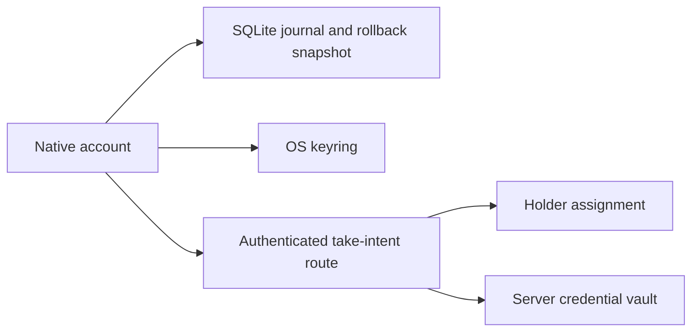
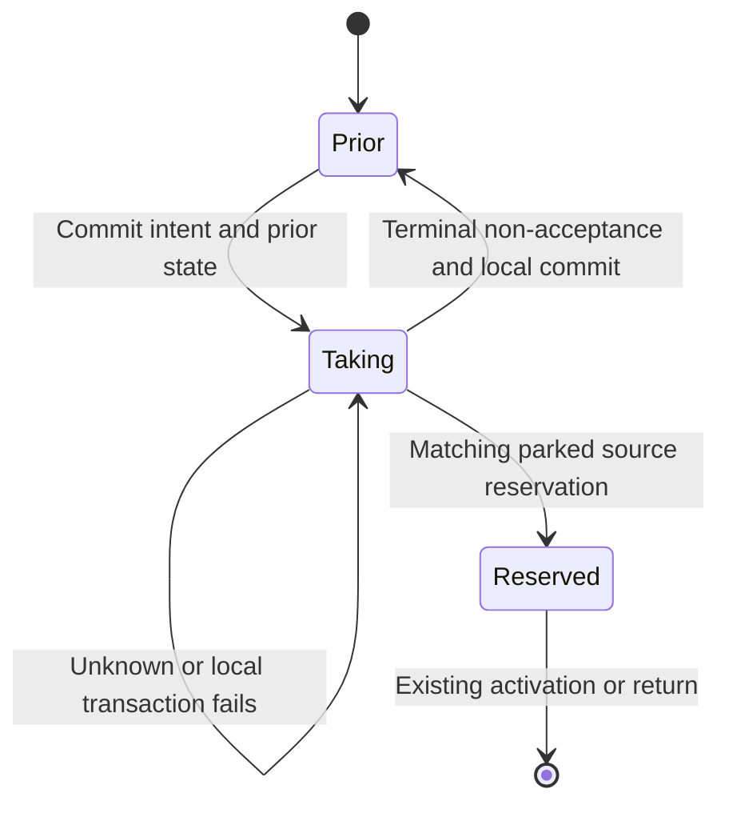
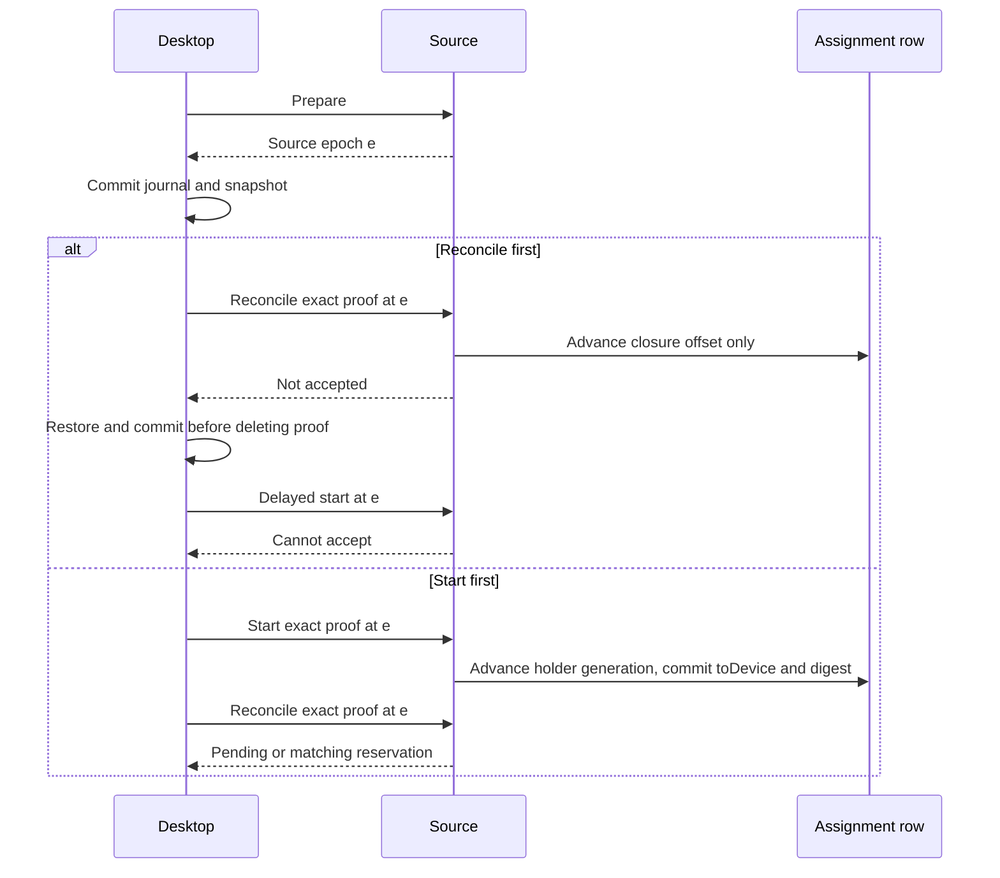
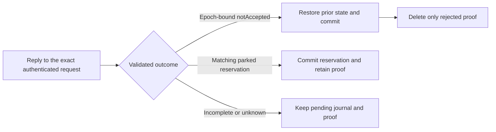

# Design

## Triage

| Trigger | Applies? | Evidence |
|---|---|---|
| T1 Components | Yes | The native operation writes SQLite, reads the keyring, and asks the source through `HolderRemote` (`app/lib/esi_sso/data/native_account.dart:279-301`, `app/lib/esi_sso/data/connected_account.dart:104-108`). |
| T2 State | Yes | `taking` persists before the request, but its rollback tuple lives only in the caller (`app/lib/esi_sso/data/native_account.dart:272,279-309`). |
| T3 Concurrency | Yes | The server gates per character and can return pending while work drains (`server/kaname_server/lib/src/esi/sso_handoff.dart:64-69,108-123`). |
| T4 Boundaries | Yes | Recovery changes the persisted journal and the authenticated handoff contract (`app/lib/esi_sso/data/device_store.dart:129-153`, `server/kaname_server/lib/src/esi/sso_route.dart:413-449`). |
| T5 Volume | Yes | Each new proof has a digest-addressed keyring entry (`app/lib/esi_sso/data/device_store.dart:272-281`). Recovery must not add an attempt history that grows with retries. |
| T6 Risk | Yes | Native activation checks the local journal and a linked proof before starting CCP authorization (`app/lib/esi_sso/data/native_account.dart:194-210`). |

TIER: FULL

## Context

See [proposal.md](proposal.md) for the user impact. `_take` saves a temporary character and changes the selection before sending the proof. Only the invocation that created the proof has the previous row and selection. Return calls `_take` again for an existing `taking` row (`app/lib/esi_sso/data/native_account.dart:272-310,333-345,520-525`). An invalid viewer and a handoff refusal currently use the same 403 (`server/kaname_server/lib/src/esi/sso_route.dart:423-448,548-555`). A refusal to a retry cannot say what the first request did.

The source accepts a fresh take by updating `serverHeld` to `toDevice`, incrementing the assignment generation, and storing the proof digest in the same compare-and-swap (CAS). It keeps that generation and digest when parking completes or the matching device releases. Server sign-in preserves the generation and proof digest of an existing assignment (`server/kaname_server/lib/src/esi/sso_handoff.dart:77-105,125-134,159-176,237-260`, `server/kaname_server/lib/src/esi/server_sso_grants.dart:197-219`). A known holder still blocks native authorization through the connected session check; linked native authorization and dispatch also check the local assignment and proof (`app/lib/esi_sso/logic/account.dart:258-268`, `app/lib/esi_sso/data/native_account.dart:194-210,439-455`).

## Decisions

### D1: Bind the intent to the source take epoch

- **Choice:** Add `POST /auth/esi/take-intent` to the existing early SSO dispatcher. Prepare accepts `{"action":"prepare"}` and responds with `200 {"sourceEpoch":"e"}` for the signed-in character's `serverHeld` assignment. It writes nothing. The `start` and `reconcile` actions each require exactly `action`, `sourceEpoch` and `proof`. All three actions use the authenticated viewer and existing origin checks, never a caller-chosen character ID. Keep the old `take`, `release` and `join` contracts (`server/kaname_server/lib/src/esi/sso_route.dart:123-171,413-449`).
- **Rejected:** Check the current holder without a take epoch. A delayed start could still accept the proof after that read. An outcome row per attempt could retain more history, but would require a retention policy for lost acknowledgments. One field on the holder row is enough to settle the common cases.
- **App interface:** `HolderRemote.prepareTake()` returns a typed epoch, legacy-server response or incomplete notice. `HolderRemote.takeIntent(proof, sourceEpoch, {required reconcile})` returns a `DeviceTakeResult`. Add a distinct exact non-acceptance subtype. Keep `DeviceTakeRefused` for legacy first-send refusal only.
- **Reversal cost:** medium.
- **Important:** yes, it defines what the wire reply proves.
- **Chosen by:** agent.

### D2: Close the intent without moving the holder

- **Choice:** The take epoch `e` is the holder's assignment generation plus a nonnegative `takeClosures` offset. Add a nullable server-only column; existing rows use zero without backfill. New and legacy acceptances advance the holder generation and replace the digest as before, so they also advance the epoch. Under the existing take gate, `reconcile` at `serverHeld` epoch `e` instead advances only `takeClosures`. Both writes check row ID, phase, holder generation and closure offset in the CAS. A valid `start` that definitively cannot proceed uses the closure CAS before confirming non-acceptance. Release, join and confidential activation do not advance the epoch or change their generation checks.
- **Rejected:** Advance the holder generation on closure. That would break lost-ack retries because `release` requires the assignment generation and a `joinStandalone` retry requires generation 1 (`server/kaname_server/lib/src/esi/sso_handoff.dart:159-176,195-203`). It would also invalidate an in-flight server sign-in (`server/kaname_server/lib/src/esi/server_sso_grants.dart:54-56,163-169`). Expanding those contracts is unnecessary for #40.
- **Reversal cost:** medium.
- **Important:** yes, the CAS is what prevents a delayed start from accepting a closed intent.
- **Chosen by:** agent.

### D3: Commit the journal with its rollback state

- **Choice:** Upgrade the desktop SQLite store from v1 to v2 in one transaction after verifying the install key. Add a companion `take_recovery` row keyed by character, with the pending digest, optional source epoch, nullable prior character snapshot and prior selection. The pending character row holds origin and registration. Write the companion, `taking` row and selection atomically after keyring write and read-back, before the first start. A null prior character in a companion means there was no prior row; a missing companion means no snapshot exists. Leave v1 pending rows untouched. On reservation, atomically replace `taking` and remove the companion; do not delete the pending proof. On terminal non-acceptance, verify the same pending row and companion, restore the prior row and applicable selection, and remove the companion in one transaction. Delete only the rejected proof after commit.
- **Rejected:** Store the rollback snapshot in memory or keyring. Memory is lost on restart. The keyring cannot commit a snapshot with the row and selection or enumerate its references from SQLite.
- **Reversal cost:** medium.
- **Important:** yes, it changes a durable format and decides when a proof stops being referenced.
- **Chosen by:** agent.

### D4: Reconcile through the existing desktop actions

- **Choice:** For a tracked intent with a source epoch, both Take and Return use `reconcile` at the saved origin for the same character and registration, using the saved epoch and proof. A matching reservation continues the existing path. After rollback, return `blocked` so Return stops without parking or releasing anything. If an older server returns the exact unknown-route response to `prepare` (404 with only `status: signInFailed`), retain the old take behavior. Its journal has no source epoch and can resume a reservation, but cannot roll back after restart. Keep the same-invocation legacy rollback on the existing exact 403. Never fall back to legacy `take` for an epoch-bound proof, even on 404. No automatic retries or new controls.
- **Rejected:** Send an extra field to the old `take` path. The current request pattern accepts extra keys (`server/kaname_server/lib/src/esi/sso_route.dart:422-427`), so a source without fencing could otherwise accept a supposedly fenced intent. A new action can never accidentally become a legacy start.
- **Reversal cost:** low.
- **Important:** yes, old and new peers may be deployed separately.
- **Chosen by:** agent.

### Decision summary

| # | Decision | Choice | Rejected | Reversal cost | Important | Chosen by |
|---|---|---|---|---|---|---|
| S1 | Interrupted takes only | Require proof about the exact intent | Clear on timeout or generic refusal | Medium | Yes | User |
| S2 | M2 follow-up | Label only | Standalone maintenance | Low | No | User |
| S3 | Pre-upgrade journals | Keep proof and existing resume path | Invent prior state | Medium | Yes | User |
| D1 | Intent identity | Authenticated proof plus source take epoch | Current-holder lookup or attempt history | Medium | Yes | Agent |
| D2 | Source ordering | CAS on holder row with an independent closure offset | Advance holder generation on closure | Medium | Yes | Agent |
| D3 | Desktop persistence | Atomic journal and rollback snapshot | In-memory or keyring snapshot | Medium | Yes | Agent |
| D4 | Resume and compatibility | Existing actions, separate versioned route | Extend the legacy request shape | Low | Yes | Agent |

## Assumptions

None.

## Carried constraints

- **C1:** Only an exact terminal result can roll back a resumed take. A timeout, authorization rejection or ambiguous assignment preserves the proof. Kind: invariant. Destination: spec: specs/esi-sso/spec.md → Requirement: The desktop restores local state after a definitively refused take
- **C2:** Start and reconcile compete on the same take epoch. An advance either stores an accepted digest or changes only the closure offset. Park, release and server activation preserve the digest and epoch. More than one advance cannot prove past non-acceptance. Kind: invariant. Destination: doc comment: server/kaname_server/lib/src/esi/sso_handoff.dart SsoHandoff
- **C3:** `taking` references the new proof. Its companion can reference a previous proof that rollback must restore. Only a committed rollback can remove the rejected proof; a reservation removes the companion, not the reservation proof. Old proofs and orphans are outside #40. Kind: invariant. Destination: doc comment: app/lib/esi_sso/data/device_store.dart DeviceStore
- **C4:** A pre-upgrade journal has no prior state. Never synthesize a companion or send an epoch-bound proof through the legacy route. Kind: deliberate gap. Destination: doc comment: app/lib/esi_sso/data/account_types.dart HolderRemote
- **C5:** Closure must not change holder generation, phase or proof digest. Lost-ack release and join retries use those fields and keep their existing behavior. Kind: invariant. Destination: doc comment: server/kaname_server/lib/src/esi/sso_holder_row.spy.yaml SsoHolderRow

## Diagrams

### Modules (T1)

### Local state (T2)

### Order at the source (T3)

### Reply interpretation (T4)

## State & Ownership

| State | Owner | Lifetime | Invalidation or rebuild | Authoritative copy |
|---|---|---|---|---|
| Pending character, snapshot and selection | `DeviceStore` inside the native operation | Across restart until reservation or rollback commits | Remove companion atomically when leaving `taking` | SQLite |
| Pending and prior proof | OS keyring, through `DeviceStore` | While referenced by live journal or snapshot | Only the rejected pending proof is deleted on successful rollback in this change | Keyring; SQLite stores digests only |
| Source epoch, holder generation, phase and accepted digest | Server holder mutations through the main-isolate character gate | Per character, across restart | Acceptance advances holder generation. Closure advances only `takeClosures`. Release and activation preserve both. | Postgres holder assignment |
| Server credential park | Existing ESI vault | Across restart | Existing park verification and fencing rules | Server vault |

## Failure & Visibility

| Failure | Recovery | Retry safe? | Who finds out |
|---|---|---|---|
| `prepare` unavailable or invalid | No local journal write. The next explicit action can prepare again. | Yes | Existing account notice |
| Source response lost after acceptance | Reconcile with the same proof and epoch. Existing park logic can finish the transfer. | Yes | Existing pending or unavailable notice |
| Source response lost after non-acceptance | Reconcile against the recorded epoch. If intervening advances make the result unknowable, retain the journal. | Yes | Existing blocked or pending notice |
| Desktop exits or SQLite rejects a restore | On reopen the last committed `taking` row still has the snapshot and proof. | Yes | Existing pending or unavailable notice |
| Desktop exits or keyring deletion fails after rollback commit | Local state is restored. The unused proof can remain in the keyring; #43 owns orphan cleanup. | No new deletion retry | Existing blocked notice |

## Resource Bounds

| Resource | Bound | At the bound | Timeout | At 10x / 100x |
|---|---|---|---|---|
| Source disambiguation | No history table. Read one assignment and use at most one extra row CAS for closure. | More than one advance leaves history unknown. `prepare` rejects an epoch that cannot be incremented. | Existing HTTP limits; no expiry used as evidence | Constant work per request and no history growth |
| Native snapshot and transitions | One companion row per pending character and one operation at a time in the runtime (`app/lib/esi_sso/data/native_account.dart:528-545`) | No second snapshot for that character; no queue | No new local timer | Storage follows the number of currently pending characters, not retry count |
| Transfer | One extra request for fresh prepare; one reconciliation request per explicit recovery. Existing 2 KiB request and 8 KiB response caps (`server/kaname_server/lib/src/esi/sso_route.dart:147-155`, `app/lib/esi_sso/data/connected_account.dart:263-271`). | Invalid input or reply conveys no authority | Existing 10-second bounds (`server/kaname_server/lib/src/esi/sso_route.dart:149-153`, `app/lib/esi_sso/data/connected_account.dart:244-253`) | No background work or retries |

## Flow & State Gaps

Generations and epochs use canonical positive decimal strings in the signed 64-bit range. Guard the sum before computing it and require `e` below the maximum. Unrepresentable epochs are ineligible for the new route. After live viewer, origin, proof shape and epoch validation, the server uses the table below. `notAccepted` is `200 {"status":"notAccepted","sourceEpoch":"e"}`. A matching parked reservation returns `200 {"sourceEpoch":"e","generation":"…","ownerFingerprint":"…"}`. The app checks the echoed epoch, positive holder generation and fingerprint format; the existing native authorization checks that fingerprint against the freshly signed owner (`app/lib/esi_sso/data/native_account.dart:160-165`). Ordinary 403s, malformed replies and 503s never produce the terminal result. The server does not echo the proof or digest.

| Assignment observed under the take gate | `start` | `reconcile` |
|---|---|---|
| `serverHeld` at `e` | Try existing admission and park flow. On a definitive pre-acceptance failure, try the same closure CAS as reconcile. Temporary uncertainty stays pending. | Advance only `takeClosures`. Return `notAccepted` after the CAS commits. |
| At `e+1`, digest matches, phase `toDevice` or `deviceReserved` | Resume park or return the existing reservation. | Same. |
| At `e+1`, digest does not match | Return `notAccepted`. The only advance took a different proof or closed the epoch. | Same. |
| At `e+1`, matching digest in a released or unexpected phase; missing row; other epoch or phase | Unknown. Do not accept, restore or expose the other holder. | Same. |

- A CAS miss or exception is not terminal. Epoch `e+1` proves exactly one advance happened, even if the first closure response was lost. At later epochs, the row cannot prove whether this exact proof was ever accepted. A closure may invalidate other starts prepared at `e`, but cannot cancel an accepted assignment. A fresh preparation reads the new epoch.
- Closure must leave a lost-ack release or join retry valid after confidential sign-in. Test both retries with a closure between sign-in and retry. Force the two start/reconcile orderings with explicit awaits or the existing dispatch barrier, and assert the assignment and vault outcome without elapsed-time checks.
- An already-admitted ESI dispatch can finish. Closure does not park it or change its vault generation; existing acceptance still waits for dispatch to drain. A grant mutation may not race the CAS in the main isolate. The design does not extend the supported source to rollback of a database, reused origin, or separate authoritative server process; ADR 0017 states the operational boundary.
- During rollback, replace the selection only if it still selects the pending character. If a prior selection referred to a different temporary row that has since been removed, clear the pending selection instead of writing a missing character ID. Preserve a newer selection of another character. Do not modify any other character row or vault data.
- A keyring write can precede an unsuccessful journal write. That creates no sent take or authority. Do not sweep that key. The migration deliberately leaves SQLite schema v2 unreadable to the old executable, which expects exactly v1 (`app/lib/esi_sso/data/device_store.dart:147-153`). This keeps older code from resending a fenced proof through legacy take.

## Mechanism Ledger

| Mechanism | Built? | Why | Evidence that would change the call |
|---|---|---|---|
| Durable prior-state snapshot | Yes | The current overwrite loses the restore point when the process exits. | A journal that leaves prior state untouched until acceptance |
| Exact epoch fence and typed outcome | Yes | A later refusal can precede or follow a committed take. The same CAS decides both orders. | An existing durable exact-intent result with replay protection |
| Full source outcome history, periodic cleanup, or time-based inference | No | The epoch fence resolves interrupted cases while the source still has definitive evidence. Lost history is not proof of non-acceptance. | A separate requirement to settle after multiple subsequent advances |
| Keyring sweep, old-journal repair, or holder reclaim | No | None can establish the missing prior state or source evidence. | Owner-approved policies for those separate issues |

## Risks / Trade-offs

Preparation costs one extra request before a fresh take. A refusal rollback restores only the authority the desktop held before the take; the holder checks still apply. A source that moved past the single-advance window may leave an intent pending rather than risk deleting the proof of an accepted take.

## ADRs

- **In force:** ADR 0005 and ADR 0017.
- **To record during apply:** none. The recovery protocol uses ADR 0017's existing holder generation and proof model.
