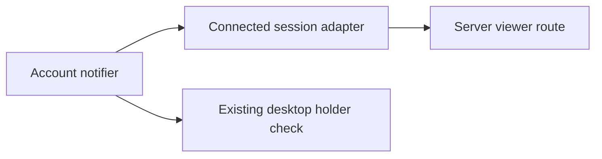
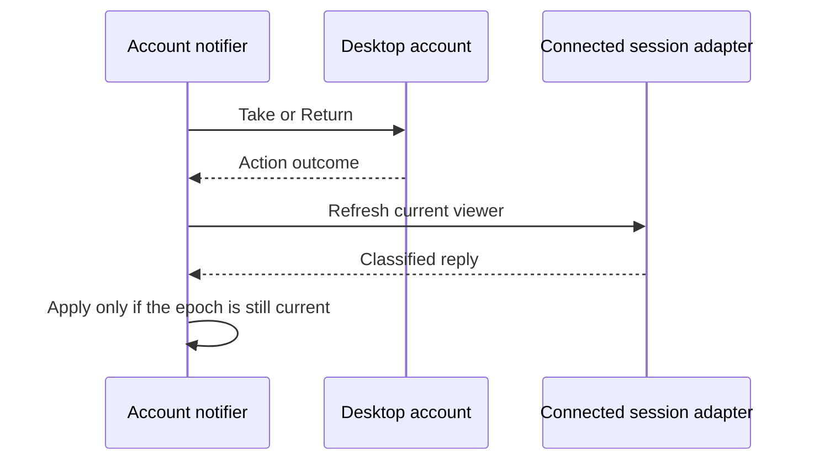
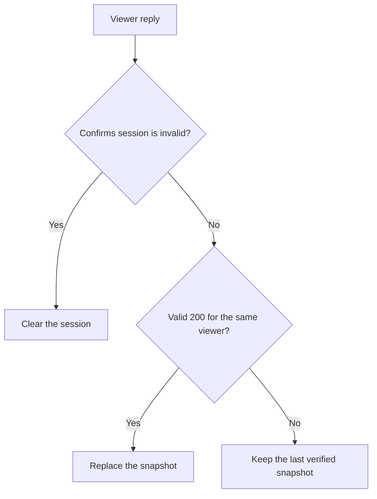

# Design

## Triage

| Trigger | Applies? | Evidence |
|---|---|---|
| T1 Components | Yes | The account notifier requests a viewer from the connected adapter, which calls the server's viewer route (`app/lib/esi_sso/logic/account.dart:305-311`, `app/lib/esi_sso/data/connected_account.dart:40-47,249-258`, `server/kaname_server/lib/src/esi/sso_route.dart:157-162`). |
| T2 State | No | Reuse the existing connected-session field and the Take and Return working-to-idle transition. Add no cache, persistent state or account state variant (`app/lib/esi_sso/logic/account.dart:13-19,305-311`). |
| T3 Concurrency | Yes | The viewer reply can arrive after sign-out or provider rebuild (`app/lib/esi_sso/logic/account.dart:97-109,192-199,305-314`). |
| T4 Boundaries | Yes | Change the app-internal `ConnectedSession.refresh` result and when the viewer route uses its existing 401 and 503 replies (`app/lib/esi_sso/data/connected_account.dart:40-47`, `server/kaname_server/lib/src/esi/sso_route.dart:169-171,363-380,548-555`). |
| T5 Volume | No | Each operation reads one already bounded viewer reply (`app/lib/esi_sso/logic/account.dart:305-311`, `app/lib/esi_sso/data/connected_account.dart:263-271`). |
| T6 Risk | Yes | The presence of a holder for the same character determines whether native authorization needs a matching reservation (`app/lib/esi_sso/logic/account.dart:258-268`). |

TIER: FULL

## Context

See [proposal.md](proposal.md). `ConnectedSession.refresh` returns `null` whenever the viewer reply is not a parseable 200. `_desktop` writes that result directly into `AccountIdle.connected` after Take or Return, so `authorizeDesktop` can no longer apply the same-character holder check (`app/lib/esi_sso/data/connected_account.dart:40-47`, `app/lib/esi_sso/logic/account.dart:258-289,305-311`). Scoped completion also interprets a null refresh as sign-out. Initial sign-in instead reports unavailable if the new bearer lacks a verified viewer (`app/lib/esi_sso/data/connected_account.dart:219-235`, `app/lib/esi_sso/logic/account.dart:165-176`).

The viewer route sends `401 {"status":"signInRequired"}` when a bearer is missing or the lookup returns null. The lookup returns null for invalid sessions and also catches lookup exceptions and returns null, so those exceptions send the same 401 (`server/kaname_server/lib/src/esi/sso_route.dart:363-374,548-555`, `server/kaname_server/lib/src/esi/sso_sessions.dart:83-101`). Exceptions that reach route dispatch instead map to the fixed 503 (`server/kaname_server/lib/src/esi/sso_route.dart:157-171,548-555`).

On success the viewer sends the member ID, character ID, name and admin flag. It includes `holder` only when an assignment has a phase (`server/kaname_server/lib/src/esi/sso_route.dart:374-380`). The generic pilot parser treats a non-string holder like an omitted holder (`app/lib/esi_sso/data/account_types.dart:29-46`). Only an omitted holder in a valid viewer reply establishes that there is no assignment.

Take maps an HTTP 401 to an incomplete action with a `signedOut` notice and the native account passes that notice through (`app/lib/esi_sso/data/connected_account.dart:121-126,149-157`, `app/lib/esi_sso/data/native_account.dart:312-313`). That notice does not prove that the viewer route rejected the session.

## Decisions

### D1: Classify the reply in the connected adapter

- **Choice:** Use a sealed result with updated, invalid-session and unavailable cases. Only the route's fixed 401 reply confirms an invalid session. A 200 must contain a parseable pilot for the same member and character. A present holder must be a nonempty string; an omitted holder means no assignment. Treat any nonempty holder phase as an assignment for the desktop check, even if the client does not display that phase. All other replies are unavailable. Keep the checks local to `refresh`.
- **Rejected:** Classify by HTTP status alone or let the notifier inspect JSON. A proxy's generic 401 is not Kaname's sign-out reply, and a malformed holder field is not evidence of no assignment.
- **Reversal cost:** Low.
- **Important:** Yes, the distinction controls whether the app keeps a holder restriction in effect.
- **Chosen by:** agent. The owner delegated internal design choices.

### D2: Reuse the current session snapshot until it can be replaced

- **Choice:** The notifier installs an updated session, clears it on confirmed invalidation, and keeps the same session object on an inconclusive refresh. Continue using the existing epoch checks before and after awaiting the refresh. If the refresh keeps or replaces the session, preserve the Take or Return notice except that `signedOut` becomes `unavailable`. Only the viewer's confirmed invalidation produces the signed-out state and notice in this path. Scoped completion keeps its established viewer on unavailable; initial sign-in still requires a verified viewer and otherwise reports unavailable.
- **Rejected:** Introduce a separate holder cache or change native handoff recovery. A second copy would require its own lifetime rules and could protect the wrong origin or character. Journal recovery cannot restore the connected viewer.
- **Reversal cost:** Low.
- **Important:** Yes, changes what a user sees after a failed refresh.
- **Chosen by:** agent. The owner delegated internal design choices.

### D3: Propagate lookup errors only for the viewer route

- **Choice:** Put the existing lookup in `SsoSessions.viewerForRefresh`, which returns null for invalid sessions and lets lookup errors propagate. Existing `viewer` callers retain their current catch-and-return-null behavior by calling that lookup inside the same exception guard. Only `SsoRoute._viewer` calls the throwing lookup directly. Route dispatch already maps escaped errors to a fixed 503.
- **Rejected:** Remove the exception guard for all session consumers, or add a new wire error format. The first changes other auth routes; the second duplicates the existing unavailable reply.
- **Reversal cost:** Low.
- **Important:** Yes, changes how the viewer route reports a temporary failure without changing other routes.
- **Chosen by:** agent. The owner authorized S3 and delegated the mechanism.

### Decision summary

| # | Decision | Choice | Rejected | Reversal cost | Important | Chosen by |
|---|---|---|---|---|---|---|
| S1 | Viewer-refresh failures only | Preserve holder evidence on uncertainty | Clear on every failure or rely on the journal | Low | Yes | User |
| S2 | M2 follow-up | Label the proposal, no manual gate | Standalone maintenance or a new manual check | Low | No | User |
| S3 | Viewer lookup errors | Send the existing 503 from the viewer route only | Leave indistinguishable failures for a follow-up | Low | Yes | User |
| D1 | Reply classification | Typed result grounded in the viewer contract | Status only or JSON in the notifier | Low | Yes | Agent |
| D2 | Snapshot lifetime | Keep one current session snapshot | A separate holder cache or native recovery | Low | Yes | Agent |
| D3 | Server lookup errors | Share the lookup; preserve existing exception handling for other consumers | Change all callers or the wire format | Low | Yes | Agent |

## Assumptions

None.

## Carried constraints

- **C1:** Inconclusive refreshes keep the last verified holder for the same session. They do not authorize the desktop, and a signed-out session cannot be restored by a late reply. Kind: invariant. Destination: spec: specs/esi-sso/spec.md → Requirement: An inconclusive viewer refresh preserves the last known holder
- **C2:** Only the viewer route's fixed invalid-session reply clears the session through refresh. A valid viewer may omit holder, but a malformed holder field cannot establish that there is no holder. Kind: invariant. Destination: doc comment: app/lib/esi_sso/data/connected_account.dart ConnectedSession.refresh
- **C3:** The viewer route reports lookup errors as unavailable, not invalid-session. Its lookup reports null only for invalid sessions; other consumers retain their existing failure handling. Kind: invariant. Destination: doc comment: server/kaname_server/lib/src/esi/sso_sessions.dart SsoSessions.viewerForRefresh

## Diagrams

### Callers and ownership (T1)

### Ordering (T3)

### Viewer result (T4)

## State & Ownership

| State | Owner | Lifetime | Invalidation or rebuild | Authoritative copy |
|---|---|---|---|---|
| Connected viewer and holder snapshot | `AccountNotifier` publishes the immutable session | Current connected app session, in memory only | Verified replacement, invalid session, sign-out or configured-target rebuild (`app/lib/esi_sso/logic/account.dart:97-109,192-207`) | The server owns actual holder authority; the app uses the last verified snapshot for the existing check |
| In-flight refresh and epoch | `AccountNotifier` | One account action | Ignore its result after an epoch change or disposal (`app/lib/esi_sso/logic/account.dart:305-314`) | The notifier's current epoch |

## Failure & Visibility

| Component | Failure | Recovery | Retry safe? | Who finds out |
|---|---|---|---|---|
| Viewer route or transport | A session lookup throws, the server is unreachable, or the reply cannot establish viewer state | The route emits the fixed 503 for a lookup error. The app keeps the existing snapshot and applies a later verified reply. | The viewer read is safe to repeat. Add no automatic retry and do not replay Take or Return automatically. | The user still sees the holder. The notifier keeps the action notice unless it would wrongly report sign-out. Scoped completion uses the existing unavailable notice. |
| Viewer route | Fixed invalid-session reply | Clear the connected session and require sign-in | A retry with the invalid bearer cannot recover authority | The user sees the signed-out state and notice |
| Notifier | Sign-out or target change overtakes the reply | Drop the late result | A later action must use the new session and epoch | The user sees the signed-out or new-target state |

## Resource Bounds

| Resource | Bound | At the bound | Timeout | At 10x / 100x |
|---|---|---|---|---|
| Viewer request and response bytes | One refresh per Take or Return, at most 8 KiB per HTTP reply (`app/lib/esi_sso/logic/account.dart:305-311`, `app/lib/esi_sso/data/connected_account.dart:263-271`) | Existing request adapter rejects an oversized reply | Existing 10-second abort (`app/lib/esi_sso/data/connected_account.dart:244-253`) | Same per-request limits; no new queue, retries or history |
| Retained state | One session | A verified refresh replaces it | No new timer | Same per-app limit |

## Flow & State Gaps

- A Take or Return can finish before the viewer read fails. A refresh result only changes the connected view; it does not undo or replay the action.
- A late refresh cannot reattach a session after sign-out or a configured-target rebuild. Neither restart nor switching servers carries the snapshot forward.
- Test the notifier through the real Take and Return methods with scripted HTTP replies and the native fixtures in `app/test/esi_sso/native_sso_test.dart` (`_TakeDevice`, `_TakeServer`). A refused Take restores an identified character with no reservation. A Return case also starts without a matching reservation. Test a transport exception, fixed 503, generic 401, non-JSON 200, a non-string or null holder, and a mismatched member or character. Assert the connected viewer and holder remain, `authorizeDesktop` reports `blocked`, and `nativeRequests` stays zero. Test the action's own 401 with an inconclusive refresh for the notice rule.
- For a verified replacement, check that a new holder still blocks and that a verified viewer with no holder lets native authorization start for an eligible unlinked character. A fixed 401 clears the session and shows `signedOut`. Hold a successful response across manual sign-out with a completer; the response cannot restore the session. Test scoped completion's interpretation of unavailability through the connected adapter without reopening or replaying the browser attempt.
- Exercise `/auth/esi/viewer` through `server/kaname_server/test/integration/esi/connected_sso_test.dart`. Sign in, then throw a synthetic `Exception` from the existing `SsoSessions` clock callback at the start of the session lookup (`server/kaname_server/lib/src/esi/sso_sessions.dart:83-90`, `server/kaname_server/test/integration/esi/connected_sso_test.dart:130-135`). Assert fixed 503 during the fault, successful viewer recovery with the same bearer after the fault, and fixed 401 after definite invalidation. Use boolean payload assertions so failure output cannot expose a credential or injected error detail.

## Mechanism Ledger

| Mechanism | Built? | Reason | Evidence that would change the call |
|---|---|---|---|
| Typed refresh result and response validation | Yes | A null or unusable 200 currently removes the evidence used by the desktop check. | A trusted viewer protocol that makes invalidation and holder absence unambiguous at another layer |
| Viewer-specific error propagation | Yes | The fixed 401 returned after a lookup exception otherwise tells the app to discard the viewer even though the server could not check the session. | Other session consumers need the distinction in a separate change |
| Additional cache, retry or native journal change | No | The established session and epoch already define the required lifetime and ordering. | A separate owner-approved requirement for cross-session holder history or a new refresh trigger |

## Risks / Trade-offs

A stale holder can keep the desktop check blocking until the app receives a valid update. That is safer than allowing missing information to remove a known restriction. The app does not use a cached holder snapshot as proof that parking occurred.

An upgraded client cannot distinguish the old server's false 401 from a confirmed invalid session. The server half of this fix is necessary at deployments that run the affected viewer route.

## ADRs

- **In force:** [ADR 0005](../../../docs/adr/0005-run-modes-and-one-token-holder.md), [ADR 0010](../../../docs/adr/0010-flutter-app-state.md) and [ADR 0017](../../../docs/adr/0017-esi-holder-handoff.md).
- **To record during apply:** none.
