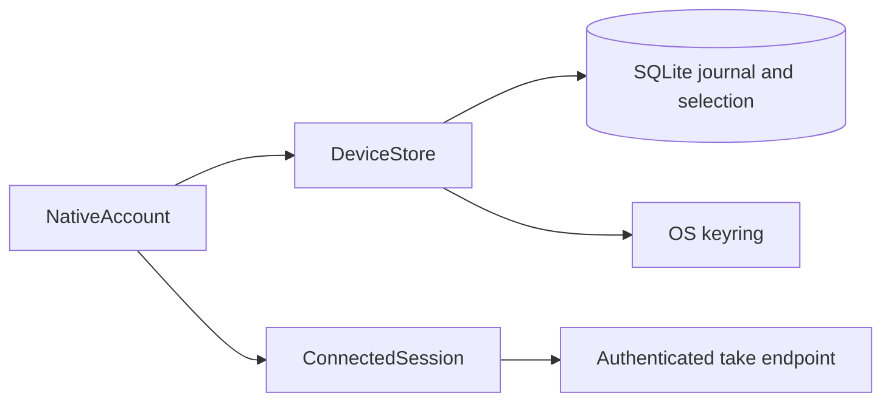
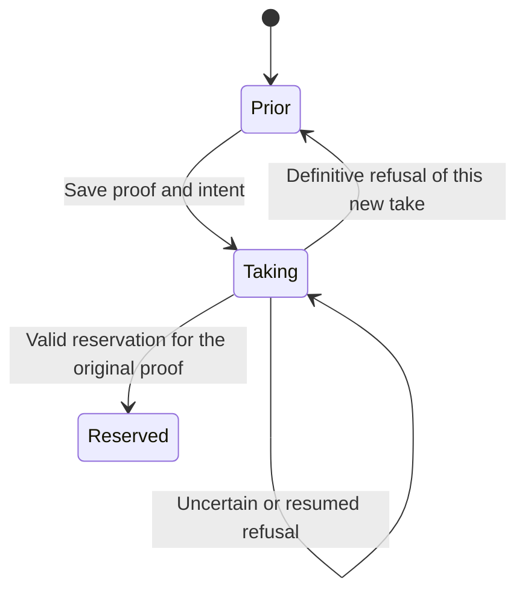
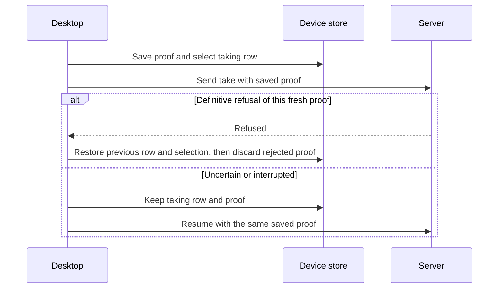
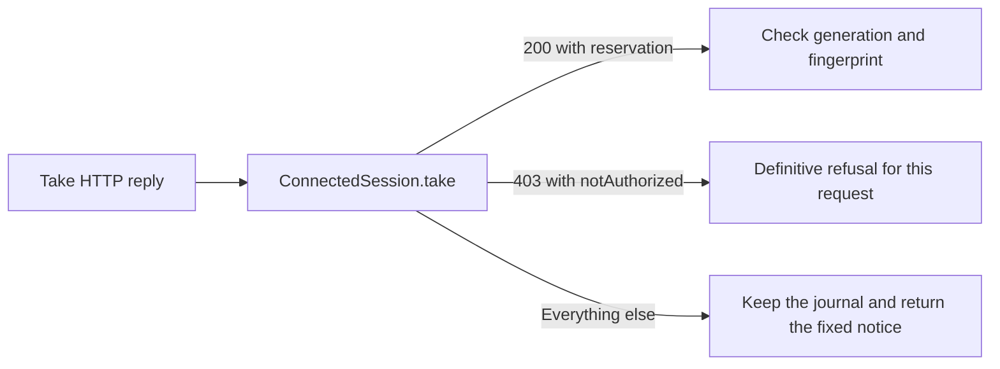

# Design

## Triage

| Trigger | Applies? | Evidence |
|---|---|---|
| T1 Components | Yes | The desktop saves a journal and sends the proof through a remote adapter (`app/lib/esi_sso/data/native_account.dart:278-299`, `app/lib/esi_sso/data/connected_account.dart:104-108`). |
| T2 State | Yes | The desktop persists `taking` before it can receive a reservation (`app/lib/esi_sso/data/native_account.dart:278-314`). |
| T3 Concurrency | Yes | The server serializes per character and can reply while a transition is pending (`server/kaname_server/lib/src/esi/sso_handoff.dart:54-63,83-110`). |
| T4 Boundaries | Yes | The change distinguishes a refusal at the HTTP adapter and changes the app-internal `HolderRemote.take` result (`app/lib/esi_sso/data/account_types.dart:97-98`, `app/lib/esi_sso/data/connected_account.dart:104-125`). |
| T5 Volume | Yes | Starting takes allocates keyring entries named by random proof digest (`app/lib/esi_sso/data/device_store.dart:228-237`). |
| T6 Risk | Yes | Native activation for a linked character requires an assignment and proof (`app/lib/esi_sso/data/native_account.dart:194-210`). |

TIER: FULL

## Context

See [proposal.md](proposal.md) for the user impact. `_take` overwrites the character row and selection before the RPC. A response without a reservation returns straight to the caller (`app/lib/esi_sso/data/native_account.dart:278-299,504-507`). `_take` also runs when Return sees `taking` (`app/lib/esi_sso/data/native_account.dart:318-329`).

The current HTTP adapter uses the same `blocked` notice for every 403 and has no way to tell its caller whether the server definitively refused the request (`app/lib/esi_sso/data/connected_account.dart:104-125,148-154`). The take route returns `403 {"status":"notAuthorized"}` for a blocked result (`server/kaname_server/lib/src/esi/sso_route.dart:422-449,548-555`). An access rejection before handoff does not execute the take. In the take operation itself, all `blocked` paths precede the first write of this proof's assignment or reject a different proof. Once the server advances this proof to `toDevice`, it returns pending or a reservation, or an exception escapes (`server/kaname_server/lib/src/esi/sso_handoff.dart:54-128`). A subsequent request rejected by auth does not prove an earlier request made no change.

While the app holds a connected session for the same character whose viewer reports a holder, `authorizeDesktop` blocks native authorization without a confirmed local reservation (`app/lib/esi_sso/logic/account.dart:258-269`). The take action refreshes that session afterward and drops it if the refresh fails (`app/lib/esi_sso/logic/account.dart:276-281,309-311`, `app/lib/esi_sso/data/connected_account.dart:40-47`). Without that session, a restored unlinked row has exactly the authority it had before the take, as ADR 0017 accepts for an installation that has not joined the protocol. Native PKCE activation and dispatch have their own checks for a linked row (`app/lib/esi_sso/data/native_account.dart:194-210,423-440`). Restoring the exact prior state must not fabricate an assignment, a grant, or any permission the desktop did not have before the take.

## Decisions

### D1: Preserve the take outcome at the adapter

- **Choice:** Represent reservation, definitive refusal, and incomplete outcome separately in `HolderRemote.take`. Only a `403` with the parsed body `{"status":"notAuthorized"}` and no extra keys is a definitive refusal for this request. Keep the existing notice for every non-reservation response. Do not map a generic or malformed 403, 401, 202, transport error, server error, or invalid success to definitive refusal. Use the existing endpoint contract.
- **Rejected:** Branch on the presentation notice alone. Generic `blocked` gives no evidence that the take route refused the proof. A new HTTP response field would duplicate the fixed refusal the server already returns and make a safe fresh refusal depend on a server upgrade.
- **Reversal cost:** low.
- **Important:** yes, the adapter classification controls disposal of a handoff proof.
- **Chosen by:** agent.

### D2: Roll back only a take started by this invocation

- **Choice:** Before replacing a row, keep the prior row and exact selection setting in memory. Leave the current durable write-before-send order. On an explicit refusal in the invocation that minted the proof, restore the prior row or delete the new row, and restore the prior setting or delete it if absent. Commit both SQLite changes in a single transaction. After that commit, remove only the rejected proof's digest-addressed keyring entry. If the call reused a journal, never roll it back from a refusal to a later request. This adds `delete(String name)` to `DeviceSecrets` (`app/lib/esi_sso/data/device_store.dart:12-18`), implemented by the OS keyring adapter (`app/lib/esi_sso/data/desktop_platform_io.dart:41-51`) and the test keyring. It also adds one `DeviceStore` method that restores or deletes the character row and the `selected-character` setting in a single SQLite transaction. The store has no such transaction or setting deletion today (`app/lib/esi_sso/data/device_store.dart:167-226`).
- **Rejected:** Clear every `taking` row when a retry returns a refusal. An earlier request may have reserved the holder even if the retry's session is denied. Persisting a second snapshot alone does not prove otherwise.
- **Reversal cost:** medium.
- **Important:** yes, changes the desktop state visible after a refusal.
- **Chosen by:** agent.

### Decision summary

| # | Decision | Choice | Rejected | Reversal cost | Important | Chosen by |
|---|---|---|---|---|---|---|
| S1 | Refused new takes only | Restore on definitive refusal; preserve uncertain intent | Clear all failures or change the holder gate | Medium | Yes | User |
| S2 | M2 follow-up | Label only | Standalone maintenance | Low | No | User |
| D1 | Adapter outcome | Match the existing HTTP code and fixed refusal body | Classify from UI notice or change the wire format | Low | Yes | Agent |
| D2 | Rollback boundary | Restore the prior row and selection only for the just-created proof | Clear the journal on a refused retry | Medium | Yes | Agent |

## Assumptions

None.

## Carried constraints

- **C1:** A fresh definitive refusal lets the desktop restore the previous state; uncertainty alone never grants authority or permits it to discard the proof. Kind: invariant. Destination: spec: specs/esi-sso/spec.md → Requirement: The desktop restores local state after a definitively refused take
- **C2:** A refusal to a resumed request may be an authentication rejection after the original request committed. Never use that refusal to discard the journal. Kind: rejected alternative. Destination: doc comment: app/lib/esi_sso/data/account_types.dart HolderRemote.take
- **C3:** `SsoHandoff.take` returns `blocked` only before it writes the caller's proof digest or when the assignment holds a different digest. The take route maps an escaped exception to 503, never 403. The desktop deletes a fresh proof on that basis. Kind: invariant. Destination: doc comment: server/kaname_server/lib/src/esi/sso_handoff.dart SsoHandoff.take

## Diagrams

### Modules (T1)

### Journal (T2)

### Ordering (T3)

### Response interpretation (T4)

## State & Ownership

| State | Owner | Lifetime | Invalidation or rebuild | Authoritative copy |
|---|---|---|---|---|
| Prior row and selection | Native account operation | One fresh take | Drop when the invocation completes; never reconstruct on retry | In-memory values read before the journal write |
| Character phase, selected character and proof digest | Desktop through `DeviceStore` | Durable across restart | Existing transitions; one transaction for refusal rollback | SQLite |
| Proof | `DeviceStore` | Until the handoff no longer needs it | Delete only this fresh rejected proof after the database commit; retain every referenced proof | OS keyring |
| Assignment and park | Server handoff and vault | Durable across requests | Existing server transitions | Server assignment and vault |

## Failure & Visibility

| Component | Failure | Recovery | Retry safe? | Who finds out |
|---|---|---|---|---|
| Connected adapter | No response, unrecognized error, or invalid reservation | Leave `taking` and resume manually | Yes, reuse the proof | Existing account notice |
| Desktop transaction | Restore fails or the process dies before it commits | Keep the `taking` row and proof | Yes, reuse the proof | An open desktop can report `unavailable`; restart shows the pending journal |
| Keyring cleanup | Interruption or failure after SQLite commits | A rejected proof can remain unreferenced; never recover authority from it | No cleanup retry in this change | The user still sees the definitive refusal |
| Server | The server reserves the holder but the reply is lost | Retry with the same proof; only the matching reservation authorizes further work | Yes, subject to the existing source-origin and registration checks | Existing account notice and holder state |

## Resource Bounds

| Resource | Bound | At the bound | Timeout | At 10x / 100x |
|---|---|---|---|---|
| Desktop take and prior snapshot | One operation per native runtime (`app/lib/esi_sso/data/native_account.dart:509-527`); one row and one selection per fresh take | Return the existing busy notice | No new deadline | No queue or repeated copies |
| HTTP response | 8 KiB (`app/lib/esi_sso/data/connected_account.dart:255-268`) | Treat as incomplete | Existing 10s request abort (`app/lib/esi_sso/data/connected_account.dart:241-250`) | Same per-request cap |
| Rejected proofs | One addition before each take, one removal after each successful rollback | Cleanup is limited to the proof named by the rejected intent | No new timer | Ordinary refusals do not accumulate keys; OS or process failures during cleanup may leave unreferenced entries as with interruption of a proof write |

## Flow & State Gaps

- Neither response loss nor rejection of a later retry can roll back a previously written journal. A valid reservation can still complete that journal after restart.
- Run the synchronous restore transaction inside the serialized native operation, outside any vault update. `_one` excludes overlapping native operations, and the existing vault transaction starts only when `withCharacter` is called (`app/lib/esi_sso/data/native_account.dart:509-527`, `app/lib/esi_sso/data/device_store.dart:278-310`).
- Capture the snapshot only in the branch that writes a new intent. If an existing selected character differs from the target, restore its selection without changing its row. No preexisting row means rollback deletes only the target's temporary row.
- Rollback is local. Return must not send a take for the restored row however the server holder view refreshes. Existing origin, character, generation, proof, park, and native grant checks stay in place.
- If the process dies after receiving a definitive reply but before recording the rollback, the next process cannot distinguish that case from a lost reply. It stays pending rather than discarding the proof.

## Mechanism Ledger

| Mechanism | Built? | Reason | Evidence that would change the call |
|---|---|---|---|
| Explicit adapter outcome and same-invocation guard | Yes | The current null result leaves a refused intent in place. Clearing all failed results can lose the proof of a live reservation. | A protocol that proves no prior request for the exact proof committed |
| Atomic local restore | Yes | The prior row and selection must survive a process interruption as a pair. | A store that keeps the selection and character state in one atomic item |
| Exact rejected-proof cleanup | Yes | Repeated definitive refusals otherwise create keyring entries indefinitely. | A keyring implementation that allocates no new slot for each take |
| Durable prior-state snapshot, after-restart discard, or keyring sweep | No | Only the first response establishes safe rollback here. An open-ended sweep is unrelated to this fix. | A need to recover a refusal across process loss with proof of the earlier outcome |

## Risks / Trade-offs

The desktop must not mistake rejection for permission to activate. Rollback adds no authority beyond the pre-take row. The connected-session check applies only under the conditions in Context, and the local checks for an already linked character are unchanged.

## ADRs

- **In force:** ADR 0005 and ADR 0017.
- **To record during apply:** none.
