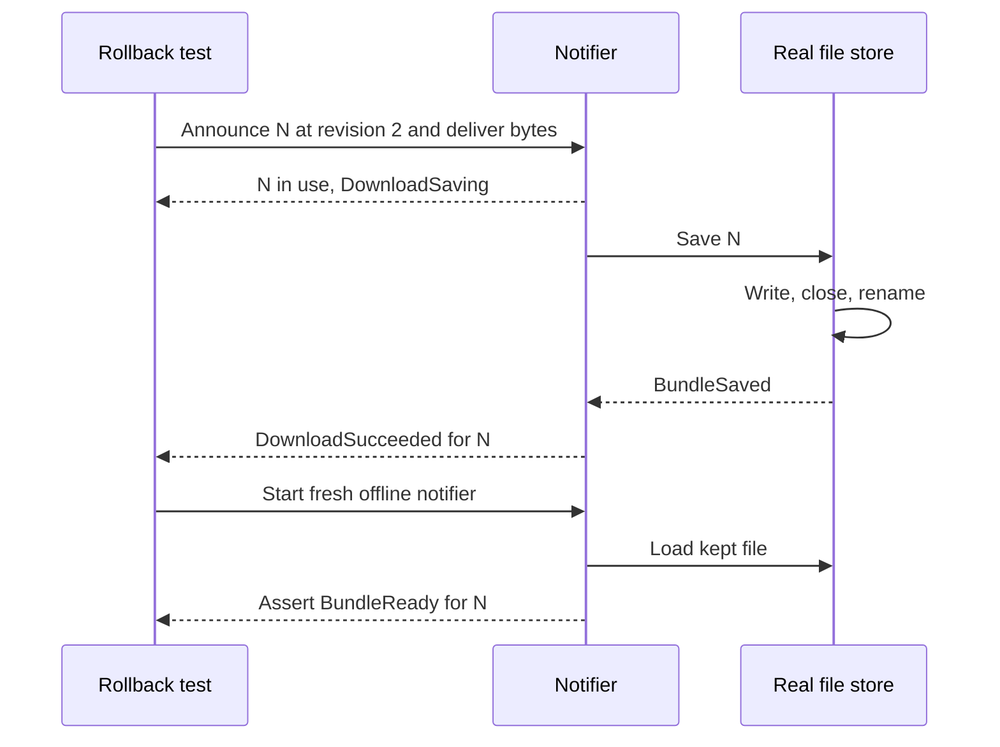

# Design

## Triage

| Trigger | Applies? | Evidence |
|---|---|---|
| T1 Components | No | Reuse the notifier test's existing store injection (`app/test/static_data/static_data_notifier_test.dart:68-80`) and the real store's pre-rename hook (`app/lib/static_data/data/file_bundle_store.dart:98-107`). No new production component. |
| T2 State | No | The persisted file and notifier state remain unchanged. The test observes the existing pending and terminal save outcomes (`app/lib/static_data/logic/static_data_sync.dart:431-442,469-476`). |
| T3 Concurrency | Yes | The test changes how it orders notifier startup, asynchronous save and restart. Another test deliberately overlaps stale-file cleanup with a paused save (`app/lib/static_data/logic/static_data_sync.dart:123-126,437-445`; `app/test/static_data/file_bundle_store_test.dart:189-219`). |
| T4 Boundaries | No | Keep the existing real filesystem and `BundleStore` interface (`app/lib/static_data/data/bundle_store.dart:124-141`). No change to a boundary or its contract. |
| T5 Volume | No | The tests use fixed fixture bundles and up to two paused saves (`app/test/static_data/static_data_notifier_test.dart:131-134`; `app/test/static_data/file_bundle_store_test.dart:157-181`). |
| T6 Risk | No | The changes touch isolated test directories, not user data (`app/test/static_data/static_data_notifier_test.dart:529-538`; `app/test/static_data/file_bundle_store_test.dart:37-46`). |

TIER: FULL

## Context

See [proposal.md](proposal.md) for scope and CI evidence. The rollback test polls the kept file and starts an offline notifier even if none of the reads found build N (`app/test/static_data/static_data_notifier_test.dart:612-629`). `BundleReady` with `updating: false` can precede persistence: the swap clears the current attempt, publishes `DownloadSaving` and starts the save separately (`app/lib/static_data/logic/static_data_sync.dart:431-445,503-511`). The truncated-file test sleeps after subscription, then probes file length during replacement (`app/test/static_data/static_data_notifier_test.dart:563-589`). Subscription starts before the kept-file load, so the subscription count does not indicate load completion (`app/lib/static_data/logic/static_data_sync.dart:119-126`).

The file-store suite polls for the opener and pre-rename stage (`app/test/static_data/file_bundle_store_test.dart:73-78,141-145,162-181,194-203`). The opener already has a controllable hold (`app/test/static_data/support/bundle_fixture.dart:73-94`). The store awaits temporary-file close before `beforeRename` and completes `BundleSaved` after rename (`app/lib/static_data/data/file_bundle_store.dart:102-107,138-149`).

## Decisions

### D1: Observe notifier outcomes

- **Choice:** Use a test-local provider listener that sees the current state and subsequent states. For rollback and offline restart, wait for `BundleReady` before asserting its identity. Announce N+1 at revision 1 before announcing N at revision 2; assert that the matching first announcement starts no download. For the truncated file, keep the replacement as the first announcement. Wait for `NoBundle` with reason `Downloading`. The notifier defers announcements until the kept load settles and starts the transfer before publishing that state (`app/lib/static_data/logic/static_data_sync.dart:182-190,251-268,293-299,330-348,539-549`). Assert the recorded transfer identity and that the truncated file is unchanged before supplying bytes. For both saves, wait for a terminal download result, assert `DownloadSucceeded` for the requested build and check the ready identity. Only then read the replaced file or start offline. `DownloadNotSaved` and `DownloadFailed` must fail the assertion rather than wait out the test timeout.
- **Rejected:** Inspect the disk to infer when the notifier has saved or add a completion API to production. Probing can race Windows rename; the existing terminal outcome already names the result (`app/lib/static_data/logic/static_data_sync.dart:459-476`).
- **Reversal cost:** low.
- **Important:** no. This changes how tests observe existing states, not those states or their contract.
- **Chosen by:** agent

### D2: Pause at the actual file stages

- **Choice:** Signal the existing fake opener's first held open and use the real store's `beforeRename` hook to signal each save's pause. Use a fixed injected `now` and set every temporary-file timestamp used in a stale or recent assertion relative to that clock. This includes the temporary file that the suspended-save test expects another store to remove. Keep the assertions that a rejection never removes a concurrent replacement, an interrupted save leaves the old bundle readable, cleanup removes only old temporaries and a suspended save recovers when its temporary disappears. Release held operations and await their futures even if an assertion fails. Resume the two paused writers in order so cleanup does not start competing renames. Each writer has its own store and hook. The hook signals and pauses only on its first call; later calls return at once, because writer 1 rewrites its removed temporary file and calls `beforeRename` again (`app/lib/static_data/data/file_bundle_store.dart:99-117`). After the interrupted-save assertions, release writer 1 and assert `BundleSaved`, then release writer 2 and assert `BundleSaved`. Use one outer test timeout as a hang guard, without stage-level timeouts or retries.
- **Rejected:** Simulate the file operations with an in-memory store or replace the polls with longer deadlines. Neither proves that the native store keeps and replaces the correct files without depending on runner speed.
- **Reversal cost:** low.
- **Important:** no. The change is limited to test fixtures and test orchestration.
- **Chosen by:** agent

### Decision summary

| # | Decision | Choice | Rejected | Reversal cost | Important | Chosen by |
|---|---|---|---|---|---|---|
| S1 | First PR scope | Two notifier tests, nearby file-store polling and all ten rules | Notifier tests and rules only | low | no | user |
| D1 | Observe notifier outcomes | Listen to state and assert save success before disk reads or restart | File probing or a new production completion API | low | no | agent |
| D2 | Pause at real file stages | Test signals, fixed clock and release-and-join cleanup | In-memory filesystem or longer waits | low | no | agent |

## Assumptions

None.

## Carried constraints

None for the product. Add `### Windows CI tests` at the end of the `## Dart and Flutter code` section in `AGENTS.md`. Use the owner-approved wording from [issue #24](https://github.com/sh1ny/kaname/issues/24):

A test must never fail because the runner is slow. A hosted Windows runner can be 10-50x slower than your machine at any moment (antivirus, cold process start, fsync, a noisy neighbour). If more time alone can turn green into red, the test is wrong.

1. **Assert order and outcome, not elapsed time.** No `elapsed < X`, no Stopwatch upper bounds, no "at most N ms" in a correctness test. Assert what happened and in what order.
2. **Wait for the event, never for a duration.** No sleep to "let it settle", "let the child start" or "let the write land". Wait on a completer, a ready or ack message, a process-exit handle, a stream event, or a file the code under test writes when it's done.
3. **Deadlines and timeouts under test use an injected or fake clock.** When the behaviour being tested *is* a timeout, drive it with a fake or manual clock, or fire it explicitly once the code has reached the stage being tested (a per-fault deadline). Never give a real budget that also has to cover startup, I/O or unrelated work.
4. **Real time only as a hang guard.** A real-time limit exists only to stop a hung test. Make it generous (minutes, not seconds), put one around the test, and never use its expiry as an expected outcome or map it to a value (such as `false`).
5. **Process and file lifecycles are confirmed, not assumed.** A returned kill, taskkill or launcher exit doesn't mean the child exited or its handles closed. Await the exit or the handle before reusing a lock, a file or a directory. Don't delete a directory a watcher or child may still hold.
6. **Polls are not deadlines.** A poll loop that gives up after N tries must fail loudly with what it was waiting for. It must never carry on silently, and it doesn't replace rule 2.
7. **Performance is a benchmark, not a gate.** Throughput, latency and "complexity" checks go in an opt-in benchmark or a nightly report, not in the PR gate. In CI, assert work counts (operations, batches, copies) instead.
8. **No retries to get green.** Never rerun a red test, add a retry around a flaky assertion, or tell agents to rerun known flaky rows. Fix the test. Retries are allowed only for downloading setup tools.
9. **Tests don't share process state.** No `Directory.current` or cwd changes, global env or fixed temp paths shared across concurrently running test files. Pass absolute paths and a working directory.
10. **Keep real OS coverage, behind barriers.** Tests of real Job Objects, pipes, locks, firewall rules or services stay. They synchronise on events, as above, with one outer hang guard.

When fixing a flaky test, say which rule it broke in the commit or PR.

## Diagrams (FULL)

## State & Ownership (FULL)

| State | Owner | Lifetime | Invalidation / rebuild | Authoritative copy |
|---|---|---|---|---|
| Startup and last download result | Notifier sync run | One provider run | New offline container loads independently | Published `StaticDataState` (`app/lib/static_data/logic/static_data_sync.dart:159-190,469-491`) |
| Kept file and temporary saves | Real store; one copy per test directory | One test | `save` renames a closed temporary file; cleanup removes old temporaries | Kept file after successful rename (`app/lib/static_data/data/file_bundle_store.dart:98-107,161-174`) |
| Test gates and observed states | Test that creates them | One wait or paused operation | Close listeners; release and join operations before directory teardown | Completing event or returned future |

## Failure & Visibility (FULL)

| Component | Failure | Recovery | Retry safe? | Who finds out |
|---|---|---|---|---|
| Notifier startup or download | Timeout if startup never reaches the expected state. A terminal failed attempt or refused save fails the success assertion. | None. | No test retries. | Test runner. |
| Interrupted or suspended writer | Stale temp removed; recent temp retained. The suspended writer must still save after resuming. | The test releases and awaits the writers, even after a failed assertion; the store keeps its existing retry for a removed temp file (`app/lib/static_data/data/file_bundle_store.dart:108-127`). | Only the existing production retry is tested. | Test runner gets the outcome assertions. |
| Held opener | Pause must occur before the other writer saves. | Release and await the old load before teardown. | No. | Test runner. |

## Resource Bounds (FULL)

| Queue / buffer / cache / transfer | Bound | At the bound | Timeout | At 10x / 100x |
|---|---|---|---|---|
| Test waits and files | One state waiter at a time, up to two paused saves per test, fixed fixture sizes | The test advances only after the next event | One generous outer hang guard per test | Extra runner delay adds no operations and changes no assertion. No file probes run while a rename can be active. |

## Flow & State Gaps (FULL)

- A subscription can precede the startup read. In the truncated-file case, the downloading state shows that the load settled with no usable bundle and the first announcement started a transfer.
- A verified bundle can become searchable before its save finishes. Neither `BundleReady` nor `updating: false` authorizes an offline restart; save success does.
- An opener may be checking bytes from the previous file while another save replaces it. The test releases the opener only after the second save has completed and then asserts both the old rejection and the new kept build.
- A paused save can lose its old temporary file before resuming. The stale and recent paths are read while the writers are paused. Each writer's returned future settles before the test removes its directory.

## Mechanism Ledger (FULL)

| Mechanism | Built? | Why | Evidence that would change the call |
|---|---|---|---|
| State listener and test-only hold signals | Yes | Remove the waits that let a reader probe during a Windows rename or restart without confirmation. | An equivalent existing completion event in the test support. |
| Production hooks beyond `beforeRename`, file watching, retries in the tests | No | Existing state, return values and pre-rename hook cover the ordering. A probe or retry can mask a failed write. | None needed for the approved tests. |

## Risks / Trade-offs

- If a test fails while a real operation is paused, it still needs to release and await that operation. Keep cleanup in `finally` or registered teardown that runs before directory removal.
- The local Flutter run checks the ordering and assertions on Linux. The PR's Windows check is still required for the real Windows file operations.

## ADRs

- **In force, constraining this change:** ADR 0010 keeps Riverpod state and test overrides in the presentation side (`docs/adr/0010-flutter-app-state.md:12-17`). ADR 0013 keeps one native file and the existing bundle format (`docs/adr/0013-client-data-bundle.md:11-13,20-22`).
- **To record during apply:** none.
