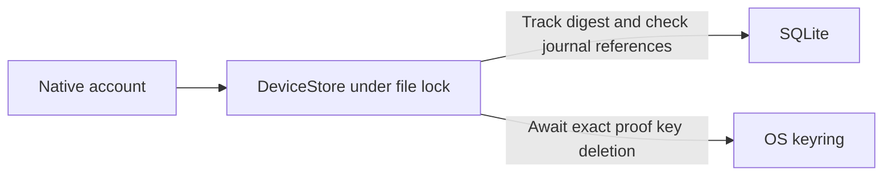
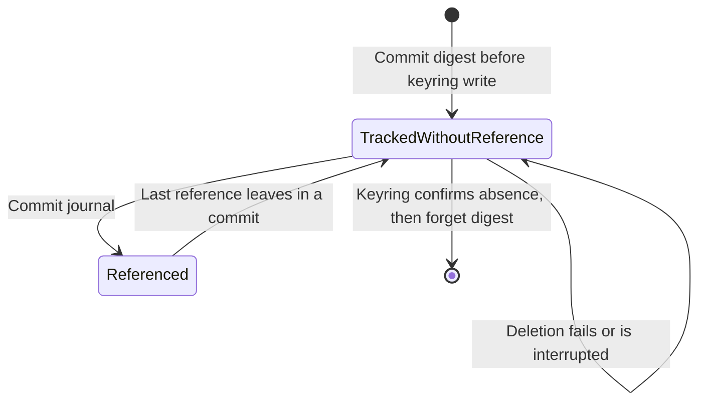
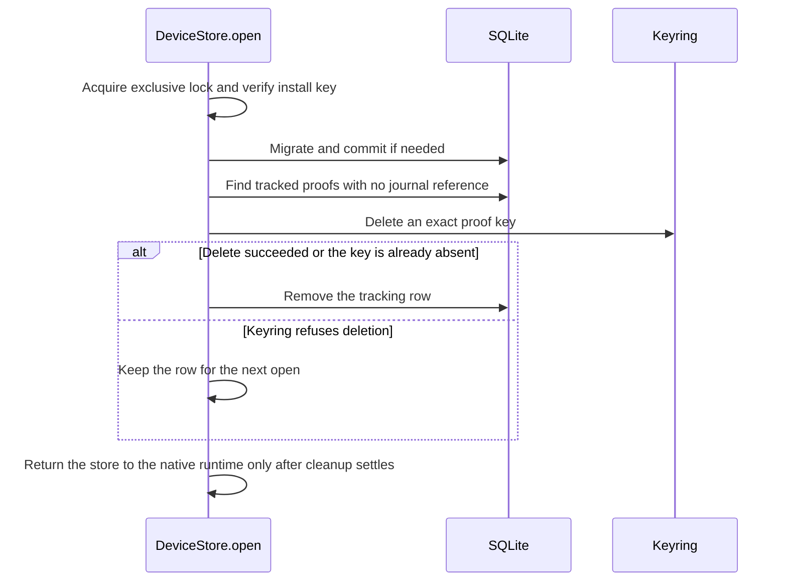
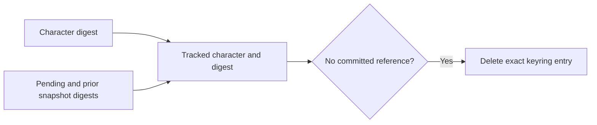

# Design

## Triage

| Trigger | Applies? | Evidence |
|---|---|---|
| T1 Components | Yes | `DeviceStore` commits a journal change in SQLite, then calls the OS keyring adapter (`app/lib/esi_sso/data/device_store.dart:308-355`, `app/lib/esi_sso/data/desktop_platform_io.dart:41-54`). |
| T2 State | Yes | The journal persists character and rollback snapshot references separately (`app/lib/esi_sso/data/device_store.dart:88-97,142-146`). Cleanup adds a durable record of which proofs the store can remove. |
| T3 Concurrency | Yes | Proof deletion awaits a keyring call. The store holds a file lock and the runtime serializes native operations (`app/lib/esi_sso/data/device_store.dart:110-120,350-354,467-475`, `app/lib/esi_sso/data/native_account.dart:544-560,568-580`). |
| T4 Boundaries | Yes | The verified store currently reads schema v1 or v2 (`app/lib/esi_sso/data/device_store.dart:158-170`). Cleanup adds a SQLite migration. |
| T5 Volume | Yes | The app creates a new digest-addressed key on each fresh take (`app/lib/esi_sso/data/native_account.dart:279-299`, `app/lib/esi_sso/data/device_store.dart:376-400`). Old keys can accumulate if deletion fails. |
| T6 Risk | Yes | A take or return cannot proceed without the original proof (`app/lib/esi_sso/data/native_account.dart:306-315,377-383`). |

TIER: FULL

## Context

[The proposal](proposal.md) covers the user impact. `restoreRefusedTake` commits the state and removes the snapshot before attempting keyring deletion. It swallows deletion failure (`app/lib/esi_sso/data/device_store.dart:311-355`). `finishTake` keeps the pending proof in the reservation and drops the snapshot, which can hold a different proof (`app/lib/esi_sso/data/device_store.dart:254-273,293-302`, `app/lib/esi_sso/data/native_account.dart:329-344`). A confirmed Return changes the phase to `returned` but retains the digest, so that proof remains referenced (`app/lib/esi_sso/data/native_account.dart:393-406,625-637`).

A v1 `taking` row can have a proof but no rollback snapshot. Opening v1 adds the v2 table without rewriting the character. Native Take uses the existing proof through the legacy route when no epoch is present (`app/lib/esi_sso/data/device_store.dart:88-97,166-169,276-290`, `app/lib/esi_sso/data/native_account.dart:301-325`). The desktop adapter opens one credential directory under app support. The install key name is fixed, and the proof name encodes the character and digest, not a directory or database identity (`app/lib/esi_sso/data/desktop_platform_io.dart:18-27`, `app/lib/esi_sso/data/device_store.dart:123-138,399-400`).

## Decisions

### D1: Track proof names in the verified journal

- **Choice:** Add a SQLite v3 `handoff_proof` table keyed by `(character, digest)`. After verifying the install key, atomically migrate v1 or v2 and seed the table from `character.proof_digest`, `take_recovery.pending_digest` and `take_recovery.proof_digest`, skipping nulls and deduplicating exact pairs. The v1 migration creates `take_recovery` first; split the existing `PRAGMA user_version` out of its schema string and set version 3 only after both schemas and the seed are written. New databases start at v3. Record a new proof's digest durably before its first keyring write and preserve the existing read-back before callers commit or send it. The journal never stores the proof itself. Keep the current key-name format and reject unsupported versions as before.
- **Rejected:** Enumerate the keyring and subtract rows in one open SQLite database. A key name alone cannot show which installation journal could still use it. An in-memory list of candidates also loses deletion intent when the process exits.
- **Reversal cost:** medium.
- **Important:** yes, this adds a persisted format.
- **Chosen by:** agent.

### D2: Delete only after the last committed reference disappears

- **Choice:** On verified store open, under the lock and before exposing the store, select tracked keys absent from all three reference fields for the same character. Do not filter by phase, selection, age or server response. After a confirmed rollback commits, check only that rejected proof the same way. `DeviceStore` calls `DeviceSecrets.delete`. If it throws, the store calls the injected `DeviceSecrets.contains` for that exact name. That method returns presence without returning the proof, or throws if it cannot establish presence or absence. A completed delete or a `false` from the fallback allows acknowledgement. `true` or an exception leaves the row tracked; discard the error text. `_Keyring.contains` delegates to the plugin's `containsKey` on macOS and Linux. On Windows it reports that absence cannot be established and leaves retry to the next open, because the legacy lookup can conflate an inaccessible file with an absent key (A1). No fallback loads a proof value into Dart. Cleanup never changes holder state or starts a background operation.
- **Rejected:** Delete before committing the journal, or clear a journal when cleanup cannot confirm the move. A failed commit or an accepted move with a lost reply could then need a proof the desktop already deleted. Running a background sweep would also race the interval between creating the proof and committing its journal.
- **Reversal cost:** low.
- **Important:** yes, this defines the ordering for deleting a credential needed by recovery.
- **Chosen by:** agent.

### Decision summary

| # | Decision | Choice | Rejected | Reversal cost | Important | Chosen by |
|---|---|---|---|---|---|---|
| S1 | Upgrade cutoff | Track referenced and newly created proofs | Sweep already-orphaned legacy keys | Medium | Yes | User |
| S2 | M2 follow-up only | Preserve holder policy and existing acceptance gates | Reset or resolve pending moves | Low | Yes | User |
| S3 | Windows backend crash atomicity | Track separately in #49 | Block cleanup on backend changes | Low | Yes | User |
| D1 | Durable ownership | Journal records exact character and digest | Enumerate keyring or keep an in-memory list | Medium | Yes | Agent |
| D2 | Deletion order | Delete after commit; verify absence through the injected keyring if supported | Delete before commit or sweep concurrently | Low | Yes | Agent |

## Assumptions

- **A1:** The pinned `flutter_secure_storage` 11.2.0 exposes `containsKey`. Inspection of the released source confirmed that macOS 0.4.3 distinguishes a missing item from other statuses, and Linux 3.0.3 checks the key in the loaded store and throws when it detects an unavailable or locked store. Windows 4.2.2's legacy check can return `false` after a failed file-attribute lookup if its credential lookup finds nothing. All three versions treat an absent key as a successful delete under normal storage conditions. The versions are pinned in `pubspec.lock:358-381,398-405`; the behaviour comes from plugin source outside the repo, not an OS run. Recheck the pins and contracts before implementing D2 and C4. Never acknowledge a thrown Windows deletion based on a presence lookup.

## Carried constraints

- **C1:** Never delete a proof that a committed character row or either rollback snapshot field still references. Do not use cleanup to settle a handoff. Kind: invariant. Destination: spec: specs/esi-sso/spec.md → Requirement: The desktop removes unreferenced handoff proofs safely
- **C2:** Keyring writes follow durable tracking; keyring deletion follows the last committed journal reference; acknowledgement follows deletion. Run only under the existing exclusive store owner, never in parallel with a proof writer. Cleanup failures leave the journal usable. Cleanup diagnostics contain no names, identifiers, digests, values, exception text or stack traces. Kind: invariant. Destination: doc comment: app/lib/esi_sso/data/device_store.dart DeviceStore
- **C3:** A key's namespace is not evidence of journal ownership. Do not enumerate or delete untracked legacy keys. Kind: deliberate gap. Destination: doc comment: app/lib/esi_sso/data/device_store.dart DeviceSecrets
- **C4:** A completed `delete`, or a failed `delete` followed by `contains` returning `false`, counts as successful cleanup. `contains` throws if the backend cannot reliably distinguish failure from absence. Kind: invariant. Destination: doc comment: app/lib/esi_sso/data/device_store.dart DeviceSecrets
- **C5:** Only a verified store with a supported, successfully migrated schema may delete a key. Kind: invariant. Destination: doc comment: app/lib/esi_sso/data/device_store.dart DeviceStore.open
- **C6:** Startup cleanup awaits the keyring under the lock. It does not time out and release the lock while a call can still delete a key. Kind: deliberate gap. Destination: doc comment: app/lib/esi_sso/data/device_store.dart DeviceStore.open
- **C7:** Cleanup requests exact-key operations and does not make persistence inside the secure-storage backend crash-atomic. Kind: deliberate gap. Destination: spec: specs/esi-sso/spec.md → Requirement: The desktop removes unreferenced handoff proofs safely
- **C8:** Older executables reject a v3 journal. Pending moves stay on disk and require a compatible executable. Kind: deliberate gap. Destination: doc comment: app/lib/esi_sso/data/device_store.dart DeviceStore.open

## Diagrams

### Modules (T1)

### Proof lifecycle (T2)

### Reopen order (T3)

### Migration and keyring seam (T4)

## State & Ownership

| State | Owner (sole writer) | Lifetime | Invalidation / rebuild | Authoritative copy |
|---|---|---|---|---|
| Character, selection and rollback snapshot | `DeviceStore`, through existing native operations | Until existing holder operations commit changes | Cleanup does not write this state | SQLite `character`, `setting`, `take_recovery` |
| Tracked proof identity | `DeviceStore`, under the store lock | From migration or before the first proof write | Delete after references are gone and the keyring confirms absence | SQLite `handoff_proof` |
| Proof secret | `DeviceStore` through `DeviceSecrets` | From verified write until cleanup | Remove only when unreferenced and tracked | OS keyring |

## Failure & Visibility

| Component | Failure | Recovery | Retry safe? | Who finds out |
|---|---|---|---|---|
| Store open | Lock, install-key verification, schema check or migration fails | Open fails before cleanup. A failed migration rolls back. | Yes | Existing unavailable desktop result |
| Proof creation | Keyring write or journal commit fails | A later open removes the tracked key if it exists and the journal never referenced it. No request was sent for that uncommitted proof. | Yes | Existing account notice for the failed move |
| SQLite and keyring | Process exits after the last reference is removed | A later open finds the tracking row. Confirmed absence counts as completion if deletion already happened. | Yes | No change to the holder outcome |
| Cleanup | Candidate query, candidate decoding, key identity validation, delete or tracking-row acknowledgement fails | Catch these failures inside best-effort cleanup. A query failure ends the pass. A bad row or failed delete leaves that row in place and does not block other candidates. A failed acknowledgement is retried on the next open. Open still returns the verified store and an inline cleanup failure cannot change the committed rollback or its notice. | Yes | The injected sink gets one fixed message per failed pass or inline delete. |
| Diagnostic | Sink throws | Catch the failure inside cleanup. Do not resend it or fail the account operation. | No retry | No further diagnostic |

## Resource Bounds

| Resource | Bound | At the bound | Timeout | At 10x / 100x |
|---|---|---|---|---|
| SQLite tracking rows | One per tracked key. Successful cleanup removes rows; prolonged keyring failure can retain one per unfinished deletion. Do not evict authority evidence. | A later healthy open removes the backlog. | None | One ordered scan with character-keyed reference lookups, not a keyring inventory. |
| Startup candidates | One ordered query loads only unreferenced `(character, digest)` pairs. Memory grows with the backlog; a healthy store does not retain successfully cleaned entries. | Process the result once. Each candidate gets one deletion attempt. | No new timer. A Dart timeout cannot safely release the store while a keyring call may still run. | One keyring delete request per unused proof and at most one fallback presence check. Work inside the backend is outside this bound; see [#49](https://github.com/sh1ny/kaname/issues/49). |
| Immediate rollback cleanup | One candidate for the rejected proof. | Defer failures to the next open. | Existing keyring call behavior. | Constant work per rollback. |

## Flow & State Gaps

- Compare the exact character and canonical lowercase digest. Skip malformed candidate identities without touching the keyring. Verify that the database is the installed store before migration or cleanup. The proof registry is not an independent grant or holder record.
- Do not hand the store to the runtime until startup cleanup finishes. While inline cleanup awaits the keyring, the native operation still owns its serialization slot. The file lock is held for both. No supported writer can commit a new reference between the check and deletion.
- Inject an optional `void Function(String)` diagnostic into `DeviceStore.open`. `openDesktopHolder` passes a sink for `dart:developer.log` under `kaname.esi_sso` before constructing `NativeAccount`. Keep the same sink for inline rollback cleanup. With no sink, diagnostics do nothing. The store emits only `Desktop handoff proof cleanup did not finish.` Neither a cleanup failure nor a sink failure may escape `open` after verification and migration or escape `restoreRefusedTake` after rollback commits. Test the three fallback outcomes using `DeviceSecrets`, and test a sink that records the fixed message and one that throws.
- The app verifies a new proof before referencing it, and commits its pending move before contacting the source. A crash anywhere before that commit leaves at most a tracked, unused key. A failed rollback transaction keeps the pending row and its snapshot, so both remain protected on reopen.
- Neither elapsed time nor `returned` is evidence that a reference can be discarded. Replacing a row or dropping a snapshot can make an old proof eligible. The startup sweep sees that change without adding cleanup logic to each holder transition.
- Delete an exact name. If the backend throws, only a successful absence check for that same name allows acknowledgement. Failure to establish absence leaves the row tracked. Do not enumerate the keyring or use secret values to decide eligibility.
- This follows ADR 0017's single authoritative installation journal. No cleanup based on a second copy, restored database or server row is introduced. An unrecognized schema or failed install-key check never authorizes a delete.

## Mechanism Ledger

| Mechanism | Built? | Why | Evidence that would change the call |
|---|---|---|---|
| Durable tracking and verified-open cleanup | Yes | A keyring delete and SQLite commit cannot be atomic. A process exit otherwise loses the exact key to clean. | An existing durable per-journal proof inventory with equivalent ordering. |
| Reference check by character and digest | Yes | The same proof can be needed by a current row or rollback snapshot. | A schema that enforces proof ownership and liveness through a single reference. |
| Keyring enumeration, age cutoff, background retry or holder reset | No | None gives stronger proof of ownership or a holder outcome. A live sweep would also race a fresh proof write. | An owner-approved requirement with verified per-install key ownership or a coordinated runtime cleanup trigger. |

## Risks / Trade-offs

Cleanup adds one small SQLite record per new proof and a keyring operation per unused key at reopen. A slow keyring can delay reopening, but the lock must not be released while deletion is still in flight. Older executables cannot read v3; they leave the journal and keyring unchanged on that failure path. Already-orphaned legacy entries remain untouched because their ownership cannot be established. The journal fix covers interruption before exact-key deletion and after its return. Crash atomicity inside the Windows backend remains open in [#49](https://github.com/sh1ny/kaname/issues/49).

## ADRs

- **In force, constraining this change:** ADR 0005 and ADR 0017.
- **To record during apply:** none. This is a private migration within ADR 0017's existing credential store and keyring split.
