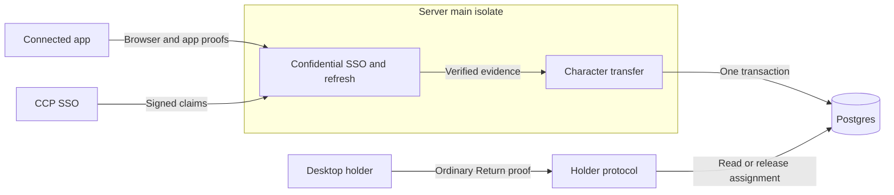
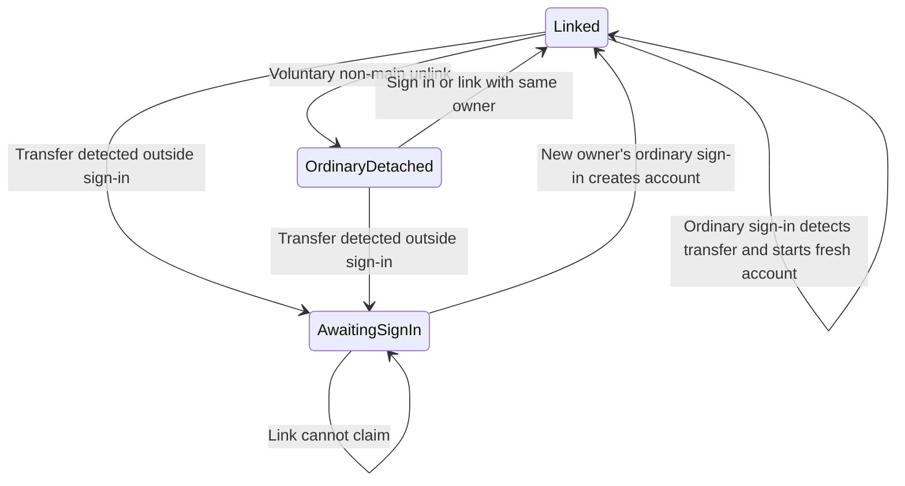
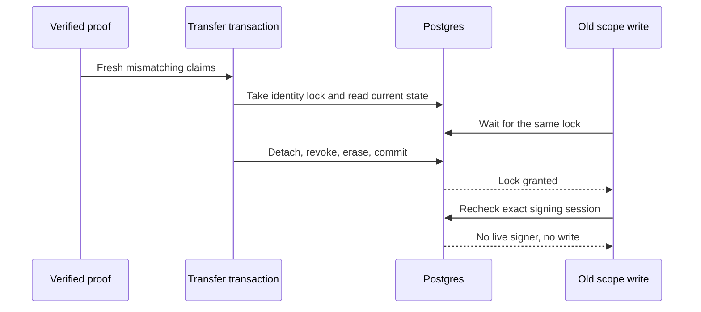
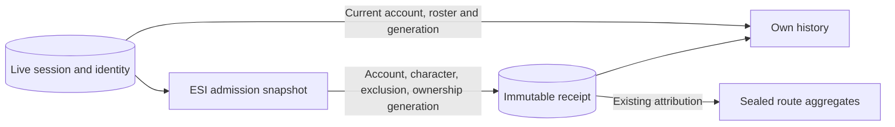

# Character transfer design

## Triage

| Trigger | Applies? | Evidence |
|---|---|---|
| T1 Components | Yes | Connected SSO, account and session persistence, and ESI authorization share a transfer operation. |
| T2 State | Yes | Ownership and main designation change in Postgres, with a distinct state before first sign-in. |
| T3 Concurrency | Yes | Browser exchanges, refresh, handoff and account writes can complete out of order. |
| T4 Boundaries | Yes | The database upgrade changes identity, account, holder and receipt metadata. |
| T5 Volume | Yes | Transfer can revoke multiple sessions and must find a main among the remaining characters. |
| T6 Risk | Yes | A stale proof or receipt can expose another owner's data or authorize a second ESI holder. |

TIER: FULL

## Context

See [proposal.md](proposal.md) for scope. Source citations describe the baseline at `ad22241`.

- The verifier checks the CCP signature and claims before returning the owner hash (`packages/kaname_esi_sso/lib/src/ccp_jwt.dart:20-33,103-112,183-217`). The browser callback verifies the CCP claims. Completion checks the app proof and browser binding or single-use code before passing the result to sign-in, link or scope activation (`server/kaname_server/lib/src/esi/sso_route.dart:284-324,345-419`). The refresh adapter pins the identity before CCP I/O and rejects a verified mismatch without accepting the returned grant (`server/kaname_server/lib/src/esi/server_sso_grants.dart:291-329`). Sign-in and link block a mismatch rather than move the identity (`server/kaname_server/lib/src/esi/sso_sessions.dart:340-352`; `server/kaname_server/lib/src/esi/member_accounts.dart:39-59`).
- An identity has a unique character ID, optional account and sticky `wasDetached`. The account has a required main. Viewer admission joins the exact session to the signing identity and current account, with an expiry check (`server/kaname_server/lib/src/esi/sso_identity_row.spy.yaml:5-14`; `server/kaname_server/lib/src/esi/member_account_row.spy.yaml:5-6`; `server/kaname_server/lib/src/esi/sso_sessions.dart:204-229`). Roster reads use the same snapshot for viewer, account and main, and already refuse a missing or mismatched main (`server/kaname_server/lib/src/esi/member_roster_endpoint.dart:34-62,80-85`).
- The member writer locks characters in CCP ID order, accounts in account ID order, then the acting session. Unlink refuses the current main, sets `wasDetached` and deletes only the removed character's sessions (`server/kaname_server/lib/src/esi/member_accounts.dart:150-189,191-250`). Sign-in and link record a first aggregate exclusion when a detached character starts or joins an account (`server/kaname_server/lib/src/esi/sso_sessions.dart:375-399`; `server/kaname_server/lib/src/esi/member_accounts.dart:71-81`).
- Postgres holds the opt-ins, vault and holder assignment separately. Scoped activation commits the grant and assignment together under the vault advisory lock. The existing opt-in path checks the signer under the main-isolate gate but writes outside an identity transaction (`server/kaname_server/lib/src/esi/sso_opt_in_row.spy.yaml:5-13`; `server/kaname_server/lib/src/esi/esi_token_vault_row.spy.yaml:5-13`; `server/kaname_server/lib/src/esi/sso_holder_row.spy.yaml:5-19`; `server/kaname_server/lib/src/esi/server_esi_vault.dart:81-109,141-171`; `server/kaname_server/lib/src/esi/server_sso_grants.dart:100-146`). Refresh calls CCP between two vault transactions and rechecks the grant handle before completing (`packages/kaname_esi_vault/lib/src/vault.dart:217-242,294-329`). Parked vault records retain the next generation without ciphertext (`packages/kaname_esi_vault/lib/src/vault.dart:144-185`).
- The holder protocol fences Take by phase, holder generation, closures and device proof. A replay of a matching reservation builds its owner fingerprint from the live viewer, not the original Take (`server/kaname_server/lib/src/esi/sso_handoff.dart:140-164,197-227,338-349,398-429`). Desktop stores the fingerprint from that reply and requires it for native authorization (`app/lib/esi_sso/data/native_account.dart:149-169,333-347`). Ordinary Return parks the local credential, then presents the saved generation and proof; the server checks them and a live character session (`app/lib/esi_sso/data/native_account.dart:386-411`; `server/kaname_server/lib/src/esi/sso_handoff.dart:242-275`).
- ESI admission captures the account, character and aggregate exclusion with the live viewer. Own history checks recorded account and current linked character but not ownership generation (`server/kaname_server/lib/src/esi/sso_sessions.dart:160-164,204-244`; `server/kaname_server/lib/src/esi/sso_skills.dart:41-71,119-134`; `server/kaname_server/lib/src/esi/esi_call_log_store.dart:148-172`). The privacy rules in [`member-accounts` D9 and D12–D17](../archive/2026-11-27-member-accounts/design.md#d9-exclude-overlapping-accounts-from-private-route-qualification) and its threat model still apply.

## Decisions

### D1: Order browser attempts and pin refresh

- Choice: Number browser attempts monotonically at registration in the existing server runtime, before CCP authorization can begin. A transfer writes the current runtime identifier and attempt high-water mark on that character under its identity lock just before admission to commit. The transaction's ordering point is this sample; the fence is effective only if the transaction commits. Compare the incoming browser order with the current identity's fence after acquiring its lock. Refuse a proof at or below the fence for the current runtime, even if its hash matches. No attempt survives runtime restart, so a fence in an earlier runtime cannot reject a new attempt. The transfer that writes the fence is admitted against the previous fence, not against its own write. A refresh pins the ownership generation before calling CCP, then checks that generation under the identity lock before applying any transfer. Existing proof deadlines still apply just after lock waits and before committing.
- Rejected: Order competing proofs by CCP's `iat`. The existing verifier treats it as optional. The CCP example does not promise a strict ordering within a second across exchanges.
- Reversal cost: Medium.
- Important: yes (what a delayed authorization can change).
- Chosen by: user. "Kaname's own attempt order and fence."

### D2: Require the ownership generation for own receipts

- Choice: Add a monotonic server-only ownership generation to the identity and a stamp on receipts. Start both at zero on upgrade. Carry the generation from the existing live admission snapshot through the real scheduler to the terminal receipt. Own history checks account, membership, unblocked character and matching generation in the same snapshot as today. A transfer sets `wasDetached`, including when the identity is already detached. Starting or joining an account then uses the existing exclusion and seal logic. Aggregate queries do not use the generation.
- Rejected: Permanently forbid links to former accounts. That would change ordinary membership and require recording every past membership.
- Reversal cost: High once receipts carry the stamp.
- Important: yes (privacy and persisted attribution).
- Chosen by: user. "Ownership number stamped on each call."

### D3: Keep a credential-free vault record

- Choice: Use one Postgres transaction to write the new owner and generation, detach, repair the old main, delete the signing character's sessions and opt-ins, and erase the vault ciphertext and refresh lease. Take the existing vault advisory key for retirement. If a vault row exists, keep it credential-free and parked; advance its authorization generation when retiring a non-parked credential, and leave an already parked row unchanged. Legacy missing records do not need a tombstone. Never reset or reuse an authorization generation. No holder assignment writes. Refresh that cannot persist a transfer still returns a definitive grant refusal under the existing vault rules.
- Rejected: Delete the vault row and keep a separate persistent vault-generation counter in the holder assignment. That adds a generation authority and rewrites holder state.
- Reversal cost: Medium.
- Important: yes (credential disposal and rollback).
- Chosen by: user. "Erase the token, keep the empty record."

### D4: Serialize writes that could restore former credentials

- Choice: Keep the existing character gate and add the character transaction lock to the opt-in and scoped grant writes. Recheck the exact live signer under that lock before writing. Order transaction locks as character keys, account rows, acting session where applicable, vault key, then the existing call-log exclusion lock where needed. No CCP or other network calls inside these transactions. The main replacement reads the old account's remaining roster under its account lock, using the CCP ID ordering in S2. The lowest unblocked choice and the fallback each need at most one returned row. A fresh sign-in that detects a transfer starts the new account in this transaction; other paths leave a durable first-sign-in flag. Ordinary sign-in clears that flag. Ordinary unlink does not set it and does not touch vault, policy or holder state.
- Rejected: Make browser transfer wait for dispatch to finish. It can already detect the change from inside a refresh on that dispatch path, and a prior in-flight call must not delay revocation indefinitely.
- Reversal cost: Medium.
- Important: yes (concurrent writes and session authority).
- Chosen by: user. "Same per-character lock, recheck signer."

### D5: Keep ordinary Return

- Choice: Leave the holder row and proof untouched on transfer. A completed device reservation can still use ordinary Return with its exact generation and proof and a live signer. The device parks before sending the release as today. The new owner must still separately authorize a scoped grant. When ordinary Return cannot complete, no path removes the assignment before M7. Keep `serverHeld` or `serverReserved` metadata on transfer too. Neither phase supplies a live vault handle after D3. Fresh authorization can update those phases only under existing policy and holder checks.
- Rejected: Add a park-only or verified reclaim path. That changes the device protocol and is outside M3.
- Reversal cost: Medium.
- Important: yes (server ESI availability and the one-holder contract).
- Chosen by: user. "Today's Return only; blocked until M7 otherwise."

### D6: Preserve legacy blocks

- Choice: The migration preserves all stored hashes and blocked flags. A matching proof for a blocked identity is still refused; a fresh mismatching proof can take the same transfer path as for an unblocked identity. An old blocked row by itself proves no new owner.
- Rejected: Require a separate operator recovery workflow even with fresh proof for a different owner.
- Reversal cost: Medium.
- Important: yes (upgrade behavior and account recovery).
- Chosen by: user, decided by Ormy under the owner's delegation. A new owner can obtain the character by signing in, as in S1.

### D7: Fence Take by ownership without changing Return

- Choice: Include the identity's ownership generation in the monotonic Take epoch, alongside holder generation and the closure offset. Keep the positive decimal wire format and fail closed on overflow. Record the ownership generation of the latest Take acceptance or closure with that write. Legacy rows represent generation zero. A Take start or closure checks the exact live signing generation under the identity transaction lock before writing. The final `toDevice` to `deviceReserved` write also takes that lock and checks the original ownership generation. It does not require a second live-session check for same-owner work already admitted. All three writes keep the existing holder compare-and-set checks. Do not hold the identity transaction open during vault parking. A replay may acknowledge acceptance or non-acceptance only from evidence for the current ownership generation. A pre-transfer intent with uncertain outcome stays pending; it cannot park a new grant or supply a new owner fingerprint. A legacy Take without an epoch cannot start or resume for a transferred identity. Ordinary Return does not require the Take's owner generation. It can release a completed reservation but cannot settle an unfinished Take.
- Rejected: Let a pending pre-transfer Take settle directly for the original device using a prior owner's fingerprint. That adds a new cross-owner settlement case.
- Reversal cost: Medium.
- Important: yes (persistent handoff and reconnect behavior).
- Chosen by: user, decided by Ormy under the owner's delegation. A pending Take cannot authorize the new owner, and M3 adds no Return path.

### D8: Trust a verified mismatch from a still-current refresh

- Choice: A refresh with a verified mismatch can commit transfer if both its pinned ownership generation and the exact vault grant generation still match under the transfer locks. Reject the returned refresh grant in all cases. Trust CCP's signed owner value for this decision without assuming that CCP documents its freshness after a sale.
- Rejected: Reject refresh authorization but require fresh browser proof before revoking Kaname sessions or detaching. That would leave the old account attached after a verified mismatch until another sign-in.
- Reversal cost: Medium.
- Important: yes (destructive state changes on upstream proof with an undocumented sampling time).
- Chosen by: user. "Yes, trust it and write down the risk."

### D9: Hold the existing attempt slot until completion settles

- Choice: Consume browser proof once before entering database work, but hold the existing global and per-client attempt slot through the completion handler. Expiry cleanup cannot release this slot. Release it once on success, refusal or exception. Replays do not run a second completion. A pending callback does not consume the attempt.
- Rejected: Add a separate completion gate that can refuse an already-started sign-in and needs a second capacity limit.
- Reversal cost: Low.
- Important: yes (overload behavior and bounded competing writes).
- Chosen by: user, decided by Ormy under the owner's delegation. Keep the existing limits and busy response without a new queue.

### Decision summary

| # | Decision | Choice | Rejected | Reversal cost | Important | Chosen by |
|---|---|---|---|---|---|---|
| S1 | First claim | Ordinary connected sign-in only | Claim directly by link | Medium | yes | user |
| S2 | Old main | Promote lowest unblocked CCP ID, then lowest blocked ID; retain empty accounts | Let another signer choose a main later | Medium | yes | user |
| D1 | Delayed proof | Local attempt order; pin refresh generation | CCP timestamp order | Medium | yes | user |
| D2 | Own receipts | Match ownership generation | Ban links into former accounts | High | yes | user |
| D3 | Vault retirement | Keep credential-free parked record | Separate counter on holder | Medium | yes | user |
| D4 | Credential writes | Character lock and exact signer check | Wait for dispatch to drain | Medium | yes | user |
| D5 | Device release | Today's Return; no reclaim | New park-only path | Medium | yes | user |
| D6 | Legacy blocks | Preserve until a verified mismatch | Separate operator recovery | Medium | yes | Ormy under owner's delegation |
| D7 | Take after transfer | Fence intent and replay by ownership | Settle a pending Take across owners | Medium | yes | Ormy under owner's delegation |
| D8 | Refresh trust | A signed mismatch with current generations can transfer | Require browser confirmation | Medium | yes | user |
| D9 | Completion admission | Retain the existing attempt slot until settlement | Add a separate completion cap | Low | yes | Ormy under owner's delegation |

## Assumptions

- A1. Kaname trusts the verified owner value from a fresh browser code exchange or a refresh of a still-current grant. [CCP's SSO documentation](https://developers.eveonline.com/docs/services/sso/#jwt-token-claims) describes signed claims, and [its JWT example](https://docs.esi.evetech.net/docs/sso/validating_eve_jwt.html) includes `owner`. Neither source documents when CCP samples ownership for either exchange or says refresh immediately reflects a sale. There is no live transferred-character fixture. Signed fake responses can verify the local ordering and retirement rules, not CCP's sampling behavior. D1, D6 and D8 depend on this trust boundary.

## Carried constraints

- C1. Only ordinary connected sign-in can first attach a transferred character, and it gets a fresh account. Kind: invariant. Destination: spec: specs/member-accounts/spec.md → Requirement: Only ordinary connected sign-in first claims a transferred character
- C2. Transfer keeps the old account and data. A nonempty account keeps a main chosen from its roster. Kind: invariant. Destination: spec: specs/member-accounts/spec.md → Requirement: Verified transfer ends the old account membership
- C3. Owner, membership, session revocation, opt-ins and vault retirement commit together. Kind: invariant. Destination: spec: specs/esi-sso/spec.md → Requirement: Verified transfer removes prior server ESI authorization
- C4. A delayed proof cannot reverse a transfer or revoke the succeeding owner's grant. Kind: invariant. Destination: spec: specs/esi-sso/spec.md → Requirement: Delayed proof cannot reverse a committed transfer
- C5. Transfer does not remove a device assignment or authorize a Take that started under another owner. Verified reclaim stays in M7. Kind: invariant. Destination: spec: specs/esi-sso/spec.md → Requirement: Transfer preserves a known device holder
- C6. Attributed receipts carry the ownership generation observed at admission. Own reads match it; aggregate release does not. Kind: invariant. Destination: spec: specs/esi-call-log/spec.md → Requirement: A transfer keeps past owners' individual receipts private
- C7. New private character reads cannot derive entitlement from character ID alone across transfer. Kind: invariant. Destination: ADR 0020
- C8. A consumed attempt holds its slot until completion settles, but cannot redeem again. Kind: invariant. Destination: spec: specs/esi-sso/spec.md → Requirement: Connected sign-in verifies the consenting browser

## Diagrams (FULL)

T1. Only a verified server path can submit an owner change.

T2. First claim after transfer differs from ordinary unlink.

T3. Transfer and an old credential write order on the identity lock.

T4. Receipt fields come from one admission, even if writing the receipt happens later.

## State & Ownership (FULL)

| State | Owner (sole writer) | Lifetime | Invalidation / rebuild | Authoritative copy |
|---|---|---|---|---|
| Browser start order and attempt slot | SSO runtime that registered the attempt | One bounded attempt in one runtime | Fresh attempts expire; a completion consumes proof immediately and releases the slot on settlement. Restart drops all slots and attempts. | Existing in-process attempt |
| Owner, generation, browser fence and first-sign-in flag | Verified identity transaction in the main isolate | Character lifetime; the first-sign-in flag lasts until a successful ordinary sign-in | Only transfer changes ownership. Same-owner sign-in does not advance generation. | `esi_identity` |
| Membership, main and session rows | Existing account and signing-session writers | Account survives even after last transfer; sessions end on revocation | Transfer removes membership and exact signing sessions; promotes from the remaining roster | `member_account`, `esi_identity`, `esi_session` |
| Opt-ins and encrypted grant | Existing authority and vault writers, including the transfer transaction | Current authorization; empty vault row retains the generation | Transfer removes opt-ins, ciphertext and lease before new authority can exist | `esi_scope_opt_in`, `esi_token_vault` |
| Holder assignment and Take evidence | Existing holder protocol | Character lifetime | Transfer never mutates it. Take acceptance and closure write their ownership generation. Ordinary Return can release an exact finished reservation. | `esi_holder_assignment` |
| Receipt attribution, exclusions and seal | Existing admission, append and privacy-release writers | Receipt retention and the existing durable exclusion and seal lifetimes | No change to a recorded receipt or to a sealed window | Existing call-log tables |

## Failure & Visibility (FULL)

| Component | Failure | Recovery | Retry safe? | Who finds out |
|---|---|---|---|---|
| Connected SSO | Wrong proof, timeout, abandoned attempt or restart | Use a new browser attempt. The server cannot redeem a spent proof. | Fresh proof only | Fixed refusal or unavailable reply |
| Transfer transaction | Expired browser proof or failed write | Roll back owner, membership, main, sessions, opt-ins, vault and all other transfer writes. After a lost acknowledgment, fresh sign-in reads the committed state. | Fresh proof only; same-owner sign-in does not transfer again | Existing sign-in or link response, without either owner hash or the former account |
| Vault refresh | Old completion or a definite verification refusal | Discard the returned grant. If the transfer does not commit, existing terminal retirement can still remove the rejected credential if it is current. That does not change membership or sessions. | No retry of a definitive rejected grant | Existing fixed vault result |
| Device | Proof, reservation or Return cannot be confirmed | Use ordinary Return only when possible; otherwise leave server ESI blocked until M7 | No automatic retry or reset | Existing holder notices |
| Own history | No live viewer or no matching ownership generation | A fresh request reads current authority. The app keeps its existing viewer and server fences. | Read only | Denied, unavailable or filtered page |
| Upgrade | Additive fields or nullable main upgrade fails | Roll back the migration and use the existing maintenance procedure | Rerun only the unapplied migration | Operator sees migration failure |

## Resource Bounds (FULL)

| Work | Bound | At the bound | Timeout | At 10x / 100x |
|---|---|---|---|---|
| Browser registration, exchange and completion | Reuse 128 attempt slots globally, 4 per client, and 8 concurrent exchanges (`server/kaname_server/lib/src/esi/sso_route.dart:195-207,299-305`). D9 keeps consumed completions inside the first two bounds. | At capacity a new attempt gets the existing busy response. No new completion waits outside the attempt pool. | Existing five-minute attempt lifetime (`server/kaname_server/lib/src/esi/sso_route.dart:115`); database limits below still govern work after consumption. | The current production pool admits 20 database connections (`server/kaname_server/config/production.yaml:14-20`). Completions can wait for those shared connections without allocating more attempt slots. Refresh keeps the existing vault and skills admission limits. |
| Transfer write | At most two character locks and two account locks, one vault key and one first-exclusion lock. Main promotion uses the existing account/character index and returns one row. The search can visit every remaining row if all are blocked. The indexed session deletion touches every verifier for the signing identity, not just the eight live at issuance; expired rows can remain between 128-row prune batches (`server/kaname_server/lib/src/esi/sso_identity_row.spy.yaml:12-14`; `server/kaname_server/lib/src/esi/sso_session_row.spy.yaml:10-16`; `server/kaname_server/lib/src/esi/sso_sessions.dart:406-419,500-513`). | On a lock, statement or proof deadline, roll back and deny the operation. Retry requires fresh proof. | Existing one-second lock and ten-second statement budgets (`server/kaname_server/lib/src/esi/sso_sessions.dart:288-299`). | At 10× or 100× the remaining roster or signing session count, index visits or deleted rows can grow by the same factor. Check scaled work counts or query plans; the deadline makes no partial transfer visible. |
| Ownership and receipt fields | One number per identity and receipt, one browser fence and first-sign-in flag per identity, one Take evidence generation per holder row | Never wrap or reset a generation. Refuse a write that cannot advance it. | Existing write limits. | Storage grows with existing identities and retained receipts, not with the number of transfers. No receipt history table or new query cache. |
| Empty accounts | Keep one existing row per account whose last character transferred | No automatic deletion, revival, or redirect. | None. | Empty-account count grows with distinct old accounts. Retention is deliberate: future account-owned rows must not move or be orphaned. |
| Own history | Keep the 100-row keyset page and indexed account scan (`server/kaname_server/lib/src/esi/esi_call_log_store.dart:145-171`) | Return no partial page on timeout. | Keep the existing statement budget. | The added predicate may skip older generations, as it already skips unlinked characters. No in-app roster scan. |

## Flow & State Gaps (FULL)

- Fresh ordinary sign-in that observes a changed owner detaches and starts a new account atomically. If link, scoped authorization or refresh sees the mismatch first, it commits detachment without creating a new account or activating a grant. A fresh link remains ineligible until ordinary sign-in clears the first-sign-in flag. A voluntary unlink after that sign-in is unchanged.
- Link proves a live source session under the existing ordered locks before recording a target transfer. Failed app or browser proof, a wrong purpose, or expired source authority cannot initiate it. Scoped proof must match the original live session and character; the protected write still rechecks the exact signer. Refresh verifies claims for the expected character. D8 checks the pinned ownership generation under the identity lock and the pinned grant generation under the vault lock before writing transfer state. An earlier same-owner refresh also cannot save over a new grant: completion requires the exact vault generation. No owner inference from `invalid_grant`.
- Main selection, link and transfer cannot leave a live account with a main outside its roster. The affected account lock orders independent characters. A roster or own-history snapshot admitted before transfer can finish as before; later snapshots for the old signing bearer fail. Other signers keep their own authority and see the updated roster on their next read. The install admin allowlist remains character-scoped under ADR 0018; no capabilities are added or inherited through account membership.
- An already admitted ESI call can settle, but an old credential cannot newly pass the vault's dispatch-time check after retirement. If a response was already on the wire it keeps its original receipt stamp. A transfer and a competing old grant or opt-in write have one lock ordering, so a write that wins first is erased by transfer. If transfer wins, the old exact signer check fails before the competing write.
- Transfer advances the composite Take epoch without establishing acceptance or non-acceptance. Only matching committed Take evidence in the current ownership generation can establish that outcome. A fresh post-transfer Take requires a valid server grant and a current epoch. If transfer commits before the final reservation write, that write refuses under the character lock. The old intent stays pending without a fingerprint, and a `toDevice` assignment is not eligible for Return. If the reservation commits first, transfer preserves its evidence. A lost reservation reply cannot be recovered by the new owner through an old Take; Return still needs the exact proof and generation that the original device uses today.
- Use event barriers after Take starts, around vault parking, and before the final reservation write. When transfer wins, assert `toDevice` survives, the old attempt returns no reservation, and Return is refused. When the reservation wins, drop its reply before the desktop can save it. Assert that the committed phase, proof and generation survive, replay stays pending without a new fingerprint, and server ESI remains blocked. Exercise the real desktop journal separately: reopen the saved `taking` row, resume with the new connected session, check the original proof survives both Take and Return, and assert Return sends no release. A separate test saves the reservation on the original desktop before transfer and proves that its ordinary Return works with the saved proof and generation, followed by fresh server authorization.
- Test browser proof expiry after a real write with a manual clock. Verify unchanged owner, membership, main, sessions, opt-ins, vault and holder. The matching refresh case separately verifies no partial membership or session changes, no returned replacement grant, and the existing terminal retirement result for a definitively rejected current credential. Force rollback in Postgres, not with a delay. Also test delayed callback and completion, the two orders for old credential writes, late receipts across a link, and upgrade of existing receipts, blocked identities and holder rows.
- Hold consumed completions with event barriers until the per-client and global limits are full. A replay cannot start a second database action. Advance an injected clock past the held attempts' expiry and verify that new attempts still get busy. When a completion settles, another attempt can use its slot.

## Mechanism Ledger (FULL)

| Mechanism | Built? | Reason | Evidence that would change it |
|---|---|---|---|
| Stored ownership generation and browser fence | Yes | The current owner hash alone cannot identify an older browser attempt or distinguish a return to a previously used hash. | An upstream proof with a contract that orders transfers and existing proofs strictly. |
| Transfer completion retains the attempt slot | Yes | Today completion frees the slot before it enters Postgres (`server/kaname_server/lib/src/esi/sso_route.dart:375-419`), so exchange and attempt caps do not bound database waiters. | An existing ingress limit that bounds admitted completions all the way through settlement. |
| First-sign-in flag | Yes | A missing membership alone cannot distinguish an ordinary unlink from an unclaimed transfer. | A replacement account state that preserves both behaviors. |
| Atomic vault credential retirement | Yes | An old grant can otherwise survive a crash after identity revocation or match a later reset generation. | An equivalent durable vault transition tested across late writes and restart. |
| Receipt generation | Yes | Account and character can match again after a later link, including while an older receipt is still pending. | A privacy model that establishes the same historical ownership without the stamp. |
| Take generation check | Yes | The existing replay recomputes the fingerprint from a new viewer and can turn an earlier device reservation into a new owner's authorization. | A replacement handoff protocol with an equivalent ownership fence. |
| New server poll, device reclaim, history copy or automatic cleanup of empty accounts | No | The roadmap does not require those operations. Copying old history or removing a device assignment would violate existing contracts. | A later approved change with its own privacy and holder decisions. |

## Risks / Trade-offs

- Fail closed if the server cannot settle a proof-authorized write. A stale browser attempt must start over, even if its owner would otherwise be current. A lost device can keep server ESI unavailable after a new owner signs in.
- Postgres commits one consistent transfer. Kaname cannot retract replies or ESI work admitted before the commit. No new cache, notification or redistribution of historical rows is introduced.
- The trust and deployment limits from `member-accounts` D20 and ADR 0017 remain. A single main isolate owns authenticated ESI, and a backward database clock step does not undo committed session deletion or sealed aggregate state. A compromised CCP, host or database, or a second writer bypassing the locks, is outside this change. No log or public reply contains either owner hash or a credential.
- Under D8, a stale but validly signed different owner value from CCP could detach the current owner and retire their old grant and sessions. A later correct proof can restore sign-in and allow fresh ESI authorization through a fresh account. The former account remains accessible through any surviving eligible signer. If none remain, it keeps its records without a connected sign-in path. Refresh does not claim an account or expose prior individual receipts. The owner accepted this upstream risk.

## ADRs

- In force: ADRs 0005, 0006, 0007, 0017, 0018, and 0019.
- To record during apply: ADR 0020, character ownership transfers without moving account data. Supersede ADR 0019's transfer boundary and main requirement, and retain its account, write-order and retirement rules in the successor. Add a cross-reference to ADR 0020 in the architecture index entry for ADR 0017, under the recovery exception for a change of owner. Do not edit the accepted ADR 0017. Update the account state row. If another accepted ADR claims that number first, use the next free number and update C7 and these references together.

Proposed ADR decision text for review:

> CCP character identity, Kaname account membership and ESI holder assignment are distinct. A verified owner change retires signing sessions and server ESI credentials as it detaches the character. It never changes the durable device assignment. Only a fresh ordinary sign-in starts the new owner's account. An old account and its records stay under the old account ID even after its last character transfers. A nonempty account keeps a main from its roster.
>
> A private character data reader must establish the viewer's entitlement under ADR 0006. Character ID or present membership alone is not evidence of ownership of a historical row. When a reader serves records whose authority depends on the owner at collection, it must retain and verify that authority across transfer. A new owner must not gain the prior owner's data because they sign in or link that character. The ESI call log uses immutable receipt attribution and ownership generation; this ADR does not choose future storage or sharing policy.
>
> This decision qualifies [ADR 0017's Recovery section](../../../docs/adr/0017-esi-holder-handoff.md#recovery) when CCP ownership changes. An unfinished Take cannot resume across owners or be returned as a device reservation. A completed reservation can use ordinary Return only when the original device kept the committed proof and generation and can park. If the desktop never saved the reply, it keeps its pending journal and cannot recover that reservation by replay after transfer. The current owner still needs fresh authorization to enable the server grant.
