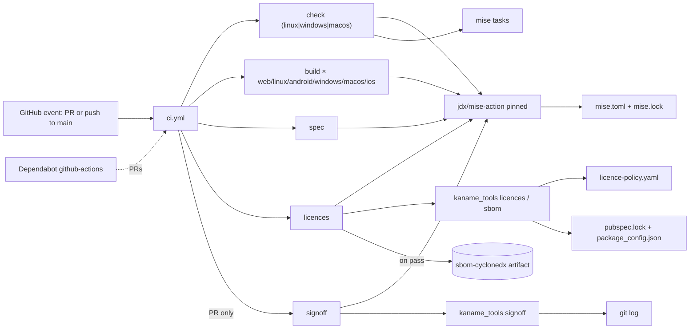
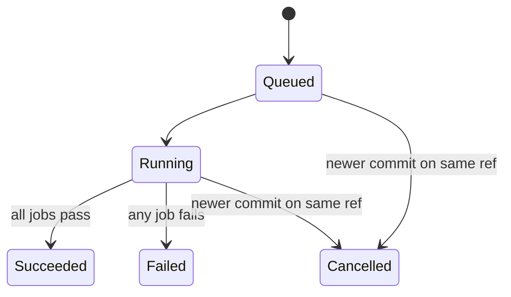
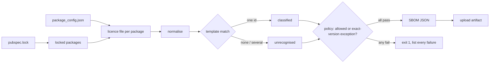

# Design

## Triage

| Trigger | Applies? | Evidence |
|---|---|---|
| T1 Components (new component, or 3+ with directed relationships) | yes | New CI workflow with 12 jobs, three new `kaname_tools` subcommands, a licence policy file, `mise.lock` and Dependabot, which depend on one another. |
| T2 State (persistent state, caches, 3+ state machine) | yes | New committed state (`licence-policy.yaml`, `mise.lock`) and CI caches (mise tools, pub cache). |
| T3 Concurrency (background work, workers/isolates, async, retries) | yes | Parallel CI jobs and the cancellation of superseded runs (concurrency group). |
| T4 Boundaries (data format, migration, shared interface, IPC, external) | yes | External systems (GitHub Actions, Dependabot, mise downloads); new file formats (licence policy, CycloneDX SBOM output). |
| T5 Volume (grows without a fixed bound) | yes | The dependency count and the commit count of a PR grow with the project; artifacts accumulate per run. |
| T6 Risk (security, money, data loss, unrecoverable user data) | yes | Supply chain: third-party actions and unverified tool downloads run with repository access; the licence gate protects the AGPL distribution. |

TIER: FULL

## Context

The proposal (`proposal.md`) states the scope. What the approach must work with:

- **Toolchain and tasks.** `mise.toml` pins Flutter, Node and OpenSpec (`mise.toml:8-11`). No `java` entry exists, and there is no `mise.lock`. The workspace tasks are single portable commands written for the Windows CI runner (`mise.toml:25-26`). `check` chains workspace, purity, analyze, format:check, test and notices:check (`mise.toml:89-...`). `resolve` runs `flutter pub get` (`mise.toml:28-30`). Strict spec validation is a task (`mise.toml:19`). Only a web build task exists (`mise.toml:84-86`).
- **Mise backend.** Local mise 2026.4.19 resolves `flutter` through its `http:` backend, with URLs for linux-x64, macos-arm64, macos-x64 and windows-x64 and `Security: [none]`: no checksum is checked (output of `mise tool flutter`, recorded during planning). The mise docs (Context7 `/websites/mise_jdx_dev`, "Continuous integration" and "mise.lock") say to commit `mise.lock` made with `mise lock --platform …`, install with `mise install --locked`, and pin mise itself separately. They also say `jdx/mise-action` adds `--locked` when a `mise.lock` exists.
- **No CI yet.** `.github/` holds only `pull_request_template.md`, and `.github/workflows/` does not exist (listing during planning).
- **kaname_tools.** The CLI registers `workspace`, `purity` and `notices` on one `CommandRunner` (`tools/kaname_tools/lib/src/cli.dart:40-42`). File access goes through the injected `FileSystem` interface (`tools/kaname_tools/lib/src/file_system.dart:32-45`). No code under `tools/kaname_tools/lib` starts processes (grep for `Process`, no match).
- **Notices.** The notices code already reads `pubspec.lock` (`tools/kaname_tools/lib/src/notices.dart:103`). It finds each package's licence file as the first of `LICENSE`, `LICENSE.md`, `LICENSE.txt` and `COPYING` in the directory that `package_config.json` names, and normalises the text (`notices.dart:57-66`, `:343-360`). SDK packages are referenced rather than copied, as `flutter-sdk` (`notices.dart:68-73`). A locked package records its source (`notices.dart:541`), and hosted entries carry a `sha256` (`pubspec.lock:8`).
- **The app.** It targets all six platforms (`openspec/specs/workspace-layout/spec.md:35-36`). Android needs JDK 17 (`app/android/app/build.gradle.kts:13-14,43`) under AGP 9.1.0 (`app/android/settings.gradle.kts:22`) and Gradle 9.3.1 (`app/android/gradle/wrapper/gradle-wrapper.properties:5`).
- **Licence text variants in today's lockfile.** The BSD-3-Clause texts name the holder inside clause 3, as "Google LLC" (`THIRD_PARTY_NOTICES:174`) or "Google Inc." (`THIRD_PARTY_NOTICES:572`). Some MIT texts start with the title line "The MIT License (MIT)" (`THIRD_PARTY_NOTICES:539`). Some Apache-2.0 texts include the "APPENDIX: How to apply…" section (`THIRD_PARTY_NOTICES:484`) and others omit it (round 1 review, finding 1).
- **Contracts this change completes.** CONTRIBUTING says there is no automated sign-off check yet (`CONTRIBUTING.md:54`). repo-scaffold left the CI run of notices `--check`, the licence check and the DCO check to this change (`openspec/specs/third-party-notices/spec.md`, "A stale dependency section is detectable"; archived repo-scaffold design C6 and S8).
- **ADRs.** ADR 0001 requires CI to build every target on Linux, Windows and macOS runners, with the toolchain pinned in `mise.toml` (`docs/adr/0001-stack-platforms-and-deployment.md`, Decision and Consequences). ADR 0002 requires CI to fail on licences that are not AGPL-compatible (`docs/adr/0002-licence-clean-room-and-eula-boundary.md`, Decision, last bullet).

## Decisions

### D1: Workflow organisation

- **Choice:** One `.github/workflows/ci.yml` with jobs `check` (matrix of 3 OS families), `build` (matrix of 6 targets), `spec`, `licences` (licence check, then SBOM generation and upload) and `signoff` (pull requests only). One concurrency group per workflow and ref, `cancel-in-progress: true`. Triggers: `pull_request` to `main` and `push` to `main`. It never uses `pull_request_target`, so fork code never runs with write tokens or secrets.
- **Rejected:** one workflow per concern, because triggers and concurrency would be duplicated four times and required-check names would be spread over several files.
- **Reversal cost:** low
- **Important:** yes, binds future changes (the job names are the required checks)
- **Chosen by:** user

### D2: Action pinning and token scope

- **Choice:** Every third-party action is pinned to a full commit SHA with a `# vX.Y.Z` comment. `.github/dependabot.yml` enables the `github-actions` ecosystem only, weekly. The workflow-level `permissions: contents: read`, with no job raising it.
- **Rejected:** major-version tags, because a moved tag runs unreviewed code; SHA pins without Dependabot, because pins go stale with no signal.
- **Reversal cost:** low
- **Important:** yes, binds future changes (every new action is pinned the same way)
- **Chosen by:** user

### D3: Licence allowlist contents

- **Choice:** `MIT`, `BSD-2-Clause`, `BSD-3-Clause`, `Apache-2.0`, `ISC` and `Zlib`. Every other licence, copyleft ones included, passes only through an owner-approved exception.
- **Rejected:** also allowing MPL-2.0, LGPL, GPL-3.0-or-later and AGPL-3.0 directly, because copyleft dependencies would then enter without a human look.
- **Reversal cost:** low
- **Important:** yes, changes behaviour users see (which dependencies a PR may add)
- **Chosen by:** user

### D4: Licence matching method

- **Choice:** Template match with slots. The tool holds the canonical text of each allowlisted licence, plus the common disallowed ones it should name precisely (MPL-2.0, LGPL-2.1, LGPL-3.0, GPL-2.0, GPL-3.0, AGPL-3.0). The order of operations is fixed:
  1. Apply the notices normalisation.
  2. Drop the leading header block only: an optional title line, then consecutive copyright lines (starting with `Copyright`, `(c)` or `©` after any indentation, case ignored), then an optional `All rights reserved.` line. No line after the first body line is ever dropped, because body lines can also start with `copyright` or `(c)` (`THIRD_PARTY_NOTICES:171`, `THIRD_PARTY_NOTICES:406`).
  3. Turn the rest into a word sequence, with case folded and punctuation and bullet or numbering marks removed.
  4. Match that sequence against each template's word sequence.

  A template marks its variable parts as slots, and only slots may differ:
  - a holder slot of 1 to 12 words, for BSD-3-Clause's "Neither the name of ⟨holder⟩ nor the names of its contributors";
  - an optional tail, for Apache-2.0's "APPENDIX: How to apply…" section.

  Every other word must match exactly. A text that matches no template, or more than one, is `unrecognised`. So is a licence file that holds several licences (for example MIT followed by a bundled BSD notice), which then needs an exception. Unit tests use today's real variants as fixtures (Context, "Licence text variants").
- **Rejected:** a token-similarity threshold, because a changed clause could pass and the result is hard to explain; exact matching with only copyright lines as wildcards (round 1), because about 55 of 60 locked packages would need exceptions that go stale on every upgrade.
- **Reversal cost:** low
- **Important:** yes, binds future changes (it decides which new dependencies need exceptions)
- **Chosen by:** user (slots chosen after round 1 review finding 1; header-block rule after round 2 finding 2)

### D5: Licence policy file

- **Choice:** `licence-policy.yaml` at the repository root, with `allowed:` (a list of SPDX ids) and `exceptions:` (entries with `package`, `version`, `licence` (an SPDX id or `unrecognised`), `reason` and `approved` (an ISO date)). Unknown keys are an error. The tool rejects an `allowed:` entry that names no template it knows, or a known licence that is not AGPL-3.0-compatible (each template carries that flag), so neither a typo nor an incompatible id can widen the policy. The check also fails on an exception whose `licence` differs from the classification it finds, and on an exception for a package that already passes (dependency-licences spec). The workspace check's required-file list gains this file.
- **Rejected:** the allowlist as a code constant with a separate exceptions file (two places for one policy); the same file under `tools/` (less visible next to `THIRD_PARTY_NOTICES`).
- **Reversal cost:** medium (a config file format later tooling reads)
- **Important:** yes, binds future changes (config file and keys)
- **Chosen by:** user

### D6: DCO check implementation

- **Choice:** `kaname_tools signoff --base <ref> [--head <ref>] [--pr-author <login>]`, where `--base` is required and `--head` defaults to `HEAD`. It reads the non-merge commits in `<base>..<head>` through an injected `GitLog` interface. The real implementation runs `git log` with a NUL-separated format that includes `%(trailers:key=Signed-off-by,valueonly,separator=%x1f)`, so git's own trailer rules decide what counts as a sign-off. The tests use a deterministic fake. A commit passes when one of its sign-off values equals `<author name> <<author email>>` exactly, after trimming. A commit is skipped, and listed as skipped, only when `--pr-author` is `dependabot[bot]` and the commit's author is exactly `dependabot[bot] <49699333+dependabot[bot]@users.noreply.github.com>`. Anywhere else that identity is checked like any commit, so it cannot be forged into an exemption. For every failing commit the tool prints its short hash, its subject and the reason (`missing`, or `mismatch: found …`). The mise task `signoff` passes its arguments through, and CONTRIBUTING documents `mise run signoff -- --base <upstream remote>/main`. CI runs it on `ubuntu-24.04` with `--base ${{ github.event.pull_request.base.sha }} --head ${{ github.event.pull_request.head.sha }} --pr-author ${{ github.event.pull_request.user.login }}` after a checkout with `fetch-depth: 0`.
- **Rejected:** an inline shell step in the workflow, because it cannot be unit-tested or run the same way locally; a hand-written trailer parser (round 1 suggestion 6), because it can disagree with `git commit -s`; a default base of `origin/main`, which is wrong for fork contributors.
- **Reversal cost:** low
- **Important:** yes, changes behaviour users see
- **Chosen by:** user (git trailer parsing and the Dependabot exemption chosen after round 1 review; the exemption limited to Dependabot's own PRs after round 2 finding 1)

### D7: Java source

- **Choice:** Add `java = "temurin-17"` to `mise.toml`. The Android SDK comes from the Ubuntu runner's preinstalled SDK (`ANDROID_HOME`). CONTRIBUTING's toolchain section says a local Android build also needs an Android SDK.
- **Rejected:** the runner's preinstalled JDK, because local and CI JDKs would drift.
- **Reversal cost:** low
- **Important:** yes, changes settings users see (a new pinned tool)
- **Chosen by:** user

### D8: Tool checksums

- **Choice:** Commit `mise.lock`, generated with `mise lock --platform linux-x64,windows-x64,macos-arm64` (the three runner platforms plus WSL), together with the dependency-graph sidecars it references under `.mise/locks/` (OpenSpec is an npm tool; `mise lock --sidecars` lists them). Per the mise docs (Context7 `/websites/mise_jdx_dev`, "Native dependency sidecars"), a lockfile entry records each sidecar's path and digest. CI installs with `--locked` (added by `jdx/mise-action`), so a tool without an entry, a missing or changed sidecar, or a download whose checksum differs fails the job.
- **Rejected:** leaving downloads unverified until a later change.
- **Reversal cost:** low
- **Important:** yes, binds future changes (every pin change updates `mise.lock`)
- **Chosen by:** user (sidecars added after round 2 finding 3)

### D9: mise version control

- **Choice:** `ci.yml` passes an exact `version:` to `jdx/mise-action`, and Dependabot bumps the action while a person bumps that version. `mise.toml` sets `min_version` to the oldest mise release that reads the committed `mise.lock` format, found in mise's changelog during apply, and raises it only when the lockfile format needs it. The owner updates the local mise if it is older (part of the user task).
- **Rejected:** taking the latest mise in CI, because a mise release could break CI with no repository change; `min_version` equal to the CI pin (round 1 suggestion 8), because every CI bump would force all contributors to upgrade.
- **Reversal cost:** low
- **Important:** yes, changes settings users see (a minimum mise version)
- **Chosen by:** user

### D10: CI caching

- **Choice:** mise's tool cache, keyed on OS and `mise.lock` (through `jdx/mise-action`'s cache). The pub cache, keyed on OS and `pubspec.lock` (`actions/cache`). No Gradle or CocoaPods cache yet. A cache miss only slows a job down.
- **Rejected:** also caching Gradle and CocoaPods now (more keys, unmeasured benefit); no caching (every job downloads the Flutter SDK).
- **Reversal cost:** low
- **Important:** no
- **Chosen by:** user

### D11: SBOM artifact retention

- **Choice:** `retention-days: 90`. The artifact is `sbom-cyclonedx` and holds `kaname.cdx.json`.
- **Rejected:** 14 days (the SBOM can be regenerated from any commit, but 90 days keeps it at hand for a quarter).
- **Reversal cost:** low
- **Important:** no
- **Chosen by:** user

### D12: Runner labels

- **Choice:** Versioned labels: `ubuntu-24.04`, `windows-2025` and `macos-15`, held as matrix values. Job names use a stable OS-family key instead (`check (linux)`, `check (windows)`, `check (macos)`, `build (<target>)`), so a runner bump never renames a required check.
- **Rejected:** `-latest` labels, because image migrations could break CI unseen; job names that include the runner label (round 1 finding 3), because a bump would rename a required check.
- **Reversal cost:** low
- **Important:** yes, binds future changes (a runner bump is a reviewed PR)
- **Chosen by:** user

### D13: SBOM content and determinism

- **Choice:** CycloneDX 1.6 JSON from `kaname_tools sbom --output <path>`. The `metadata.component` is `kaname_workspace`, typed `application`. Each locked package is a `library` component, sorted by name, with `bom-ref` and `purl` `pkg:pub/<name>@<version>`, `licenses` taken from the licence check's classification (`sky_engine` as `LicenseRef-flutter-engine-bundle`, naming the SDK's `bin/cache/pkg/sky_engine/LICENSE`; `flutter` and `flutter_test` as `BSD-3-Clause`), `hashes` holding the lockfile SHA-256 for hosted packages, and `properties` with `kaname:source`. There is no `serialNumber` and no `metadata.timestamp`, so the same lockfile gives byte-identical output. Keys are written in a fixed order, with 2-space indentation and a trailing newline.
- **Rejected:** a random serial number and a timestamp (the CycloneDX defaults), because they break the spec's byte-identical rule and CI diffing.
- **Reversal cost:** low
- **Important:** yes, binds future changes (an output format)
- **Chosen by:** user

### Decision summary

| # | Decision | Choice | Rejected | Reversal cost | Important | Chosen by |
|---|---|---|---|---|---|---|
| S1 | When the full matrix runs | Every PR and push to main, superseded runs cancelled | Linux-only PRs; label-triggered | low | yes | user |
| S2 | Where checks run | `mise run check` on Linux, Windows, macOS | Linux only | low | yes | user |
| S3 | Licence classification | `kaname_tools` + allowlist + exceptions | Third-party checker | medium | yes | user |
| S4 | Dependency scope | Root `pubspec.lock` only; native deps a named gap | Pub + native deps | low | yes | user |
| S5 | SBOM form | CycloneDX JSON CI artifact, not committed | SPDX; committed file | low | yes | user |
| S6 | DCO rule | Every non-merge PR commit, matching author; Dependabot exempt only in its own PRs | Any sign-off; owner signs bot PRs; drop Dependabot | low | yes | user |
| S7 | Required checks | `[user]` task to mark them required on main | Leave out | low | yes | user |
| S8 | CI toolchain | mise | subosito/flutter-action | low | yes | user |
| S9 | Spec validation in CI | One Linux job, strict | Pre-push hook only | low | yes | user |
| D1 | Workflow organisation | One `ci.yml`, many jobs; `pull_request` only | One workflow per concern | low | yes | user |
| D2 | Action pinning | SHA pins + Dependabot (actions only); `contents: read` | Tags; SHA without Dependabot | low | yes | user |
| D3 | Allowlist | MIT, BSD-2/3, Apache-2.0, ISC, Zlib | Plus copyleft | low | yes | user |
| D4 | Matching | Template match with holder and appendix slots after stripping the leading header block; fixed operation order | Similarity threshold; exact match with copyright wildcards only | low | yes | user |
| D5 | Policy file | Root `licence-policy.yaml` (allowed + exceptions); only AGPL-compatible ids allowed; wrong or redundant exceptions fail | Code constant + file; under tools/ | medium | yes | user |
| D6 | DCO implementation | `kaname_tools signoff`, git trailer parsing, required `--base`, Dependabot skipped only in its own PRs, on Linux | Inline shell; own parser; `origin/main` default | low | yes | user |
| D7 | Java | `temurin-17` in mise.toml; runner Android SDK | Runner JDK | low | yes | user |
| D8 | Tool checksums | Commit `mise.lock` and `.mise/locks/` sidecars for 3 platforms, `--locked` | Not now | low | yes | user |
| D9 | mise version | Exact pin in CI; `min_version` = oldest that reads `mise.lock` | Latest; `min_version` = CI pin | low | yes | user |
| D10 | Caching | mise tools + pub cache | Plus Gradle/CocoaPods; none | low | no | user |
| D11 | SBOM retention | 90 days | 14 days | low | no | user |
| D12 | Runner labels | Versioned labels as matrix values; job names by OS family | `-latest`; label in job name | low | yes | user |
| D13 | SBOM content | CycloneDX 1.6, no serial or timestamp, fixed order; `sky_engine` as LicenseRef | Defaults with serial/timestamp | low | yes | user |

## Assumptions

- **A1:** The versioned runner images `ubuntu-24.04`, `windows-2025` and `macos-15` are available to this public repository and carry an Android SDK (Ubuntu), Visual Studio with the C++ desktop workload (Windows) and an Xcode that Flutter 3.47.9 accepts (macOS). Not checked because the runner image lists are external and change; apply checks the current GitHub runner-images docs. Depends on it: D12, the build tasks.
- **A2:** mise's `http:` flutter backend and `core:java` record per-platform URLs and checksums in `mise.lock` for windows-x64 and macos-arm64 when locked from Linux. Not checked because no lockfile has been generated yet. Depends on it: D8, and the task that generates `mise.lock` (a fallback is noted under Risks).
- **A3:** `jdx/mise-action` accepts an exact mise `version:` input and caches installs keyed on the lockfile. Not checked against the action's current README. Depends on it: D9, D10.
- **A4:** With D4's slots, the locked packages whose licence file holds a single licence classify without exceptions. Only files that combine several licences, or carry unusual edits, need one. The variants known so far are checked against tracked data (Context, "Licence text variants"), but not every text was walked one by one. Depends on it: the task that writes the initial `licence-policy.yaml`. Any exceptions it does need go to the owner for approval.
- **A5:** The Linux desktop build needs `clang`, `cmake`, `ninja-build`, `pkg-config` and `libgtk-3-dev` installed through apt on the Ubuntu runner. Not checked against Flutter 3.47's Linux setup docs. Depends on it: the Linux build job.

## Carried constraints

- **C1:** Every check task stays one portable command that runs on Linux, Windows and macOS, because `mise run check` runs on all three in CI. Kind: invariant. Destination: spec: specs/continuous-integration/spec.md → Requirement: The local checks run on three runner OSes
- **C2:** No workflow file states a Flutter, Dart, Java, Node or OpenSpec version. CI installs in locked mode, and a pin change edits `mise.toml` and regenerates `mise.lock` and its `.mise/locks/` sidecars together. Kind: invariant. Destination: spec: specs/continuous-integration/spec.md → Requirement: CI uses the toolchain pinned in mise.toml
- **C3:** Third-party actions are pinned by full SHA, the workflow token is `contents: read`, and `pull_request_target` is never used. Kind: invariant. Destination: doc comment: .github/workflows/ci.yml header comment
- **C4:** A licence outside the allowlist enters only through an exact-version exception with the owner's approval date, and stale exceptions fail. Kind: invariant. Destination: spec: specs/dependency-licences/spec.md → Requirement: Exceptions are explicit and owner-reviewed
- **C5:** Native platform dependencies (Gradle, CocoaPods/SwiftPM, the Flutter engine's bundled components) are neither licence-checked nor in the SBOM. Kind: deliberate gap. Destination: doc comment: tools/kaname_tools/lib/src/licences.dart library comment
- **C6:** The SBOM carries no serial number or timestamp, so it is byte-identical for the same lockfile. Kind: invariant. Destination: spec: specs/dependency-licences/spec.md → Requirement: An SBOM is generated from the lockfile
- **C7:** The CI job names (`check (linux|windows|macos)`, `build (<target>)`, `spec`, `licences`, `signoff`) are the required status checks on `main`. They never include a runner label, and renaming one needs the owner to update branch protection. Kind: invariant. Destination: doc comment: .github/workflows/ci.yml header comment

- **C8:** The policy file refuses unknown keys and unknown allowlist ids, so a typo can never widen the policy. Kind: invariant. Destination: spec: specs/dependency-licences/spec.md → Requirement: The licence policy file is validated
- **C9:** The only sign-off exemption is a commit with Dependabot's exact identity (`dependabot[bot] <49699333+dependabot[bot]@users.noreply.github.com>`) in a pull request opened by `dependabot[bot]`. Kind: invariant. Destination: spec: specs/continuous-integration/spec.md → Requirement: CI checks DCO sign-off on pull requests

## Diagrams (FULL)

T1, the components and their dependencies:

T3, the run lifecycle under the concurrency group:

T4, the licence and SBOM data flow:

## State & Ownership (FULL)

| State | Owner (sole writer) | Lifetime | Invalidation / rebuild | Authoritative copy |
|---|---|---|---|---|
| `licence-policy.yaml` | Owner, through reviewed PRs (agents propose entries, and the owner's approval date is required) | Permanent, versioned | Edited when dependencies change; stale entries fail the check | The file on `main` |
| `mise.lock` and `.mise/locks/` sidecars | `mise lock` run by whoever changes a pin in `mise.toml` | Permanent, versioned | Regenerated on every pin change; `--locked` fails when it is out of date | The file on `main` |
| `.github/dependabot.yml`, `ci.yml` | Reviewed PRs (Dependabot PRs bump SHAs) | Permanent | — | The files on `main` |
| CI caches (mise tools, pub) | The CI jobs | Until GitHub evicts them (7 days unused, 10 GB repo cap) | Key change (lockfile hash, OS) or eviction; rebuilt on miss | None: a cache is never authoritative |
| SBOM artifact | The `licences` job | 90 days | Regenerated every run | `pubspec.lock` at that commit |
| Branch protection required checks | Owner (GitHub settings) | Until changed | Must be updated when a job is renamed (C7) | GitHub settings |

## Failure & Visibility (FULL)

| Component | Fails / dies mid-operation → | Recovery | Retry safe? | Who finds out |
|---|---|---|---|---|
| mise install (any job) | The job fails at setup; nothing runs | Fix the pin or lock, or rerun after an upstream outage | yes | PR author (red check, mise error in log) |
| `check` job | The failing sub-check names the problem; the job is red | Fix and push | yes | PR author |
| `build` job | The build error is in the log; that target is red | Fix and push | yes | PR author |
| `spec` job | OpenSpec names the change, the requirement and the problem | Fix the spec | yes | PR author |
| `licences` job | Lists every failing package; no artifact | Remove the dependency or request an owner-approved exception | yes | PR author and owner (who reviews the exception) |
| `sbom` step | Non-zero exit; no artifact (writes to a temp file, then renames) | Fix and rerun | yes | PR author |
| `signoff` job | Lists each failing commit with its reason | Amend or rebase with sign-off (CONTRIBUTING) | yes | PR author |
| Cancelled run | That run's checks show cancelled; the newer run reports | None needed | yes | Nobody needs to: the newer run supersedes it |
| Dependabot | No update PRs, so pins go stale | Owner notices in Insights | yes | Owner (Dependabot alerts page) |
| Runner image retired | Jobs on the label fail to start | Bump the label in a PR | yes | PR author / owner (queued or failed jobs) |

## Resource Bounds (FULL)

| Queue / buffer / cache / transfer | Bound | At the bound | Timeout | At 10x / 100x |
|---|---|---|---|---|
| Jobs per run | 12 (3 check + 6 build + spec + licences + signoff) | Fixed by the matrix | Each job has `timeout-minutes` (check 30, build 45, others 10) | Unchanged; more targets would need a spec change |
| Concurrent runs per ref | 1 (concurrency group cancels older runs) | Older run cancelled | — | Unchanged |
| Locked packages read by licences/sbom | All of `pubspec.lock` (63 today) | Linear read; licence texts read one at a time | Job timeout | 630 / 6,300 packages: a few MB of text, well under a minute |
| Commits checked by signoff | Commits in the PR range | Linear; `git log` read with NUL separators | Job timeout | Thousands of commits in seconds |
| Caches | GitHub's 10 GB repo cap, oldest evicted | Eviction leads to a cache miss and a slower job | — | Fine: one Flutter SDK per OS plus the pub cache |
| SBOM artifact | One JSON file, about 50 KB today | — | 90-day retention | 0.5 MB / 5 MB: fine |

## Flow & State Gaps (FULL)

- **Partial completion:** jobs are independent. A red build job does not stop the others, so every result shows. The SBOM is uploaded only when the licence check passes, in the same job.
- **Concurrent pushes:** the concurrency group keeps only the newest run per ref, so a superseded `main` run is cancelled too. That is acceptable, because the newest `main` commit is what matters and each of its jobs checks the whole tree.
- **Stale data:** a cache keyed on the lockfile hash cannot serve stale tools. A `mise.lock` that is stale against `mise.toml` fails `--locked` installs (C2). A stale notices section fails `check` (existing spec).
- **Fork PRs:** `pull_request` runs with a read-only token and no secrets. Nothing in this workflow needs secrets.
- **Base moved during a PR:** `signoff` uses the event's base SHA, and `git log base..head` excludes commits already on the base.
- **Restart mid-operation:** every job is safe to rerun. Only the artifact upload has an effect, and a rerun replaces it.

## Mechanism Ledger (FULL)

| Mechanism | Built? | Why (harm nobody catches / expensive later) | Evidence that would change the call |
|---|---|---|---|
| SHA pins + Dependabot | yes | A moved tag silently runs foreign code with repo access (T6) | — |
| `mise.lock` checksums | yes | Today a tampered Flutter download would go unnoticed (`Security: [none]`) | — |
| Stale exception detection | yes | Exceptions would accumulate and silently cover future versions | — |
| Unknown-`allowed`-id rejection | yes | A typo would widen the policy unseen | — |
| Licence check over native deps | no | Large, per platform; S4 names it a gap (C5) | An owner request, or a native dependency with a problem licence |
| Gradle/CocoaPods caches | no | Only speed | Android/iOS builds over ~15 minutes |
| Retry of flaky network steps | no | A rerun is a click and results stay correct | Repeated download flakes in CI history |
| SBOM signing/attestation | no | Not needed before releases exist | `release.enabled` turned on |
| Merge queue | no | One maintainer, low PR volume | Several concurrent contributors |

## Risks / Trade-offs

- [macOS and iOS jobs are slow, and macOS minutes count 10x on private repos] → The repository is public (free minutes), superseded runs are cancelled, and `timeout-minutes` bounds runaway jobs.
- [`mise lock` from Linux may not record Windows/macOS checksums for the `http:` flutter backend (A2)] → The apply task checks the generated lockfile for all three platforms. If an entry is missing, it stops and reports to the owner before any fallback, such as locking from each runner.
- [Too many licence texts in the cache are `unrecognised` at first (A4)] → The apply task lists them, and each becomes an exception proposal for the owner. None is added without the owner's approval date (a `[user]` task).
- [Bumping mise locally is a manual owner step (D9)] → `min_version` fails with a clear message, and the user task names it.
- [A runner image lacks the Xcode or Android SDK Flutter needs (A1)] → Apply checks the runner-images docs, and a failing build job shows it on the PR itself.

## ADRs

- **In force, constraining this change:** ADR 0001 (all targets on three runner OSes; toolchain in `mise.toml`), ADR 0002 (CI fails on licences that are not AGPL-compatible; notices list every bundled dependency), ADR 0003 (workspace layout the checks walk).
- **To record during apply:** none. Supply-chain pinning and the licence policy apply ADR 0001 and ADR 0002 rather than change them, and they are carried as C3 and C4.

## Open Questions

None.
