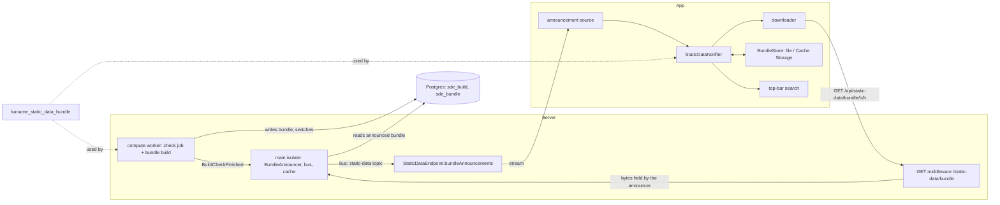
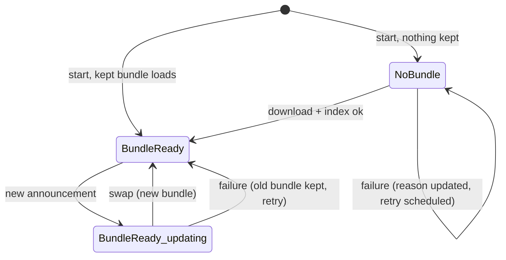
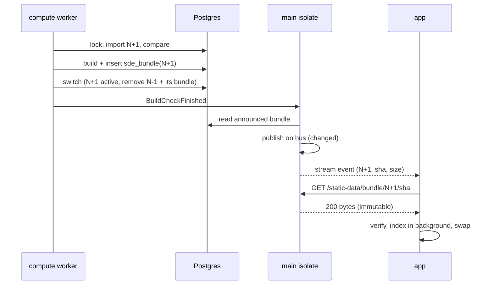
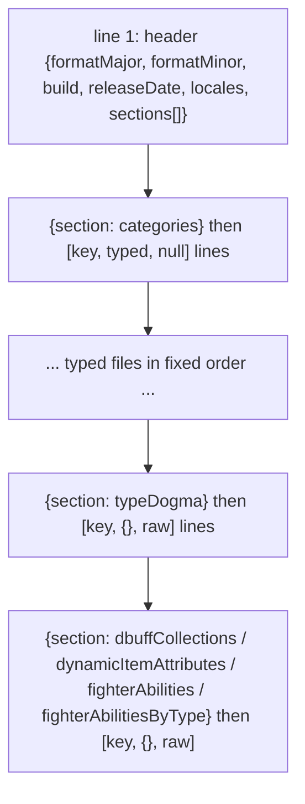

# Design

## Triage

| Trigger | Applies? | Evidence |
|---|---|---|
| T1 Components (new component, or 3+ with directed relationships) | yes | New shared package, a realtime bus, a bundle route, an app feature; compute worker → main isolate → bus → stream → app → server route |
| T2 State (persistent state, caches, 3+ state machine) | yes | New `sde_bundle` table; server in-memory bundle cache; app file / Cache Storage copy; app state none / ready / updating |
| T3 Concurrency (background work, workers/isolates, async, retries) | yes | Bundle build on the compute worker, 60 s announcement check, stream reconnects, download retries, background indexing and swap |
| T4 Boundaries (data format, migration, shared interface, IPC, external) | yes | The bundle file format, a migration, the `RealtimeBus` interface, a streaming endpoint, an HTTP route, the fit engine's input |
| T5 Volume (grows without a fixed bound) | yes | Bundle size grows with the SDE; one bundle per stored build (at most three) |
| T6 Risk (security, money, data loss, unrecoverable user data) | yes | A new unauthenticated route and stream on a public server; corrupt downloads |

TIER: FULL

## Context

The proposal (`proposal.md`) states the scope; this section holds only what the approach relies on.

- **Stored data.** Every typed table keeps each record's full JSON in a `raw` `jsonb` column: each of the 13 models in `server/kaname_server/lib/src/static_data/tables/` declares `raw: SdeJson, serializationDataType=jsonb` (for example `tables/sde_type.spy.yaml:23`) next to its typed columns, read by the differ as `SELECT "sdeId" AS id, "raw" AS r` (`server/kaname_server/lib/src/static_data/postgres_static_data_differ.dart:229-231`). Files outside the typed set are rows of `sde_record` with `build`, `file`, `line`, a `String` `key` and the record as `jsonb` (`server/kaname_server/lib/src/static_data/sde_record.spy.yaml:1-15`). `typeDogma.jsonl` has no typed column; its `dogmaAttributes` and `dogmaEffects` live only in JSON (`packages/kaname_static_data/lib/src/typed_files.dart:316-321`), as do a type's `radius`, `factionID`, `raceID` and `variationParentTypeID`, listed in the types entry's `otherFields` (`typed_files.dart:202-215`). `dbuffCollections`, `dynamicItemAttributes`, `fighterAbilities` and `fighterAbilitiesByType` are known, non-required files stored raw (`packages/kaname_static_data/lib/src/known_files.dart:63`, `:69`, `:73-74`).
- **First activation.** The first import of a server activates its build directly and returns `BuildSwitched` without the compare-and-switch path (`packages/kaname_static_data/lib/src/take_latest_build_job.dart:251-252`); later builds go through `_compareAndSwitch` (`:253-254`, `:267-271`).
- **Builds.** `sde_build` holds one active and at most one previous build, enforced by unique nullable markers, and a `held` flag (`server/kaname_server/lib/src/static_data/sde_build.spy.yaml:1-31`).
- **The check job.** One lock hold covers lock, sweep, read CCP's build, decide, import, compare, switch and record (`packages/kaname_static_data/lib/src/take_latest_build_job.dart:94-120`). Every switch and rollback takes the advisory lock and changes states in one transaction on the lock holder's job connection (the worker's in the server, the development process's own for `sde:rollback`, `server/kaname_server/lib/src/static_data/sde_dev_tasks.dart:60-88`); none runs through the main isolate's ORM (`packages/kaname_static_data/lib/src/static_data_store.dart:269-277`).
- **Rollback is out of process.** `sde:rollback` runs `RollbackJob` from a development task (`server/kaname_server/lib/src/static_data/sde_dev_tasks.dart:60-88`), which mise runs as its own Dart process (`mise.toml:252-255`), so an in-process bus never sees it.
- **Start-time check.** At start the hook runs a build check only when `DailyBuildCheckSchedule.catchUpDue` holds: no active build, or no check since the latest 12:00 UTC (`server/kaname_server/lib/src/static_data/static_data_start_hook.dart:166-199`, `packages/kaname_static_data/lib/src/daily_build_check_schedule.dart:23-39`). A check that cannot take the lock stops at step 1 (`packages/kaname_static_data/lib/src/take_latest_build_job.dart:96-98`).
- **Worker replies.** A dispatched check normally ends with the worker replying a typed `BuildCheckFinished` (`server/kaname_server/lib/src/workers/compute_worker.dart:218-242`, declared at `server/kaname_server/lib/src/workers/worker_messages.dart:273`); a rejected request or a worker exit gives no such reply. The main isolate and logs it (`server/kaname_server/lib/src/static_data/static_data_check_call.dart:69-76`). Only imports are one at a time on the compute worker; each later job kind sets its own bound (`server/kaname_server/lib/src/workers/compute_worker.dart:88-91`).
- **The `_sde` record.** The import skips unreadable lines and lines that are not JSON objects (`packages/kaname_static_data/lib/src/sde_ingest.dart:123-142`) and stores every other record of a file without a typed table as an `sde_record` row (`:168-178`); `_sde.jsonl` is such a file and is required (`packages/kaname_static_data/lib/src/known_files.dart:43`). So the server holds each build's `_sde` objects. One observed CCP build's `_sde.jsonl` held a single object with a `releaseDate` (`packages/kaname_static_data/lib/src/sde_source.dart:102-105`); the import does not require a date (`packages/kaname_static_data/lib/src/import_build.dart:283-297`), so a build without one is valid and its bundle's date is `null`.
- **Record selection.** For typed files the import also drops a line with a missing, non-integer or duplicate key, keeping the first (`packages/kaname_static_data/lib/src/sde_ingest.dart:143-157`), and converts each typed column, storing `null` for a value of the wrong JSON type, such as a float in an integer column (`packages/kaname_static_data/lib/src/typed_files.dart:97-116`, `:144-151`). Raw records are not deduplicated (`sde_ingest.dart:168-178`).
- **Worker dispatch.** The worker starts each job without awaiting it (`server/kaname_server/lib/src/workers/compute_worker.dart:162-173`) and opens a job's Postgres connection before the job runs (`:274-303`), so several requests of one kind can be outstanding at once.
- **Purity.** `kaname_static_data` imports `dart:io`, for example in the check job (`packages/kaname_static_data/lib/src/take_latest_build_job.dart:4`) and the zip sources (`packages/kaname_static_data/lib/src/local_zip_sde_source.dart:4`, `packages/kaname_static_data/lib/src/zip_sde_archive.dart:6`), so the web app cannot depend on it. The `purity` task keeps `packages/` and `tools/` free of Flutter, `dart:ui` and Serverpod, but does not refuse `dart:io` (`tools/kaname_tools/lib/src/purity.dart:10-17`, `:145-181`); D23 extends it.
- **Server start.** `server.dart` creates the pod and calls `pod.start()` (`server/kaname_server/lib/server.dart:12-13`); there is no middleware yet.
- **Routing.** Caddy proxies `/api/*`, prefix stripped, to the API server on 8080 only (`deploy/Caddyfile:12-13`). Release web builds reach the server at their own origin's `/api/`, while native builds keep the configured address's path (`app/lib/server/data/server_address.dart:73-99`). The generated client opens its WebSocket at `<origin>/v1/websocket` whatever the configured path (serverpod_client 4.1.2 replaces the path), so Caddy also proxies `/v1/websocket`, unchanged, to the API server; without it the web app's announcement stream gets the single-page-app fallback (round 21, found by task 11.1). The same holds for a native app whose configured address has a path (for example `https://host/base/`): health and bundle downloads keep the path, but the announcement stream still opens `<origin>/v1/websocket`, and serverpod_client 4.1.2 offers no way to change it. So a server published under a sub-path must also route `<origin>/v1/websocket` to the server, as the bundled Caddy stack does; otherwise announcements never arrive and the app keeps the bundle it holds (pre-ship round 3, owner's choice to document rather than replace the generated client's stream).
- **Serverpod 4.1.2 behaviour** that decisions rely on was read in the package sources outside this repository, so it is listed as assumptions A7–A14, each proved by an early task against the real server. Round 17 (apply, task 2.1) disproved parts of A11 to A14; D4 and D8 were amended to what the probes showed, with the owner's choice.
- **App.** Server state is a `ServerStatusNotifier` with a sealed `ServerStatus` and a `check()` method (`app/lib/server/logic/server_status.dart:19-148`, `check()` at `:119-133`). The app already depends on `flutter_riverpod`, `shared_preferences` and the generated `kaname_client` (`app/pubspec.yaml`).
- **Design system.** `DESIGN.md` sets the 1080 px breakpoint at which the inspector leaves the grid (`DESIGN.md:303`), which D22 reuses for search.
- **Fit engine input (ADR 0011).** EVEShipFit's engine reads `sde.dat`, a Flatbuffers file built by its `sde-patched` project. From the SDE it takes: types (`_key`, name, group, published, faction, market group, meta group, race, variation parent, capacity, mass, radius, volume, and per-type dogma attributes and effects); groups and categories (key, name, ids, published); dogma attributes, effects (with `modifierInfo` and the duration, discharge, range, falloff, tracking, resistance and fitting-chance links), units and attribute categories; buffs (`dbuffCollections`); mutaplasmids (`dynamicItemAttributes`); market and meta groups; fighter abilities (`fighterAbilities`, `fighterAbilitiesByType`); and `_sde` `releaseDate`. It refuses an `sde.dat` below its minimum major version. `sde-patched` also adds synthetic attributes and effects that the SDE lacks. This was read from the two projects' public sources for this design; nothing of theirs is copied into Kaname.

## Decisions

### D1: When the bundle is built

- **Choice:** the check job builds the staged build's bundle after the comparison and before the switch, under the same lock hold. A first build, activated directly with no build to switch from, gets its bundle in the same check right after activation (round 5). A failed bundle build is recorded and does not stop the switch. Repair of the active build's bundle (missing, failed, or of another format version) is D10's: at server start, in every check that holds the lock, and on the announcer's 60-second tick while it is still owed.
- **Rejected:** blocking the switch until the bundle builds, because a bundle bug would stop every new build on the server; building after the switch, because apps would see an active build with no bundle on every switch, not only on a failure.
- **Reversal cost:** low
- **Important:** yes (changes behaviour users see: when apps hear of a build)
- **Chosen by:** user

### D2: Bundle file format

- **Choice:** one gzip file of UTF-8 JSON Lines. Line 1 is the header: `formatMajor` (1), `formatMinor` (0), `build`, `releaseDate`, `locales` (`["en"]`) and `sections`, each with `file`, `present` and `records`. Then, per section in a fixed file order, one `{"section": <file>}` line and one line per record in ascending key order: `[key, typed, raw]`. `typed` holds the typed columns (and `radius`, `factionID`, `raceID` and `variationParentTypeID` for types), with names as `{"en": ...}`; the English-only rule applies to this name projection, while `raw` keeps the record as CCP ships it, localized fields included. `releaseDate` comes from the first `_sde.jsonl` object, by line, whose `buildNumber` is a number equal to the build number, on both paths: the server reads the build's `sde_record` rows of `_sde.jsonl` ordered by line, the zip path reads `_sde.jsonl`. The rule uses numeric equality, not the import's integer-type test (`packages/kaname_static_data/lib/src/import_build.dart:283-297`), because the stored records are `jsonb` (`server/kaname_server/lib/src/static_data/sde_record.spy.yaml:10-14`), which keeps a number's value but may rewrite its form, such as `42e0` as `42` (A6), so both paths pick the same object even when it is not the one the import read the build number from. The date is `null` when that object has none; other `_sde` objects are ignored (rounds 6, 9 and 10; C23). `raw` is the full record for the dogma, buff, mutaplasmid and fighter files, and `null` elsewhere. JSON keys are sorted, numbers are written in Dart's shortest form, and gzip is written with a zero mtime and a fixed level. A reader accepts any minor version of a major it knows and ignores unknown header keys and sections. Record selection and typed projection are the import's on both paths: the server builds from its stored typed columns and raw JSON, and the zip path runs the import's own `SdeIngest` into an in-memory writer, so both keep the same lines (unreadable lines dropped, the first of a duplicate typed key kept) and the same typed values (a wrong-typed value is `null`). The builder never re-projects typed columns from raw JSON. Raw sections keep every stored record, ordered by key then line, so a duplicate raw key is kept, not merged (round 7; C23). Each section's `records` is the count of its accepted records and `present` is `records > 0`, on both paths and whatever import report is kept (C24): a missing optional file and one whose lines were all rejected or that has none are both absent, because the stored rows cannot tell them apart once the import report is pruned (round 8).
- **Rejected:** a custom binary layout, because it is much more code and a harder contract for a file whose size we have not yet measured (D19); a SQLite file, because it needs SQLite on every platform, WASM on web, and pre-empts R32.
- **Reversal cost:** medium (apps and the fit engine path read it; a major bump makes every app download once)
- **Important:** yes (binds future changes: data format)
- **Chosen by:** user

### D3: Server storage of bundles

- **Choice:** two new tables. `sde_bundle` holds metadata only: `build` (unique), `outcome` (`built` or `failed`), `reason`, `formatMajor`, `formatMinor`, `sha256`, `size` and `builtAt`. `sde_bundle_bytes` holds `build`, `sha256` (unique together) and `bytes` (`ByteData`, `bytea`), written in the same transaction as a `built` row, so bytes are always found by the identity in the URL, never by build alone (round 4). A rebuild of the same build deletes the superseded hash's byte row in that same transaction, so a build has at most one byte row (round 5). So no metadata read ever loads bytes (review round 1). The worker writes both through its own job connection (ADR 0012). Every statement that removes a build's rows (the switch's removal of the old previous build, the import's removal of the staged build) also deletes both rows in the same transaction.
- **Rejected:** files on a Docker volume, because that is one more store to back up and keep in step with `sde_build` across a crash; one table with projected metadata reads, because the rule would rest on every later reader's discipline.
- **Reversal cost:** low
- **Important:** yes (binds future changes: stored schema and migration)
- **Chosen by:** user

### D4: Serving the bundle

- **Choice:** a GET middleware on the API server, registered before `pod.start()`, answers `/static-data/bundle/<build>/<sha256>` (Caddy's `/api/` prefix is stripped before it). It answers 200 with a streamed body (`Body.fromDataStream` over chunk views of the held bytes, `application/gzip`; a `Body.fromData` body gives no completion signal, A13), `Cache-Control: public, max-age=31536000, immutable` and `ETag: "<sha256>"`; 304 on a matching `If-None-Match`; 404 for anything else. The route never reads the database (round 12, reversing round 3's read on every GET): it serves only the bundles the announcer (D9) holds in memory, the announced one and the previous one (the last bundle announced for another build), each matched by build, hash and current format together; the announcer holds at most one bundle per build, so when a build's bundle is rebuilt under a new hash the old hash is dropped as soon as the new one is announced (round 13), so a bundle the announcer does not hold, a replaced hash, an old-format bundle and a staged build's bundle all get a 404, whatever HTTP caches hold (C15, C18). The announcer loads a bundle's bytes by build and hash together, inside its serial refresh, before it announces that bundle, and drops bytes once their bundle is neither announced nor previous, so the route's answer changes only when the announcer's state does. A response already admitted keeps a reference to the bytes it sends until its body ends; dropped bytes are freed once their last response ends. A bundle removed by another process can still be served until the next successful refresh; that is harmless, because the bytes are public and apps check hash, build and format before use. At most 16 bundle responses are in flight: a slot is taken at admission and released when the response body has been written to the connection, fails or is cancelled by a disconnect, and at once for a response with no body (304, 404). A 2-minute deadline from admission releases the slot of a transfer still running, and its body ends at the next chunk it is asked for. A client that has stopped reading never asks: its paused socket stalls the body, and relic gives the middleware no socket to close (A13). So in production the deploy proxy closes stalled client connections with a timeout that leaves the announcement WebSockets alone (the Caddy setting is chosen against Caddy's documentation in task 7.3), and the bytes such a connection pins are freed when it closes (round 17, owner's choice; C19). A further GET gets 503 with `Retry-After: 60`, which the app treats as a failed download (D5). The limit and the deadline are named constants. Old-format copies already held by HTTP caches cannot be revoked; that is harmless for the same reason.
- **Rejected:** a `sendAsRaw` endpoint method, because its URL is shaped like RPC and it would put a public HTTP contract inside an endpoint of the generated client (A12: it can set Content-Type by returning a relic `Response`, so that is not the reason; round 17); a metadata read on every GET (rounds 3 to 12), because on Serverpod's shared pool a cancelled read cannot be proven stopped, so the route's database work could not be bounded; reading the bytes from Postgres on every download, because each read loads the whole `bytea`; a route on the web server (8082), because it is not configured outside development and Caddy does not proxy it (A12).
- **Reversal cost:** low
- **Important:** yes (binds future changes: public HTTP contract)
- **Chosen by:** user

### D5: App failure policy

- **Choice:** a failed download or refused bundle keeps the bundle in use; retries after 1 minute, doubling to 30 minutes, and at once only on an announcement of another bundle. A reconnect that announces the same bundle waits out the backoff (review round 1: reconnects every 5 s must not turn into downloads; C14). A 503 from the route counts as a failed download. With no bundle, the search shows "Static data not loaded yet" and a reason (D21).
- **Rejected:** retrying only on the next notice, start or reconnect, because an app could stay stale for a day; retrying at once on every reconnect, because a flapping stream would download the bundle every few seconds.
- **Reversal cost:** low
- **Important:** yes (changes behaviour users see)
- **Chosen by:** user

### D6: The safe point

- **Choice:** a new bundle is checked (hash, format, build) and indexed in the background, then swapped in one assignment of the notifier's state. A search captures the index it starts with and finishes on it. Two identities are kept apart: epoch, revision and subscription generation decide whether an event is accepted (D8, D15), while the bundle identity (build, hash, format) is the target that work, cancellation and backoff key on, so a server restart that announces the same bundle under a new epoch neither cancels a running transfer nor resets a backoff wait (round 11). Every download, check, index and retry belongs to an attempt: an attempt starts when the target becomes a bundle, is kept while announcements name that same bundle, and ends when the target changes, to another bundle or to "none"; it swaps in or schedules a retry only while its attempt is current. So B, then "none", then B again ends B's first attempt, drops its result whatever its stage, and starts a new one (round 13). Any change of target, to another bundle, to "none", to the bundle already held or to an unreadable format, discards the work in flight. A verified bundle is swapped in first and saved after: a save always writes the bundle in use, never an announcement target, so no save needs a target check. Saves run one at a time; when a save completes and the bundle in use is no longer the one it wrote, the notifier saves the bundle in use again, so the kept copy converges to it (rounds 5 and 6; C17). An announcement of "none" or of an unreadable format changes no bundle in use, so it never undoes a completed swap or save. An interruption before the follow-up save can leave an older whole bundle kept; the next start loads it, and the next announcement corrects it. Work is capped: one pipeline (download, check, inflate, index) runs at a time. When its target is replaced, a running download is cancelled at once; cancellation and the 2-minute limit end a download at every stage, name lookup, connect and TLS setup included, because on native platforms each transfer has its own client whose connections it owns. dart:io gives no handle that closes a socket during its TLS handshake, so a peer that accepts TCP and never answers TLS keeps that one connection open until it closes it; the transfer still ends at once and the next pipeline starts (pre-ship round 19, owner's choice); a running check, inflate or index cannot be interrupted, so it finishes and its result is dropped; only then does the pipeline start for the latest target, and targets replaced while waiting are skipped. So memory holds at most three bundles: the bundle in use, one in flight, and one still held by a save that has not completed (one save at a time); searches hold none once they return (D17; rounds 8 and 13). At start, the app finishes loading its kept copy before it acts on any announcement; events that arrive meanwhile wait, and only the latest is taken, so a slow load can neither cause a download of the held bundle nor replace a newer bundle in memory (round 8).
- **Rejected:** asking the user to reload; swapping only at the next start. Both leave the app on old data although nothing needs the user.
- **Reversal cost:** low
- **Important:** yes (changes behaviour users see)
- **Chosen by:** user

### D7: The realtime bus

- **Choice:** in `kaname_core`, a `RealtimeBus` interface with `publish<T>(Topic<T>, T)` and `subscribe<T>(Topic<T>) → Stream<T>`. A `Topic<T>` has a name, a version and a visibility (`public` or `scoped`). The server implementation posts Serverpod models on the message system with local scope, listening through `pod.internalSession`; only the main isolate publishes, and a worker's change reaches the bus as a typed worker reply the main isolate turns into a message. An unknown message version is logged and dropped. Every delivery to a client stream passes the topic's delivery scope, as ADR 0008 requires: a public topic carries only public, non-character data and its scope passes every message; a scoped topic is refused until the privacy scope exists (ADR 0006). The static-data topic is public. This keeps ADR 0008 as written; ADR 0014 records the rule.
- **Rejected:** delivery through Redis now, because 1.0 runs one instance (ADR 0001); a stream fed straight from the switch, because ADR 0008 routes fan-out through the bus; letting public topics bypass the scope, or a superseding ADR with a public-topic exception, because a bypass is what ADR 0006's architecture test must catch.
- **Reversal cost:** medium (every later realtime feature uses the interface)
- **Important:** yes (binds future changes: shared interface)
- **Chosen by:** user

### D8: The notice API

- **Choice:** a `StaticDataEndpoint` with `requireLogin` false and one streaming method, `bundleAnnouncements()`. The announcer starts with the pod in every run mode, tests included. The stream subscribes to the bus first, then waits until the announcer has installed its first announcement, then sends the installed announcement (D9) as its first event. The first announcement is installed when the first refresh succeeds, or as "none" when that refresh fails or has not succeeded 19 seconds after its limit was armed (a second below the limit, leaving room for delivery; round 19). The server arms that limit before `pod.start()`, because Serverpod's API listener accepts subscriptions before the rest of its startup, which can wait on the database, has ended; the announcer's refreshes start once the pod has started (pre-ship round 21), whether or not its database work has ended; the refresh goes on, and when it or a later refresh succeeds it publishes the real state. So a stream sends its first event at most 20 seconds after it subscribed (at once once the server has run 20 seconds), well inside the generated client's idle timeout of about 40 seconds (A11), and no stream waits for database work (rounds 13 to 15; C29). That timeout ends a stream only when its transport delivers nothing, because the server answers the client's 20-second pings; a quiet stream on a healthy connection stays open until the server's 30-minute expiry (A11, round 17). When a stream ends, the app resubscribes per D15 and gets the installed announcement first. A refresh that missed its deadline never publishes its late result; the next refresh, which starts once that read has ended, reads again and publishes. An app that holds a bundle keeps it on "none" (D6); an app without one shows "server has no bundle yet" until the real state arrives. The installed announcement is the last one the announcer has made servable (its bytes loaded), never a state it has read but not yet loaded, so at the moment a stream sends an event its bundle's URL is served by this server; a later rotation can still retire it before the app's GET, which the app handles as a failed download and corrects from the next event (rounds 13 and 14). After the first event, every bus message is only a wake-up: at each handoff to the writer, the stream selects the announcer's installed announcement as it is then, applies the delivery scope and sends it only if its revision is higher than the last one it sent; the message's own payload is never forwarded. So a stream never goes back to an older announcement (round 3), and never sends one the announcer has already replaced, however late the wake-up arrives (round 16; C16). The handoff is synchronous: the stream's controller is a sync one, so the check and the handoff to Serverpod happen in the same step. Serverpod then delivers the value through its own asynchronous output controller, one microtask before it writes it to the WebSocket, and the endpoint cannot check again at that write. If an announcement is installed in that microtask, the client receives the one it replaced, and the newer one follows at once, since the install wakes the stream; the app handles the older one's failed download as above (pre-ship round 14, owner's choice). An announcement is a Serverpod model with a version, the server's `epoch` (a random id chosen at each server start), a `revision` that rises with each publish within an epoch, and either `build`, `sha256`, `size` and `formatMajor`, or "none". The app ignores an announcement whose revision is not higher than the last one it took from the same epoch, and takes any announcement of a new epoch. A real rollback is a new publish with a higher revision, so it is never suppressed. The local bus delivers every message to each stream's endpoint subscription without loss; only the client-facing stream coalesces. Serverpod applies no backpressure to an endpoint stream: it passes each event to the WebSocket as soon as the endpoint yields it, so the server cannot see that a client has stopped reading (A14, round 17). A stream is therefore bounded by rate and lifetime, not by write completion (owner's choice): it sends an event only at a handoff whose installed announcement has a higher revision than the last one it sent, so it sends at most one event per change of the installed announcement, and the announcer changes it at most once per refresh, refreshes running one at a time. A stream that stops reading thus buffers at most the few small events of its 30-minute life. A disconnect and the 30-minute expiry end a stream and free its slot, also while its client still does not read; each ending also removes the stream's bus listener from `pod.internalSession`, so ended streams leave no listener behind (rounds 5 to 7, 12; A14, C20). The stream carries the latest announced bundle, not every transition: changes that fall between two reads may be merged, and apps need only the current bundle (round 4). Every event, the first included, passes the topic's delivery scope (D7). The server holds at most 2,000 announcement streams and refuses more, and ends each stream after 30 minutes; the app resubscribes per D15. Both are named constants.
- **Rejected:** a separate one-shot method plus a change-only stream, because that is two calls whose answers can disagree.
- **Reversal cost:** medium (generated client contract)
- **Important:** yes (binds future changes: client contract)
- **Chosen by:** user

### D9: Who decides the announced bundle

- **Choice:** the main isolate owns the announcement. It reads the announced bundle (the active build's built bundle in the builder's current format, else the previous build's, else none) at start, after each `BuildCheckFinished` and each bundle-repair reply, and every 60 seconds, and publishes on the bus only when the value changed. Refreshes run one at a time: read, load the bytes by build and hash (D4), raise the revision, update the cached announcement and the bytes the route serves, and publish, as one step; a trigger during a refresh queues one more refresh, so a slow refresh can never publish older state after a newer one (round 3). Each refresh has a 2-minute deadline; a refresh that misses it or fails publishes nothing and changes nothing, and is logged. The queued refresh starts only after the database work of the one before has ended, so the announcer has at most one database read in flight and the route none (round 12). Nothing in the server frees a read that never ends: while one is outstanding past its deadline, every tick logs a warning "announcer read outstanding for <n> s", distinct from the refresh-timeout line, and announcements stay as they were; recovery is the database answering, the connection failing, or an operator restarting the server (round 14; C27). A change made by another process is published by the first refresh that starts after it and succeeds; refreshes are attempted at each 60-second tick, one at a time; no time bound is promised, because a refresh's database read can outlast its deadline and the next refresh waits for it (rounds 12 to 14). A rollback to a bundle that is already announced, such as the previous build's fallback, changes nothing and publishes nothing. A byte load that fails ends that refresh without publishing, leaves the previous announcement in place, and a later refresh retries it (round 7). Where a worker runs, each 60-second tick also sends `RunBundleRepair` while the active build's bundle is missing, failed or of another format version and no repair is outstanding (D10): an owed repair is sent at the first tick after the lock's release at which none is outstanding, and announced once its bundle is stored. At most one `RunBundleRepair` is outstanding per server, the start request included, until its reply, a worker error or the worker's exit; a tick while one is outstanding sends nothing (round 7). A bundle in another format is never announced, so after a format upgrade a rollback cannot make newer apps report "app update needed" (round 2). The 60-second read also catches out-of-process changes, such as `sde:rollback`.
- **Rejected:** Postgres `LISTEN/NOTIFY`, because it is a second channel and connection to own; reaching apps only on their next subscribe, because a rollback would go unseen until apps reconnect.
- **Reversal cost:** low
- **Important:** yes (changes behaviour users see: a rollback reaches apps at the first successful refresh after it)
- **Chosen by:** user

### D10: Bundle build inside the check job

- **Choice:** the check job gains a step between compare and switch: build the bundle for the target build unless a built bundle of the current format is stored. After the decision, whatever the outcome (switched, up to date, held, older, staged, or CCP unreachable), every check that holds the lock also builds the active build's bundle when it is missing, failed or of another format version. A check never builds the same build's bundle twice: a bundle its staged-build or first-build step already attempted is not attempted again by its repair step, and a recorded failure is retried by the next check, start or 60-second repair (round 6). A check that could not take the lock builds nothing. A server start whose catch-up check is not due (`catchUpDue` false) sends the worker a `RunBundleRepair` request instead, which takes the lock without waiting and does the same repair; a start whose check is due relies on that check's repair. So the repair and the catch-up check of one start never compete for the lock (round 2). The announcer's ticks send no repair from the start until the start has decided and its check or repair is answered; the refresh that answer asks for no longer holds them (rounds 7 and 8). When another job or process holds the lock (a development import, `sde:rollback`), the repair does nothing, and the announcer sends it again at the first 60-second tick at which no repair is outstanding (D9), until it is done (rounds 3 and 13). Starts that owe a repair are those of the monolith role in the development, staging and production run modes, where the worker runs; the test run mode and the maintenance role start no worker, and tests start one explicitly. All bundle writes happen under the lock, on the worker's job connection.
- **Rejected:** a separate bundle job taking the lock after each check, because it adds an ordering in which a switch can remove the build being read; a full build check at every start, because it contacts CCP on each restart only to repair a bundle.
- **Reversal cost:** low
- **Important:** yes (binds future changes: the check job's step order)
- **Chosen by:** user

### D11: A new pure-Dart package

- **Choice:** `packages/kaname_static_data_bundle`, with no `dart:io`: the format, the builder core (records in, bytes out), the reader, the section index and the search. `kaname_static_data` depends on it to read records from a zip (solo path) and from the store's interface; the server and the app depend on it.
- **Rejected:** a `dart:io`-free library inside `kaname_static_data`, because the app would depend on the whole importer and only import discipline would keep `dart:io` out of the web build.
- **Reversal cost:** low
- **Important:** yes (binds future changes: package boundary, ADR 0003)
- **Chosen by:** user

### D12: Where the app parses and indexes

- **Choice:** native platforms hash, inflate, parse and index a bundle in `Isolate.run`. Web, where the app's Dart code runs on the browser's main thread (A17), hashes with the browser's `SubtleCrypto.digest` and inflates with its `DecompressionStream` (both asynchronous and native). Browsers offer `SubtleCrypto` only in a secure context (HTTPS or loopback); elsewhere the app falls back to a pure-Dart SHA-256 in chunks that yield to the event loop (round 2). It parses in chunks of 2,000 lines that yield to the event loop between chunks. The reader keeps the decompressed bytes and an offset per section, and decodes only the sections search needs (types, groups, solar systems, regions); the dogma, buff, mutaplasmid and fighter sections stay undecoded until the fit engine asks.
- **Rejected:** the main thread everywhere, because a mid-session swap would freeze the UI; a web worker, because it adds build and interop setup that native browser APIs and a chunked parse make unnecessary at this size; pure-Dart inflate and hash on web, because each is one long synchronous task over the whole file.
- **Reversal cost:** low
- **Important:** yes (changes behaviour users see: jank)
- **Chosen by:** user

### D13: The fit engine's input and the bundle

- **Choice:** the bundle maps to the engine's `sde.dat` as follows. Types, groups, categories, market and meta groups come from typed columns plus types' `radius`, `factionID`, `raceID` and `variationParentTypeID`, so every type field in the engine's input listed in Context is in the bundle (round 5). Dogma attributes, effects, units, attribute categories and per-type dogma come from the dogma sections' raw JSON. Buffs, mutaplasmids and fighter abilities come from their raw sections. `releaseDate` is in the header. M10 writes an adapter that turns a bundle into the engine's input; the synthetic attributes and effects of `sde-patched` are an M10 decision. 
- **Rejected:** shipping `sde.dat` itself as the bundle, because its build pipeline is a third-party tool outside Kaname's SDE-is-data path (ADR 0004) and it is not built per Kaname build; leaving fighters to M10, because that would mean a format bump for data the engine needs.
- **Reversal cost:** medium (format)
- **Important:** yes (binds future changes: fit engine input)
- **Chosen by:** user

### D14: App dependencies

- **Choice:** `path_provider` for the native support directory, `web` for Cache Storage, and `http` for the download, each checked by `notices:check` and the licence policy.
- **Rejected:** working out paths by hand per platform, because it means more platform code to get right.
- **Reversal cost:** low
- **Important:** yes (binds future changes: dependencies)
- **Chosen by:** user

### D15: Stream reconnect

- **Choice:** resubscribe after 5 seconds, doubling to 5 minutes, reset after an event arrives; `ServerStatusNotifier.check()` also resubscribes at once. Each subscription has a generation; only the current generation's events, errors and reconnect timers act, and a resubscribe cancels the old subscription and its timer, so a late event or ending from a replaced subscription changes nothing, whatever its epoch (round 9).
- **Rejected:** the download schedule (1 to 30 minutes), because an app could miss a build for half an hour.
- **Reversal cost:** low
- **Important:** yes (changes behaviour users see)
- **Chosen by:** user

### D16: App structure

- **Choice:** `app/lib/static_data/{data,logic,ui}`. `data/` holds the announcement source over the generated client, the downloader and a `BundleStore` with a file implementation and a Cache Storage implementation, picked by conditional import. The store keeps one copy of the bundle in use, replaced whole by each save: on native, a temporary file renamed over the kept file; on the web, one `Cache.put` on a fixed key whose entry holds the build and hash. A reader always finds a whole old or a whole new bundle, so no pointer, cleanup or cross-tab lock is needed; between tabs the last save wins (round 5, replacing the round 3–4 pointer design). The web store never deletes: a load that finds an unreadable entry rejects it in memory and leaves it for the next save to replace, so a slow reader in one tab can never delete another tab's good save; the native store does the same, since two app processes can share the support directory: an unreadable kept file is rejected in memory and left for the next save's rename to replace, and each save writes its own uniquely named temporary file, so no process deletes a file another one wrote; temporary files older than one hour are removed at start (rounds 6 and 11). `logic/` holds one `StaticDataNotifier` with a sealed `StaticDataState` (`NoBundle(reason)`, `BundleReady(bundle, index, updating, notice)`, where `notice` is an optional sealed notice such as app update needed, shown while search keeps working) and a search provider. `ui/` holds the top-bar search. `data/` never imports Riverpod (ADR 0010).
- **Rejected:** separate static-data and search features, because that is more files before global search exists. Several kept entries with a current pointer written last, cleanup and a Web Locks lock (rounds 3–4), because each version raced across tabs or an interrupted save, and one bundle on a device needs none of them.
- **Reversal cost:** low
- **Important:** no
- **Chosen by:** user

### D17: Search implementation

- **Choice:** per bundle, build lowercase name arrays for published types and all solar systems, plus id maps over all types, unpublished included, and all solar systems, built separately from the name arrays (round 7). Each query is a linear scan that collects prefix and substring matches, sorts each group by name, puts an exact id match first and cuts the list at 50. A query runs synchronously on the main isolate, scan to cut, over the index it captured, and its results copy the names and ids they show, so no search holds a bundle once it has returned and no search spans a swap (round 13). The field debounces input by 150 ms.
- **Rejected:** a trigram index, because a linear scan of about 60,000 names is expected to fit within one 16 ms frame on web (A16), and an index costs more memory and code.
- **Reversal cost:** low
- **Important:** no
- **Chosen by:** user

### D18: ADRs

- **Choice:** record ADR 0013 (client data bundle: format and versioning, contents rule, per-build delivery, the solo and solo-lite paths) and ADR 0014 (`RealtimeBus` topics: typed and versioned, public or scoped, local delivery first) during apply, and update `openspec/architecture.md`: the client data bundle contract line, the bus in the components, state ownership for bundles, the Realtime worker row (workers report to the main isolate, which publishes; C10), and the server–app contract rule, which gains the bundle GET route (`/static-data/bundle/<build>/<sha256>`, ADR 0013) beside the generated client (round 7).
- **Rejected:** one combined ADR, because the two decisions change on different triggers; bundle only, because the bus rules bind every later realtime feature.
- **Reversal cost:** low
- **Important:** yes (binds future changes)
- **Chosen by:** user

### D19: Bundle size

- **Choice:** no hard cap. Each bundle's size is stored and logged, and apply measures a real build (compressed and decompressed size, app parse time on web and one native platform) and records it as evidence.
- **Rejected:** a 50 MB cap, because a number we have not measured would block new builds.
- **Reversal cost:** low
- **Important:** yes (chosen on weak evidence: size not yet measured)
- **Chosen by:** user

### D20: Bundle format changes

- **Choice:** a stored bundle whose format version differs from the server's builder counts as missing, so the start-time repair or the next check (D10) rebuilds it after an upgrade, and the announcer never announces it (D9). The announcement carries `formatMajor`; an app that cannot read that major downloads nothing, keeps the bundle it holds and shows "app update needed" (as `NoBundle`'s reason, or as `BundleReady`'s notice while search keeps working, D16), and tries again only when the announcement changes. Old and new formats are never served side by side: the route serves only the current format (D4, C15).
- **Rejected:** building and serving old and new formats side by side, because it doubles storage and build time for a window that is hard to bound.
- **Reversal cost:** low
- **Important:** yes (binds future changes: format upgrade path)
- **Chosen by:** user

### D21: Why there is no bundle

- **Choice:** `NoBundle` carries a sealed reason: starting (the kept copy is not loaded and no announcement has arrived yet; round 20), downloading, no server configured, server unreachable, server has no bundle yet (a valid "none" announcement while the app holds no bundle), refused (hash, format, build or indexing; round 20), app update needed (round 10). Each has a localised message; exception text, hosts and ports never reach the UI, as the app's existing rule requires (`app/lib/server/logic/server_status.dart:13-18`); this change also writes them to the log, a new policy for bundle errors.
- **Rejected:** one generic message, because the user could not tell a missing server from an outdated app.
- **Reversal cost:** low
- **Important:** yes (changes what users see)
- **Chosen by:** user

### D22: Search layout by width

- **Choice:** above 1080 logical pixels, an inline field in the top bar with a result list below it; at narrower widths, a search button that opens a full-width search (field and results), closed by Escape or back, returning focus to the button; Escape closes it wherever focus is in the shell, not only within the search (round 10). Built with DESIGN.md tokens and the impeccable skill. The open narrow search has its own history entry, marked by a `search` query parameter on the current location (pre-ship round 4, owner's choice): opening it adds the entry, so the browser's Back on the web closes it before it leaves the page; every marked entry comes right after the same location unmarked, so Escape, the close button and widening the window step the browser back over the marked entry, also when Forward reopened it, and no dead entry stays; without a browser the marker is removed in place, and the platform's back closes the search. A marked location the app navigates to itself, such as the remembered location of a branch switched back to, is unmarked in place, and ends a search open on another page (round 6). The bar tags each marked entry it pushes in the browser's entry state; a page loaded on a tagged entry, by a reload or by Back or Forward from another site, is already such a pair and is kept: the narrow search shows over it and tags it again, since the router's first report rewrites the entry's state, and a wide window steps back over it (rounds 7 to 9). A page loaded on an untagged marked entry, such as a shared or typed link, opens unmarked in place with the search closed on every width (round 12, owner's choice, replacing round 5's pair made at load): a history entry pushed before the user acts on the page is one the browser's Back may skip. Only the browser's Back and Forward reach a marked entry. The wide layout otherwise ignores the marker.
- **Rejected:** an overlay on every width, because it hides search behind a button on desktop.
- **Reversal cost:** low
- **Important:** yes (changes what users see)
- **Chosen by:** user

### D23: Purity check for web-safe packages

- **Choice:** `kaname_tools purity` also refuses `dart:io`, `dart:ffi` and `dart:isolate` in packages marked web-safe: `kaname_static_data_bundle` and `kaname_core`. It runs in `mise run check`.
- **Rejected:** relying on the wasm build to fail, because it runs later and less often than `check`.
- **Reversal cost:** low
- **Important:** yes (binds future changes: package rule)
- **Chosen by:** user

### Decision summary

| # | Decision | Choice | Rejected | Reversal cost | Important | Chosen by |
|---|---|---|---|---|---|---|
| S1 | Bundle contents | Typed columns; full JSON for dogma, buffs, mutaplasmids, fighters; types' radius, faction, race, variation parent | Typed only; explicit dogma fields; JSON for all | medium | yes | user |
| S2 | Name languages | English, keyed by locale | All languages | low | yes | user |
| S3 | Server notice | Minimal bus + stream, check on start and reconnect | Stream without bus; polling | medium | yes | user |
| S4 | Device storage | One copy replaced whole: file native, one Cache Storage entry web | Web memory only; choose M4 store; pointer + cleanup | low | yes | user |
| S5 | Search location | Top-bar quick search | Nav destination; settings page | low | yes | user |
| S6 | Search rules | Substring, prefix first, 50, ids | Prefix only; fuzzy | low | yes | user |
| S7 | Patches | Full bundles only | Patches now | low | yes | user |
| S8 | Building without a server | Shared builder, proven by test | Wire solo now; server only | low | yes | user |
| D1 | Bundle timing | Before switch (first build: right after activation), never blocks | Blocks switch; after switch | low | yes | user |
| D2 | File format | Gzip canonical JSON Lines; release date from the `_sde` record; import's selection and projection on both paths | Custom binary; SQLite | medium | yes | user |
| D3 | Server storage | `sde_bundle` metadata + `sde_bundle_bytes` keyed by build and hash, superseded hash deleted | Files on a volume; one table with projections | low | yes | user |
| D4 | Serving | GET middleware, no database: serves only the announcer's announced and previous bundles by build, hash and current format; streamed body; ≤ 16 requests in flight until the body ends or 2 min from admission; the deploy proxy closes stalled connections | Raw endpoint; metadata read per GET; bytes from DB per request; web server | low | yes | user |
| D5 | App failure policy | Keep old, retry 1–30 min, reconnect does not bypass | Retry on notice only; retry on every reconnect | low | yes | user |
| D6 | Safe point | Between searches; work fenced by current target; one pipeline at a time; kept copy loaded before announcements; swap first, save only the bundle in use, kept copy converges | Ask user; next start; strict compensating write | low | yes | user |
| D7 | Bus | Typed versioned topics, local, main isolate publishes, delivery scope (public passes all) | Redis now; no bus; public bypass | medium | yes | user |
| D8 | Notice API | One stream; first event = current; latest state, coalesced; epoch + rising revision, stale dropped; ≤ 2,000 streams, 30 min lifetime, at most one event per change of the installed announcement (no backpressure in Serverpod, A14); announcer in every mode | RPC + change stream; every transition | medium | yes | user |
| D9 | Announcement owner | Main isolate, current format only, serial refresh with a 2 min deadline and one database read in flight, loads the bytes the route serves; out-of-process change published by the first successful refresh after it; tick requests owed repairs, one outstanding; failed byte load keeps the previous announcement | LISTEN/NOTIFY; next subscribe only | low | yes | user |
| D10 | Build job placement | Inside check job on every lock-holding outcome; start repair only when no check is due; busy lock retried by the tick; never twice per build per check | Separate job; full check at start | low | yes | user |
| D11 | Package | New `kaname_static_data_bundle` | Library in `kaname_static_data` | low | yes | user |
| D12 | App parsing | Isolate native; browser-native inflate/hash (Dart SHA-256 fallback off secure contexts) + chunked parse on web; lazy dogma | Main thread; web worker; pure-Dart web inflate | low | yes | user |
| D13 | Fit engine input | Bundle maps to `sde.dat`, all listed type fields included; adapter and patches in M10 | Ship `sde.dat`; fighters later | medium | yes | user |
| D14 | App dependencies | `path_provider`, `web`, `http` | Hand-made paths | low | yes | user |
| D15 | Stream reconnect | 5 s doubling to 5 min | 1–30 min | low | yes | user |
| D16 | App structure | One `static_data` feature folder; store keeps one copy, replaced whole (rename native, one `Cache.put` web, web never deletes); `BundleReady` notice | Split features; pointer + cleanup + Web Locks | low | no | user |
| D17 | Search implementation | Lowercase arrays, linear scan; id map over all types | Trigram index | low | no | user |
| D18 | ADRs | 0013 bundle, 0014 bus topics; architecture.md incl. Realtime worker row | One ADR; bundle only | low | yes | user |
| D19 | Size cap | None; measured | 50 MB cap | low | yes | user |
| D20 | Format changes | Other format = missing, rebuilt, never announced; app skips unreadable major | Serve both formats | low | yes | user |
| D21 | No-bundle reason | Sealed, localised reasons | Generic message | low | yes | user |
| D22 | Search layout | Inline wide; button + full-width search narrow | Overlay everywhere | low | yes | user |
| D23 | Purity | Refuse `dart:io` in web-safe packages | Rely on wasm build | low | yes | user |

## Assumptions

- **A1:** with the same builder package version and locked dependencies, `package:archive`'s gzip encoder gives the same bytes for the same input, level and header on the native Dart runtimes the builder runs on (JIT and AOT). Byte identity is promised only in that scope (C1): a dependency upgrade that changes the bytes is allowed, gives a new hash and makes apps download once more, with no format bump (round 3). Settled by a builder test that pins the hash on the VM and the same build run from an AOT-compiled builder. Depends on it: D2, spec "The builder is deterministic".
- **A2:** the four extra raw files (`dbuffCollections`, `dynamicItemAttributes`, `fighterAbilities`, `fighterAbilitiesByType`) are integer-keyed. `sde_record.key` is a `String` column, so both builder paths parse keys as integers and sort in Dart, never by SQL order. Not checked against a real build; the builder fails a section whose key is not an integer, and the real-build measurement (D19) confirms it. Depends on it: D2 record order.
- **A3:** a full bundle is a few MB gzip'd and tens of MB decompressed, and web parses its search sections in under 2 seconds. Not measured; D19's apply measurement settles it. Depends on it: D12, D19.
- **A4:** the generated Serverpod client's streaming methods work on the wasm web build. Not checked; an app test runs the stream on the web target. Depends on it: D8.
- **A5:** the engine field list in Context reflects the projects' sources on 2026-11-19; it may change before M10. Not re-checkable now; M10 re-checks. Depends on it: D13.
- **A6:** decoding a record from Postgres `jsonb` and decoding the same record from the zip's text give equal Dart values once the builder normalises numbers (an integral number is written as an integer on both paths). `jsonb` drops duplicate keys and rewrites numbers, so the builder canonicalises before writing. It also assumes `jsonb` keeps every number's value, so a numeric comparison such as the `_sde` selection gives the same answer before and after storage. Not checked; task 3.4 covers the decoding rules, and task 5.3 checks the round trip, `42e0` included, through real Postgres. Depends on it: D2, spec "The builder is deterministic".
- **A7:** in Serverpod 4.1.2 the API server has no route API, and `pod.server.addMiddleware` registered before `pod.start()` can answer a GET with a byte body; Content-Type is taken from the body, not from headers. Read in the package source outside this repository; proved by the first server task (a GET through the middleware on port 8080 with the expected headers). Depends on it: D4.
- **A8:** a streaming endpoint method may be unauthenticated, and the generated client does not resubscribe after a drop. Read in the package source; proved by an endpoint test and by D15's reconnect test. Depends on it: D8, D15.
- **A9:** `postMessage` with local scope needs no Redis, and listeners on `pod.internalSession` live until shutdown. Read in the package source; proved by a bus test with Redis off. Depends on it: D7.
- **A10:** a `ByteData` model field maps to `bytea` and is read whole. Read in the package source; D3 keeps bytes in their own table either way. Depends on it: D3.
- **A11:** the generated client's stream has a client-side idle timeout (about 40 s). Round 17 (task 2.2) showed it ends a stream only when the transport delivers nothing: the client pings every 20 s and the server's pong resets the timer, so a quiet stream on a healthy connection stays open (75 s observed). D15's resubscribe covers a timeout, the bounds table does not rely on it, and D8's 20-second first-event limit stays inside it. Depends on it: D8, D15.
- **A12:** the web server (port 8082) is not configured outside the development run mode: proved. That a `sendAsRaw` endpoint method cannot set the response Content-Type was disproved in round 17 (task 2.1): returning a relic `Response` passes it through with its body's mime type; only the `ByteData` form cannot. Depends on it: D4's rejected alternatives only, whose reason was restated.
- **A13:** a middleware on Serverpod 4.1.2's API server, sending a streamed body, can learn when its response body has been written to the connection, has failed or was cancelled by a client disconnect, and frees its slot at once for a response with no body: proved in round 17 (task 2.1) on the real API listener with a 32 MB body. Disproved in the same round: closing a transfer at its deadline while the client does not read, because the paused socket stalls the body stream and relic gives the handler no socket; the deadline is seen only when the client reads again. D4 now releases the slot at the deadline and leaves closing stalled connections to the deploy proxy. Depends on it: D4's download slots, C19.
- **A14:** disproved in round 17 (task 2.1): Serverpod 4.1.2 does not wait for a WebSocket write before pulling the next event; it pipes the endpoint's stream into the socket with no backpressure (384 events pulled, none paused, while the transport read nothing), so an endpoint cannot tell that a transport has not accepted an event. Proved in the same round: the endpoint can end a method stream and free its slot while the peer still does not read, and a replacement subscription is admitted. D8 now bounds streams by rate and lifetime (owner's choice). Depends on it: D8's stream bounds, C20.
- **A15:** withdrawn in round 12: the route reads no database (D4), and the announcer runs one database read at a time (D9), so no statement timeout, connection-wait limit or socket destroy is relied on.
- **A16:** a whole broad query (one letter) over about 60,000 lowercase names, scan, ranking, sort and cut to 50 included, takes under 16 ms on web. Not measured; the apply measurement (task 11.2) times it. Depends on it: D17's rejection of an index.

- **A17:** on the supported web targets (current Chrome, Edge, Firefox and Safari, wasm and JS builds) the app's Dart code runs on the browser's main thread, and `DecompressionStream('gzip')` and `SubtleCrypto.digest('SHA-256')` are available in a secure context. Not checked; proved by task 11.1, which downloads, hashes, inflates and indexes a real bundle in each browser. Depends on it: D12. If it fails, apply stops for design drift.

## Carried constraints

- **C1:** a bundle's bytes depend only on the build's records, the format version and the builder version with its locked dependencies; never on time, host or locale. Byte identity holds across native Dart runtimes for the same builder version, not across builder versions. Kind: invariant. Destination: spec: specs/client-data-bundle/spec.md → Requirement: The builder is deterministic and runs without a server
- **C2:** readers accept any minor version of a major they know and ignore unknown header keys and sections; adding a section or header key is a minor bump, anything else a major bump. Kind: invariant. Destination: ADR 0013
- **C3:** the dogma, buff, mutaplasmid and fighter sections carry full raw JSON so the fit engine adapter (M10) needs no format change for SDE fields; EVEShip.fit's synthetic patches are not in the bundle. Kind: deliberate gap. Destination: ADR 0013
- **C4:** every delivery to a client stream passes its topic's scope; a public topic carries only public, non-character data and its scope passes all; a scoped topic is refused until the privacy scope exists and then must pass it (ADR 0006, ADR 0008). Kind: invariant. Destination: ADR 0014
- **C5:** every statement that removes a build's rows also removes its `sde_bundle` and `sde_bundle_bytes` rows in the same transaction. Kind: invariant. Destination: doc comment: packages/kaname_static_data/lib/src/static_data_store.dart StaticDataStore (covers `dropStagedBuild` and, through the store, `StaticDataWriter.switchTo`)
- **C6:** the announcement is owned by the main isolate and re-read every 60 s because rollback still runs out of process; The timer also retries owed bundle repairs (D9, D10), and recovers from a failed read or preload (D9), so it may be dropped only once rollback runs in the server (`static-data-settings`), owed repairs have another retry path, and a failed refresh has another trigger to retry it. Kind: deliberate gap. Destination: doc comment: server/kaname_server/lib/src/static_data/bundle_announcer.dart BundleAnnouncer
- **C7:** bundle builds and repairs run only under the static-data lock: inside the check job, on every outcome that holds the lock, and in the repair request sent at start or by the announcer's tick. Kind: invariant. Destination: doc comment: packages/kaname_static_data/lib/src/take_latest_build_job.dart TakeLatestBuildJob
- **C8:** a bundle URL always carries the bundle's SHA-256, which is what makes `Cache-Control: immutable` safe; a rebuilt bundle of the same build gets a new hash and a new URL. Kind: invariant. Destination: ADR 0013
- **C9:** a bundle holds only public SDE data, never character- or member-derived data; that is what allows its unauthenticated route and stream. Kind: invariant. Destination: ADR 0013
- **C10:** only the main isolate publishes on the server bus; workers report through typed replies. Kind: invariant. Destination: doc comment: server/kaname_server/lib/src/realtime/serverpod_realtime_bus.dart ServerpodRealtimeBus
- **C11:** bundle metadata and bytes live in separate tables so no metadata read loads bytes; `static-data-settings` reads `sde_bundle` only. Kind: invariant. Destination: doc comment: server/kaname_server/lib/src/static_data/sde_bundle.spy.yaml SdeBundle
- **C12:** a stored bundle whose format version differs from the builder's, or that lacks its hash, size or a bytes row of its build and hash, counts as missing and is rebuilt; the announcer and the bundle step test the same rule, the bytes row by existence only (C11; pre-ship rounds 24 and 25). Kind: invariant. Destination: spec: specs/client-data-bundle/spec.md → Requirement: A missing active bundle is repaired
- **C13:** bundles are delivered whole; build-to-build patches are not built, and adding them is a format decision (S7). Kind: deliberate gap. Destination: ADR 0013
- **C14:** a reconnect that announces the same bundle never bypasses the download backoff; only another announcement retries at once (D5). Kind: invariant. Destination: doc comment: app/lib/static_data/logic/static_data_notifier.dart StaticDataNotifier
- **C15:** a server never builds or serves two format versions side by side; a bundle of another format counts as missing, is never announced, and is not served by the route (D4, D20). Kind: rejected alternative. Destination: ADR 0013
- **C16:** the announcer refreshes one at a time (read, byte load, raise the revision, publish as one step), and a stream sends, at each handoff, only the announcer's installed announcement and only when its revision is higher than the last one it sent; a bus message is a wake-up, its payload never forwarded (D8, D9). Kind: invariant. Destination: doc comment: server/kaname_server/lib/src/static_data/bundle_announcer.dart BundleAnnouncer
- **C17:** the app swaps a verified bundle in before saving it and saves only the bundle in use; a save that completes after the bundle in use changed is followed by a save of the bundle in use, so the kept copy converges; each save replaces the one kept copy whole; neither store ever deletes the kept copy, a bad one being replaced by the next save (D6, D16). Kind: invariant. Destination: doc comment: app/lib/static_data/data/bundle_store.dart BundleStore
- **C18:** the route reads no database; it serves only the announcer's announced and previous bundles, at most one per build, matched by build, hash and current format together, and answers 404 for anything else; a new hash for a build retires the old hash at once without cancelling responses already admitted, which finish from the bytes they hold (D4, D9). Kind: invariant. Destination: doc comment: server/kaname_server/lib/src/static_data/bundle_route.dart BundleRoute
- **C19:** the unauthenticated bundle route admits at most 16 requests, holds each slot until its body has been written, has failed or was cancelled, or until 2 minutes after admission, when the slot is freed and the body ends at its next chunk, and reads no database; the deploy proxy closes stalled client connections (D4). Kind: invariant. Destination: spec: specs/client-data-bundle/spec.md → Requirement: Bundle downloads are bounded
- **C20:** the unauthenticated announcement stream admits at most 2,000 streams, ends each after 30 minutes, also while its client does not read, and sends each stream at most one event per change of the installed announcement (D8). Kind: invariant. Destination: spec: specs/realtime-bus/spec.md → Requirement: Announcements are ordered and bounded
- **C21:** realtime delivery is local to one server instance while 1.0 runs one instance (ADR 0001); a second instance is the trigger to deliver through Redis. This does not make Redis optional for deployments (D7). Kind: deliberate gap. Destination: ADR 0014
- **C22:** the app keeps one bundle per device as a cache of the bundle in use; this is not the M4 local store, whose choice stays deferred to R32's spike (S4, D16). Kind: deliberate gap. Destination: ADR 0013
- **C23:** the no-server builder selects and projects records with the import's own code (`SdeIngest`), never its own rules; the server never re-projects typed columns from raw JSON; raw sections keep duplicate records in key, then line order; and both paths take the release date from the first `_sde` object whose `buildNumber` numerically equals the build (D2). Kind: invariant. Destination: spec: specs/client-data-bundle/spec.md → Requirement: The builder is deterministic and runs without a server
- **C24:** a section's `records` counts its accepted records and `present` is `records > 0`, on both paths, never derived from archive membership or an import report (D2). Kind: invariant. Destination: spec: specs/client-data-bundle/spec.md → Requirement: Section presence follows accepted records
- **C25:** only the current subscription generation's events, errors and reconnect timers act; an old subscription's late event is ignored whatever its epoch (D15). Kind: invariant. Destination: spec: specs/client-static-data/spec.md → Requirement: Events from a replaced subscription are ignored
- **C26:** a download superseded by another bundle or by "none" is aborted at the transport, not only ignored, before the next pipeline starts (a native TLS handshake that never answers keeps its socket until the peer closes it, D6); an announcement of the same bundle leaves the attempt running, and a bundle announced again after "none" starts a new attempt whose predecessor's results, at any stage, are dropped (D6). Kind: invariant. Destination: spec: specs/client-static-data/spec.md → Requirement: Bundle work runs one at a time
- **C27:** the announcer never starts a second database read while one is outstanding, even past its deadline; such a read is reported at every tick, and its recovery is left to the database or an operator (D9). Kind: deliberate gap. Destination: doc comment: server/kaname_server/lib/src/static_data/bundle_announcer.dart BundleAnnouncer
- **C28:** the web-safe packages `kaname_static_data_bundle` and `kaname_core` import no `dart:io`, `dart:ffi` or `dart:isolate`, enforced by `kaname_tools purity` in `mise run check` (D23). Kind: invariant. Destination: doc comment: tools/kaname_tools/lib/src/purity.dart PurityCheck
- **C29:** a stream sends its first event within 20 seconds of subscribing, even while the database does not answer, so it stays inside the generated client's idle timeout of about 40 seconds; the 20-second limit must stay below whatever that timeout becomes (D8, A11). Kind: invariant. Destination: spec: specs/realtime-bus/spec.md → Requirement: Apps learn the current bundle from one stream

## Diagrams (FULL)

**T1 Components**

**T2 App state**

**T3 Switch to announcement**

**T4 Bundle layout**

## State & Ownership (FULL)

| State | Owner (sole writer) | Lifetime | Invalidation / rebuild | Authoritative copy |
|---|---|---|---|---|
| `sde_bundle` and `sde_bundle_bytes` rows | Check job and start repair on the compute worker, under the static-data lock | Same as its build | Removed with its build (C5); a missing or failed bundle is rebuilt by the next check or start | Postgres |
| Announced bundle (epoch, revision, build, hash, size) | `BundleAnnouncer` in the main isolate, one refresh at a time | Process lifetime | Re-read at start, after each check and repair reply, and every 60 s | Derived from `sde_build` + `sde_bundle` |
| Server bundle byte cache (≤ 2) | `BundleAnnouncer` | Until no longer announced or previous | Loaded by build and hash in the refresh that announces the bundle | Postgres |
| Bus subscriptions | Each stream's session | Stream lifetime | Closed with the session | — |
| Bundle on device (one copy) | `StaticDataNotifier` through `BundleStore`, saves one at a time | Until the next save replaces it | Replaced whole by each save; a copy that fails its check at start is rejected in memory and left for the next save, on native and web (rounds 6 and 11) | Server's `sde_bundle` |
| Download target | `StaticDataNotifier` | Until the next announcement | Each new announcement replaces it and discards work for the old one | Last announcement taken |
| In-memory bundle and index | `StaticDataNotifier` | Until swapped | Rebuilt from the device copy or a download | Device copy |

## Failure & Visibility (FULL)

| Component | Fails / dies mid-operation → | Recovery | Retry safe? | Who finds out |
|---|---|---|---|---|
| Bundle build | Records `failed` with reason in `sde_bundle`; the switch goes on | Next 60 s repair request, next server start or next lock-holding check rebuilds; never twice in one check | Yes: no row is `built` until the insert commits | Server log; `static-data-settings` shows it later; apps keep the previous bundle |
| Worker dies during a bundle build | Transaction rolls back; supervisor restarts the worker after a growing wait (`server/kaname_server/lib/src/workers/worker_supervisor.dart:38-51`) | Next 60-second repair, next start's repair request or next check | Yes | Server log: the supervisor logs the exit at `error` (`worker_supervisor.dart:216-220`) |
| `BundleAnnouncer` read fails | Keeps the last announcement | Next 60 s tick | Yes | Server log |
| `BundleAnnouncer` read never ends | Keeps the last announcement; no further refresh starts | Database answers, connection fails, or operator restart | Yes | Server log: a warning at every tick with the read's age, distinct from a refresh timeout |
| Bus publish fails | Logged; switch stays | Next subscribe gets the current value | Yes | Server log |
| Bundle route | 404 for a build, hash or format the announcer does not hold; 503 above 16 responses in flight | Client retries per D5 | Yes (idempotent GET) | Client state reason; server log |
| Stream | App resubscribes per D15 | — | Yes | Status of search shows nothing new; server status shows unreachable when the server is down |
| Download / verify / index | Old bundle kept; typed reason stored in state (D21) | Retry per D5 | Yes | User: search shows the reason when there is no bundle; with a bundle, nothing visible until `static-data-settings`; details in the log |
| App too old for the announced format | Nothing downloaded; old bundle kept | App update | — | User: "app update needed" (D20, D21) |
| Device store write fails or is interrupted | The kept copy is still the previous whole bundle (no rename, or `Cache.put` did not commit); bundle used from memory; next start loads the previous one and downloads again | — | Yes | Log only (native); acceptable because the bundle is re-downloadable |

## Resource Bounds (FULL)

| Queue / buffer / cache / transfer | Bound | At the bound | Timeout | At 10x / 100x |
|---|---|---|---|---|
| `sde_bundle` rows | One per stored build, ≤ 3 | Removed with builds | — | Unchanged; bytes scale with SDE size (A3) |
| Bundle build memory (worker) | One build at a time (inside the check's lock). Not streamed: the database reads one section at a time, but the builder keeps every section's projected records until it builds, then holds the whole JSON Lines text, its UTF-8 bytes and the gzip output at once, so the peak is several times the inflated bundle | — | None of its own; a check builds each build's bundle at most once, one at a time, and a hang shows as a held lock in the log | The build adds 647 MiB for today's 43 MiB inflated bundle (task 11.2's evidence), and that grows with the bundle: at 10x it would pass the 4 GB footprint, and at 100x it would exhaust memory before any failure could be recorded. A larger bundle needs a streaming builder first; task 11.2 measures peak memory and apply stops for design drift if a real build needs more than a quarter of the 4 GB envelope (the memory the bundle work adds to the server, not the idle server's own footprint; round 21) |
| Server byte memory | Held: 2 bundles (announced and previous, one per build); loading: 1 (the refresh's byte load, one at a time); pinned: bundles dropped while a response still sends them, one per response: up to 16 within their 2 minutes, plus stalled responses past their deadline until the deploy proxy closes them; transport buffers per response are the socket's own | Held bundles dropped when neither announced nor previous; pinned bytes freed when their last response ends | 2-minute deadline frees the slot; the proxy's timeout closes a stalled connection | Normal: 3 bundles; worst case 19 bundle versions (2 + 1 + 16) plus the versions rotated out within the proxy's timeout; task 11.2 measures the memory of one version (bytes plus one response's transport buffers) and checks 19 times it plus the worker's measured peak against a quarter of the 4 GB envelope |
| Stream subscribers | 2,000 open streams per server; at most one event per change of the installed announcement each (a stalled stream buffers the few small events of its 30 minutes, A14) | Further subscribes refused; apps retry per D15 | Server ends each stream after 30 min, also while its client does not read; client idle timeout (A11) ends one whose transport delivers nothing | 500 members → hundreds of streams; 10x members needs the constant raised |
| Bundle responses | 16 requests in flight per server; slot held until the body is written, fails or is cancelled, or 2 minutes pass; no database work | 503 with `Retry-After: 60` | 2 minutes from admission frees the slot and ends the body at its next chunk; the deploy proxy closes stalled connections (D4, A13) | 10x apps after a notice: queued by app retries, health stays responsive |
| Announcement re-read | One refresh at a time, one database read in flight (metadata, then one bundle's bytes) | A tick during a refresh queues one more | 2 minutes per refresh; the next starts only after the previous one's database work ended (D9) | Unchanged |
| Download | One in flight per app | A new announcement cancels the running one | 2 minutes per download | 10x size: longer download, same bound |
| App memory | At most three bundles with their search arrays: the bundle in use, one in flight (one pipeline, D6) and one still held by a save that has not completed (one save at a time); searches are synchronous and hold none (D17) | Old freed once its save ends | — | 10x: tens of MB more each; task 11.2 measures the peak with all three held |
| Web Cache Storage | One entry per app, fixed key | Replaced by the next `Cache.put`; never deleted by a reader | — | Browser quota; refusal falls back to memory (spec) |
| Search results | 50 | "More matches" note | — | Scan time grows linearly; 100x names would need an index (not built) |

## Flow & State Gaps (FULL)

- **Switch while a download runs:** the app cancels the running download and starts the new one; the old bundle stays in use.
- **Switch while a bundle is checked or indexed:** that work finishes and is dropped, then the latest target's pipeline starts; targets replaced meanwhile are skipped (D6).
- **Announcement before the kept copy is loaded:** it waits until the load ends; the app then compares the latest announcement with the loaded bundle (D6).
- **Announcement for a build whose bundle is no longer held:** the route answers 404; the app retries and gets the newer announcement on its stream.
- **Rollback between two 60 s reads:** apps hear of it at the first successful refresh that starts after it (D9), with no time bound promised; a rollback to the bundle already announced publishes nothing; a download started for the rolled-back build still succeeds while the announcer holds it as the previous bundle.
- **Server restart mid bundle build:** the transaction never committed; the start-time repair request (D10) builds it again, with no build check.
- **Repair and catch-up check at one start:** never both; the repair is sent only when no check is due (D10). A repair that finds the lock held by another job or process does nothing, and the announcer's next tick sends it again (D9).
- **Rollback after a format upgrade:** the active build's bundle is old-format, so the announcer announces the previous build's current-format bundle (D9) until the next start or check rebuilds the active one; then it announces that.
- **Server upgraded to a new bundle format:** the start-time repair rebuilds the active build's bundle; until then the announcer announces only current-format bundles (D9), else none, and apps keep what they hold.
- **Subscribe racing a publish:** the endpoint subscribes before it reads the cached announcement (D8) and drops buffered messages at or below the snapshot's revision, so a change is never lost and never replayed out of order.
- **Out-of-order stream events:** the stream sends only rising revisions, and the app ignores a revision it has passed within the same epoch (D8). A slow refresh cannot publish after a newer one, because refreshes run one at a time (D9).
- **Server restart:** a new epoch; the app takes its first announcement whatever the revision.
- **Announcement changes while a bundle is indexing:** the work is tagged with its target and discarded; it never swaps in or saves (D6).
- **Save interrupted:** on native the temporary file was never renamed, so the next start loads the previous copy and removes temporary files older than one hour; on the web `Cache.put` replaces the entry whole or not at all (D16).
- **Bundle in use changes during a save:** the save completes; the notifier then saves the bundle in use again, and the kept copy converges (D6). An announcement of "none" during a save changes nothing in use.
- **Unreadable web entry while another tab saves:** the reader rejects it in memory only; the other tab's save stands (D16).
- **Two app tabs (web):** each tab holds its own stream and memory copy; each save replaces the one entry whole, so a loading tab finds one whole bundle and the last save wins.
- **Stalled stream subscriber:** the server cannot see it (A14); the stream sends only rising revisions, at most one per change of the installed announcement, and is ended at its 30-minute expiry (D8).
- **Bundle replaced under the same build:** the announcer loads the new hash's bytes before it announces them and, holding one bundle per build, drops the old hash at that moment; a request for the old hash answers 404, and a transfer of it already admitted finishes (D4).
- **Stalled download:** 2 minutes after admission the slot of a transfer still running is freed, and its body ends at the next chunk the transport asks for; a client that has stopped reading asks for none, so its connection, and the bytes it pins, stay until the deploy proxy's idle timeout closes it (D4, C19). The route has no database work to wait on.
- **Switch and rollback between two reads:** merged; the stream sends the latest state only (D8).
- **Format upgrade with old-format previous or staged bundles stored:** the route answers 404 for them; only current-format bundles are served and announced.
- **App starts offline with a kept bundle:** loads it; the stream subscribes when the network returns (D15).
- **Bundle of another format major on disk after an app update:** the reader refuses it in memory; the kept copy is not deleted, the announced bundle is downloaded, and its save replaces the copy (D16).

## Mechanism Ledger (FULL)

| Mechanism | Built? | Why (harm nobody catches / expensive later) | Evidence that would change the call |
|---|---|---|---|
| SHA-256 check before use | yes | A truncated or corrupt cache would silently break search | — |
| Format version in header | yes | Stored format; expensive to add later | — |
| Server byte cache, loaded by the announcer | yes | Each download would read the whole `bytea`, and the route's database work could not be bounded on the shared pool (round 12) | — |
| Start-time bundle repair | yes | A failed or interrupted bundle would wait up to 24 h for the next check | — |
| Format-version check before download | yes | Older apps would re-download bundles they refuse, forever | — |
| Immutable caching headers | yes | Free; lets browsers and proxies skip downloads | — |
| 60 s announcement re-read | yes | Rollback runs out of process and would go unseen | Rollback moved into the server (`static-data-settings`), owed repairs and failed refreshes retried another way |
| Patches between builds | no | Full downloads once per build are acceptable | Measured bundle size too large for mobile data (D19) |
| Redis bus delivery | no | One instance in 1.0 | A second server instance |
| Streaming `bytea` reads and writes | no | Bundles fit in memory | Measured size beyond ~100 MB |
| Search index beyond a scan | no | A scan of ~60k names expected within 16 ms on web (A16, measured in apply) | Scan over 16 ms on web |
| Global stream and download caps, rate- and lifetime-bounded streams | yes | The stream and route are unauthenticated; without a server-side bound a careless or hostile client holds sockets and buffers indefinitely (round 3) | — |
| Per-client stream limit | no | The global caps bound the server; clients are not identified | Abuse seen in logs that the global caps do not contain |
| Announcement epoch and revision | yes | Without it a stream can replay a stale announcement and the app cannot tell it from a rollback (round 3) | — |
| Device pointer, cleanup and cross-tab lock | no | One copy replaced whole needs none of them (round 5) | A need to keep several bundles on a device (M4 local store) |
| Download resume (ranges) | no | Downloads are a few MB | Measured size and mobile failures |

## Risks / Trade-offs

- [The gzip encoder is not byte-stable across versions] → byte identity is promised only for one builder version and its locked dependencies (C1, A1); an `archive` upgrade that changes bytes only changes the hash and costs each app one download, never correctness.
- [Unauthenticated route and stream on a public server] → they serve only public SDE data (C9); each app downloads one bundle per build and browsers keep it under immutable caching; Caddy does not cache, so every download that Caddy receives reaches the server (a download answered by an HTTP cache before Caddy never does, and the 16-response bound applies only to those that arrive), where the bytes the announcer holds (D4) serve it with no database read; at most 16 bodies are in flight; no member data is reachable.
- [JSON Lines is larger and slower than binary] → measured in D19; a minor-compatible binary section or a major bump stays possible behind the reader.
- [Engine input drifts before M10] → A5; M10 re-checks the field list against the bundle, and raw dogma JSON covers new dogma fields without a format change.

## ADRs

- **In force, constraining this change:** 0003, 0004, 0005, 0006, 0008, 0009, 0010, 0011, 0012
- **To record during apply:** 0013 (client data bundle), 0014 (RealtimeBus topics and the delivery-scope rule, which keeps ADR 0008's "every delivery passes the privacy scope" as written); `openspec/architecture.md` updated (bundle contract line, bus in components, state ownership for bundles, Realtime worker row)

## Open Questions

- The exact web parse time and bundle sizes (A3) are measured in apply; they change no spec, only the evidence and possibly D12's chunk size.
