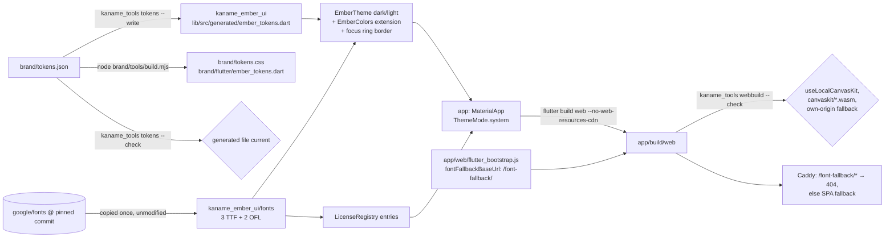
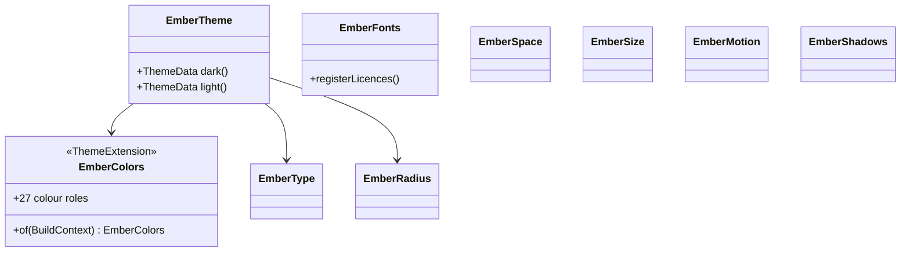

# Design

## Triage

| Trigger | Applies? | Evidence |
|---|---|---|
| T1 Components (new component, or 3+ with directed relationships) | yes | A new package `kaname_ember_ui`, plus two new `kaname_tools` commands (`tokens`, `webbuild`) feeding it and checking the app's build. |
| T2 State (persistent state, caches, 3+ state machine) | no | No runtime state beyond Flutter's theme. The committed generated token file is a build artefact (covered under T4). |
| T3 Concurrency (background work, workers/isolates, async, retries) | no | Font registration is a one-off at startup; no background work. |
| T4 Boundaries (data format, migration, shared interface, IPC, external) | yes | A shared public interface (the package's theme API, which every later UI change imports); the `brand/tokens.json` input format; external font files from google/fonts. |
| T5 Volume (grows without a fixed bound) | no | Fixed sets: 27 colour roles, 9 generated type styles, 3 font files. |
| T6 Risk (security, money, data loss, unrecoverable user data) | no | No user data. The licence obligations (OFL) are covered by S5. |

TIER: FULL

## Context

See proposal.md for the why and the scope decisions S1-S11.

- The workspace check already knows `app_packages/`: it scans it for packages (`tools/kaname_tools/lib/src/workspace.dart:53-56`, `:73-80`) and accepts `app_packages/kaname_<name>` as a format directory (`tools/kaname_tools/lib/src/workspace.dart:231-233`). No package lives there yet.
- The purity check does not cover `app_packages/`, so a Flutter package there is allowed (`tools/kaname_tools/lib/src/purity.dart:29`).
- The notices coverage check looks for font licences only in `brand/fonts/` (`tools/kaname_tools/lib/src/notices.dart:103`, `:159-167`, `:403-414`).
- `kaname_tools` commands are registered in one runner (`tools/kaname_tools/lib/src/cli.dart:42-52`). That is where `tokens` and `webbuild` join.
- `mise run check` runs workspace, purity, analyze, format, test, notices and licences (`mise.toml:185-194`). Its `test` lists each package's task by name (`mise.toml:66-72`). CI runs `check` on Linux, Windows and macOS (`.github/workflows/ci.yml:39-67`).
- The web build is `flutter build web --release`, both in mise (`mise.toml:104-107`) and in the CI matrix (`.github/workflows/ci.yml:77`). `stack:up` builds the web app before Compose (`mise.toml:162-169`).
- The web app boots through `flutter_bootstrap.js` (`app/web/index.html:44`). The app has no custom bootstrap file of its own, so Flutter generates the default one (`app/web/` holds only `favicon.png`, `icons/`, `index.html` and `manifest.json`).
- Caddy serves the web build with a single-page-app fallback: any path without a file gets `index.html` (`deploy/Caddyfile:26-31`). Only `/api` paths and the `/livez` and `/readyz` probes are kept from that fallback (`deploy/Caddyfile:9-24`).
- The app is a placeholder `MaterialApp` with no theme (`app/lib/main.dart:13-18`), and its one test finds the text "Kaname" (`app/test/app_test.dart:5-9`).
- The kit's theme builder (`brand/flutter/ember_theme.dart:12-134`) maps tokens to a `ColorScheme`, text theme and control themes. It carries `EmberColors` as an extension (`:132`) and was never compiled here (`:1-2`). Its generated companion comes from `brand/tools/build.mjs`.
- Shared packages under `packages/` add `public_member_api_docs` (`packages/kaname_core/analysis_options.yaml:1-6`). The root options exclude `brand/**` (`analysis_options.yaml:11-16`).
- `brand/tokens.json` holds 27 colour roles with `dark` and `light` values, two shadows, three font stacks (`mono` is a system stack only), ten type styles (nine once `mono` is skipped), radii, spacing, sizes and motion. DESIGN.md's frontmatter repeats the colour values. Its "What Kaname changes" section is empty (`DESIGN.md:400`).

## Decisions

### D1: Tokens are generated by a `kaname_tools tokens` command

- **Choice:** `kaname_tools tokens --write` reads `brand/tokens.json` and writes `app_packages/kaname_ember_ui/lib/src/generated/ember_tokens.dart` in formatter output form, with doc comments on every public member. `--check` writes nothing and fails when the file differs, naming it. A mise `tokens` task runs `--write`, and a `tokens:check` task runs inside `check`. Parsing is typed: a missing room or an unparseable colour is an explicit failure naming the role, and nothing is written. The generator skips the `mono` font stack and the `mono` type style (S9), and fails when a remaining style names a family that is not bundled. `brand/tools/build.mjs` keeps generating the kit's own `tokens.css` and `brand/flutter/ember_tokens.dart`.
- **Rejected:** extending `build.mjs` to write the package file, because its output would need `dart format` before any comparison, its logic has no Dart tests, and the check would need Node on every runner.
- **Reversal cost:** low.
- **Important:** yes: binds future changes (generated-file contract and a new check in `check`).
- **Chosen by:** user

### D2: Keyboard focus is a theme-level offset ring; text fields keep a Focus border and halo

- **Choice:** the package defines an outlined border that paints its base shape (stadium or rounded rectangle) and, when used for the focused state, a 2px Focus ring 2px outside it. Each control theme (buttons, icon buttons, chips, menu items) resolves its shape through widget states, so focused controls get the ring from the theme alone. Menu items paint the ring just inside their 8px rounded shape, so a scrolling menu's clip and neighbouring items never cut it (design review round 3, S-2, agreed by the owner). The ring stays visible on the dark primary button, whose fill equals Focus. Text fields keep DESIGN.md's focused look (border plus Ember Glow halo) but draw the border in the Focus token instead of Ember: light Ember is 2.76:1 on Raised and Focus passes 3:1. Menu items take the ring whenever they have focus. Material moves focus to a menu item on pointer hover, so a hovered item shows both the Hover fill and the ring. The Hover fill alone is about 1.1:1, so keyboard focus needs the ring. The ring border implements `lerpFrom` and `lerpTo`, so the chip's 75ms shape tween fades the ring rather than collapsing the outline. DESIGN.md's "What Kaname changes" records both deviations (applied in round 1 after design review M-1).
- **Rejected:** a wrapper widget app code must put around each control, because every call site could forget it; a 2px border on the control's own edge, because it vanishes on the dark primary button; the ring on text fields too, because it departs further from DESIGN.md than needed; DESIGN.md's input and menu focus as written, because both fall below 3:1.
- **Reversal cost:** low.
- **Important:** yes: changes what users see.
- **Chosen by:** user

### D3: Goldens compare on Linux only

- **Choice:** golden tests skip on Windows and macOS with the reason "goldens are rendered on Linux", and compare exactly on Linux (CI and WSL). Contrast, focus, font and licence tests run on all three OSes.
- **Rejected:** a cross-OS pixel tolerance, because a tolerance loose enough for text rendering differences hides real regressions; per-OS golden sets, because regenerating them needs Windows and macOS machines.
- **Reversal cost:** low.
- **Important:** no.
- **Chosen by:** user

### D4: Full variable fonts, unmodified

- **Choice:** bundle `Geist[wght].ttf`, `Literata[opsz,wght].ttf` and `Literata-Italic[opsz,wght].ttf` from google/fonts at one pinned commit, unmodified (about 2 MB), with each family's `OFL.txt` saved as `OFL-geist.txt` and `OFL-literata.txt`. `fonts/PROVENANCE.md` in the package records the commit, the source path and the SHA-256 of each file. Families are declared in the package's pubspec, and styles name them through the package, so the app needs no font declaration of its own.
- **Rejected:** a Latin subset, because Cyrillic pilot names would fall back to system fonts, it adds a subsetting tool, and it makes a modified font under the OFL; adding Geist Italic, because Ember does not use it.
- **Reversal cost:** low.
- **Important:** yes: changes what users see (glyph coverage) and adds binaries to the repository.
- **Chosen by:** user

### D5: The theme starts from the kit's builder

- **Choice:** copy `brand/flutter/ember_theme.dart` into the package as the starting point (the owner's kit is an authorised asset), then add the focus ring (D2), the icon button and quiet button themes, instant hover and press for buttons, icon buttons and menu items (a transparent overlay, with the background colour resolved per state, and `animationDuration: Duration.zero` on every styled button, icon-button and menu-item style; design review round 3, S-1, agreed by the owner), chips with `ChipThemeData.color` set per state so their hover highlight is transparent (no 50ms fade and no hover fill, as in the kit's CSS), an accessor that fails with "Ember theme is not installed", the project's lints and doc comments. The theme file's library doc comment carries the provenance note ADR 0002 requires for adapted owner code: "Adapted from the owner's Ember kit, `brand/flutter/ember_theme.dart`." `brand/flutter/` stays as the kit delivered it.
- **Rejected:** writing a fresh builder from DESIGN.md, because it redoes decisions the owner's kit already made.
- **Reversal cost:** low.
- **Important:** no.
- **Chosen by:** user

### D6: The web build points fallback fonts at its own origin, and `kaname_tools webbuild --check` verifies it

- **Choice:**
  - `build:web`, the CI web job and `stack:up` build with `--no-web-resources-cdn`, which makes Flutter bundle the engine and set `useLocalCanvasKit: true` (A1).
  - A committed `app/web/flutter_bootstrap.js` loads the engine with `fontFallbackBaseUrl: "/font-fallback/"`, an empty path on the app's own origin. Caddy answers `/font-fallback/*` with 404 ahead of the single-page-app fallback.
  - `kaname_tools webbuild --check <dir>` reads the built `flutter_bootstrap.js`. It fails, naming what it found, when `useLocalCanvasKit` is not `true`, when `canvaskit/` holds no `.wasm` file, or when `fontFallbackBaseUrl` is missing or is not the own-origin path.
  - A mise task `webbuild:check` runs the check on `app/build/web`. `build:web` runs it right after its build, so `stack:up`, which calls `build:web`, is covered too. The CI web job keeps its own matrix command (`.github/workflows/ci.yml:77`), now with the flag, and runs `mise run webbuild:check` in a web-only step after it.
- **Rejected:** grepping the output for `gstatic.com`, which fails on every correct build because the engine and loader still carry the default address as a string (round 1 finding C-1); an inline CI step, which is untested, needs a Linux shell and is absent from `stack:up`.
- **Reversal cost:** low.
- **Important:** yes: binds future changes (the web build contract that self-hosting relies on).
- **Chosen by:** user

### D7: Literata's optical size follows the font size, and weights are explicit

- **Choice:** the generator gives each serif type style `FontVariation('opsz', <size>)` equal to its font size, matching how browsers render the kit's CSS (automatic optical sizing). Every style also carries `FontVariation('wght', <weight>)` next to its `fontWeight`, so the weight does not depend on how the engine combines `fontWeight` with explicit variations (round 1 suggestion S-1, agreed by the owner).
- **Rejected:** the font's default optical size at every size, because the app and the web kit would render the serif differently; relying on `fontWeight` alone, because a wrong first golden baseline would go unnoticed.
- **Reversal cost:** low.
- **Important:** yes: changes what users see.
- **Chosen by:** user

### D8: Tests load the real bundled fonts

- **Choice:** a test helper in the package loads every declared font file through Flutter's font loader before the golden and font tests. A missing file fails with its path.
- **Rejected:** flutter_test's placeholder font, because goldens would show boxes and could not catch font or weight regressions.
- **Reversal cost:** low.
- **Important:** no.
- **Chosen by:** user

### Decision summary

| # | Decision | Choice | Rejected | Reversal cost | Important | Chosen by |
|---|---|---|---|---|---|---|
| S1 | Package name and place | `kaname_ember_ui` in `app_packages/` | `kaname_ui`, `kaname_ember` | medium | yes | user |
| S2 | Component scope | Theme + Ember-styled Material controls, no segmented control | All primitives; tokens and theme only; Material's segmented button | low | yes | user |
| S3 | Theme in the placeholder app | Wire in now | Package only | low | yes | user |
| S4 | Web engine and fallback fonts | Bundle engine; fallback address on own origin (404) | Self-host Noto; accept Google fallbacks; defer | low | yes | user |
| S5 | Font licences in the app | Assets + LicenseRegistry, notices paths | Notices file only | low | yes | user |
| S6 | Default theme | Follow the OS | Dark by default | low | yes | user |
| S7 | Ink Tertiary contrast | Nudge to `#918d86` / `#635e55` | Hover rule; resting surfaces only | low | yes | user |
| S8 | Ember fill vs surface | Exempt from 3:1 | Enforce and darken light accent | low | yes | user |
| S9 | Mono style | Left out until a code view needs it | Bundle Geist Mono; exempt system stack | low | yes | user |
| S10 | Field, chip, snackbar, tooltip transitions | Recorded exceptions | Ember wrappers with zero durations | low | yes | user |
| S11 | Light empty-field edge | Known gap, recorded | New `field-line` token | low | yes | user |
| D1 | Token generator | `kaname_tools tokens --write/--check` | Extend `build.mjs` | low | yes | user |
| D2 | Focus indicator | Outside ring; menu items inside; fields: Focus border + halo | Wrapper; edge border; ring on fields; DESIGN as written | low | yes | user |
| D3 | Golden platform | Linux only | Tolerance; per-OS sets | low | no | user |
| D4 | Font files | Full variable, unmodified, pinned | Latin subset; plus Geist Italic | low | yes | user |
| D5 | Theme source | Adapt the kit's builder; instant hover/press per state | Write fresh | low | no | user |
| D6 | Web build fallback and check | Own-origin `fontFallbackBaseUrl`, `webbuild --check` on config | gstatic grep; inline CI step | low | yes | user |
| D7 | Serif variations | opsz = size, explicit wght | Font default; `fontWeight` alone | low | yes | user |
| D8 | Fonts in tests | Load bundled fonts | Ahem placeholder | low | no | user |

## Assumptions

- **A1:** In Flutter 3.47.9, `--no-web-resources-cdn` adds only `useLocalCanvasKit: true` to the build configuration and copies the engine into `build/web/canvaskit/`. The engine's fallback-font address defaults to `https://fonts.gstatic.com/s/` unless the loader passes `fontFallbackBaseUrl`. This was read in the installed SDK outside the repository (`flutter_tools` `build_system/targets/web.dart` line 818; engine `configuration.dart` lines 366-368) and in Flutter's web initialisation docs through Context7, so it cannot be cited as a repository path. Depends on it: S4, D6. The first web task builds once and records the emitted `flutter_bootstrap.js` before the check is written.
- **A2:** Setting `fontWeight` drives the `wght` axis of the bundled variable fonts in Flutter 3.47.9 on every platform, web included. This comes from Flutter's "FontWeight also controls the weight attribute of variable fonts" breaking-change note, not from a run. Depends on it: D4, D7, and the golden tests, which would show it.
- **A3:** A font declared in a package's pubspec is bundled into an app that depends on the package, and is addressed as `packages/kaname_ember_ui/<family>`. This is Flutter's documented package-font behaviour, not run here. Depends on it: D4, and the app-wiring task.
- **A5:** With fallback fonts pointed at the empty own-origin path, every web start-up requests Roboto from `/font-fallback/` and gets a 404 with a console warning, because the engine's global fallback list starts with Roboto and only a registered font family named exactly `Roboto` avoids the fetch. This was read in the engine source outside the repository (`font_fallbacks.dart` around line 41), as reported by design review round 2, and has not been run. The warning is expected, and the fix is never to bundle Roboto. Any other uncovered glyph fails the same way and shows as an empty box, without blocking the first frame. Depends on it: S4, D6. The web evidence task loads the built app in a headless browser and records every request: all must go to the app's own origin, and the Roboto 404 is expected.
- **A4:** google/fonts commit `4e5f06dbb274a27ebe71ed54ea706b3ee40eabd9` (2026-03-03, the latest touching `ofl/literata`) holds the three files at the listed sizes (Geist 169,056 B; Literata 955,132 B; Literata Italic 902,728 B). Read from the GitHub contents API on 2026-11-15; the Geist folder's own latest commit was not checked. Depends on it: D4. The apply task pins the commit it actually downloads from.

## Carried constraints

- **C1:** `ember_tokens.dart` in the package is generated by `kaname_tools tokens` from `brand/tokens.json` and is never edited by hand. Change tokens in the JSON and rerun the task. Kind: invariant. Destination: spec: specs/ember-ui/spec.md → Requirement: Tokens are generated from the brand source
- **C2:** Every focusable control themed by the package gets its focus ring from the theme's focused-state shape. A new control theme must do the same, or the focus test fails. Kind: invariant. Destination: spec: specs/ember-ui/spec.md → Requirement: Keyboard focus is always visible
- **C3:** Ember fills are not checked for 3:1 against surfaces; their label pair is. Kind: deliberate gap. Destination: spec: specs/ember-ui/spec.md → Requirement: Token colours meet WCAG contrast
- **C4:** Golden images are rendered and compared on Linux only. Regenerate them on Linux (WSL or CI). Kind: deliberate gap. Destination: doc comment: app_packages/kaname_ember_ui/test/golden_test.dart main
- **C5:** The font files are unmodified copies from google/fonts at the pinned commit. Replacing one means updating `PROVENANCE.md` and the hashes together. Kind: invariant. Destination: doc comment: app_packages/kaname_ember_ui/lib/src/fonts.dart EmberFonts
- **C6:** The web build must keep `--no-web-resources-cdn` and the own-origin `fontFallbackBaseUrl`. The `webbuild` check fails without either. Kind: invariant. Destination: spec: specs/ember-ui/spec.md → Requirement: The web build loads no engine or font files from third-party hosts
- **C7:** Switching between the dark and the light theme is instant for surfaces and Ember-styled controls: `MaterialApp`'s theme animation is off. app-shell's rewrite of `MaterialApp` must keep it. Text that inherits the default style still blends over Material's 200ms, text-field borders and labels over Material's 167ms, and chip outlines over Material's 75ms (recorded exceptions). Kind: invariant. Destination: spec: specs/ember-ui/spec.md → Requirement: The app follows the system theme until the user chooses
- **C8:** The package's theme file is adapted from the owner's kit and carries the ADR 0002 provenance note. Kind: invariant. Destination: doc comment: app_packages/kaname_ember_ui/lib/src/ember_theme.dart library
- **C9:** The package has no mono type style (S9). The first code or source view adds a bundled mono font and its style, and does not bring back the system stack. Kind: deliberate gap. Destination: doc comment: app_packages/kaname_ember_ui/lib/src/generated/ember_tokens.dart EmberType
- **C10:** The fallback-font path is the same in `app/web/flutter_bootstrap.js` and in the Caddy rule that answers it with 404. Changing one means changing the other. Kind: invariant. Destination: spec: specs/self-host-stack/spec.md → Requirement: The fallback-font path never serves the web app
- **C11:** The package styles no segmented control. Material's SegmentedButton forces rectangular, clipped segments, so neither pills nor the focus ring can come from a theme. The first change that needs one builds an Ember segmented control in this package with its own focus test. Kind: rejected alternative. Destination: doc comment: app_packages/kaname_ember_ui/lib/src/ember_theme.dart EmberTheme
- **C12:** Five Material transitions remain in the styled set: the text-field border transition, the chip selection draw-in of the checkmark (195ms; the fill changes on the next frame because `ChipThemeData.color` is set), the chip shape's 75ms tween (outline, selected border and focus ring; a fixed Material constant), the snackbar entrance and exit, and the tooltip fade. None can be switched off from a theme, and DESIGN.md records them as exceptions. Kind: deliberate gap. Destination: spec: specs/ember-ui/spec.md → Requirement: Material controls take Ember's shapes and states
- **C13:** In the light theme an empty text field's edge is 1.37:1 against the field, below 3:1 for component boundaries; fields rely on their visible label. Kind: deliberate gap. Destination: doc comment: app_packages/kaname_ember_ui/lib/src/ember_theme.dart EmberTheme

## Diagrams (FULL)

T1 and T4: components and the token and font data flow.

T4: the package's public interface.

## State & Ownership (FULL)

| State | Owner (sole writer) | Lifetime | Invalidation / rebuild | Authoritative copy |
|---|---|---|---|---|
| Token values | `brand/tokens.json` (edited by hand) | Repository | Edit the JSON, run `mise run tokens` (and `build.mjs` for the kit outputs) | `brand/tokens.json` |
| Generated `ember_tokens.dart` | `kaname_tools tokens --write` | Repository | Regenerated from the JSON; `tokens:check` flags drift | Derived; the JSON wins |
| Kit `tokens.css`, `brand/flutter/ember_tokens.dart` | `brand/tools/build.mjs` | Repository | Rerun `build.mjs` after a JSON edit | Derived; the JSON wins |
| Font files and OFL texts | Apply task (one-off copy) | Repository | Replaced only with `PROVENANCE.md` and hashes | google/fonts at the pinned commit |
| Theme mode in the app | Flutter (`ThemeMode.system` follows platform brightness) | App session | Platform brightness change | The OS setting (until app-shell adds the user's choice) |
| Licence registry entries | `EmberFonts.registerLicences()` called once in `main` | App session | Rebuilt each start | The bundled OFL assets |

## Failure & Visibility (FULL)

| Component | Fails / dies mid-operation → | Recovery | Retry safe? | Who finds out |
|---|---|---|---|---|
| `tokens --write` | Invalid JSON, missing room, bad colour → exits non-zero, writes nothing | Fix the JSON, rerun | Yes (idempotent) | Developer (message names role and room) |
| `tokens --check` | Generated file stale or hand-edited → non-zero | Run `mise run tokens`, commit | Yes | Developer and CI `check` jobs |
| Font asset missing in a build | Flutter falls back to a system font silently at runtime | Restore the file | Yes | Package tests (D8 helper names the file); without them nobody, so the test is part of the design |
| Licence asset missing | The licence page lacks the entry silently | Restore the file | Yes | Package licence test names the family |
| `webbuild --check` | Local engine off, no `.wasm`, or fallback address missing or foreign → non-zero | Restore the flag or the bootstrap config | Yes | CI `build (web)` job, `stack:up` |
| Engine fallback-font fetch on web | 404 on own origin → glyph shows as an empty box, console warning | None needed (by design, S4) | n/a | User sees the box; nothing leaves the origin |
| Focus ring regression | A control loses its ring | Fix the theme | Yes | Focus test names the control and theme |
| Contrast regression | A token edit lowers a pair | Adjust the token | Yes | Contrast test names theme, roles and ratios |

## Resource Bounds (FULL)

| Queue / buffer / cache / transfer | Bound | At the bound | Timeout | At 10x / 100x |
|---|---|---|---|---|
| Bundled fonts in every app build | About 2 MB (3 files) | Fixed set; adding a family is a reviewed change | n/a | n/a: not volume-driven |
| Web build size with bundled engine | Engine files (a few MB) plus fonts | Fixed per Flutter version | n/a | n/a |
| `webbuild --check` | Reads one file (`flutter_bootstrap.js`) and lists `canvaskit/` | n/a | CI job timeout (45 min) | Constant |
| Token generation | 27 roles, 9 styles | n/a | n/a | n/a |

## Flow & State Gaps (FULL)

- **Partial write:** `tokens --write` renders the whole file in memory and writes it once. A crash mid-write leaves a truncated file that `tokens:check` and analysis both reject.
- **JSON edited, generator not rerun:** caught by `tokens:check` in `check` (spec scenario).
- **JSON edited, `build.mjs` not rerun:** the kit's CSS and Dart drift from the JSON. They are not used by the app, and no check covers them; that matches today (`brand/**` is outside every check, `analysis_options.yaml:11-16`). This change reruns `build.mjs` once for the `ink-tertiary` edit.
- **Brightness change while running:** `MaterialApp` with `ThemeMode.system` rebuilds on the platform brightness change (spec scenario). Material's default theme animation would blend the two rooms, which the One Motion Rule forbids, so the app sets it to zero (spec scenario; C7). That leaves Material's 200ms blend of inherited text colour inside `Scaffold` the 167ms blend of text-field borders and labels, and the 75ms blend of chip outlines, all recorded as exceptions (proposal What Changes; C7).
- **Restart mid-operation:** no persistent runtime state.

## Mechanism Ledger (FULL)

| Mechanism | Built? | Why (harm nobody catches / expensive later) | Evidence that would change the call |
|---|---|---|---|
| Generated-token staleness check | Yes | A JSON edit without regeneration ships wrong colours that nobody notices in review | n/a |
| Contrast test | Yes | A token edit can silently fail AA (three pairs already did, S7) | n/a |
| Focus test per control | Yes | A theme edit can silently drop the ring | n/a |
| Web build check | Yes | A dropped flag or bootstrap config reintroduces Google fetches invisibly | n/a |
| Caddy 404 for the fallback path | Yes | Without it the SPA fallback returns `index.html` to font requests, which the engine tries to parse as a font | n/a |
| Self-hosted Noto fallback fonts | No | Owner chose boxes over tens of MB (S4) | Users report names or text that need glyphs outside Geist and Literata on web |
| Font hash verification at test time | No | `PROVENANCE.md` records hashes, and the files change only in reviewed PRs | A font file changed without a provenance update in review |
| Check that the kit's `build.mjs` outputs are current | No | The kit outputs are not used by the app; the brand kit is outside every check today | The app or the web build starts using `brand/tokens.css` |
| Theme-mode persistence | No | app-shell's settings screen owns the user's choice | n/a |

## Risks / Trade-offs

- [Variable-font weight rendering differs on some platform (A2)] → Goldens on Linux catch Linux; the owner's look check at the M0 close covers Windows, web and a phone.
- [Glyphs outside Geist and Literata (CJK, emoji) show as boxes on web] → Accepted (S4). Desktop and mobile still use OS fonts. Revisit with self-hosted fallbacks if pilots' names or content need them.
- [Literata adds about 1.9 MB to every app] → Accepted for Cyrillic coverage (D4); revisit if the web first-load budget in `web-grid-spike` objects.
- [Material's internals change a focus or shape detail on a Flutter bump] → Goldens and the focus test fail on the bump PR.
- [The kit and Kaname now hold different `ink-tertiary` values from the kit as delivered] → `brand/BRAND.md` keeps the kit's text, and DESIGN.md's "What Kaname changes" records the edit (S7).

## ADRs

- **In force, constraining this change:** ADR 0001 (one Flutter app on six platforms; CI builds all targets), ADR 0002 (AGPL with separately licensed fonts keeping their notices; clean room), ADR 0003 (`ember_ui` package in the workspace; names set by the workspace rule), ADR 0010 (no code generation through `build_runner`: the token generator is a repository tool, not a build_runner step).
- **To record during apply:** none. The package boundary is ADR 0003's, and the other decisions are local to this package and its tools.

## Open Questions

- Which `ColorScheme` slots the icon button reads for selected and hovered states in Flutter 3.47.9. Answered by the goldens during apply; it changes neither the spec nor the tasks.
