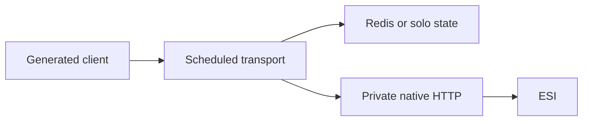
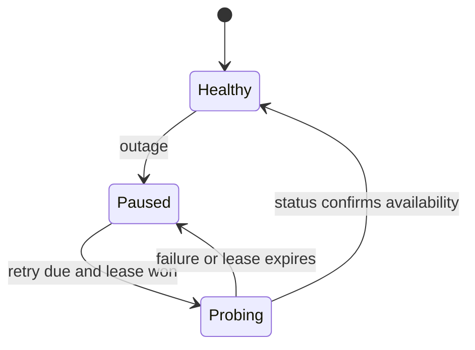
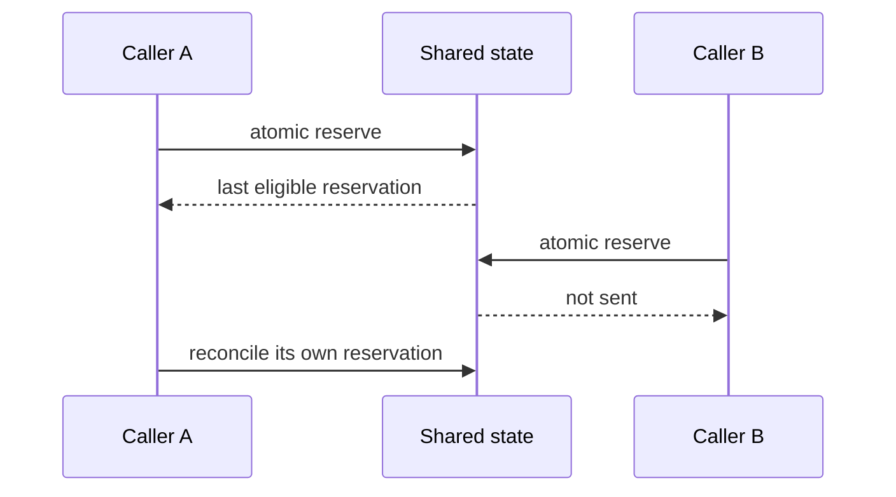
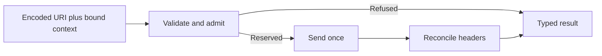

## Triage

TIER: FULL

T1 new scheduling and storage modules; T2 shared reservations, cache and governor; T3 concurrent isolates and recovery; T4 generated-client, Redis and ESI interfaces; T5 bounded admission and HTTP bodies; T6 authenticated representation isolation.

## Context

`EsiRequest` carries an operation ID and not a credential or priority (`packages/kaname_esi/lib/src/transport.dart:26-31`); the bound transport owns context (`:68-77` in that file). The generated client receives the transport outcome before decoding (`packages/kaname_esi/lib/src/call.dart:145-174`). `EsiRateGroup.none` explicitly leaves budget meaning to the scheduler (`packages/kaname_esi/lib/src/catalogue_types.dart:18-30`). CI already starts Redis before server tests (`.github/workflows/ci.yml:131-146`). The proposed contract follows CCP's [rate limiting](https://developers.eveonline.com/docs/services/esi/rate-limiting/) and [caching/error limit](https://developers.eveonline.com/docs/services/esi/best-practices/) descriptions; the pinned catalogue remains the route inventory.

## Decisions

The owner delegated inner design details to the author; the scope choices S1–S3 remain owner decisions.

- **D1 — Runtime seam.** Keep `kaname_esi` dependency-free. Add an explicit refusal variant to transport and result; scheduling lives in `kaname_esi_scheduler`, with injected state, clock and sender. Native/server composition supplies one shared scheduler per calling isolate, never a raw sender to product code; bind credential identity and priority outside `EsiRequest`. Reject putting I/O in the generated package. Reversal: medium. Important: yes (caller contract). Chosen by: agent.
- **D2 — Store.** Redis Lua admission/completion against one install namespace, with a connection per calling isolate using the existing locked Redis driver; solo applies equivalent synchronous transitions to one in-process store. No Serverpod Session in workers, no local fallback. Reject proxying each command via main. Reversal: medium. Important: yes (worker pattern). Chosen by: agent.
- **D3 — Accounting.** Reserve five group tokens and one potential connection error for each dispatch; release cost individually rather than replacing local counters with raw header values. Use a sliding debit ledger for groups and a fixed reset for the connection. Reject optimistic expected-status reservation because simultaneous errors can overspend. Reversal: medium. Important: yes (admission behavior). Chosen by: agent.
- **D4 — Admission.** Order waiting tickets by priority and insertion sequence; dispatch only the head among currently eligible tickets. Use bounded transient tickets rather than persisted jobs or replay; caller owns reattempts. Reversal: medium. Important: yes (caller behavior). Chosen by: agent.
- **D5 — Polling.** Caller retains the body and supplies its matching ETag. Scheduler shares deadlines, negative metadata and equivalent corp leases; no response bodies. Reject response-cache ownership because validation, privacy and writes belong to the recipe. Reversal: medium. Important: yes (cache contract). Chosen by: agent.
- **D6 — Outage.** Poll connectivity failure, or 502/503/504 on two distinct explicitly polled operation IDs within 30 seconds, triggers a shared pause pending anonymous `/status` confirmation. First probe may run immediately; VIP mode does not resume. Reject replaying the failed operation because it may consume a different budget or produce a write. Reversal: low. Important: yes (observed availability). Chosen by: agent.

### Decision summary

Round 1 refinements (agent decisions under the coordinator's handback):

- **Tickets:** register atomically, refresh at most every 250 ms and expire after one second without refresh; absolute five-second deadline. Demand-driven polling is the only wake mechanism; a lower ticket cannot overtake a live higher eligible ticket even if it polls first. Scope pacing, single-slot saturation, freshness and scope blocks make a ticket ineligible, not a head-of-line barrier. At capacity, strictly higher priority displaces the lowest-priority newest ticket; displaced callers receive queue-full on their next check. No ticket resurrection. Tests advance injected time and use ticket registration barriers.
- **Reconciliation:** admission sequence orders observations. A newer observation can raise the upstream ceiling but never the local ledger limit; ignore earlier observations for ceiling updates, still settle their own debits and honor their throttle deadline. Expire the ceiling one bucket window after its reservation time. Inject `now` into both transitions; production uses the common host clock, clamped against the last shared transition, and tests run the same clock cases against Redis and solo.
- **Restart:** each Redis operation uses an incarnation-bound connection established by `INFO server` (`run_id`); atomic initialization rejects continuity across run IDs and starts a quarantine of the longest supported window before admitting, including stale snapshot restoration. Connect/auth and command deadlines are two seconds each; destroy the timed-out socket, do not replay. Solo cannot guarantee prior process history with memory alone: first 60 seconds allow one request outstanding and at least one second between sends; repeated relaunch remains a best-effort limitation, not cross-process atomicity.
- **Polls:** explicit polling intent on scheduled GETs only. Report `notDue` with a deadline if the caller still has its representation; a caller without it may populate unconditionally under the usual admission and lease. Use the shared corporation representation key for due-times; never share one caller's payload with another.
- **Reasons:** the closed set in the `esi-client` delta, including `stateRecovering`. Store no upstream body or raw target in diagnostics. Hash representation keys with an install key.
- **Learned groups and sizing:** stored only in the atomic store, at most one per operation; expire after the longest of the observed and prior windows. Incompatible group observations suppress that operation for those windows and surface `routeConflict`, then re-observe on its next normally admitted call. Bound each debit ledger by its allowed token count (positive spent units plus at most eight still-live attempts), and active groups by the generated distinct-group count times 2,001, plus bounded learned-operation capacity; fail closed rather than evict debits.
- **ADR 0016 details:** corp claim is request-scoped, not an extra future-call lock. Isolate-local Redis clients hold bounded command connections for repeated short scheduler requests, unlike ADR 0012's per-job Postgres connections. This settles only the ESI Redis portion of R56 ahead of the first realtime consumer. `redis` becomes a direct dependency at the already resolved version (`pubspec.lock:832-839`); update dependency notices and licence checks.
- **Expiry:** all semantic expiry uses injected `now` inside each transition. Redis TTL is garbage collection only, strictly beyond the longest logical deadline of the containing record. Assert equivalent expiry in the shared conformance suite without sleeping.

| ID | Choice | Rejected | Reversal | Important | Chosen by |
|---|---|---|---|---|---|
| S1 | Shared corp coalescing | Per recipe | medium | yes | user |
| S2 | Page-local controls; traversal in the M5 ingestion-recipes change | Traversal now | low | yes | user |
| S3 | Factories and synthetic HTTP proof, no product consumer | Public status consumer | low | yes | user |
| D1 | Separate policy, typed refusal | Generated package I/O | medium | yes | agent |
| D2 | Direct Redis, synchronous solo | Main proxy | medium | yes | agent |
| D3 | Conservative reservations | Expected cost | medium | yes | agent |
| D4 | Transient priority tickets | Durable queue | medium | yes | agent |
| D5 | Shared metadata only | Shared bodies | medium | yes | agent |
| D6 | Connectivity or distinct-route failure; verify with scheduled status | Replay calls | low | yes | agent |

## Assumptions

- A1: All server isolates share one ESI egress; deployment provides no separate source-IP routing. If that changes, keeping one legacy/anonymous budget is conservative. Applies to D2/D3.

## Carried constraints

- C1: No runtime transport bypass. Invariant. Destination: spec: specs/esi-request-scheduling/spec.md → Requirement: Shared atomic admission
- C2: Caller retains bodies and validators. Invariant. Destination: spec: specs/esi-request-scheduling/spec.md → Requirement: Conditional polling and downtime
- C3: Role selection remains with recipes. Deliberate gap. Destination: spec: specs/esi-request-scheduling/spec.md → Requirement: Equivalent corporation polls
- C4: ESI workers use isolate-owned Redis clients, not sessions or main-isolate proxy. Invariant. Destination: ADR 0016

- C5: Page traversal and body consistency remain with the caller. Deliberate gap. Destination: spec: specs/esi-request-scheduling/spec.md → Requirement: Conditional polling and downtime
- C6: Never replay a wire operation. Invariant. Destination: spec: specs/esi-request-scheduling/spec.md → Requirement: Shared atomic admission
- C7: Closed refusal reasons distinguish suppression from wire errors. Invariant. Destination: spec: specs/esi-client/spec.md → Requirement: Typed results, never thrown
- C8: Revisit durable solo rate state with the M4 local store to remove the restart gap. Deliberate gap. Destination: ADR 0016
- C9: Corporation recipes own a role-holder-independent representation. Invariant. Destination: spec: specs/esi-request-scheduling/spec.md → Requirement: Equivalent corporation polls

## Diagrams

## State & ownership

| State | Writer and authority | Lifetime / invalidation |
|---|---|---|
| Tickets, leases, group debits, error epochs and outage | Atomic state transition in Redis or solo store | Expire at defined deadlines below; reservation identity fences completion |
| Poll eligibility and negative entries | Same store; matching completion only | TTL and bounded eviction of metadata; never evict live debits or leases |
| Learned group or route conflict | Atomic state transition, by operation | Observation window; re-observe after expiry |
| Response body and matching ETag | Recipe caller | Replace only after consuming a valid representation |
| Credential and HTTP exchange | Bound native composition | Per dispatch, never part of stored state or outcome diagnostics |

## Admission and reconciliation

- Keys: group + opaque application/character for scoped routes; group + install egress for anonymous routes (never attach auth to public routes); one connection error key per install egress. Metadata adds encoded target, compatibility date and language; scope negatives to authorization generation, not a raw token. Corp lease uses corp and equivalent representation independent of qualified character. Only GETs participate in suppression/polling; non-GETs still reserve.
- One transition prunes deadlines, checks reservations, blocks and ticket order, then records all debits, slots and applicable leases before permission. Refusals spend nothing. Complete once by reservation identity; on crash protect maximum cost through expiry.
- The 30-second reservation allows up to five seconds to begin dispatch and 20 seconds on the wire, leaving five seconds for completion delivery before lease expiry.
- For five seconds after the lease expires, retain the reservation only for recording completion. It cannot hold a live slot, a corporation claim, or the probe; late responses still reconcile by reservation ID.
- Roll group debits off individually. Validate group/limit/used/remaining together. Release only the specific reservation's excess using valid `Used`, otherwise documented status costs (2xx 2, 3xx 1, other 4xx 5 except 429, 5xx 0); no refund on ambiguous delivery. Subtract outstanding or later reservations from the ceiling without counting a reservation twice.
- Error budget: 100 per 60-second epoch, reserving one even on grouped calls because 420 can apply globally; successful 2xx/3xx free their held error unit. Valid remain/reset can tighten the current epoch; stale completions cannot raise capacity or change a newer epoch. Carry live reservations across an epoch boundary in admission accounting. Apply 429 Retry-After to the bucket, or route when no group is known; 420 to the whole connection. Missing/invalid deadlines use the relevant window (60 seconds for unknown group or error-limit blocks). Use the max of live blocks and never let a late response shorten them.
- Governor uses the worse remaining fraction of applicable group and error budgets before debit: full above 50%, spaced above 25% through 50% (at least one second between admissions), single above 10% through 25% (one outstanding on the constrained scope), stopped at or below 10% or while blocked. Hard budget checks always apply. Full outstanding cap is eight per install; apply any pacing and single limits at the scope reporting pressure. Tickets eligible for a free slot use interactive, realtime, notifications, sync, backfill, then FIFO; skip tickets with unavailable buckets, not tickets merely waiting for the shared slot.
- Polling records valid expiry for each representation after 2xx/304; cap freshness at 24 hours plus stable positive jitter of up to five seconds. Preserve a valid caller-provided If-None-Match only; do not invent one without the body. A 403/404 suppresses for 60 seconds per key and returns not sent on repeats. Explicit `Retry-After` is not shortened by the freshness cap. Late metadata cannot replace a newer observation.
- The anonymous `/status` probe does not recurse and consumes normal budget. A failed probe or expired claim leaves the pause active, backing off from 30 seconds to five minutes; honor later upstream retry deadlines.

## Failure & visibility

| Failure | Effect and recovery | Visibility |
|---|---|---|
| Redis unavailable or uncertain admission | Not sent; no local spend. Orphan reservation expires. | Typed refusal |
| Redis incarnation changes | Quarantine admissions until the longest supported window drains | `stateRecovering` and retry deadline |
| Send times out or caller dies | Abort wire; no replay, retain conservative debit if outcome unknown | Typed transport failure or worker supervision |
| Reconciliation unavailable after send | Preserve sent result, retain reservation; no replay | Secret-free operational error, not a call log |
| HTTP malformed or oversized response | Bound reads; still reconcile any valid received headers and status; no replay | Typed failure, no raw credential or body in diagnostics |

## Resource bounds

One wire attempt per reservation, 20-second hard deadline and 16 MiB decoded-body limit; disable redirects and retries. Reserve slots for 30 seconds. At most eight active exchanges and 64 waiting tickets per install. Limit poll metadata to 16,384 entries; do not evict future due-times or live negatives; when no safe metadata slot exists, refuse new polling keys as `scopeCapacity` before sending. Expire incrementally; no full-keyspace scans. At 10x and 100x, contention is refused without resetting known limits.

## Flow & state gaps

Reservation lost before wire send is not refunded unless known unsent. Timeout after send is ambiguous, so never replay. Out-of-order or duplicate completion cannot clear another lease. Redis reconnect never falls back to solo.

## Mechanism ledger

| Mechanism | Decision and reason |
|---|---|
| Atomic lifecycle, bounded claims and error reserve | Build: split check/spend or crash refund permits overspend |
| Shared metadata and due probe claim | Build: per-isolate cache and recovery multiply failed calls |
| Body cache / persisted jobs / automatic replay | Not built: privacy and ambiguous writes; revisit only when an owning recipe needs it |
| Generalized cross-isolate RPC | Not built: Redis already serializes the state |

## Risks / Trade-offs

Conservative accounting can refuse requests ESI might have accepted; this is preferable to a lockout. External clients using the same upstream identity can consume capacity unseen; reconcile on the next response, not a promise never to receive a throttle. Redis scripts must validate before mutation because script isolation is not rollback.

After Redis restarts, even one exploratory request can overspend an already empty upstream bucket because a restored snapshot can omit recent debits. Fail closed for the supported window instead of treating single-tier pacing as proof of capacity.

## ADRs

0001, 0002, 0003, 0005, 0006, 0007, 0009, 0012 constrain the design. Record ADR 0016 during apply for ESI-calling isolates' Redis ownership; vault and privacy access remain open.

## Open Questions

None required for implementation; the live soak belongs to milestone verification, not fixture tests.
