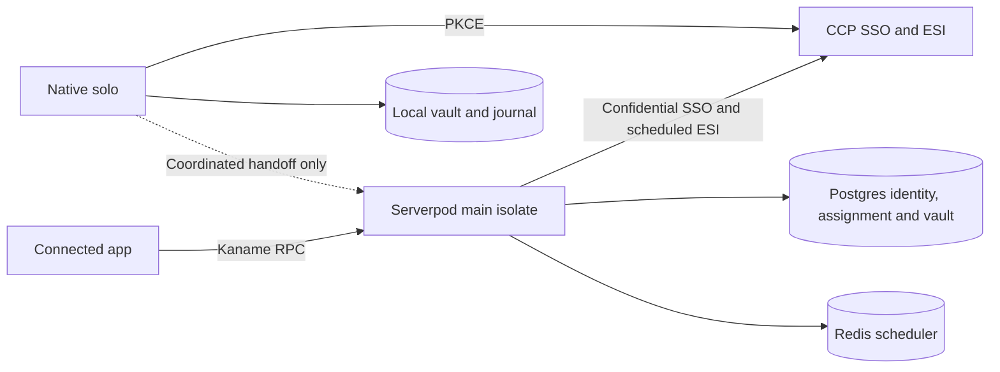
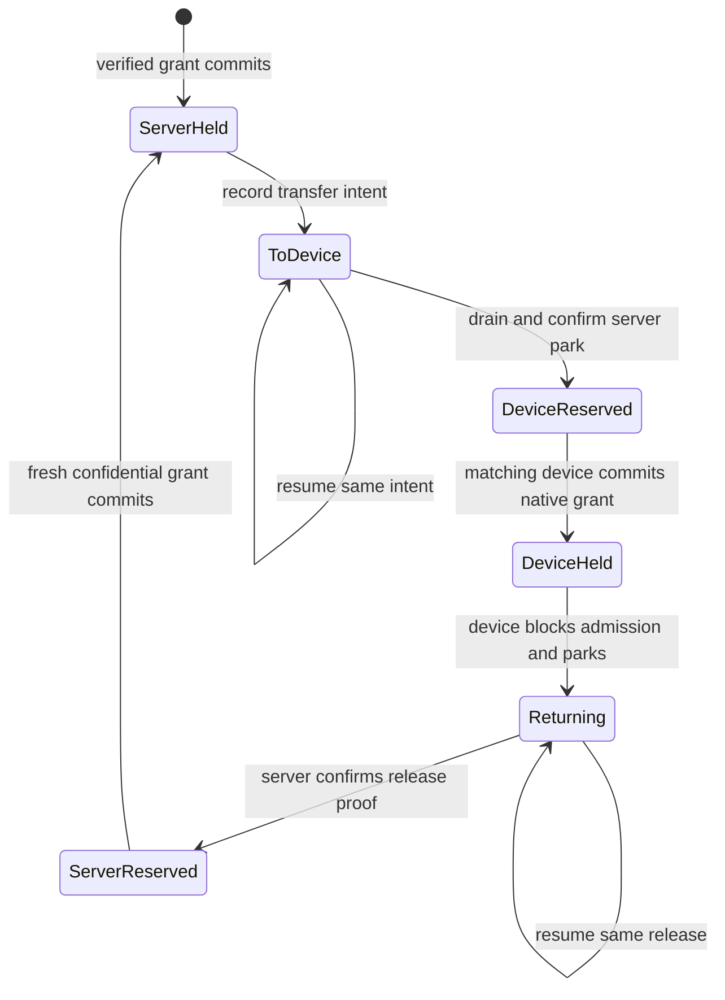
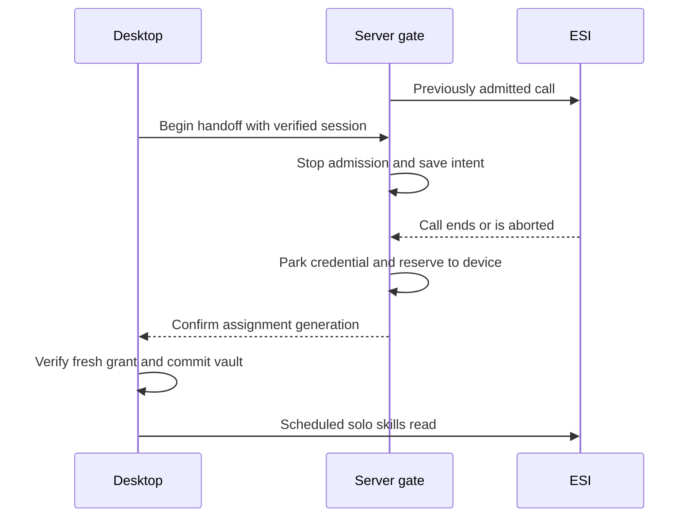
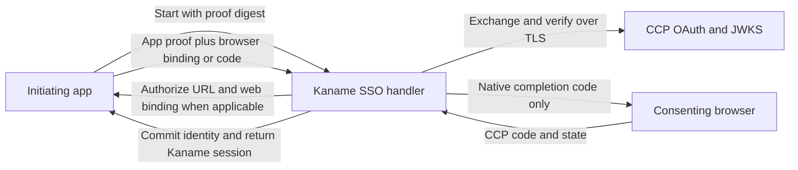

# Design

## Triage

| Trigger | Applies? | Evidence |
|---|---|---|
| T1 Components | yes | Flutter, Serverpod, CCP SSO and ESI, Postgres, Redis and native credential storage. |
| T2 State | yes | Sign-in attempts, verified identity, scope grants and holder transitions. |
| T3 Concurrency | yes | Callback replay, concurrent activation, ESI dispatch and refresh during handoff. |
| T4 Boundaries | yes | New RPCs, OAuth redirects, JWKS, migrations and a native vault adapter. |
| T5 Volume | yes | Identities and opt-ins accumulate; login and call history need bounded reads and work. |
| T6 Risk | yes | Credentials, private history, duplicate holds and install admin access. |

TIER: FULL

## Context

- [Proposal](proposal.md) defines the M2 scope. ADR 0005 separates the connected and solo credentials and forbids a connected client falling back to ESI (`docs/adr/0005-run-modes-and-one-token-holder.md:22-26`). ADR 0009 defines one server process and puts endpoints on its main isolate (`docs/adr/0009-server-process-and-isolates.md:19-26`). Worker vault and privacy access remain open (`docs/adr/0012-worker-isolate-access.md:19`).
- `EsiTokenVault.activate` compares the observed generation before sealing and installing a grant; `park` clears credentials, advances the generation and refuses a live refresh (`packages/kaname_esi_vault/lib/src/vault.dart:81-118,131-166`). Its refresh adapter receives only the refresh token today (`packages/kaname_esi_vault/lib/src/vault.dart:10-17`). The server vault uses a dedicated `esiVaultKey` and a Postgres adapter (`server/kaname_server/lib/src/esi/server_esi_vault.dart:17-26`).
- `ServerEsiRuntime.forPod` uses Redis and writes scheduler receipts through `EsiCallLogStore` (`server/kaname_server/lib/src/esi/server_esi_runtime.dart:25-38`). `NativeEsiRuntime.solo` supplies an in-process scheduler state (`packages/kaname_esi_scheduler/lib/native.dart:22-35`). `EsiPrincipal` binds the application, character, generation, member and late bearer resolver (`packages/kaname_esi_scheduler/lib/src/scheduler.dart:12-39`); the generated skills operation requires `esi-skills.read_skills.v1` (`packages/kaname_esi/lib/src/generated/catalogue.dart:1454-1466`).
- The call-log store takes a trusted viewer and caps own-row pages at 100 (`server/kaname_server/lib/src/esi/esi_call_log_store.dart:13-29,119-130`). The aggregate rules already exist (`openspec/specs/esi-call-log/spec.md:49-75`).
- Admin mutations and `checkKey` are unauthenticated endpoint methods checked against `StaticDataAccess.gate` (`server/kaname_server/lib/src/static_data/static_data_admin_endpoint.dart:16-28,125-140`); `adminConfigured` comes from the key gate (`server/kaname_server/lib/src/static_data/static_data_access.dart:29-37,75-84`). Serverpod API-listener middleware already serves fixed raw routes before startup (`server/kaname_server/lib/server.dart:47-57`; `server/kaname_server/lib/src/static_data/report_route.dart:33-41`). Caddy strips `/api` and routes fixed non-SPA paths before the fallback (`deploy/Caddyfile:42-67,80-85`).
- The app resolves a `ServerTarget` at startup (`app/lib/main.dart:36-41,46-55`); Settings has a responsive column with existing Server and Static data sections (`app/lib/settings/ui/settings_screen.dart:24-57`). The new controls use Ember and ARB text. Data adapters stay Riverpod-free (`docs/guides/riverpod.md:9-17,89-94`).
- `ModuleSlot` registers navigation metadata, not ESI grants (`app/lib/shell/logic/slot_registry.dart:14-34`). The compiled skills declaration, server configuration parser and solo policy source in D3 are new. The server already has an address key that groups IPv6 clients by /64 (`server/kaname_server/lib/src/network/client_identity.dart:23-39`).

## Decisions

### D1: Share OAuth validation; keep callback handling at each edge

- **Choice:** Put typed exchange, signed-claim verification and policy selection in `packages/kaname_esi_sso`. Fetch CCP metadata from its fixed HTTPS discovery URL. Only same-origin HTTPS endpoints are accepted, without redirects. Select one signing JWK by `kid`, type, purpose and explicit `RS256` or `ES256` allowlist. Use a JOSE library for signatures, never a JWT-supplied key or key URL. CCP documents the host and URL issuer forms and both audiences. Its access JWT example includes `owner` and `azp` ([current documentation](https://developers.eveonline.com/docs/services/sso/), [claim example](https://docs.esi.evetech.net/docs/sso/validating_eve_jwt.html), [live key set](https://login.eveonline.com/oauth/jwks)). If `azp` or time constraints beyond `exp` are present, validate them. Require a positive decimal `CHARACTER:EVE:<id>` subject, a bounded owner hash and a valid grant before exposing claims.
- **Choice, web:** The registered server redirect is `https://<install-origin>/auth/esi/callback`. A same-origin HTTPS begin POST returns the CCP URL and a public attempt ID. The server binds the attempt to a fresh app completion-secret digest and to a short-lived `__Host-` attempt cookie (`HttpOnly; Secure; SameSite=Lax; Path=/`). Callback and completion require that binding. The web app supplies an explicit link once it has the CCP URL and does not rely on a delayed popup. Neither a forwarded link nor an app completion secret alone can fulfill the cookie check.
- **Choice, connected native:** The same confidential flow runs in the external browser. The callback exchanges one valid code and shows the verified, HTML-escaped character name. It issues a random 128-bit one-time completion code on its own no-store page, with instructions to enter it only in the initiating Kaname app and never share it. The native app completes via HTTPS POST with both that code and its original app completion secret. Do not display, poll for or transmit the code back to the app through any other channel. A confirmed server-side session or grant exists only after both bindings verify. Until then the handler holds the verified outcome in a bounded in-memory attempt; it cannot change identity, scope or vault rows. An abandoned attempt discards the outcome.
- **Choice, standalone desktop:** Listen only on the IPv4 and IPv6 loopback interfaces that are available, on port `48175`, and require the registered `localhost` host, port, path and state. A port conflict on either available interface fails the attempt. Exchange with a single-use S256 verifier and the local client ID. Close listeners on completion, cancellation or expiry. No custom URI scheme or CCP secret is needed on the device.
- **Choice, local owner check:** Keep the existing loopback Compose publication (`deploy/compose.yaml:110-120`). `KANAME_ESI_SSO_ALLOW_LOCAL_HTTP=true` permits exactly `http://localhost/auth/esi/callback` on that stack. Require the configured origin for begin, callback and redemption, and accept forwarding information only from the configured trusted proxy. Never permit remote plain HTTP, wildcard hosts, or an arbitrary port. Keep `Secure` and `HttpOnly` on the attempt cookie. A Chromium probe set the `__Host-` cookie over `http://localhost` and received it on a top-level return from a separate site. If the owner's browser does not support that exception, show a fixed sign-in failure rather than dropping the binding. Do not enable this flag behind an external proxy or tunnel.
- **Rejected:** Interpret JWTs without verification or ship a different verifier per mode. Give the initiating app a bearer merely because it started an attempt with a valid CCP callback.
- **Reversal cost:** medium
- **Important:** yes; binds callback registrations and the credential trust boundary.
- **Chosen by:** agent

### D2: Use a distinct Kaname session and configured admin scope

- **Choice:** Install the custom authentication handler at `Serverpod` construction, including the in-process server used for the HTTP integration tests. This is the custom identity-provider seam required by ADR 0007. Map a random Kaname session bearer to the positive int64 identity row key, expressed as an opaque string in Serverpod's authentication identifier and resolved back to the same member ID for scheduler and call-log use. Persist only the token digest, identity reference and expiry in an indexed server-only table. Derive `Scope.admin` per authentication from a non-secret operator allowlist and the pinned, verified owner record. Never derive Kaname privilege from ESI scopes or client claims. A valid owner mismatch blocks the old identity and its vault use; it does not relink. M3 owns ownership resolution.
- **Choice, static data:** Use the configured client origin for authenticated HTTPS requests. D1 defines the only local HTTP exception, also for the app session and handoff calls used by the owner check. An authenticated identity probe drives the controls, but dispatch still enforces scope. Keep anonymous status, operation and report reads. Remove `checkKey`, key fields, the wrong-key pause and `KANAME_ADMIN_KEY`. Keep job and revision guards.
- **Rejected:** Use a CCP token for every RPC, or keep the shared key alongside scoped authentication. Either crosses the vault boundary or bypasses the viewer identity.
- **Reversal cost:** medium
- **Important:** yes; changes persistence, RPC authorization and deployment configuration.
- **Chosen by:** agent

### D3: Resolve permitted scopes before sending the user to CCP

- **Choice:** The pure-Dart `kaname_esi_sso` package adds a compiled `personalSkills` declaration. It maps the generated skills operation and its catalogue scopes to the typed `characterSkills` class. Server startup reads the non-secret `KANAME_ESI_SCOPE_POLICY` JSON object with a positive operator revision, enabled module IDs and typed class rules (`required`, `optional`, `never`). Unknown IDs, malformed config and absent rules grant nothing. Derive a fingerprint from the canonical typed record, including the revision, module list and class rules. Turn off new ESI authorizations when it is invalid without disabling identity sign-in or public reads.
- **Choice, recorded input:** Both modes start identity sign-in without scopes. A scoped attempt requires the verified character and owner. The server intersects scopes declared by enabled modules with its configured class rules and records explicit optional opt-ins against member, owner and policy fingerprint. The desktop Settings control to enable local skills access writes an explicit, versioned one-class personal policy (`personalSkills` enabled, `characterSkills` optional) and a recorded opt-in for the validated character in the credential database. Thus an unconfigured desktop never asks for skills access. The control does not edit generic policy or organisation sharing. Pin the fingerprint and applicable opt-in set at grant activation and recheck them before use; changes require fresh authorization.
- **Choice, use:** Each mode builds the generated skills request through its existing scheduler. Obtain a refresh-capable vault result before admission, pass only a generation-checked read-only vault resolver into `EsiPrincipal`, and check registered scopes before entering the scheduler. Extend the vault refresh interface with the authorization handle. Recheck JWT and exact granted scope set against the current registration, character, owner and generation. A definitive mismatch marks only the still-current authorization dead with a typed re-login result and no retry; a signed owner change for the same character also records the identity conflict under the existing gate. Transient verification dependencies remain temporarily unavailable, never trusted.
- **Choice, call-log reads:** The two authenticated RPCs project `ownRows` and `routeCounts` through the current trusted viewer. No request can choose a member, character or period. After checking admin scope, reuse a single-flight successful aggregate cache for the current released window. Compute the release key in the data-access layer from the same clock and release rule as the query. A computation spanning release is returned only for the window it actually read and cannot populate the new window's cache. Own rows never use this cache.
- **Rejected:** Take scopes from a client payload, infer them from CCP's token response or use a separate ESI client for the demonstration.
- **Reversal cost:** medium
- **Important:** yes; determines what members authorize and what a revoked opt-in blocks.
- **Chosen by:** agent

### D4: Serialize holder changes where calls are owned

- **Choice:** A handoff is a coordinated park plus fresh authorization, not a token copy. The server coordinator owns a generation-fenced holder assignment per character. All M2 authenticated ESI calls, login activation, owner-conflict handling and handoff share the same per-character gate on the server main isolate. All native calls and holder changes share the gate in one desktop process. A gate admits at most one user skills operation per character; transfer stops new entry and waits for admitted refresh and wire work to finish or abort before parking. No database lock or transaction waits for the network. Short conditional Postgres updates fence the durable server assignment. An open assignment is authoritative on restart, even if a vault row still says active. Adding authenticated worker dispatch or moving to multiple server processes requires revisiting the gate before enabling it.
- **Choice, server to device:** The device persists a random transfer proof before requesting a handoff. The live server session binds the request to a verified character and owner and records only the proof digest for that exact device and assignment generation. The server records transfer intent before parking, drains admitted calls, then parks the observed vault generation. Only after reading the expected parked state does it durably reserve the character to that device. A successful, same-proof response gives the device the assignment generation and a comparison fingerprint of the character and owner. The device validates a fresh native JWT, compares both values and installs its encrypted grant only after saving the reservation. Later ordinary server sign-in may establish a session but cannot reactivate ESI while the assignment belongs to a device.
- **Choice, device to server:** The same device durably records returning and parks its local vault before sending release with the assignment proof. The server checks live session identity, proof and generation and reserves the holder for a fresh confidential authorization. The device stays parked before and after the acknowledgement. A previously standalone device uses the same explicit join ordering for a character with no holder assignment row on the server: record a source-bound intent, park the device, then authorize server activation. A known different assignment never takes this path. A lost acknowledgement is retried only for the same assignment and proof and returns committed state. Expiry of an OAuth attempt never frees or reassigns a holder. A lost device or rollback of a database backup is not proof of parking; document that automatic recovery is unavailable and that operators must quiesce linked copies before restoring.
- **Choice, confirmed return:** Once released to `ServerReserved`, require fresh server authorization before any later device transfer. After `ToDevice` commits, repeat only the same proof to complete or resume; closing the browser or the app does not silently cancel the intent.
- **Choice, cancellation before native activation:** Commit a native journal entry tied to the server origin, character and proof before any outbound request. A device that cancels the CCP prompt can return an unused reservation only if that same journal proves it never activated this assignment. Atomically inspect the committed journal and vault under the local gate, record returning, and block future native activation before sending the normal release proof. A missing or recreated journal is not proof. If the server is still in `ToDevice`, finish parking with the same proof before releasing the reservation.
- **Rejected:** Reuse the server refresh token on a different registration, unpark on timeout, accept `parked: true` from an arbitrary caller, or gate dispatch only at the vault lookup. A call that already got a bearer or an ordinary concurrent authorization could otherwise overlap the next holder. Distributed consensus is not needed for the one-process install and is incompatible with always-standalone solo.
- **Reversal cost:** high; end-to-end owner evidence and restart/race tests settle the design's main uncertainty.
- **Important:** yes; binds a durable cross-install protocol.
- **Chosen by:** agent

### D5: Persist only the native authorization and coordination state

- **Choice:** Keep a dedicated, versioned native credential database in app support with `sqlite3` 3.9.1 and full synchronous commits. Serialize app ownership of that file with a process-lifetime OS lock and local single-flight. A second process cannot dispatch from the same vault. Store vault ciphertext, scoped grant metadata, the narrow personal-skill policy and holder journal, not general device data. Put install keys and the device proof in OS secure storage. Missing keys for an existing credential or an unavailable keyring fail closed. Do not reopen in memory or claim an existing device reservation with a new key. Use conditional imports and runtime platform guards so web and mobile keep connected paths. Verify platform keyring dependencies, macOS entitlements and all six build targets.
- **Rejected:** Use shared preferences, a JSON file with ad hoc crash recovery, or an in-memory grant that can leave a server reserved to a lost device on normal restart. Choose no general solo store here.
- **Reversal cost:** medium
- **Important:** yes; binds a private credential format across deliberate restarts.
- **Chosen by:** agent

### D6: Put account and ESI controls in the existing Settings layout

- **Choice:** The app shows the current character and whether the server holds ESI, this device holds it, or a handoff needs attention. One account section supplies sign-in, authorization, sign-out, skills and transfer controls; desktop additionally accepts the native public client ID. A connected sign-in is available on all connected targets. Call history keeps only the selected page in memory, with a separate route-totals view for admins. Changing server or signed-in session invalidates account data and any late responses; Static data may still follow an already submitted public job on the same server. Use the existing responsive layout, accessible controls, text status and no new design tokens. Keep the remote HTTP connection usable for public reads only.
- **Rejected:** Add a new shell module or present a full organisation consent/settings console. The work can be tested in Settings without deciding either future UX.
- **Reversal cost:** low
- **Important:** yes; changes visible navigation and actions.
- **Chosen by:** agent

### Decision summary

| # | Decision | Choice | Rejected | Reversal cost | Important | Chosen by |
|---|---|---|---|---|---|---|
| S1 | Live acceptance | Local loopback stack, native desktop and two owner registrations for one character | Public test host, server-only demo or shared native ID | medium | yes | user |
| S2 | Deferred work | Keep sharing, consent and general local store in M4 | Settle them in M2 | high | yes | user |
| S3 | Integrations | Scoped app log and explicit holder transfer | Admin drill-down or independent second login | high | yes | user |
| S4 | Admin auth | Scoped session, public reads | Keep the shared key | medium | yes | user |
| S5 | Lost-device recovery | Keep the server blocked; verified reclaim in M7 Solo to join | Reclaim without proof of exclusion | high | yes | user |
| D1 | OAuth | Verified CCP flow, browser binding and initiator proof | Trust decoded claims or the initiator alone | medium | yes | agent |
| D2 | Server authority | Kaname bearer verifier and configured scope | Pass through CCP tokens or the key | medium | yes | agent |
| D3 | Scope and call | Typed module and policy inputs, opt-ins by verified identity and policy, existing scheduler | Caller-supplied scopes or a direct ESI client | medium | yes | agent |
| D4 | Handoff | Durable assignment and gated dispatch on both sides | Copy tokens, time-based takeover or extra consensus | high | yes | agent |
| D5 | Desktop state | Dedicated durable vault plus OS key store | Preferences, ad hoc file recovery or memory only | medium | yes | agent |
| D6 | App | Extend Settings using Ember | New shell module and full sharing UI | low | yes | agent |

## Assumptions

- **A1:** CCP accepts the exact local callback registrations `http://localhost/auth/esi/callback` and `http://localhost:48175/auth/esi/callback`. CCP's [registration guide](https://docs.esi.evetech.net/docs/sso/creating_sso_application.html) uses localhost for development; an [ISD setup guide](https://forums.eveonline.com/t/esi-setup-step-by-step/94912/2) shows an HTTP localhost callback with an explicit port working for a confidential exchange. The current portal requires the owner's login to confirm the exact registrations. D1 depends on that confirmation for the live check.
- **A2:** CCP's signed `owner` is comparable for the same character and account across the two registrations. The public claim example shows its format but not a pair of live grants. Verify against available CCP documentation before adding handoff, and prove it in the owner's two-registration check; a mismatch fails closed. D4 depends on this.
- **A3:** Each supported desktop build can open the credential-only `sqlite3` 3.9.1 database and OS secure-storage adapters with the pinned Flutter toolchain. The repository's lockfile already resolves that SQLite version transitively (`pubspec.lock:1125-1132`); add it as a direct app dependency. Verify native build hooks, entitlements and secure-store read-back before relying on the adapters. D5 depends on this.

## Carried constraints

- **C1:** Only the active holder with the current generation can dispatch. A connected app cannot fall back to solo. Kind: invariant. Destination: spec: specs/esi-sso/spec.md → Requirement: An active holder can read character skills.
- **C2:** No transfer of CCP tokens or secrets and no timeout takeover. Kind: invariant. Destination: spec: specs/esi-sso/spec.md → Requirement: Handoff parks the source before activating the destination.
- **C3:** The M2 in-process gate only covers its calling runtime; worker vault access and multi-process dispatch must not bypass it. Kind: deliberate gap. Destination: ADR 0017.
- **C4:** Admin authorization uses live Kaname authority; public static-data reads stay public. Kind: invariant. Destination: ADR 0018.
- **C5:** Caller input never chooses the call-log viewer or aggregate period. Kind: invariant. Destination: spec: specs/esi-call-log/spec.md → Requirement: The connected app reads the viewer's ESI call log.
- **C6:** No implicit scope or reused opt-in after a policy change. Kind: invariant. Destination: spec: specs/esi-sso/spec.md → Requirement: Configured scope policy fails closed.
- **C7:** The native store contains only credentials and holder state; the general solo store and the shared client ID stay open. Kind: deliberate gap. Destination: ADR 0017.
- **C8:** Malformed OAuth and handoff input must not leak through server, database, browser or proxy diagnostics. Kind: invariant. Destination: spec: specs/esi-sso/spec.md → Requirement: Sign-in and handoff keep credentials out of diagnostics.
- **C9:** A validated owner conflict cannot relink the old identity; M3 decides ownership transfer. Kind: deliberate gap. Destination: spec: specs/esi-sso/spec.md → Requirement: Accept only validated CCP character identity.
- **C10:** Restoring a database cannot prove the other holder stopped. Operators must quiesce linked devices and resolve their assignments before enabling restored server ESI. Kind: invariant. Destination: ADR 0017.
- **C11:** Connected sign-in requires both app proof and the consenting browser's binding, including native browser completion. Kind: invariant. Destination: spec: specs/esi-sso/spec.md → Requirement: Connected sign-in verifies the consenting browser.
- **C12:** M2 cannot reclaim a holder without proof from the original device. M7's Solo to join work owns verified reclaim. Kind: deliberate gap. Destination: ADR 0017.

## Diagrams

### T1: Credential and call ownership by mode

### T2: Known assignment states

`DeviceHeld` is known by the device only. For dispatch, the server treats it the same as `DeviceReserved`.

### T3: Drain before destination activation

### T4: Connected callback and identity boundary

## State & Ownership

| State | Owner | Lifetime | Invalidation or rebuild | Authoritative copy |
|---|---|---|---|---|
| CCP attempt and exchange | Server SSO handler or desktop listener | One authorization window | Consume before exchange; cancel, expire or restart | Runtime-local map; one native entry |
| Discovery and signing keys | Each CCP verifier | Fresh cache interval | Refresh on expiry or throttled miss; no expired keys | CCP HTTPS metadata and JWKS |
| Identity and Kaname sessions | Server identity adapter | Identity until owner resolution; session until expiry or sign-out | Conflict blocks sessions, scope read per authentication | Server-only Postgres rows; verifier digest only |
| Policy and recorded opt-ins | Server operator sets server policy; authenticated input writes its opt-ins. Desktop Settings writes its own skills policy and opt-in. | Identity and policy fingerprint | Different policy or owner invalidates grant use | Server config and opt-in rows; desktop credential database |
| Encrypted CCP grant | `EsiTokenVault` in current holder | Current grant generation | Park, rotate or reauthorize | Postgres or native vault ciphertext |
| Holder assignment and native journal | Server coordinator; device owns only its local state | Until completed transfer or explicit reauthorization | Expected generation and proof on each transition | Postgres assignment plus committed native journal |
| Device keys and transfer proof | Desktop vault adapter | Installation or assignment lifetime | Explicit safe park and confirmed return; never replace a missing existing key | OS secure storage |
| Account, skills, call-log page and admin visibility | App notifiers | Current viewer/server | Sign-out, origin/viewer change, or current-session denial | Server session and scoped projections; no app cache on disk |

## Failure & Visibility

| Failure | Recovery | Retry safe? | Who finds out |
|---|---|---|---|
| Callback missing, expired, cancelled or already used | New browser attempt; no repeat exchange of a code | New attempt only | App, fixed browser page |
| Callback or redemption proof is missing or mismatched | Leave identity, vault and session unchanged; start a new attempt if the matched one is lost | Never retry with a different browser binding or proof | App and callback browser |
| Sign-in admission is full | Use an existing attempt or retry after it completes or expires | No automatic allocation while busy | Initiating app |
| JWKS unavailable or token fails checks | Wait for bounded fetch window or start again; no trust from JWT fields alone | New attempt; bounded metadata freshness | App, fixed server diagnostic |
| Refresh rotates but vault save is lost | Existing `invalid_grant` recovery; reauthorization if dead | Only as allowed by the vault | Holder's app |
| Refreshed grant definitively fails verification | Current authorization becomes dead; block a signed owner conflict and require re-login | No repeat refresh from the rejected grant | Holder's app |
| Policy or ownership changes during exchange | Re-read authority under the character gate; discard the superseded grant | New valid authorization only | Initiating app |
| Postgres or Redis unavailable | No dispatch or role fallback; public endpoints retain existing behavior | User may request again after recovery | App; fixed diagnostic |
| Failure before confirmed parking | Persisted intent keeps new source dispatch blocked; resume drain/park | Same proof and generation only | Connected and native apps |
| Lost acknowledgement after park or reservation | Read committed phase for same identity and proof; never roll back on timeout | Same proof and generation only | Both apps show pending or reserved |
| Native keyring or database unavailable | Close solo runtime, keep server reservation, surface source unavailable | Once storage is available; never change authority | Native app |
| Original device is lost, or its proof or journal is gone | Keep the server assignment blocked. M7 Solo to join owns verified reclaim; M2 has no override. | No retry from a replacement device | Connected viewer sees that the original device must park before the server can take over |
| Lost account completion response | Unused session expires, user starts a new sign-in | No redeem replay | App |
| Unauthorized admin or call-log request | No admission and no private projection; clear only current stale session state | After verified sign-in or grant | App |
| Log read admission is full | Return busy instead of queuing database work | Explicit retry against the same viewer | Connected app |

## Resource Bounds

| Queue, buffer or store | Bound | When full or late | At 10x / 100x |
|---|---|---|---|
| Connected attempts and exchanges | 4 live attempts per trusted client address key, 128 per install, and 8 simultaneous exchanges. An attempt expires after 5 minutes. At most one completion poll per app, starting no sooner than 2 seconds after the previous reply. | Reject busy. Bound the address map by live entries and remove keys when their last attempt leaves. An admitted exchange retains its slot through cancellation. | One client cannot fill the install cap; the install cap also covers distributed callers. |
| Native callback | One live listener and attempt; same attempt lifetime. Callback request target ≤8 KiB, no body. | Reject malformed/oversize requests before exchange. Fixed response, no echo. | No extra listeners or fallback ports. |
| CCP transport and keys | Metadata/token bodies ≤64 KiB, JWKS ≤128 KiB and ≤32 signing entries. One discovery/JWKS fetch in flight per runtime; 5-minute key freshness; at most one unknown-key refresh per 30 seconds. Requests abort locally at 10 seconds, including bodies. | Do not trust stale or unknown keys. Do not cache invalid documents. | New untrusted kids cannot start more concurrent or unbounded fetches. |
| Local or connected scoped calls | One admitted call per character, up to 16 across the server; scheduler wire deadlines remain unchanged. | Refuse extra work. During transfer return pending if drain/park is incomplete, never block an RPC on indefinite work. | In-flight memory and downstream pressure remain bounded. |
| Sessions, identity and policy records | 24-hour sessions, at most 8 live sessions per identity. Indexed expiry cleanup in bounded batches; identity and opt-in count proportional to verified characters and configured classes. | Revoke oldest session transactionally; expired rows cannot authenticate. Keep one current assignment and grant per character. | Point lookups and capped cleanup, no account scans on RPC. |
| Call-log projections | One in-flight read per viewer and four database reads per server across both RPCs. One aggregate computation per released window, keyed by its release boundary; waiters also take an admission slot. Existing page and query limits apply. | Reply busy without queues. Failed aggregation does not populate the cache. At most one private page and one aggregate result in app memory. | One completed database aggregation per window, and at most four log queries competing with other pooled work. |

## Flow & State Gaps

- Claim the matched callback before awaiting CCP. Unknown or malformed inputs cannot use or cancel another attempt. Keep callback success pending until the server checks both proofs and claims completion atomically. That commit is the first operation allowed to write identity, vault or session state. A reload, stale request or start from an old identity cannot activate a credential or reset a newer app session.
- Make admission and draining decisions before the first await. Keep the slot until local IO has finished or has actually been aborted, not until an outer timeout replies. Read back a durable park or activation after uncertain commit; test process restart after each durable phase. The fresh process uses the expected assignment and vault generation together, never a cached bearer. Use only scoped app RPCs for authenticated ESI in M2; no ESI polling job adds a path around the gate.
- A native handoff uses a verified grant plus a reservation whose authenticated response binds server origin, character, owner fingerprint, assignment generation and the device proof. Recheck them after restart. If store updates split across vault and journal, keep the gate closed until both are confirmed. Repeated return or transfer messages cannot reset the next holder's generation. The same device can resume by signing in again to the same server; no network fallback until a real native reservation has committed.
- Another untouched install cannot observe an offline holder. This protocol coordinates the explicit transition between installations, not independently created third-party EVE grants or restored copies. Never allow a known assignment to take the first-login path. An operator needs the original device to prove safe release; recoverability does not weaken exclusion.
- Proxy routes that handle secret material enforce no-store and no-referrer and suppress request logging; use a fixed server-side completion page with no external content and no redirect based on request headers. Document the same query-logging restriction for the owner's outer TLS proxy. Assert sentinel absence through the HTTP dispatcher, Caddy, server logs and database rows.

## Mechanism Ledger

| Mechanism | Built? | Why | Evidence that would change the call |
|---|---|---|---|
| Callback state and separate app/browser proofs | yes | Forwarding the CCP link must not sign the initiating app in as the approving user. | A platform transport that binds both without returning a credential in a URL. |
| Bounded JWKS single-flight and unknown-key throttle | yes | Rotation must work without one fetch per hostile token. | A reviewed verifier with the same origin, freshness and work bounds. |
| Per-client attempt limit and released-window log single-flight | yes | One caller could exhaust anonymous sign-in capacity or make repeats hold pooled connections against the call-log release lock. | Equivalent admission and aggregate reuse in the underlying store. |
| Durable park, assignment proof and admission gate | yes | Independent vaults cannot prevent overlap after a crash or a stale mode switch. | A later authority with equivalent ordering and standalone operation. |
| Distributed lock service, polling-stale fallback | no | ADR 0009 has one calling runtime for authenticated M2 calls, and fallback violates ADR 0005. | A later worker or multi-process deployment requires a new decision first. |
| Forced takeover after timeout or device loss | no | Elapsed time does not prove a solo device stopped refreshing and calling ESI. | Proof of upstream revocation that fences outstanding use. |
| General local data and sharing store | no | M4 owns these choices; no product data needs durable solo storage for this change. | M4 decision. |
| Persistent connected app session and CCP secret in the app | no | A user can sign in again, and no connected app needs a raw CCP credential. | A later approved session UX and secure storage contract. |

## Risks / Trade-offs

- Local redirect uses a fixed port because CCP requires the registered redirect URI. Occupancy is a visible failure, never a reason to bind another interface or reuse a browser session.
- If the original device cannot prove it parked, the server stays blocked in M2. Verified reclaim belongs to M7 Solo to join (S5).
- Public status remains independent of SSO. The public `adminConfigured` flag reports configuration, never viewer scope; operators must roll out app and server together for static-data mutations.
- `server:dev` at `http://localhost:8080/` cannot complete confidential sign-in, because the registered callback is on port 80. Admin mutations need the loopback stack or HTTPS.

## Local owner acceptance

The operator registers two applications with ESI API access, each with only `esi-skills.read_skills.v1`. The local stack callback is `http://localhost/auth/esi/callback`. The native solo callback is `http://localhost:48175/auth/esi/callback`. Neither callback has a trailing slash. The native registration's secret, if issued, is unused.

The owner edits the ignored `deploy/.env` directly. Set the server registration's public ID in `KANAME_ESI_SSO_CLIENT_ID`, its secret in `KANAME_ESI_SSO_CLIENT_SECRET`, and the exact server callback in `KANAME_ESI_SSO_REDIRECT_URI`. Set `KANAME_ESI_SSO_ALLOW_LOCAL_HTTP=true` and supply a separate Base64 vault key as `KANAME_ESI_VAULT_KEY`. Enable the skills class for the check with `KANAME_ESI_SCOPE_POLICY='{"revision":1,"enabledModules":["personalSkills"],"classes":{"characterSkills":"required"}}'`. Compose passes the two secrets and the non-secret SSO configuration to the `server` service only. It no longer passes `SERVERPOD_PASSWORD_adminKey` (`deploy/compose.yaml:91`). Do not paste the secret values into chat or an issue.

Run `mise run stack:up` and open `http://localhost/`. Sign in as the test character, authorize skills, and ask the app to read skills. Check that the connected app shows a successful response and the corresponding own call-log row. Start the native desktop app against `http://localhost/api/`; for a Linux desktop build use `mise exec -C app -- flutter run -d linux --dart-define=KANAME_SERVER_URL=http://localhost/api/`. A Windows desktop build uses the same define with `-d windows` from the separate checkout sourced from GitHub. Enter the native public client ID in Settings. Sign in to the connected server as the same character, complete the browser confirmation, and explicitly take the holder to the device. Follow the local permissions and PKCE prompts and read skills again in solo mode. The local result succeeds without the connected client calling ESI, and the server no longer dispatches for that character. Return via the same device if the character should end on the server.

## ADRs

- **In force, constraining this change:** ADR 0001, 0003, 0005, 0006, 0007, 0009, 0010, 0012, 0015 and 0016.
- **To record during apply:** ADR 0017 for holder coordination, credential-only native storage and the restore constraint. Carry the restore instruction into `deploy/README.md`. ADR 0018 supersedes ADR 0015 with scoped static-data admin access. Update the architecture index and the two affected main-spec purpose lines when syncing the static-data deltas.
