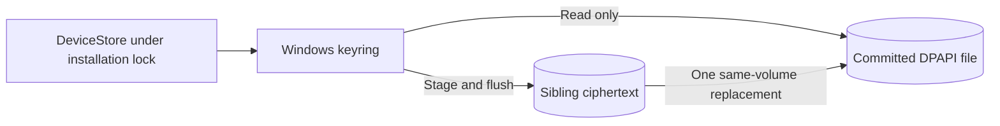
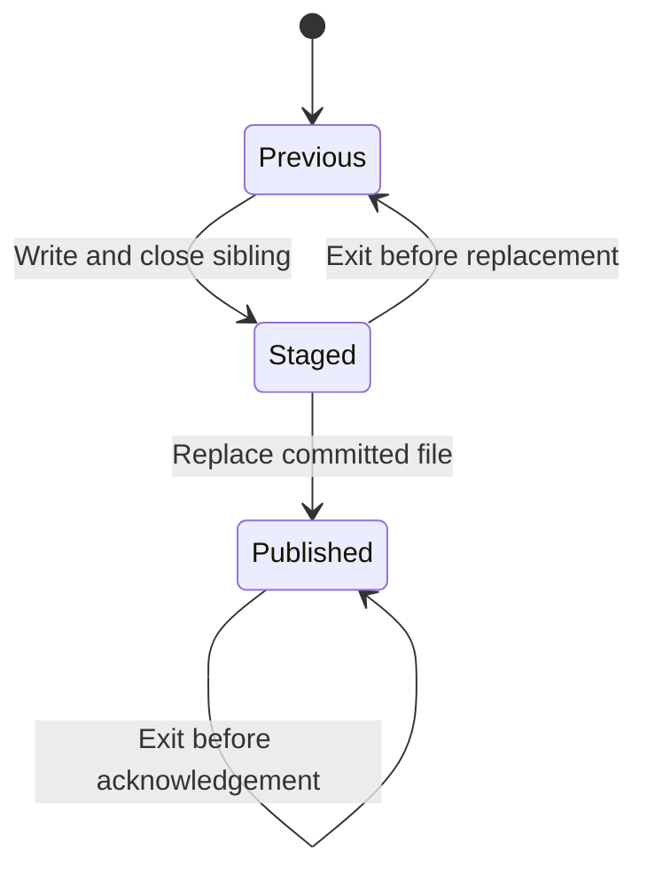
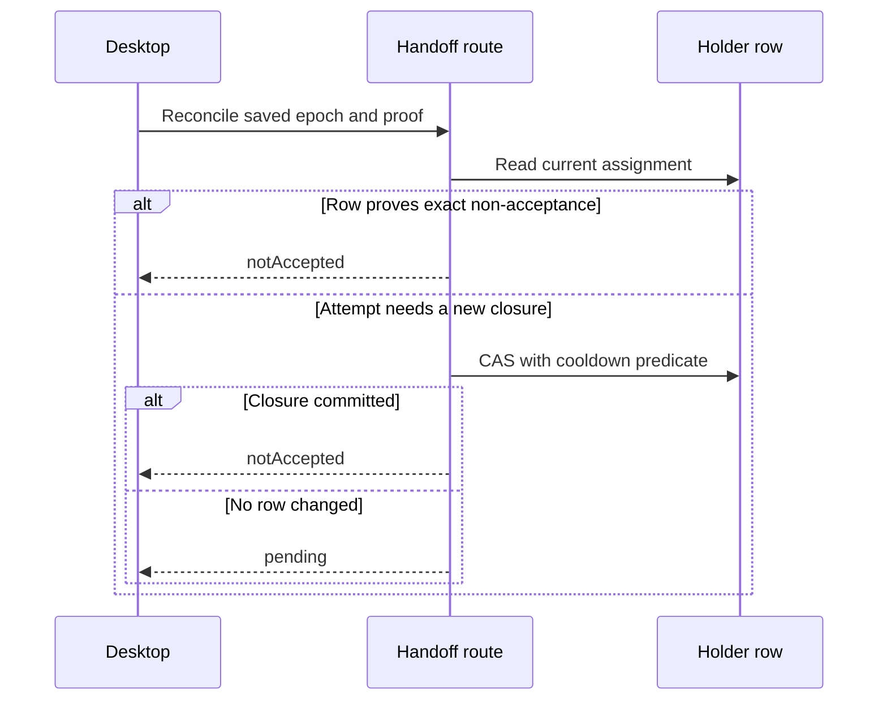
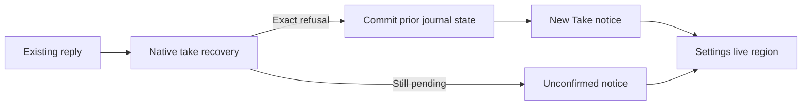

# Design

## Triage

| Trigger | Applies? | Evidence |
|---|---|---|
| T1 Components | Yes | `app/lib/esi_sso/data/native_account.dart:301-328` reads the journal and calls the source; `app/lib/esi_sso/logic/account.dart:291-329` carries the outcome to Settings. |
| T2 State | Yes | `server/kaname_server/lib/src/esi/sso_holder_row.spy.yaml:6-15` owns the durable take epoch fields. The closure limit adds one field. |
| T3 Concurrency | Yes | `server/kaname_server/lib/src/esi/sso_handoff.dart:106-128` serializes take work by character; `app/lib/esi_sso/data/device_store.dart:154-173` locks the credential store before touching the keyring. |
| T4 Boundaries | Yes | `app/lib/esi_sso/data/desktop_platform_io.dart:43-67` adapts a platform plugin for credential operations. `server/kaname_server/lib/src/esi/sso_holder_row.spy.yaml:1-15` requires a Postgres migration for the new column. |
| T5 Volume | Yes | Repeated current-epoch requests can reach `server/kaname_server/lib/src/esi/sso_handoff.dart:298-318`, which increments the closure offset without a rate limit. |
| T6 Risk | Yes | `app/lib/esi_sso/data/device_store.dart:167-182,204-210` requires the original install key to reopen the journal. |

TIER: FULL

## Context

See [the proposal](proposal.md) for user impact. The desktop adapts `FlutterSecureStorage` for read, write, delete and contains in `app/lib/esi_sso/data/desktop_platform_io.dart:43-67`. `DeviceStore` acquires the installation's lock before the first read (`app/lib/esi_sso/data/device_store.dart:154-174`) and its caller waits for active account work before closing it (`app/lib/esi_sso/data/native_account.dart:568-580`). Windows currently cannot confirm absence after a failed delete (`app/lib/esi_sso/data/desktop_platform_io.dart:63-67`). Keep that conservative fallback in this change.

The desktop uses the saved origin, registration, epoch and proof when resuming. Exact non-acceptance restores the persisted snapshot but returns `blocked`; incomplete results return their notice (`app/lib/esi_sso/data/native_account.dart:301-328`). Return already stops on a non-successful result (`app/lib/esi_sso/data/native_account.dart:350-360`). Settings displays account notices in its existing live region (`app/lib/esi_sso/ui/esi_account_section.dart:225-241`).

The server derives an epoch from holder generation plus closure offset (`server/kaname_server/lib/src/esi/sso_handoff.dart:287-295`). The one-advance evidence check precedes closure (`server/kaname_server/lib/src/esi/sso_handoff.dart:117-128`). Fenced reconciliation and two necessary early-refusal paths for a fenced start call the same closure statement (`server/kaname_server/lib/src/esi/sso_handoff.dart:126-150,298-318`). An accepted start uses the separate holder CAS (`server/kaname_server/lib/src/esi/sso_handoff.dart:152-165,334-358`).

`ServerSso.install` already shares a runtime clock with its session and vault dependencies (`server/kaname_server/lib/src/esi/server_sso.dart:65-81`), and confidential activation copies the observed holder row when it updates an existing assignment (`server/kaname_server/lib/src/esi/server_sso_grants.dart:209-218`).

## Decisions

### D1: Publish the Windows map by replacement

- **Choice:** In the Windows package, keep the current file name, DPAPI context and JSON map. Read the committed path only. Treat only confirmed path absence as an empty map; return a fixed error for other I/O, DPAPI or decoding failures and preserve the committed bytes. Reject a malformed entry rather than silently dropping it. For an exact-key mutation, write ciphertext to one reserved sibling, flush and close it, then rename it over the committed regular file on the same volume. Do not remove or truncate the destination before rename. If publication fails, return failure without retrying the write or falling back to a rewrite. Discard only the reserved staging file on a later mutation after verifying the committed map, never promote it on read. Leave legacy per-key compatibility behavior and explicit `deleteAll` semantics outside this fix.
- **Rejected:** Keep a backup and repair on load. That still rewrites the authoritative file in place and introduces another recovery decision if both copies exist.
- **Reversal cost:** medium.
- **Important:** yes, this protects data that cannot always be recovered.
- **Chosen by:** user.

### D2: Pin the patch from the owner's public fork

- **Choice:** Base the patch on the upstream Windows tag `flutter_secure_storage_windows-v4.2.2` from `juliansteenbakker/flutter_secure_storage`, peeled commit `bd602d0a47bea9088cd40bd87fcbf7d2c67f7e60`. Push the patch branch to [`sh1ny/flutter_secure_storage`](https://github.com/sh1ny/flutter_secure_storage) as KintsugiBot after apply approval. Pin only `flutter_secure_storage_windows` to the full patch commit and the Windows package subdirectory using a root pub override. Keep and credit the upstream licence; mark the modified code in the fork and document the source, pin and removal condition in Kaname's third-party notices. Do not copy package code into Kaname.
- **Rejected:** A bot-owned fork or a vendored package. The owner chose to retain control of the fork without adding another package to Kaname's tree.
- **Reversal cost:** low. An upstream release with the fix can replace the override.
- **Important:** yes, this changes the dependency source.
- **Chosen by:** user, "Fork under sh1ny".

**Publishing restriction:** After the owner approves apply, KintsugiBot may push only the patch branch to `sh1ny/flutter_secure_storage`. Every `gh` command that touches the fork must pass `-R sh1ny/flutter_secure_storage` explicitly. Open no pull request in the fork. Pushes, pull requests, issues, and comments in `juliansteenbakker/flutter_secure_storage` or any other upstream or third-party repository are outside this change. This restriction does not apply to the assigned Kaname PR.

### D3: Use the existing replies for the recovery notices

- **Choice:** For an epoch-bound retry, map the existing `202 {"status":"pending"}` reply to a recovery-specific notice that says the take is unconfirmed and retry may not settle it. A malformed 202 must not get that notice. After exact non-acceptance, return a different notice only after the journal rollback commits, so the user knows they can start a new Take under the existing rules. Failure to delete an unused proof after the commit leaves it tracked for existing cleanup; it does not change the rollback notice. Keep the current notices for a fresh request, legacy flow, invalid or missing reply, and failed rollback. Use the existing localized Settings live region. Add no retry, reset, new controls or wire status.
- **Rejected:** A new server status for permanently unprovable outcomes. It would change the protocol and would not help a new app talking to an older server.
- **Reversal cost:** low.
- **Important:** yes, this changes what the user sees.
- **Chosen by:** user, "Messages only".

### D4: Limit closure writes in the existing holder row

- **Choice:** Add a nullable server-only `lastTakeClosureAt` to `SsoHolderRow`. Null means no prior closure recorded. Under the current character gate, check committed epoch evidence first. Only on a branch that needs to close an epoch, start a transaction and select the holder row `FOR UPDATE`. After the row lock is granted, sample the existing runtime clock in UTC, never a client-supplied time. Use that value in one parameterized CAS to check the cooldown and update `takeClosures` and `lastTakeClosureAt` together. Keep the row ID, phase, generation and closure-offset predicates to reject a stale pre-lock observation. Return `notAccepted` only after a successful commit; a missing row or CAS miss stays pending. All `_closeTake` callers use this path. Prepare, an eligible start and a result already proven by a committed row do not take this new lock or consult the cooldown.
- **Rejected:** Sampling at request entry counts time before a blocked write. Measuring from commit acknowledgement would need a separate durable mechanism. An in-memory limit resets on restart, and counting alone does not bound writes.
- **Reversal cost:** medium.
- **Important:** yes, this changes the persisted schema and which requests can close an epoch.
- **Chosen by:** user, "Stored limit" and "Start at row lock".

### Decision summary

| # | Decision | Choice | Rejected | Reversal cost | Important | Chosen by |
|---|---|---|---|---|---|---|
| S1 | Scope | One off-milestone change, on the assigned branch | Split issues or edit the roadmap | Low | Yes | User |
| S2 | Windows fix | Patch the dependency without migrating credentials | Replace the backend or wait for a release | Medium | Yes | User |
| S3 | Holder policy | Keep evidence and current authority rules | Reset uncertain takes or bypass parking | High | Yes | User |
| D1 | Windows commit | Flush a sibling and replace the committed file | In-place rewrite with backup recovery | Medium | Yes | User |
| D2 | Dependency source | Immutable Windows package pin from the owner's fork | Bot fork or vendored copy | Low | Yes | User |
| D3 | Recovery feedback | Two Settings notices, no wire change | New server result | Low | Yes | User |
| D4 | Closure limit | Durable per-character cooldown sampled under the holder row lock | Request-time sampling, commit-time tracking, in-memory limit or counting only | Medium | Yes | User |

## Assumptions

- **A1:** The locked upstream package (`pubspec.lock:398-405`) uses one DPAPI JSON file, rewrites it for write and exact-key delete, and can delete it on decode failure. The package is not tracked in Kaname. The tagged source was inspected externally. During apply, recheck the exact source and licence and record the fork diff and pin for review. Depends on D1 and D2.
- **A2:** The pinned Dart 3.13.7 Windows `File.rename` converts paths with `ToWinAPIPath` and uses same-volume `MoveFileExW` with replacement and write-through flags for regular files. This was inspected in the [pinned SDK source](https://github.com/dart-lang/sdk/blob/3.13.7/runtime/bin/file_win.cc#L787-L826), but the commit sequence has not run on Windows. The Windows regression tests must verify the old and new states through the pinned package. Depends on D1.
- **A3:** The 4.2.2 Windows implementation exposes `createFlutterSecureStorageWindows` and `DpapiJsonFileMapStorage` for tests in its `src` library. A Flutter VM test on Windows can use them to run the real write and delete path, and the generated Dart registrant can select the same resolved backend for the default `FlutterSecureStorage` facade. This is based on the pinned plugin manifest, source and Flutter test compiler, not a Windows run. Verify facade registration with the hosted preservation probe before patching, then verify the direct test import and shared save path under the fork pin. In the patched suite prove parent and child resolve the same Windows package and that `exit` terminates the Windows test host with the expected code. Depends on D1 and D2.

## Carried constraints

- **C1:** The committed file alone is authoritative. A staged sibling never grants access or replaces the committed file on read. A failed load must not yield an empty map or remove the committed bytes. Kind: invariant. Destination: spec: specs/esi-sso/spec.md → Requirement: Windows secure-storage mutations preserve committed credentials
- **C2:** The durability guarantee is for process interruption on the supported local Windows installation, not power loss, a restored backup or simultaneous uncoordinated writers to the same file. Kind: deliberate gap. Destination: spec: specs/esi-sso/spec.md → Requirement: Windows secure-storage mutations preserve committed credentials
- **C3:** Notice changes neither establish holder authority nor replace journal evidence. Only a committed rollback can produce the new-Take notice. Kind: invariant. Destination: spec: specs/esi-sso/spec.md → Requirement: The desktop restores local state after a definitively refused take
- **C4:** Check committed outcome evidence before conditioning a new closure on the cooldown. A cooldown, exception or CAS miss cannot prove non-acceptance. Kind: invariant. Destination: spec: specs/esi-sso/spec.md → Requirement: The source bounds closures of unused desktop take epochs
- **C5:** A closure changes only the closure offset and its timestamp, never holder generation, phase, or proof. Other holder writes preserve both closure fields. Kind: invariant. Destination: doc comment: server/kaname_server/lib/src/esi/sso_handoff.dart SsoHandoff.takeIntent
- **C6:** Sample closure time after acquiring the holder row lock. Time waiting for the lock does not count; time from the guarded write to commit acknowledgement can count. Kind: invariant. Destination: spec: specs/esi-sso/spec.md → Requirement: The source bounds closures of unused desktop take epochs
- **C7:** After explicit apply approval, publish only the authorized patch branch to `sh1ny/flutter_secure_storage`. Use `-R sh1ny/flutter_secure_storage` for fork `gh` calls. Open no fork PR. Upstream and third-party pushes, pull requests, issues, and comments are outside this change. Kind: invariant. Destination: doc comment: THIRD_PARTY_NOTICES Windows secure storage patch (handwritten section).

## Diagrams

### Modules and file publication

### Windows save states

### Recovery response order

### Data and presentation boundary

## State & Ownership

| State | Owner | Lifetime | Invalidation or rebuild | Authoritative copy |
|---|---|---|---|---|
| Windows credential map | Plugin mutation under Kaname's installation lock | Until an exact-key operation commits | Only replacement publishes new data; a reader does not repair unreadable bytes | Existing DPAPI file |
| Staged Windows ciphertext | Current mutation under the same lock | Until replacement, failure cleanup, or the next mutation after exit | Discard, never recover from the sibling | None |
| Pending local take and saved prior state | Existing `NativeAccount` and `DeviceStore` | Until the same intent reserves or a proven rollback commits | Declined or uncertain retries do not fabricate prior state | SQLite journal and original proof in the keyring |
| Recovery notice | Existing account notifier | Until the next action or sign-out | Derive from this action's validated result; do not persist | `AccountIdle.notice` |
| Closure timestamp | `_closeTake` under the existing character gate and CAS | Holder row lifetime | Null on insert; update only with the offset | PostgreSQL holder row |

## Failure & Visibility

| Component | Failure | Recovery | Safe retry? | Who finds out |
|---|---|---|---|---|
| Windows decode or read | Committed file exists but cannot be read or decoded | Leave it intact and report a fixed error; do not initialize a replacement map | Yes, after the storage fault is resolved | Desktop receives the existing unavailable result |
| Windows stage or replace | Exit or error before publication | Reopen the old committed file. Ignore a staged file; clean that exact name under the lock on a later mutation | Yes | On error, the caller receives failure; after exit, it reads committed state |
| Windows acknowledgement | Exit after publication | Reopen the new full map. An exact delete is safe to repeat | Yes | The caller can observe the actual entry on reopen |
| Settings recovery | Pending, a wrong reply, or a failed rollback | Keep the intent and proof. Explain pending for the valid recovery reply only | Yes, without promising settlement | User sees an existing fixed notice or the new unconfirmed message |
| Windows proof cleanup after rollback | Exact-delete failure or absence cannot be confirmed after the SQLite rollback commits | Keep the unused proof tracked for existing cleanup on reopen. Do not restore the already-rolled-back intent | Yes | Settings shows the new-Take notice; existing cleanup emits its fixed diagnostic |
| Closure CAS | Stale row, cooldown or DB error | A miss remains pending; a DB exception is not terminal evidence. Check the row again on a user retry | Yes | Existing source reply and Settings notice |

## Resource Bounds

| Resource | Bound | At the bound | Timeout | At 10x / 100x |
|---|---|---|---|---|
| Windows file and buffer | One committed map and one ciphertext sibling; use the existing encoded map, no additional retained copies | Reuse the reserved sibling name under the existing lock; no backup chain or scan | No retry loop or new deadline | Existing whole-map work stays linear in entries; each mutation writes one ciphertext map |
| Closure state and writes | One timestamp per holder row. The spec sets the successful-write limit per character | No row change when the predicate rejects the operation | Existing Postgres transaction and statement behavior; no application retry queue | One row lock and one conditional update at most for a new closure; no new lock on the proven reply or accepted path |
| Settings | One notice per action; no new persisted state | Replace the previous notice as before | None | Constant |

## Flow & State Gaps

- Load committed data before writing or deleting an exact key. Open the staging file only after confirming there is no stale staging file at that name, or after deleting that one stale entry. The existing installation lock serializes Kaname access. Flush and close before rename. If an operation fails, cleanup may remove the sibling but never the destination. Pure absence retains legacy lookup behavior; an unreadable committed file does not reach legacy lookup or mutation.
- The Kaname Windows test entry is `mise exec -- flutter test --no-pub test/esi_sso/windows_secure_storage_crash_test.dart` from `app/`. The existing Windows `check` job discovers the same test in `mise run test:app` (`.github/workflows/ci.yml:39-67`, `mise.toml:91-124`). Run Windows tests only on Windows. Resolve the workspace first and record the fork SHA in the lockfile and the actual package root in `.dart_tool/package_config.json`; check that Git reports the same SHA at that resolved root. Do not run against a separate checkout of the package or an independently resolved Flutter project.
- Give the app test a direct dev dependency on the Windows plugin and import its `src` test factory only in the test. The factory must construct the same plugin implementation, with the same exact-key methods and `DpapiJsonFileMapStorage.save`, as the default constructor. Only the directory and two publication barrier callbacks differ. The release constructor installs no callbacks. Both use the same DPAPI and file replacement code. Give the test explicit dev dependencies for its Win32 and path-provider test imports if they are not already direct.
- For the normal-facade test, rely on the pinned Flutter test runner's generated Dart plugin registration; do not manually select or install a replacement secure-storage platform. Use `const FlutterSecureStorage()` as `_Keyring` does. Replace only `PathProviderPlatform.instance` with a test implementation that returns a unique fixture directory, restored on teardown. The facade's Windows options default to disabling legacy lookup. Prove selection through the canonical file and an exact-key read: seed the real Windows DPAPI format in the temporary directory, then write, reopen, read and delete through the facade. Do not read or write the user's keyring.
- The parent runs the same pinned Flutter executable with `flutter test --no-pub --no-test-assets` and a name filter for the child case. The child runs only when given the unique test endpoint and directory. At the chosen before- or after-rename barrier, it sends its own Windows-host PID and the stage marker over a loopback connection. Before acknowledging, the parent opens a process handle for that PID with `SYNCHRONIZE` and `PROCESS_QUERY_LIMITED_INFORMATION`; failure to obtain it is a test failure. After acknowledgement the child exits with the designated code without unwinding the save. Wait for the host handle to signal off the listening isolate, verify `GetExitCodeProcess` returns the designated code, close the handle, and reap the Flutter runner before reopening or deleting the directory. Runner failure alone is not evidence. Drain both output streams, check test diagnostics for disclosure, and use one generous hang guard for the whole test. Assert the full old and new maps for exact write and exact delete on both sides of rename, including unrelated install key and proof.
- Write `app/test/esi_sso/windows_secure_storage_preservation_test.dart` first. It uses only the hosted 4.2.2 facade and path-provider test seam, with no patch-only imports or hooks. In a unique temporary support directory, write synthetic invalid bytes at `flutter_secure_storage.dat` so DPAPI unprotect fails. Call `const FlutterSecureStorage().read` for a synthetic key. Assert that it fails and that the exact committed bytes are still at that name. Report a fixed test failure if the file is gone; do not print the bytes. Run `mise exec -- flutter test --no-pub test/esi_sso/windows_secure_storage_preservation_test.dart` from `app/` on Windows against the original hosted pin. Require the preservation assertion to fail after the facade reaches that file, not a registration, compilation or setup error. Run the identical test under the fork pin and require it to pass. Record the hosted checksum and resolved Git SHA with the results.
- Keep the four process-exit cases in `windows_secure_storage_crash_test.dart`. That suite also verifies that a partial staged file is ignored and that a destination handle opened without delete sharing causes a real replacement failure without changing the old bytes. Check returned errors and captured diagnostics for synthetic secret sentinels without printing them. Record the fault stage, observed host exit, and assertion results, not credential values.
- Keep legacy and fresh-start behavior unchanged. For a fenced retry, check the exact pending envelope rather than every HTTP 202. Return stops after either new notice, so it sends no park/release for a rolled-back take. A new Take still prepares and generates a fresh proof under the existing rules. A stale action or invalid session does not override the notifier's current session rules.
- After the transaction obtains the row lock, use the same sampled UTC time for the cooldown comparison and stored timestamp. A backward clock adjustment can postpone closure until the clock reaches the stored deadline. Time spent waiting for the lock never consumes the cooldown; time from the guarded write until commit acknowledgement can. For the regression, hold that row in a separate Postgres session and wait until the closing session is visibly blocked on that lock. Advance the injected clock, release the blocker and assert the persisted timestamp, exact replay and eligibility just before and at the cooldown boundary. Existing rows need no backfill. Preserve the timestamp across sign-in, accepted take, park and release; none refills the limit. A second advance can still make an older intent unprovable; the cooldown is not outcome history.
- A legitimate start may still encounter the existing gate while a reconcile is in flight. The cooldown itself cannot invalidate a current epoch; it prevents closure writes until the next eligible time. An eligible successful closure can still fence a delayed unaccepted start, as required by the existing recovery contract.

## Mechanism Ledger

| Mechanism | Built? | Why | Evidence that would change the call |
|---|---|---|---|
| Sibling replacement and non-destructive read errors | Yes | Breaking either rule can lose the only copy of an unrelated live proof | A released package that proves the same guarantees |
| Typed recovery notices | Yes | The existing pending and blocked text does not tell the user whether a new Take can start | The existing Settings state represents both outcomes without new notices |
| Timestamp in closure CAS | Yes | A new authenticated closure can otherwise advance the epoch on every call | Existing durable request admission with the same per-character and retry rules |
| Backup chain, keyring migration, take reset or outcome history | No | These add another source of truth or relax authority without solving the reported failures | A separately approved requirement needing longer recovery or a new storage format |

## Risks / Trade-offs

The map remains a whole-file store. The tested process-exit contract does not extend to storage-device failure, external writes, or a downgrade to the unpatched backend. Persistent file errors now fail closed rather than writing through them. Keep the fork as a narrow diff until a verified upstream release can replace the pin. The cooldown bounds changes to the row, not authenticated request volume. An unprovable take still requires the existing holder recovery rules.

## ADRs

- **In force, constraining this change:** ADR 0002, ADR 0005, ADR 0010 and ADR 0017.
- **To record during apply:** none. The pinned patch retains the existing credential format and boundary. The notice and server-only cooldown do not change holder policy.
