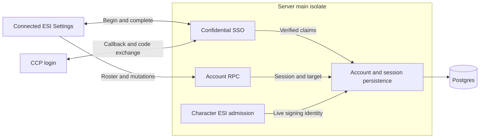
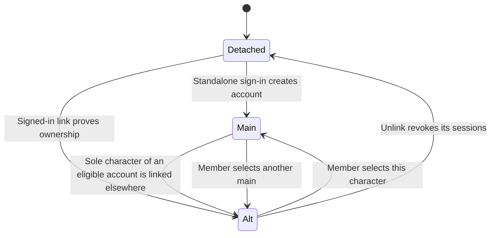
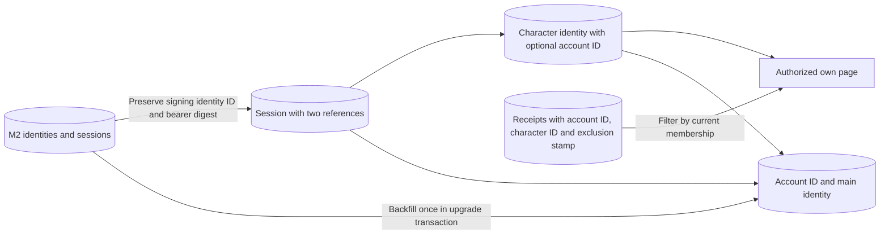

# Member accounts design

## Triage

| Trigger | Applies? | Evidence |
|---|---|---|
| T1 Components | Yes | The Flutter account settings, confidential CCP callback, generated RPC and Postgres have distinct interfaces. |
| T2 State | Yes | Accounts, the main designation and sessions move from one character per account to a roster. |
| T3 Concurrency | Yes | Callback completion, sign-in, unlink, main selection and session revocation can overlap. |
| T4 Boundaries | Yes | The upgrade backfills stored identities and sessions. Flutter reads a new RPC projection. |
| T5 Volume | Yes | A roster can grow as characters are added. Migration work grows with existing identities and sessions. |
| T6 Risk | Yes | A stale session or the wrong receipt owner could expose an account's private data. |

TIER: FULL

## Context

The source citations describe the pre-change baseline at `e177950`. D20 amends the implemented design; it does not change what the baseline code did.

See [proposal.md](proposal.md) for scope. `SsoIdentityRow` stores a unique CCP character ID, verified owner and blocked flag (`server/kaname_server/lib/src/esi/sso_identity_row.spy.yaml:1-9`). The M2 session stores a digest and `memberId`, and viewer lookup treats `memberId` as the identity row ID (`server/kaname_server/lib/src/esi/sso_session_row.spy.yaml:5-13`, `server/kaname_server/lib/src/esi/sso_sessions.dart:96-110`). Serverpod uses that row ID as `userIdentifier` and the session row ID as `authId` (`server/kaname_server/lib/src/esi/sso_sessions.dart:70-79`). Sign-in can block a stored owner conflict under a character advisory lock and delete that identity's sessions (`server/kaname_server/lib/src/esi/sso_sessions.dart:115-145`).

The raw SSO routes reserve a bounded attempt before I/O (`server/kaname_server/lib/src/esi/sso_route.dart:183-208`). The callback verifies claims and holds the result until the app supplies the proof and either the web browser binding or the native completion code (`server/kaname_server/lib/src/esi/sso_route.dart:255-305`, `server/kaname_server/lib/src/esi/sso_route.dart:315-355`). Scoped completion checks the exact session, character and owner before using the grant (`server/kaname_server/lib/src/esi/server_sso_grants.dart:142-169`). Handoff takes the current session's identity as input (`server/kaname_server/lib/src/esi/sso_route.dart:419-446`, `server/kaname_server/lib/src/esi/sso_route.dart:477-491`). The signing character's allowlist entry determines admin scope (`server/kaname_server/lib/src/esi/sso_sessions.dart:96-110`).

The skills path rechecks the session under the dispatch gate, then passes the identity row ID to the ESI client as `EsiPrincipal.member` (`server/kaname_server/lib/src/esi/sso_skills.dart:34-67`, `server/kaname_server/lib/src/esi/sso_skills.dart:117-128`). The call-log endpoint resolves the authenticated ID as a character identity and passes one character to the store (`server/kaname_server/lib/src/esi/esi_call_log_endpoint.dart:38-75`). The store filters receipts by both ID and character (`server/kaname_server/lib/src/esi/esi_call_log_store.dart:137-152`). Route aggregates count distinct recorded IDs (`server/kaname_server/lib/src/esi/esi_call_log_store.dart:208-238`).

Flutter binds a bearer to its original origin and rejects a viewer refresh that changes its member ID or signing character (`app/lib/esi_sso/data/connected_account.dart:50-89`). The account notifier uses an epoch to discard late sign-in replies across sign-out and changes of server (`app/lib/esi_sso/logic/account.dart:91-109`, `app/lib/esi_sso/logic/account.dart:150-199`, `app/lib/esi_sso/logic/account.dart:333`). ESI Settings has connected and solo controls (`app/lib/esi_sso/ui/esi_account_section.dart:81-141`, `app/lib/esi_sso/ui/esi_account_section.dart:178-219`). The call-log notifier retains one page and checks the source on each reply (`app/lib/esi_sso/logic/call_log.dart:74-98`, `app/lib/esi_sso/logic/call_log.dart:112-129`). Its generated RPC client carries the bearer in an auth header (`app/lib/esi_sso/data/call_log_client.dart:15-34`).

`SsoSessions.block` currently reads and updates the identity without the sign-in path's advisory lock (`server/kaname_server/lib/src/esi/sso_sessions.dart:212-236`). Scoped activation and vault refresh can both call it (`server/kaname_server/lib/src/esi/server_sso_grants.dart:150-162`, `server/kaname_server/lib/src/esi/server_sso_grants.dart:283-287`). The opt-in's current `memberId` is also an identity row ID (`server/kaname_server/lib/src/esi/sso_opt_in_row.spy.yaml:5-12`, `server/kaname_server/lib/src/esi/server_sso_grants.dart:73-92`, `server/kaname_server/lib/src/esi/server_sso_grants.dart:100-135`).

The handoff route passes a previously resolved identity to `release`, which acquires its gate later (`server/kaname_server/lib/src/esi/sso_route.dart:477-488`, `server/kaname_server/lib/src/esi/sso_handoff.dart:224-244`). The aggregate endpoint uses captured admin scope before returning a cached page (`server/kaname_server/lib/src/esi/esi_call_log_endpoint.dart:107-128`). Static-data mutations check the request's captured scope before starting bounded admission or a setting write (`server/kaname_server/lib/src/static_data/static_data_admin_endpoint.dart:17-46`, `server/kaname_server/lib/src/static_data/static_data_admin_endpoint.dart:57-72`, `server/kaname_server/lib/src/static_data/static_data_admin_endpoint.dart:101-102`). Job admission awaits lookup and later reserves and inserts (`server/kaname_server/lib/src/static_data/admin_admission.dart:76-87`, `server/kaname_server/lib/src/static_data/admin_admission.dart:115-130`).

## Threat model

In scope: a member or admin who uses linking or unlinking to inflate private-aggregate counts or read another account's data; concurrent requests; a crash or restart at any point; and one backward step of the database clock. D15 handles that step for aggregate release, and D20 handles it for session expiry.

Accepted cutoff limit: until a window is first durably sealed, the cutoff uses the database clock. A clock crossing that was never sealed does not decide eligibility. Once sealed, one backward step cannot change the window or make the server select an older one. No independent time source is required.

Accepted expiry limit: until Postgres durably records expiry, an admission read uses current database time. If the clock crosses a session's expiry and steps back before any expiry deletion commits, that crossing does not terminate the session. After the delete commits, a backward step or restart cannot make the same bearer valid again.

Out of scope unless the owner adds them: a compromised Postgres or host, an operator editing the database directly, repeated or malicious clock manipulation, and attackers who control CCP SSO. Record and file out-of-scope findings separately; they do not block this change.

## Decisions

### D1: Separate the account, signing identity and session

- Choice: Add a server-only member account row with a stable ID and a non-null main identity reference. Each character identity has at most one nullable account reference, indexed with its character ID. Each session binds both that account and its signing identity. The API uses the account ID as `memberId` and Serverpod `userIdentifier`, and preserves the `authId` session ID. Live viewer resolution checks the session's expiry, unblocked signing identity and unchanged membership in one database snapshot. ESI, holder and admin decisions still use the signing identity.
- Upgrade: Seed account IDs from the M2 identity IDs. Advance the account sequence above every seeded ID. Keep all character identity primary keys and legacy receipt IDs. Preserve valid session digests, IDs and expiries. D11 defines the column changes, invalid-session cleanup and constraints.
- Rejected: Use the main's character identity as the account ID. Changing a main would change a durable reference used by later M3 changes.
- Reversal cost: High once other modules own data under the account ID.
- Important: yes (persistence and authentication contract).
- Chosen by: user; approved by Ormy on the owner's delegation, 2026-11-27, owner to confirm.

### D2: Add a link purpose to confidential SSO

- Choice: Reuse `begin`, `callback` and `complete`. At begin, record an immutable link purpose and bind it to the exact live session ID and account ID. Request zero ESI scopes. The callback applies the existing browser binding and CCP verifier rules. Retain only the verified claims and completion proof for a link, not the CCP grant. At complete, require the link purpose in the request to match the stored purpose. Require the original app proof, the browser binding or native code, and the exact still-live session. Consume the attempt once. The transaction rechecks that the attempt and claims have not expired after lock acquisition. Completion returns a fixed link outcome, never a bearer. The app keeps its original connected session. Preserve the existing non-link request shapes, and reject requests that combine link and scoped purposes.
- Rejected: Add a separate callback and duplicate the OAuth proof and attempt handling.
- Reversal cost: Medium, because clients and the confidential registration depend on the callback contract.
- Important: yes (external security contract).
- Chosen by: user; approved by Ormy on the owner's delegation, 2026-11-27, owner to confirm.

### D3: Scope receipts by recorded account and current ownership

- Choice: Attribute an admitted connected ESI request to the account of its signing session. For own history, filter by the live viewer's account and by unblocked, currently linked characters in the same database snapshot as the receipt read. Resolve the real session ID rather than treating `userIdentifier` as sufficient. A moved character's prior receipts do not appear in the new account. D9 defines aggregate qualification from those immutable receipts, and D12 defines the own-page read.
- Rejected: Limit own history to the signing character or move old receipts along with a character. The first makes linked members use multiple sign-ins for their own account history; the second changes historical ownership and released aggregate counts.
- Reversal cost: High once retention has removed records or other data readers adopt the ownership rule.
- Important: yes (privacy and account ownership).
- Chosen by: user; approved by Ormy on the owner's delegation, 2026-11-27, owner to confirm.

### D4: Unlinking leaves character ESI authority in place

- Owner confirmation priority: The owner explicitly confirmed this decision in item 96. The detached character keeps its server grant and opt-ins, though its sessions and old account access end.
- Choice: Revoke the removed character's connected sessions in the unlink transaction. Do not clear or update its vault grant, opt-ins, holder assignment or owner. A later sign-in under the same verified owner can use that character's grant only through the ordinary live-session, policy and holder checks. A device assignment still blocks server ESI. Preserve the existing owner-conflict block and session revocation until `character-transfer` defines disposal and reassignment.
- Rejected: Park or purge server authorization on unlink. That would make ordinary account editing part of the ESI credential lifecycle and introduce recovery work outside this change.
- Reversal cost: Medium, because deleting a grant would require fresh CCP authorization.
- Important: yes (credential lifecycle and user-visible behavior).
- Chosen by: user; approved by Ormy on the owner's delegation, 2026-11-27, owner to confirm.

### D5: Use short transactions and a fixed lock order

- Choice: Take the existing transaction advisory locks for the involved CCP character IDs in ascending order, then lock affected account rows in ascending ID order. Re-read identities and membership under those locks. Lock and revalidate the exact source session before a write, including expiry, blocked status and the account/identity pair. Sign-out's deletion of that row orders with completion. If sign-out commits first, the link or mutation must fail; if the link commits first, sign-out does not undo it. Never call CCP, the vault or the scheduler while holding these locks. D10 applies the writer protocol and defines admission for other protected work.
- Rejected: Serialize all membership changes on one install-wide lock. Independent accounts would contend for no data-integrity benefit.
- Reversal cost: Medium. Every writer must use the same order until a replacement is in place.
- Important: yes (session revocation and concurrent data integrity).
- Chosen by: user; approved by Ormy on the owner's delegation, 2026-11-27, owner to confirm.

### D6: Page the roster without limiting linked characters

- Choice: Use the existing keyset pattern. A page returns up to 50 characters ordered by CCP character ID, with a next cursor when another row exists. Index the account and character ID together. Return the account ID, main and signing character separately. A cursor controls order within the authenticated account and cannot select another account. Apply the bounded admission and first-page restart rules below. The owner confirmed both review fixes in item 96.
- Rejected: Cap the total number of linked characters and return them in one response.
- Reversal cost: Medium. The response shape will become a client contract.
- Important: yes (user-visible paging and public RPC shape).
- Chosen by: user; approved by Ormy on the owner's delegation, 2026-11-27, owner to confirm.

### D7: Absorb only a standalone account with no product data

- Choice: After fresh proof, permit an already-linked character to join only if it is the other account's only character and that account has no durable account-owned product data. Under the locked membership state, refuse after finding a second attached identity instead of scanning the roster. Revoke the other account's sessions and retire its ID in the same transaction that moves the identity. Existing ESI receipts do not move and are not product data that blocks a link. Any future feature adding durable account-owned data must include it in the eligibility check before those records can be written.
- Rejected: Treat a retained diagnostic receipt as a blocker for linking. M2 users would have to wait for retention to expire to link an otherwise eligible character.
- Reversal cost: High if absorbed accounts already had product data.
- Important: yes (cross-account move and future ownership contract).
- Chosen by: user; approved by Ormy on the owner's delegation, 2026-11-27, owner to confirm.

### D8: Use authenticated RPC for account settings

- Choice: Add generated Serverpod RPC for roster, make-main and unlink. Derive account and acting identity from the validated session. Accept only the roster cursor or target character ID, never a claimed owner or account. Return typed outcomes and project only account and character display data, with decimal ID strings for web. Keep OAuth exchange in the raw SSO middleware and share the origin-bound bearer adapter with the generated RPC. Put the controls in the existing Flutter ESI Settings section and keep one page of state for the current connected session. Do not add a solo route or local persistence.
- Rejected: Add raw middleware routes for roster and mutations. They do not need browser redirects or callback proof handling.
- Reversal cost: Medium because account UI and RPC need to ship together.
- Important: yes (client/server interface).
- Chosen by: user; approved by Ormy on the owner's delegation, 2026-11-27, owner to confirm.

### D9: Exclude overlapping accounts from private-route qualification

- Owner confirmation priority: The owner explicitly confirmed this privacy rule in item 96. It suppresses more routes than grouping overlapping accounts would.
- Choice: Use recorded account and character pairs in the released window, across routes. For each character recorded under more than one account, disqualify every associated account. Count distinct eligible accounts per private route. If it qualifies, include all its attributed calls. Public route totals keep their existing rules. D13–D17 govern detachment and release. Current account relationships are not an input.
- Rejected: Treat each graph of accounts connected by shared characters as a single eligible member. It suppresses fewer routes but adds graph computation to the fixed-window read.
- Reversal cost: Medium. Receipts retain their original account and character, so a later approved rule can change qualification without rewriting data.
- Important: yes (private aggregate disclosure).
- Chosen by: user; approved by Ormy on the owner's delegation, 2026-11-27, owner to confirm.

### D10: Order identity writes and recheck session authority at admission

- Choice: Every identity writer uses D5's character advisory lock, including the common block path used by sign-in, scoped activation and refresh. The writer re-reads current state after obtaining the lock. Sign-in updates the name only; owner conflict updates the blocked flag only and revokes sessions by signing identity in that transaction. Only membership operations update `accountId`. A refresh admitted before unlink can still block a signed owner conflict, but cannot restore membership from an older row snapshot.
- Admission: An exact live-session read at the gate below is the authorization point. Use current signing identity, account membership, expiry, blocked state and, for admin paths, the live character allowlist result. Nothing admitted before revocation gains new authority, but already admitted work may finish. Never keep a membership or session transaction open across a holder operation, ESI request, or static-data job.
- Expiry: Apply D20 within the protected admission read. For a snapshot that must include both viewer and data, the live-session read is its first snapshot read. For a membership mutation, sample expiry after the exact acting-session lock. Do not proceed with protected work after observing expiry, even if the expiry deletion fails.

  | Protected path | Where to check the session |
  |---|---|
  | Link, make-main and unlink | After locking the relevant identities and accounts, lock and check the source session before changing anything. |
  | Viewer, roster and own history | Resolve the session and requested data in one database snapshot. |
  | Opt-in, scoped grant activation and scheduled skills | Inside the existing character gate, before changing consent, using a grant or admitting dispatch. The scoped attempt must still match the exact session. |
  | Handoff take, reconciliation, return and standalone join | Inside the existing character or handoff guard, before any holder read used to justify a transition or replay acknowledgment. Take preparation checks the session at its epoch read. Reject an invalid session without implying a previously submitted take was not accepted. |
  | Admin route totals | Inside the existing read admission slot, before reading the cache, joining an in-flight calculation or starting the calculation. |
  | Static-data mutations | Use the existing admin work budget for the live-session check. Update and rollback await that check after lookup work. Then sample the final job gate, check the remaining deadline and reserve the slot in one synchronous turn, with no await between the final sample and reservation. A replay checks authority before answering. The setting write checks within its admin work slot before writing. Public reads and already admitted job settlement stay unchanged. |

- Rejected: Hold the account or session lock until protected work finishes. An ESI call or job would delay unlink without changing an operation already admitted under live authority.
- Reversal cost: Medium because the admission points protect multiple consumers.
- Important: yes (revocation and privacy).
- Chosen by: user; approved by Ormy on the owner's delegation, 2026-11-27, owner to confirm.

### D11: Delete absorbed accounts with restrictive references

- Choice: The migration adds the account table and nullable membership column, then seeds accounts, attaches identities, and backfills each surviving session's account reference. Rename the old session `memberId` to its identity reference. Before installing the required account and identity foreign keys, delete sessions whose signing identity is missing or whose expiry is at or before the single Postgres UTC cutover sample. Rename opt-in `memberId` to `identityId` without changing values or policy. Keep opt-in lookups and writes keyed to the signing identity. Keep the receipt's `memberId` as the account ID with no account foreign key. The upgrade commits as one transaction; a fresh schema has the same required references with no backfill.
- Retirement: Move the identity, revoke old account sessions and delete the absorbed account row together. Do not recycle its ID. Future durable account-owned product rows must reference the account with `ON DELETE RESTRICT`, never cascade on absorption. The database refuses the delete if such rows exist. That failure rolls back the move and the session revocation and returns the same fixed refusal as other ineligible links. Receipts do not reference the account row and do not block retirement. Verify eligibility with an isolated integration fixture containing a product row protected by a restrictive foreign key.
- Rejected: Keep an absorbed account row without a main and track eligibility separately. That would make an invalid active account state represent retirement and require another mechanism to protect future records.
- Reversal cost: High once more features use the account foreign key.
- Important: yes (stored data and upgrade compatibility).
- Chosen by: user; approved by Ormy on the owner's delegation, 2026-11-27, owner to confirm.

### D12: Keep chronological paging with a bounded failure

- Choice: Scan the existing `(memberId, recordedAt, id)` receipt index backward. Apply the current account ID, retention cutoff and composite keyset cursor as range predicates. Use an existence check against the indexed `(accountId, characterId)` membership for each candidate; do not read the entire roster or materialize its IDs in Dart. The result contains the first 100 eligible rows or fewer if the range is exhausted. If the existing ten-second query limit is reached before establishing a page, return unavailable without partial rows or an automatic retry.
- Work at scale: The lookup is cheap per candidate, not constant per returned row. In a retained range dominated by removed or blocked characters, 10× or 100× more candidates may require 10× or 100× more index visits. Check a seeded sparse range for correct rows and cursor progression, and inspect the query plan on scaled sparse fixtures without asserting an elapsed-time budget in CI. The read does not need another index, a protected candidate cursor, or a new cache.
- Rejected: Page through bounded candidate batches and return empty but incomplete pages. It changes the current cursor contract and can reveal the positions of filtered receipts without an opaque cursor.
- Reversal cost: Medium because pagination is an existing client contract.
- Important: yes (existing observable error and paging behavior).
- Chosen by: user; approved by Ormy on the owner's delegation, 2026-11-27, owner to confirm.

### D13: Exclude accounts a detached character starts or joins

- Choice: Set `wasDetached` on the existing character identity in the same transaction as unlink and session revocation. Keep it for the life of that identity. When that character starts or joins an account, insert its first exclusion into a server-only Postgres table keyed by account ID. No foreign key to the account row: the evidence survives retirement. The insert commits with membership. Never update or delete the evidence in this change. Unlink alone does not exclude the account the character leaves.
- Receipt stamp: Read the existence of an exclusion row in the same snapshot as live ESI admission. Carry that boolean with the account and character through the scheduler to the receipt. Do not recalculate it when persisting receipts or computing aggregates. M2 receipts keep their original attribution and have no exclusion stamp; the migration starts with no detached identities or exclusion rows.
- Privacy: Keep the receipt stamp as evidence of what the server observed at admission. At release, D14 uses the durable exclusion time to decide whether the account qualifies. The stamp cannot override the cutoff. Exclusion does not change sign-in, grants, opt-ins, holder state, own history, or the attributed totals for routes that qualify.
- Rejected: Store a graph of historical memberships and count a privacy cohort for each connected group. It could qualify more private routes but requires keeping and resolving membership history.
- Reversal cost: Medium. The detachment flag, exclusion evidence and receipt stamp are durable. Replacing the rule requires a reviewed privacy decision and must not rewrite released windows.
- Important: yes (private aggregate disclosure and persistent evidence).
- Chosen by: user; owner approved option A in item 96.

### D14: Include exclusions effective before the fixed release cutoff

- Choice: An account's first exclusion row contains its account ID and immutable UTC `excludedAt`. Before inserting that row, the membership transaction takes a shared transaction lock on the existing diagnostic release key, after its character, account and acting-session locks. Choose `excludedAt` under that lock using the database clock and D15's watermark. Hold the lock through commit. If lock acquisition or persistence fails, roll back the membership change instead of accepting a link without its privacy evidence.
- Release: The fixed cutoff is the window end plus the existing one-minute grace. Use `excludedAt < cutoff`, including at first release when the account has no later receipt or its row has retired. Exclusion at or after cutoff cannot change that window. This holds even if the clock steps backward before the first seal and a later stamped receipt lands in the window. The exclusive barrier drains writers that sampled before cutoff, or the reader fails unavailable. D15 prevents new evidence from changing a sealed window. D9 still applies. Use indexed exclusion lookups for observed accounts without joining live accounts.
- Existing release protocol: Receipt writers already take that shared lock and reject stale writes under the database clock (`server/kaname_server/lib/src/esi/esi_call_log_store.dart:73-97`). The current release derives the window using the one-minute grace and takes the exclusive lock before reading receipts (`server/kaname_server/lib/src/esi/esi_call_log_store.dart:174-178`, `server/kaname_server/lib/src/esi/esi_call_log_store.dart:189-225`). Keep its existing admission, release bounds and cache. Only membership writes that first exclude an account need the additional shared lock. The release barrier never needs account or session locks.
- Rejected: Rely on the receipt stamp alone. An account newly excluded before cutoff would still qualify on earlier receipts if it does not make another call in that window.
- Reversal cost: Medium. Future qualification can change under a new reviewed rule without rewriting receipts or exclusion times.
- Important: yes (private aggregate disclosure, storage and release ordering).
- Chosen by: user; owner approved option A in item 96.
- Pre-ship clarification: The owner confirmed in item 96 that only the durable timestamp determines whether a detachment exclusion applies at release. The admission stamp is unchanged.

### D15: Persist the latest sealed window

- Choice: Keep one Postgres watermark row with the latest sealed window end. The release cutoff is that end plus the grace in D14. Under the existing exclusive release lock, sample database UTC, find the latest complete window past its grace, and seal the greater of that candidate and the stored end. Do not answer or cache a newly selected window before the seal commits. If sealing fails or the lock cannot drain before its existing deadline, answer unavailable.
- Writes: Receipt appends and first-exclusion inserts take the existing shared release lock before reading the watermark and keep the lock through commit. An append whose `recordedAt` is before the sealed window end is refused, in addition to the existing stale-receipt guard. An exclusion records the greater of the sampled database UTC and the sealed cutoff. At equality it does not affect the sealed window. An already-stamped receipt does not get a different stamp at write time.
- Reads and pruning: Key the existing single-flight and cache by the selected sealed end, not by raw process wall time. Recheck live admin authority on each request. A new calculation checks its selected end against the durable watermark in the same snapshot as its aggregate query; if another release or prune advanced it, do not return a partial old window. On restart, select no earlier than the durable end. Before pruning could delete receipts needed by the latest seal, advance the same watermark to the current eligible window under the exclusive release lock in the prune transaction. That window's five-day range fits inside the seven-day retention range. If pruning cannot seal it, roll back that batch. This prevents a backward step from selecting an older, partly pruned window, without retaining receipts past the existing retention rule.
- Initialization: Seed the watermark to the eligible database UTC window at the M2 maintenance cutover. Do not rewrite M2 receipts. A fresh database has no released window until it first seals one. Use a controllable clock for deterministic ordering tests; production selects and advances the seal using the database clock.
- Rejected: Persist aggregate pages indefinitely or rely on a memory cache. Persisting pages adds a second data lifecycle; a memory cache is lost on restart.
- Reversal cost: Medium. Future reporting may change the release protocol, but must preserve already released answers while their inputs are retained.
- Important: yes (release stability, persistent state and privacy).
- Chosen by: user; owner approved option A in item 96.

### D16: Define the cutoff before the first seal

- Choice: Before the first seal for a window, use the current database UTC sample and D14's fixed cutoff. If the clock reaches the cutoff and steps back without a seal, evaluate subsequent writes against the database time and the latest actual seal, not the unobserved crossing. Seal and prune use the same database UTC sample for eligible-window and retention calculations. After the first seal, D15 applies even across restart.
- Rejected: Add an independent monotonic time authority to reconstruct an unobserved crossing. Polling the same clock would not establish that it ever crossed.
- Reversal cost: Medium because it changes the published definition of a window.
- Important: yes (time and release contract).
- Chosen by: user; owner approved option A in item 96.

### D17: Recheck the seal at response admission

- Choice: After calculation or cache lookup, compare its sealed window end to the current durable watermark in a fresh database read. This comparison is response admission, not a promise about network delivery order. If a newer seal already committed, or the final read fails, answer unavailable without rows. Every waiter makes the check, including a cache hit; it also needs live admin admission. Cache the computed page by its sealed end only, and never replace a newer cached page with an older one. The seal and prune never wait for response delivery.
- Rejected: Let a response admitted at an earlier aggregate snapshot return without checking the latest seal.
- Reversal cost: Low.
- Important: yes (observable ordering at a release boundary).
- Chosen by: user; owner approved M1 in item 96.

### D18: Revoke the acting session after an ambiguous unlink

- Choice: After a missing or inconclusive reply, keep roster and own-history views uncertain in the acting app. Clear both views and advance their epochs. Use the old bearer only to revoke that exact session at its original server. Require acknowledgment of committed deletion or committed absence before a fresh connected sign-in. A lost revocation reply can be retried for that exact bearer; an auth or database error does not establish deletion. If the app closes, its volatile session and views are discarded. A new app context cannot restore or resume the former viewer, its roster, cursor, or history.
- Ordering: The unlink checks and locks the acting session before changing membership. Definitive sign-out deletes that same row. If unlink already holds the row lock, sign-out confirms deletion only after unlink settles. If revocation wins, a delayed unlink cannot mutate. Require a fresh sign-in after revocation in the recovery flow. Do not retry unlink or use absence from page one as settlement evidence.
- Rejected: Add a mutation receipt and a separate settlement protocol.
- Reversal cost: Medium (member recovery behavior).
- Important: yes (visibility after an uncertain membership change).
- Chosen by: user; owner approved M2 in item 96.

### D19: Admit roster RPC before bearer database work

- Choice: Match the generated roster RPC route at the API HTTP ingress, before Serverpod's bearer authentication. Reserve one of four server-wide slots immediately. An exhausted gate returns a fixed busy response that the app adapter maps to the same typed busy outcome as the per-account gate. Hold that slot through auth, page work and cleanup, then release it in all paths. After auth, admit at most one page per account by adding its trusted account ID to the active set. The ingress token also serves as the server-wide page slot; do not acquire a second global slot. Keep the exact live-session check in the page snapshot. Only transport-valid requests enter the gate; no route, cursor or caller value can bypass it.
- Rejected: Bound page SQL after a potentially queued authentication lookup.
- Reversal cost: Low.
- Important: yes (request admission and resource bounds).
- Chosen by: user; owner approved M3 in item 96.

### D20: End a session permanently when expiry is recorded

- Choice: Use database UTC inside the exact live-session query, including the post-lock check for a membership mutation. At or after `expiresAt`, deny the protected action and delete that exact session row. Commit the deletion before confirming expiry to the caller. The deletion is the durable record. Do not write or take a row lock for a live lookup that did not already require a lock, and do not add a watermark or tombstone table.
- Ordering: Expiry deletion uses the caller's transaction when admission is already transactional. Return a refusal value through that transaction, including for own history, and translate it to a denial only after commit. An independent lookup commits a separate bounded delete keyed to the exact row it observed. Neither path compares the time again during deletion. A fresh admission snapshot taken after commit cannot read the bearer. Work already admitted follows D10.
- Time and bounds: Use database UTC to issue new session expiries and to choose the existing bounded prune batch. Don't rewrite valid M2 expiries. Pruning removes expired rows, not new evidence tables. Expiry deletion uses the short existing lock and statement deadlines, never touches account, character, grant or holder rows, and does not acquire character or account locks. Concurrent expiry checks can only contend on the exact session being deleted.
- Failure: A concurrent delete can abort an older repeatable-read transaction. If that happens, or if the statement or commit outcome is unresolved, admit no work and report unavailability from the explicit viewer route. The same rule applies to the independent delete. A later request can confirm exact-row absence using a fresh snapshot. A crash before commit can leave no durable expiry record; a crash after commit but before the reply leaves the bearer absent. No process cache or external clock is required.
- Rejected: Keep a process-local expiry set or write a shared clock watermark on live reads. The set cannot survive restart, and the watermark would add shared write contention to authentication.
- Reversal cost: Medium (the existing session row remains the source of authority).
- Important: yes (durable authority and operation admission).
- Chosen by: owner, item 96, pre-ship expiry amendment.

### Decision summary

Ormy approved S1–S4 and D1–D12 on the owner's delegation on 2026-11-27. The owner confirmed them and authorized apply in item 96, after approving D13–D19 and the threat model. The owner later approved D20 during pre-ship review. Archive still requires separate approval.

| # | Decision | Choice | Rejected | Reversal cost | Important | Chosen by |
|---|---|---|---|---|---|---|
| S1 | Existing standalone identity | Seed separately and absorb only eligible singletons | Separate release workflow | High | yes | user |
| S2 | Unlinking | Unlink non-main and revoke its sessions | Close an account by removing its last character | Medium | yes | user |
| S3 | M2 sessions | Preserve live bearers and their signing characters | Force re-login | Medium | yes | user |
| S4 | Account controls and character authority | Connected ESI Settings; character-scoped ESI and admin | Separate page or account-wide authority | Medium / low | yes | user |
| D1 | Account, identity and session | Stable ID independent of main; session bound to signing identity | Main identity as account ID | High | yes | user |
| D2 | Link authorization | Existing flow with dedicated session-bound purpose | Separate OAuth callback | Medium | yes | user |
| D3 | Diagnostic ownership | Recorded account plus current linked character | Signing character only or move history | High | yes | user |
| D4 | ESI lifecycle on unlink | Revoke sessions without changing ESI state | Park or purge grants at unlink | Medium | yes | user |
| D5 | Concurrent mutation | Ordered character and account locks, then live session | Install-wide serialization | Medium | yes | user |
| D6 | Roster bounds | 50 per page, roles outside the page, one read per account and four server-wide | Cap total characters or queue requests | Medium | yes | user |
| D7 | Singleton eligibility | No product data; receipts do not block | Block if any receipt remains | High | yes | user |
| D8 | Settings interface | Generated RPC and existing OAuth routes | Raw routes for account management | Medium | yes | user |
| D9 | Private aggregate qualification | Exclude accounts with a shared recorded character | Count connected groups | Medium | yes | user |
| D10 | Live admission and identity writers | Recheck at existing gates; serialize column-scoped identity writes | Hold locks through protected work | Medium | yes | user |
| D11 | Retirement and migration | Restrictive references and atomic deletion | Keep retired rows and separate eligibility | High | yes | user |
| D12 | Sparse history | Indexed chronological page or bounded failure | Candidate cursor returning incomplete pages | Medium | yes | user |
| D13 | Known membership splits | Exclude accounts a detached character starts or joins; stamp receipts | Retain historical membership cohorts | Medium | yes | owner, item 96 |
| D14 | Exclusion at first release | Add durable exclusion time under the release lock; use the fixed cutoff | Use receipt stamps alone | Medium | yes | owner, item 96 |
| D15 | Restart and backward clock step | Seal a monotonic cutoff before release and enforce it on writes | Persist aggregate pages | Medium | yes | owner, item 96 |
| D16 | Unsealed cutoff | Use database time until the first durable seal | Add an independent monotonic time source | Medium | yes | owner, item 96 |
| D17 | Aggregate response ordering | Check durable seal again at response admission | Return a superseded result | Low | yes | owner, item 96 |
| D18 | Ambiguous unlink | Keep affected views uncertain; revoke and sign in again | Add a separate settlement protocol | Medium | yes | owner, item 96 |
| D19 | Roster ingress | Admit before bearer DB authentication; retain per-account cap | Bound only page work | Low | yes | owner, item 96 |
| D20 | Session expiry after a clock step | Database UTC at admission; commit deletion of the exact expired session | In-memory expiry or a shared watermark | Medium | yes | owner, item 96 |

## Assumptions

None.

## Carried constraints

- C1: Account identity and signing identity remain distinct; changing the main cannot change either session authority or the account ID. Kind: invariant. Destination: ADR 0019, Account and signing identity.
- C2: Neither a matched owner hash nor a stale proof can link a character. Kind: invariant. Destination: spec: specs/member-accounts/spec.md → Requirement: Linking requires fresh CCP proof and a live source session.
- C3: Session revocation and membership changes share a commit. Token holder state, grants and opt-ins do not change on unlink. Kind: invariant. Destination: spec: specs/member-accounts/spec.md → Requirement: Unlinking ends the removed character's account access.
- C4: Own receipt reads require both the recorded account and current, unblocked membership. Admins cannot bypass that predicate. Kind: invariant. Destination: spec: specs/esi-call-log/spec.md → Requirement: Privacy-scoped call-log reads.
- C5: Account-owned product data makes a singleton ineligible, including data added by later changes. Retained ESI receipts are diagnostics under the old ID and do not prevent a link. Kind: invariant. Destination: spec: specs/member-accounts/spec.md → Requirement: Only an eligible standalone account can supply an already linked alt.
- C6: Source session, browser and app proofs authorize only the link purpose. No link flow creates a bearer or installs an ESI grant. Kind: invariant. Destination: spec: specs/member-accounts/spec.md → Requirement: Linking requires fresh CCP proof and a live source session.
- C7: Owner-hash blocking does not transfer an identity or change a device holder. Transfer and reclaim are outside this change. Kind: deliberate gap. Destination: ADR 0019, Transfer boundary.
- C8: Scope, holder and interim admin authority cannot be inherited from another linked character. Kind: invariant. Destination: spec: specs/esi-sso/spec.md → Requirement: Connected authority follows the signing character.
- C9: Character/account lock order covers all identity writers, with no install-wide lock or transaction over external calls. Kind: invariant. Destination: ADR 0019, Write order.
- C10: Absorbed IDs are not recycled or redirected. Future account product data restricts account deletion. Kind: invariant. Destination: ADR 0019, Account retirement.
- C11: The roster rechecks on each page request and has no cross-session subscriptions or revision token. Kind: deliberate gap. Destination: spec: specs/member-accounts/spec.md → Requirement: Connected Settings shows the account and its characters.
- C12: Revocation prevents later protected admission. Work already admitted follows its own completion rules. Kind: invariant. Destination: spec: specs/esi-sso/spec.md → Requirement: Connected operations recheck the signing session at admission.
- C13: Receipt attribution does not move. In the fixed release window, accounts with shared characters do not qualify toward the threshold, but their attributed calls count for routes that qualify. Kind: invariant. Destination: spec: specs/esi-call-log/spec.md → Requirement: Receipt ownership and aggregate eligibility follow recorded activity.
- C14: Sending unlink clears own history and fences pending reads. Every unlink completion, including an ambiguous response, invalidates again. A confirmed link also invalidates history. Kind: invariant. Destination: spec: specs/esi-call-log/spec.md → Requirement: Account changes invalidate affected call-log access.
- C15: A cached admin aggregate does not carry authority. The request must still pass live admin admission. Kind: invariant. Destination: spec: specs/esi-call-log/spec.md → Requirement: Account changes invalidate affected call-log access.
- C16: Detachment evidence and account exclusion never reset. New receipts snapshot exclusion at admission. Release applies a durable first exclusion strictly before the fixed cutoff; a receipt stamp cannot override it. Kind: invariant. Destination: spec: specs/esi-call-log/spec.md → Requirement: Known membership splits do not qualify as independent accounts.
- C17: The final static-data job-gate sample and reservation run in the same synchronous turn after live authority has been checked. Kind: invariant. Destination: doc comment: server/kaname_server/lib/src/static_data/admin_admission.dart AdminAdmission.request.
- C18: Local membership changes fence older roster replies. After an ambiguous unlink, the acting view remains uncertain until definitive revocation and fresh sign-in. Kind: invariant. Destination: spec: specs/member-accounts/spec.md → Requirement: An ambiguous unlink requires session recovery.
- C19: One live admission snapshot supplies account, signing character and receipt exclusion. Link and unlink cannot reattribute existing or in-flight work. Kind: invariant. Destination: spec: specs/esi-call-log/spec.md → Requirement: Receipt ownership and aggregate eligibility follow recorded activity.
- C20: A sealed window cannot regress across restart and a backward clock step. New receipt and exclusion writes cannot change its inputs. Kind: invariant. Destination: spec: specs/esi-call-log/spec.md → Requirement: Released aggregate windows cannot go backward.
- C21: The roster admits one in-flight page per account and four server-wide, with no queue ahead of bearer database authentication. Kind: invariant. Destination: spec: specs/member-accounts/spec.md → Requirement: Roster reads do not queue.
- C22: An aggregate response rechecks the durable seal immediately before admission, including cache hits. A superseded page is not returned. Kind: invariant. Destination: spec: specs/esi-call-log/spec.md → Requirement: Released aggregate windows cannot go backward.
- C23: Once Postgres commits an expiry deletion, no later admission snapshot can use that bearer, including after a backward clock step or restart. A clock crossing before any durable observation does not terminate a session. Kind: invariant. Destination: spec: specs/esi-sso/spec.md → Requirement: Connected operations recheck the signing session at admission.

## Diagrams (FULL)

T1. Interfaces and trust boundaries.



T2. Membership transitions for one character. Main and alt are roles within an account; blocked status is separate and prevents sign-in in every role.



T3. Link completion and concurrent revocation.

```mermaid
sequenceDiagram
  participant App as Connected app
  participant SSO as SSO middleware
  participant CCP as CCP
  participant DB as Postgres
  App->>SSO: Begin with source bearer and app proof digest
  SSO->>DB: Resolve live source session
  CCP->>SSO: Browser callback and verified alt claims
  App->>SSO: Complete with the same bearer and required proofs
  SSO->>DB: Lock identities, accounts and source session
  alt Source session still live and link eligible
    DB-->>SSO: Membership committed; old singleton sessions ended
    SSO-->>App: Linked, no new bearer
  else Sign-out or another mutation won
    DB-->>SSO: Refused; no membership change
    SSO-->>App: Fixed refusal
  end
```

T4. Upgrade and ongoing account references.



## State & Ownership (FULL)

| State | Owner (sole writer) | Lifetime | Invalidation / rebuild | Authoritative copy |
|---|---|---|---|---|
| Account ID and main | Account transactions in the server main isolate | Account lifetime; absorption deletes its row without reusing its ID | First sign-in or backfill creates it; choosing main replaces the pointer | Postgres member account row |
| Character membership | The same account transactions | Until unlink or eligible singleton absorption | Fresh verified proof or an authorized unlink; no owner-hash inference | Postgres character identity row |
| Character detachment and account exclusion | Account transactions in the server main isolate | Identity lifetime for detachment; install lifetime for exclusion evidence | Unlink sets detachment. Account creation or linking inserts the exclusion once under the release lock. Account retirement does not delete it. | Character row and separate Postgres first-exclusion table keyed by account ID |
| CCP identity and blocked state | Server SSO identity authority | Character lifetime through this change | Verified claims update name; a signed owner conflict blocks the identity | `esi_identity` |
| Kaname bearer digest, account and signing identity | Session authority. Account transactions revoke through the same persistence module | Existing expiry, sign-out or revocation | Backfilled at upgrade; new sign-in issues it; block or unlink removes it | `esi_session` |
| Browser link attempt and proofs | SSO middleware | One attempt | Completion consumes it, expiry or restart drops it | Process memory |
| Holder, grant and opt-ins | Existing ESI holder and policy modules | Existing ESI rules | Unchanged by link or unlink | Character-scoped assignment, encrypted vault, identity-keyed `esi_scope_opt_in` |
| Call-log receipts and released route counts | Scheduler log store and existing aggregate reader | Existing retention and release periods | Receipt account and exclusion stamp remain unchanged; current scope is checked on each own read | Postgres receipts, one released aggregate page cached in server memory |
| Aggregate release watermark | Call-log store seals or prunes under the exclusive release lock | Install lifetime | Advance only. Exclusion and receipt writers read it under the shared lock. Never infer it from app cache. | One Postgres row |
| App connected viewer and displayed roster page | Existing account notifier owns auth; a viewer-scoped roster notifier owns its page and request epoch | Current server/session only | Clear on viewer invalidation. Fence earlier replies on first-page restart after confirmed writes or ambiguous unlink. No disk cache. | Server RPC projection, retained in app memory |

## Failure & Visibility (FULL)

| Component | Fails / dies mid-operation → | Recovery | Retry safe? | Who finds out |
|---|---|---|---|---|
| Browser or SSO middleware | Missing proof, cancellation, timeout or restart abandons the attempt. An attempt cannot create an identity before completion. | Start a new link while signed in. | Fresh attempt only; no callback replay. | App shows fixed pending, canceled or failed status. |
| Account service or Postgres | A lost reply does not tell the app whether the transaction committed. | An ambiguous unlink uses the revocation and fresh sign-in flow in D18. Partial roster data is not settlement evidence. | Same-account link is a no-op; no automatic unlink retry. | App reports refusal or unavailable without owner or secret data. |
| Migration | DDL and data backfill roll back together before commit. | Rerun the normal backup-backed maintenance migration. | Yes for a failed, uncommitted upgrade. | Operator sees the migration fail. |
| RPC authentication or roster | An invalid viewer yields no data. A transient lookup error does not confirm sign-out. | Retry the read explicitly. An invalid session needs sign-in again. | Yes for a read. | App shows sign-in required or unavailable. |
| Session expiry | A live admission read finds the exact session expired. | Delete only that row. Refuse admission even if deleting fails. Confirm expiry only after the delete commits. | Recheck authority; an already deleted row stays absent. | The explicit viewer check reports invalidity or unavailable; no protected work starts. |
| Flutter Settings | The app closes or switches server while a reply is in flight. | Re-enter Settings under the current session; discard old replies. | Read only after binding to the current session. | App shows the current viewer or signed-out state. |
| ESI call log | An own read cannot establish live authority; it returns no rows. | The next own read checks membership from Postgres again. | Yes; no new ESI call is sent. | Call log shows denied or unavailable. |

## Resource Bounds (FULL)

| Queue / buffer / cache / transfer | Bound | At the bound | Timeout | At 10x / 100x |
|---|---|---|---|---|
| OAuth attempts, exchange and body | Use the existing 128 live attempts, 4 per client, 8 exchanges, and 2 KiB raw SSO JSON request limit (`server/kaname_server/lib/src/esi/sso_route.dart:147-153`, `server/kaname_server/lib/src/esi/sso_route.dart:183-208`, `server/kaname_server/lib/src/esi/sso_route.dart:270-274`). | Refuse using the existing busy or invalid reply. No queue. | Existing five-minute attempt lifetime (`server/kaname_server/lib/src/esi/sso_route.dart:99-104`, `server/kaname_server/lib/src/esi/sso_route.dart:560-562`). | Link shares the same slots; it does not open another exchange pool. |
| Membership writes | At most two character keys, two existing account rows and one acting session validation per mutation. Singleton eligibility checks at most two attached identity rows. Revoke sessions with an indexed delete. | Conflicting writes wait only for the short DB lock deadline, then report busy or unavailable. | Follow existing short database lock and statement limits used by the receipt store (`server/kaname_server/lib/src/esi/esi_call_log_store.dart:132-135`, `server/kaname_server/lib/src/esi/esi_call_log_store.dart:198-211`). No network inside a transaction. | Unrelated accounts do not share a lock. Active DB connections use the existing production pool (`server/kaname_server/config/production.yaml:20`). |
| Roster read and Flutter state | Four server-wide ingress slots before bearer DB authentication; one page per account after authentication. Hold slots until admitted work settles. Fetch at most 51 rows to return 50 and a cursor. | Fixed typed busy without waiting or partial data. The client displays one page and requests another explicitly. | Preserve the RPC connection timeout and use the existing page statement budget for the live auth lookup and page query (`app/lib/esi_sso/data/call_log_client.dart:28-34`, `server/kaname_server/lib/src/esi/esi_call_log_store.dart:130-135`). | Excess requests start neither bearer DB authentication nor page SQL. Only the admitted request count can wait for a database connection. |
| Active bearers | At issuance, retain at most eight sessions live by the sampled database time for a signing identity. Expiry remains one day. Live reads do not write. A read that finds expiry deletes at most one row. | Sign-in retires the oldest live bearer at the cap. The bounded prune batch removes expired rows. A backward step can only reclassify expired rows whose deletion was never committed. | Keep the existing short database lock and statement deadlines for expiry deletion. | No shared expiry row, history table or cross-session lock. |
| Upgrade backfill | One account row and membership update per identity; one account reference per session. Do not copy receipt, vault or holder records. | Maintenance transaction must commit as a unit. | No application request is held open by the maintenance command. | Linear writes and index maintenance over existing rows. No per-identity CCP request. The maintenance window, disk space and backups are operator concerns. |
| Known split evidence | One boolean per character and receipt, and one keyed timestamp row per ever-excluded account. No event history. | Insert only on first exclusion. A failed insert fails the account write. | Use the existing account transaction limits and log release barrier. | Evidence can grow with excluded accounts even after retirement. At 10× or 100× churn, storage grows linearly. Admission uses one primary-key lookup; aggregate checks only candidates present in the current window and does not scan lifetime evidence. |
| Release watermark | One row. One short shared lookup per evidence or receipt write. Advance under the exclusive lock. | On lock or persistence failure, release is unavailable; a write cannot bypass the watermark. | Keep the release lock deadline and existing statement budgets. | State size is constant. Share one in-flight calculation and cache only the latest committed seal. |
| Own call-log read and aggregate | Preserve one in-flight read per viewer, four per server, a 100-receipt page and the shared window cache (`server/kaname_server/lib/src/esi/esi_call_log_endpoint.dart:53-75`, `server/kaname_server/lib/src/esi/esi_call_log_endpoint.dart:115-128`, `server/kaname_server/lib/src/esi/esi_call_log_store.dart:130-152`). | Existing busy result. A timed-out sparse read returns unavailable. | Keep existing query and release-lock bounds (`server/kaname_server/lib/src/esi/esi_call_log_store.dart:194-225`). | Own-read candidate work is described in D12. Compute D9 with set grouping over one bounded window of attributed receipts, with one shared calculation per release. At 10× or 100× work may hit the existing query budget; fail unavailable rather than relax the threshold. |

## Flow & State Gaps (FULL)

- First sign-in and linking both take the claimed character's lock. A committed first sign-in yields one singleton; a concurrent link sees that committed account and applies D7. If the link wins first, later sign-in follows the committed membership. Sign-in cannot leave an account without its own main because creation and attachment commit together.
- A singleton absorption reads the currently linked identities after taking its account lock. A competing link sees the winning account's second character and fails. If two singletons try to absorb each other, the losing source session is gone when rechecked. Record a new membership only after the verified owner matches the stored owner or the identity is first established. A signed mismatch keeps existing block semantics and never moves any account or wakes the vault.
- Make-main and unlink serialize on the same account and recheck the selected identity under lock. Unlink cannot remove the designated main, including on an old client page. Self-unlink ends the caller's session and the UI drops its viewer. A blocked main remains designated until a valid linked character replaces it. It is never usable as a login path.
- Successful unlink changes membership and revokes target sessions atomically. A sign-in ordered after unlink sees the detached identity and creates a fresh account. A viewer lookup ordered after commit cannot resolve the old account. The existing character admission controls continue to govern ESI work and holder operations already admitted with a live character session.
- Before sending unlink, clear own history and its cursor, advance its epoch and disable new own reads until completion. On a definitive reply, invalidate again; a later explicit read uses the live session and the first page. A confirmed link also invalidates own history.
- On an ambiguous unlink, invalidate both roster and own history. Remain in D18's uncertain state until revocation and fresh sign-in. Do not publish a fresh or stale page while the old mutation can still commit.
- The roster is live. Each page rechecks the viewer. Before restarting at page one after a confirmed link, make-main or unlink, advance the roster epoch and clear the cursor. Drop all older replies. A different session's changes appear on the next explicit read without a subscription or revision token.
- Old identity snapshots never drive a whole-row update. For a refresh paused across unlink, the later signed owner-conflict write applies to the detached identity and revokes any sessions for it without assigning it to an account.
- Test revocation order with barriers before the protected admission check, not delays. Place revocation before a holder action's fresh check, an allowlisted alt's cache hit and static-data mutation admission. Compare with an ESI call whose live check already succeeded before unlink.
- Hold a pre-unlink own-history reply. Drop the mutation reply while unlink is still waiting or committing, and keep the acting session active in the database. The client stays uncertain and cannot publish history or roster pages. Confirm revocation and sign in anew; the first page reflects whether unlink or revocation won.
- Hold one of two distinct admin operations at the live-session check. Let the other reserve the job slot, then resume the first. It must take the ordinary contention path, not attempt a reservation based on a stale gate sample.
- Pause a scheduled request after live admission, then commit a link that excludes its account. The admitted request keeps its stamp; later admissions see the exclusion. Test the M2 cutover, a split with no prior receipts, absorption of a detached character's singleton, relinking into an active account, and evidence that survives retirement.
- Test release against the fixed cutoff using ordered database barriers. An exclusion written under the shared lock before the cutoff must affect first release despite there being no subsequent receipt. Hold that transaction through cutoff and prove release includes it or answers unavailable, never eligible. An exclusion stamped at or after cutoff cannot change that window, even if the first read runs after the link or the server restarts. The next applicable window applies the exclusion.
- Hold a page-two reply containing an alt, confirm non-self unlink on the same bearer, then restart at page one. Release the held reply after page one responds. It cannot restore the alt or its cursor. In the lost-reply case, verify the old reply cannot restore either view during revocation or after fresh sign-in.
- Seal and read a window, step the database clock behind its cutoff, and restart with an empty cache. Attempt one receipt append inside the sealed range and one new exclusion. The append is refused, the exclusion is stamped no earlier than the sealed cutoff, and the retained window returns the original counts. Also test failure before and after the seal commits, the first subsequent release, and pruning across a restart without serving a partly pruned window.
- Hold four roster requests before their auth lookups settle. A fifth gets busy without bearer database work. Separately, hold a page for one account with spare ingress capacity. A second session on that account receives busy without page work, and a different account can use the spare slot.
- Step the database clock backward across a cutoff that was never sealed. Allow an exclusion with the now-current database time; on first release after the clock reaches the cutoff again, that exclusion applies. Contrast with the same step after a seal, where the watermark keeps the exclusion out of the earlier window.
- Record a first exclusion after cutoff but before the first seal. Step the database clock backward and append a stamped receipt inside the window. The first seal still counts that account toward qualification. The next eligible window applies the exclusion.
- Pause an aggregate calculation or cache hit before response admission. Advance the seal from another request or prune, then resume. Each waiting response rejects the superseded end and returns unavailable without old rows.
- Test a live bearer before expiry and an unrecorded clock crossing. Separately, lose the expiry reply after commit, step the clock backward and restart the server. The next admission must still refuse the former bearer and accept another live bearer.
- Exercise roster and own history separately. Hold each request after initial authentication, then advance to exact expiry before its first snapshot read. Assert no protected rows and no surviving acting bearer after a backward step.
- Hold the exact acting-session lock before unlink's protected check. Advance the clock while the mutation waits. The check samples expiry after acquisition, and refusal commits only the exact session deletion. Check that membership and other sessions stay unchanged.
- Force an expiry transaction to roll back before commit. The row remains and the explicit viewer route reports unavailable. Separately, order a concurrent delete so it aborts an older repeatable-read transaction. That transaction reports unavailable, and the next fresh snapshot confirms absence.
- Hold a row lock held by another transaction and verify an ordinary live viewer lookup proceeds without waiting for that lock. Reject any session write during that lookup in the test database. No elapsed-time assertion.

## Mechanism Ledger (FULL)

| Mechanism | Built? | Why (harm nobody catches / expensive later) | Evidence that would change the call |
|---|---|---|---|
| Unique character key and foreign references | Yes | Do not allow duplicate membership or valid sessions without an existing account and signing identity. | None without a replacement database invariant. |
| Ordered short transactions | Yes | Sign-in, link and unlink compete on the same identities. A split commit can leave an old bearer usable after membership moved. | A replacement serialization mechanism verified by the race tests. |
| Exact session-bound link purpose | Yes | An alt proof alone cannot name the receiver, and a sign-in proof cannot be allowed to create links. | None under the existing OAuth contract. |
| Keyset page and index | Yes | A large account could otherwise cause an unbounded payload and block Settings. | An owner-approved strict account-size limit. |
| Separate Redis locks or membership event stream | No | One Postgres system owns the state. There is no background membership consumer in this change. | A later change needs a live cross-session roster or adds another mutation service. |
| Account-owned data migration or alias table for absorbed accounts | No | They would defeat the eligibility rule or expose history from a different account. | An explicit owner-approved product-data merge with its own privacy rules. |
| Grant purge or holder change on account edit | No | The character and verified owner still own the grant. The ESI gate checks the signing identity and existing assignment. | An accepted credential-lifecycle decision, not an account-routing change. |
| Cross-account receipt cohort check | Yes | A character that signs in under new account IDs after unlink could otherwise count as five independent members. | A stronger approved way to establish independent contributors without following current membership. |
| Additional read cache or candidate cursor | No | The account index, membership predicate and existing deadline suffice for the current contract; a cursor based on hidden rows changes it. | Sparse load measurements that justify a new, opaque paging contract. |
| Persistent split evidence and receipt stamp | Yes | Receipt overlap cannot establish an earlier shared membership when each alt first makes calls after leaving. | An owner-approved privacy rule with equivalent coverage and stable releases. |
| Single durable seal | Yes | A release lock orders transactions, not wall time. Without the seal, a backward step could let new data alter an already released answer after restart. | An equivalent persistent release protocol reviewed against the threat model. |
| Roster admission slots | Yes | A row limit controls page size but does not bound concurrent work in the database pool. | An equivalent existing server-wide page admission and deadline. |
| Delete the exact session on observed expiry | Yes | A backward clock step can make a retained row appear live again. Deletion persists the decision without adding another store or a write to the live path. | A reviewed admission mechanism with the same persistent expiry guarantee and no shared write contention. |

## Risks / Trade-offs

- Preserving active M2 bearers keeps clients signed in through an identity upgrade. The backfill keeps the signing identity and expiry, and tests seed an old database and exercise those same bearer digests after upgrade.
- Sessions linked through an alt reach the account, but do not inherit interim administrator authority. The main label is not the authorization input.
- D9 and D13 are conservative. Overlap on another route can disqualify an account across a window, and an account a detached character starts or joins stays excluded. Neither rule changes live access or rewrites a released window.
- Protected RPC responses must never include a database exception, raw authentication payload, owner hash or account information belonging to a refused link target.

## ADRs

- In force, constraining this change: ADR 0003 (module layout), ADR 0005 (run modes and holders), ADR 0006 (privacy), ADR 0007 (verified identities and scopes), ADR 0010 (Flutter state), ADR 0017 (holder continuity), and ADR 0018 (live character-derived admin).
- To record during apply: ADR 0019, account identity separate from character authority, plus its index and state ownership entries in `openspec/architecture.md`. This decision binds `character-transfer`, `member-states` and `groups-and-capabilities`. The existing ADRs remain in force.
