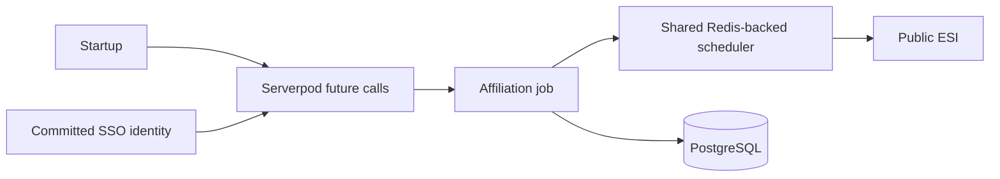
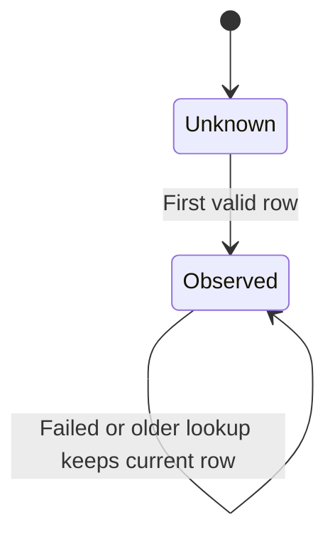
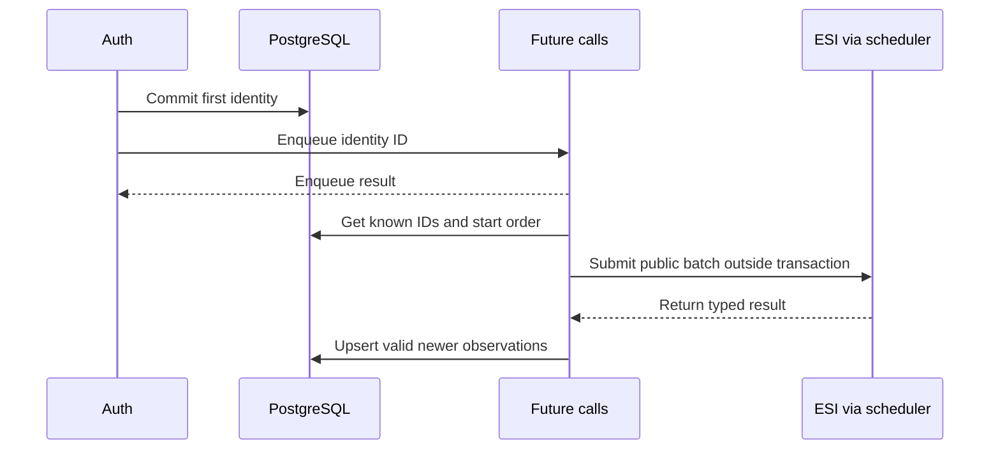
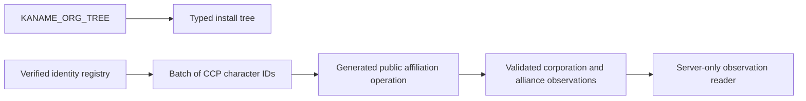

# Organisation tree and affiliation design

## Triage

| Trigger | Applies? | Evidence |
|---|---|---|
| T1 Components | Yes | Serverpod future calls, the shared scheduler and the observation store have distinct interfaces. |
| T2 State | Yes | PostgreSQL stores the latest successful observation per character. |
| T3 Concurrency | Yes | Startup and hourly sweeps can overlap first-known calls. |
| T4 Boundaries | Yes | Install configuration, an additive schema change, and a generated ESI operation. |
| T5 Volume | Yes | The identity registry grows as new characters sign in or link. |
| T6 Risk | Yes | The change touches authentication completion and must not change its result or expose the association between character IDs and Kaname accounts. |

TIER: FULL

## Context

See [proposal.md](proposal.md) for scope.

- `SsoIdentityRow` has a unique CCP character ID and a nullable account reference (`server/kaname_server/lib/src/esi/sso_identity_row.spy.yaml:1-14`). Sign-in inserts a row when none exists under the character lock (`server/kaname_server/lib/src/esi/sso_sessions.dart:317-325,337-364`). The link transaction has a separate insert path (`server/kaname_server/lib/src/esi/member_accounts.dart:36-41,85-107,121-128`). Both use verified claims. The raw SSO completion route returns their outcomes (`server/kaname_server/lib/src/esi/sso_route.dart:360-396,416-419`).
- The generated affiliation operation accepts one to 1,000 distinct character IDs (`packages/kaname_esi/lib/src/generated/character_client.dart:21-54`). The catalogue marks it a public POST with a one-hour cache lifetime (`packages/kaname_esi/lib/src/generated/catalogue.dart:114-128`). The decoder requires character and corporation IDs and makes the alliance ID optional (`packages/kaname_esi/lib/src/generated/character_models.dart:35-51`).
- The shared scheduler resolves public requests without a principal, has no GET-only conditional metadata for this POST, and supplies no bearer (`packages/kaname_esi_scheduler/lib/src/scheduler.dart:217-257,281-287`). It records refusals before sending and records decoded outcomes as route metadata. Receipts do not hold the request or response body, and the omitted public principal leaves member and character attribution null (`packages/kaname_esi_scheduler/lib/src/scheduler.dart:156-180,268-279,332-352`). The server's ESI factory wires that scheduler to Redis and the call-log sink (`server/kaname_server/lib/src/esi/server_esi_runtime.dart:20-38,60-81`). Today the factory call is inside SSO setup, after registration and vault validation (`server/kaname_server/lib/src/esi/server_sso.dart:42-64,74-89,99-109`).
- `serve` registers recurring jobs in the monolith after starting the pod (`server/kaname_server/lib/server.dart:69-91`). The shared package defines a pure-Dart job interface (`packages/kaname_core/lib/src/job.dart:4-14`). Compose forwards product settings as environment variables (`deploy/compose.yaml:89-98`). The ESI call-log store sets a statement budget inside its write transaction (`server/kaname_server/lib/src/esi/esi_call_log_store.dart:73-88`).
- Both scheduler backends use GET polling metadata to gate requests during a recorded outage (`packages/kaname_esi_scheduler/lib/src/memory_state.dart:133-145`, `server/kaname_server/lib/src/esi/redis_scheduler_script.dart:164-171`). The scheduler asks for a shared recovery probe after a due outage refusal (`packages/kaname_esi_scheduler/lib/src/scheduler.dart:268-279`). The native transport bounds an exchange at 20 seconds and limits the response to 16 MiB of bytes before JSON decoding (`packages/kaname_esi_scheduler/lib/native.dart:97-101,156-174`).

## Decisions

### D1. One environment variable

- Choice: Read `KANAME_ORG_TREE` once before accepting requests. Use `corporation:<id>`, `alliance:<id>`, or `coalition:<id>,<id>[,...]`. An empty value leaves the tree unconfigured. A non-empty invalid value fails startup with the setting name, not the raw input. Represent the result as a sealed server-side value.
- Deployment: Forward the optional value to the Compose `server` service. Document the accepted declaration forms and empty default in `deploy/.env.example` and `deploy/README.md`. Verify a nonempty value reaches the rendered `server` environment.
- Rejected: JSON in the environment or a mounted configuration file. The declaration has only a type and IDs; neither alternative needs fewer deployment steps.
- Reversal cost: Medium. Existing installs would need to change how they declare the tree.
- Important: yes. This is an operator-facing configuration contract.
- Chosen by: user. 'One env var, e.g. alliance:<id>'.

### D2. Refresh triggers

- Choice: Queue a sweep after server startup and one per hour. Queue a one-off when a verified sign-in or link first commits a new character. A failed lookup waits for a later scheduled sweep; no immediate retry.
- Rejected: Hourly only. It would delay the first observation for new characters and for existing installs after deployment.
- Reversal cost: Low.
- Important: yes. This sets when observed affiliations become available.
- Chosen by: user. 'At start, hourly, plus once for each new character.'

### D3. One observation per character

- Choice: Use a server-only `character_affiliation` table with a unique foreign key to the identity row, `corporationId`, nullable `allianceId`, and `observedAt` in UTC. D6 adds the internal write order. A server read maps a missing row to unknown, independently of whether a character has an alliance. Read by CCP character ID through the unique identity lookup. The data class is public ESI affiliation. The server reader returns the observation, not the identity's account, owner, or holder data. Scope any future outbound delivery in the consuming change under ADR 0006.
- Rejected: Store the observation on the identity row. That makes affiliation another writer to coordinate with sign-in, linking, and `character-transfer`. In-memory storage also loses the last good observation on restart.
- Reversal cost: Medium. A table replacement would need a migration and an update to its readers.
- Important: yes. This binds the persistence and server read contract.
- Chosen by: user. 'Own table, one row per character.'

### D4. Enqueue only after identity commit

- Choice: Use Serverpod future calls in the monolith. Enqueue a one-off after a successful identity-inserting transaction returns. The sign-in or link path waits only for enqueue, never for ESI. Carry the new identity ID, not verified claims or tokens. The adapter re-reads that identity and uses the same pure-Dart job as the sweep. Compose the existing `ServerEsiRuntime` once for both SSO and affiliation before the pod starts, independently of whether SSO registration and vault configuration are valid. The affiliation job uses `EsiPriority.sync` with no principal, polling validator, or corporation claim.
- Composition: `run` owns the shared runtime. Bind the tree and the affiliation runtime before listening. Register sweeps and inject the first-known hook only when the role is monolith, the mode is not `test`, future calls and their execution are enabled, and enabled Redis and a nonempty `serviceSecret` are configured. Keep the original SSO runtime eligibility in other modes. A lazy factory lets affiliation and SSO share one runtime. An otherwise eligible monolith with missing Redis settings or secret logs that configuration problem without scheduling new affiliation work or sending ESI. Once the pod is running, a transient Redis connection failure leaves existing scheduled work in place and yields a scheduler refusal, without fallback.
- Persisted dispatch: Each dispatch checks the runtime and its stop state at entry. Missing or inactive runtime is a typed skip with no wire request or observation write.
- Shutdown: The generated `Serverpod` class extends the framework class (`server/kaname_server/lib/src/generated/serverpod.dart:24-48`). Use a small application subclass in `run` that overrides `shutdown` and sets a per-pod stop flag before calling `super.shutdown`. A1 verifies that the framework's signal handlers reach the override. Stop registration retries and prevent submission of new batches. Let an already-started batch per executing job finish. Close the shared runtime once in the post-drain task group. The static-data adapter documents the post-drain order (`server/kaname_server/lib/src/static_data/static_data_check_call.dart:44-50`).
- An identity transaction may commit after shutdown begins. The first-known hook rechecks the stop flag immediately before calling the generated enqueue, including after the identity commit returns, and leaves the committed auth result unchanged if it skips.
- Rejected: Await ESI in sign-in or launch a detached lookup from the request. Waiting makes authentication depend on ESI; detached work has no durable scheduling record and can outlive its request session.
- Reversal cost: Medium. The post-commit callback and the scheduling adapter would have to change.
- Important: yes. This changes the authentication and scheduling contracts.
- Chosen by: user. 'Queue it after sign-in.'

### D5. Partial reply

- Choice: Validate an entire decoded reply before writing. Accept a subset of the requested characters, save its observations in one database statement, and log the omitted count without IDs. Duplicate rows, unexpected IDs, invalid IDs or a decode failure invalidate the batch. No result changes on a refusal or a failed request.
- Rejected: Require a complete reply. One omitted character would prevent all the other observations in its batch from updating.
- Reversal cost: Low.
- Important: yes. This defines what a partial refresh can publish.
- Chosen by: user. 'Save what came back, keep the rest.'

### D6. Order by lookup start

- Choice: Before each batch, call `nextval` on the `character_affiliation` table's generated `BIGSERIAL` sequence in a short transaction. Release the connection before asking ESI. Store that order with a conditional upsert on the unique identity reference. A higher order replaces a lower one only when its lookup returns a valid observation. Sequence gaps do not matter. `observedAt` tells a reader when the valid data arrived, not which concurrent write wins.
- Logical restore: PostgreSQL backs up the sequence position with the table. A fresh cluster's transaction counter cannot invalidate observations restored into it. Use the generated table sequence, not a separate sequence, lock, or counter table.
- Rejected: Let last completion win, which can restore older data, or use the cluster's transaction ID, which can be lower than stored orders after logical restore.
- Reversal cost: Medium. Changing the order would alter the stored write predicate and concurrency tests.
- Important: yes. This binds the freshness contract for downstream reads.
- Chosen by: user, via Ormy under the owner's delegation. Ormy selected the generated table sequence under that same delegation (item 118).

### D7. Use the shared downtime pause for affiliation

- Choice: Bind both affiliation triggers with explicit polling intent. Only the public affiliation POST joins the existing outage rules alongside GET polls. Track outage eligibility independently of the GET representation key in Redis and in-process state. The admission and completion paths use the same eligibility; GET validator, freshness, negative cache, and corporation claim behavior stays unchanged. Keep the existing atomic probe claim. Refuse the current POST even if its recovery probe succeeds. A later scheduled lookup can run.
- Rejected: Treat every POST as a poll, or leave affiliation outside the shared pause. Mutating POSTs do not become polls, and ADR 0007 still applies to this read.
- Reversal cost: Medium. This affects the scheduler contract and both backends.
- Important: yes. This extends an existing shared guard to one operation.
- Chosen by: user, item 118. 'Yes, for this one call only.'

### D8. Coalesce full sweeps that Serverpod dispatches concurrently

- Choice: Keep one full sweep active per server. A distinct hourly or startup dispatch that enters while a full sweep is active counts the active sweep for that trigger, logs the coalescing, and returns without starting a second scan. The timer still schedules later triggers as described in D9. First-known work does not take the full-sweep guard.
- Rejected: Run concurrent full registry scans. They duplicate ESI and database work without improving freshness for most characters.
- Reversal cost: Low.
- Important: yes. This defines behavior under overlap.
- Chosen by: user, via Ormy under the owner's delegation on 2026-11-28.

### D9. Give one timer ownership of sweep registration

- Choice: Use one per-pod timer to enqueue durable Serverpod one-shot calls for startup and hourly sweeps. This is the owner's exception to ADR 0009's `callRecurring` adapter for affiliation only. The timer owns cadence and registration repair. It never runs a sweep or touches Serverpod's recurrence fields. Serverpod claims and executes each queued call as usual.
- Registration: Start after `pod.start()`. Derive slot 0 and each later hour from elapsed process time, not civil time. Hold at most one pending slot that has not been accepted by the sweep dispatcher. Keep a row for the pending boot nonce and slot only under A1's one-shot liveness condition. The registrar has at most one operation in flight. While a slot remains pending, check for the row after one minute and enqueue the same slot if it is missing. A transient check or enqueue failure uses the same interval. Recheck the accepted watermark and stop flag after the presence read, immediately before calling enqueue. Do not rearm the timer after stop. After dispatch accepts the slot, schedule the next hour or, if hours elapsed while waiting, one catch-up slot for the latest elapsed hour.
- Dispatch: A sweep payload contains an opaque boot nonce and slot. Before any await, reject a different boot and any slot no greater than the last slot accepted in this boot. Mark the new slot accepted before checking the full-sweep guard. This also rejects a duplicate queued after a lost enqueue acknowledgment, even when both entries dispatch serially. The new process's startup slot replaces pending sweep work from old boots. First-known jobs carry their identity ID and remain eligible without a boot check.
- Rejected: Reconcile `callRecurring` outside the pinned manager. A1 must confirm that its claim and successor insert are separate and that a failed successor insert can prevent the sweep callback. Do not add a lock or custom write to framework recurrence tables to work around that handoff.
- Reversal cost: Medium. Reverting needs a framework adapter that can renew and restore the recurrence without duplicating it; neither the observation schema nor the first-known queue would change.
- Important: yes. This is a scoped exception to the scheduling ADR and defines restart and registration repair.
- Chosen by: user, item 118. 'Yes, a narrow exception to ADR 0009'.

### Decision summary

| # | Decision | Choice | Rejected | Reversal cost | Important | Chosen by |
|---|---|---|---|---|---|---|
| S1 | No declaration | Run unconfigured and still refresh | Defer refresh or refuse startup | Medium | Yes | Owner |
| S2 | Known characters | Entire verified registry | Only linked characters | Low | Yes | Owner |
| D1 | Configuration | `KANAME_ORG_TREE` | JSON setting or mounted file | Medium | Yes | Owner |
| D2 | Cadence | Startup, hourly, and first-known | Hourly only | Low | Yes | Owner |
| D3 | Observation storage | One server-only row per identity | Identity-row fields or in-memory state | Medium | Yes | Owner |
| D4 | First-known execution | Enqueue after commit; reuse scheduler and job | Await ESI in auth or detach from request | Medium | Yes | Owner |
| D5 | Partial reply | Save valid returned rows; retain omissions | Require every requested ID | Low | Yes | Owner |
| D6 | Write order | Later-started valid lookup wins; allocate order from the generated table sequence | Last completion wins or use cluster transaction IDs | Medium | Yes | Ormy, delegated |
| D7 | Outage handling | Share the outage pause for scheduled affiliation POSTs only | All POSTs or no POSTs participate | Medium | Yes | Owner, item 118 |
| D8 | Sweep overlap | One active full sweep; count a concurrent dispatch against it | Concurrent full scans | Low | Yes | Ormy, delegated |
| D9 | Sweep registration | One timer enqueues boot-scoped Serverpod one-shots | `callRecurring` plus a second repair writer | Medium | Yes | Owner, item 118 |

## Assumptions

- A1: Verify the pinned Serverpod 4.1.2 package before implementing D4 or D9 (`server/kaname_server/pubspec.yaml:28-30`). Confirm that after an interrupted claim a visible, eligible current-boot one-shot whose slot has not been accepted can be reclaimed and reach dispatch, or disappears so the registrar can restore it. Read the scanner and stale-claim transaction. Exercise an abandoned claim with injected registrar time and synchronize on a claim or dispatch event. Assert that the recovered slot starts at most one sweep and the next hourly slot reaches dispatch without restart. Also confirm recurring successor insertion is separate from the claim, execution flags govern the manager, and both shutdown signal paths call the override before future-call drain. The package source is not tracked in Kaname. If the liveness check fails, reopen D9 before apply and specify how the same registrar recovers the abandoned claim without starting a second sweep.

## Carried constraints

- C1: An unconfigured tree does not disable the refresh. Kind: invariant. Destination: spec: specs/org-affiliation/spec.md → Requirement: Install organisation tree declaration.
- C2: The verified identity registry defines coverage; account, block and holder state never filter the sweep. Kind: invariant. Destination: spec: specs/org-affiliation/spec.md → Requirement: Scheduled public character affiliation refresh.
- C3: Only the transaction that first commits an identity asks to enqueue a one-off lookup. Auth never waits for ESI or changes outcome if enqueue fails. Kind: invariant. Destination: spec: specs/org-affiliation/spec.md → Requirement: First-known character lookup.
- C4: No observation and a known absence of alliance are different states. A failed or older lookup cannot replace a later valid observation. No client delivery is added here. Kind: invariant. Destination: spec: specs/org-affiliation/spec.md → Requirement: Last valid affiliation observation.
- C5: Observations contain public ESI affiliation and remain server-only here. Future delivery goes through the viewer's privacy scope under ADR 0006. Kind: invariant. Destination: spec: specs/org-affiliation/spec.md → Requirement: Last valid affiliation observation.
- C6: The scheduled affiliation POST participates in the shared outage pause without GET metadata or replay. Kind: invariant. Destination: spec: specs/esi-request-scheduling/spec.md → Requirement: Conditional polling and downtime.
- C7: Repair failed enqueue while running without retrying a failed ESI request. The scoped ADR 0009 exception gives one timer recurrence ownership; the queued call only executes the requested slot. Kind: invariant. Destination: spec: specs/org-affiliation/spec.md → Requirement: Affiliation sweep registration.
- C8: The Compose `server` service forwards `KANAME_ORG_TREE`. Kind: invariant. Destination: spec: specs/org-affiliation/spec.md → Requirement: Install organisation tree declaration.
- C9: The unique identity reference limits an observation to one row and deletes it with the identity. The generated model and migration keep it server-only and enforce the foreign key in PostgreSQL. Kind: invariant. Destination: spec: specs/org-affiliation/spec.md → Requirement: Last valid affiliation observation.

## Diagrams (FULL)

T1. Runtime dependencies:

T2. Observation lifetime:

T3. Order and transaction boundaries:

T4. Data passed across each interface:

## State & Ownership (FULL)

| State | Owner | Lifetime | Invalidation or rebuild | Authoritative copy |
|---|---|---|---|---|
| Declared tree | Operator writes configuration; server parses once | Until next restart | Change environment and restart | Install configuration |
| Known characters | Existing SSO identity transactions | Identity lifetime | Job neither adds nor changes identities | `esi_identity` |
| Sweep cadence and pending slot | Per-pod timer | One boot | A pending slot is not replaced before dispatch; recheck and repair a missing row. A new boot starts its own slot 0. | In-process boot nonce, elapsed time, slot and accepted watermark |
| Queued calls | Serverpod future-call manager | Until dispatch | A queued full-sweep slot must match the current boot and be newer than its accepted watermark. A first-known call survives restart while its identity still exists. | Serverpod future-call table |
| Observation | Affiliation job through one store | Until a later valid observation or identity deletion | Missing response does not clear it; identity deletion cascades if it occurs | `character_affiliation`; ESI supplies its values |
| Scheduler state | Existing shared scheduler | As defined by the scheduler | Existing Redis reconciliation and cooldowns | Existing Redis install namespace |
| Active full sweep | Affiliation runtime | Until the active sweep completes or the process stops | D8 counts an overlapping dispatch against the active sweep | Per-pod flag, always cleared when the job exits |

## Failure & Visibility (FULL)

| Component | Failure and effect | Recovery | Who finds out |
|---|---|---|---|
| Tree parser | Invalid explicit declaration stops startup before the listener | Operator corrects `KANAME_ORG_TREE` and restarts | Startup error names the setting |
| Future calls | A slot enqueue or presence check fails; a post-commit first-known enqueue failure leaves auth unchanged | D9 repairs a missing slot without restarting. A missed first-known lookup waits for the next sweep. | Fixed diagnostic without IDs or claims |
| Shared ESI runtime | Missing Redis settings or scheduler secret, Redis unavailable, or scheduler refusal; do not send through another transport | Operator fixes missing settings and restarts; temporary state failures use existing scheduler recovery | Startup diagnostic or existing call receipt and batch outcome code |
| ESI reply | HTTP, transport or validation failure leaves the batch unchanged; missing rows leave those characters unchanged | Later sweep uses a fresh request | Call log records route, not payload; job logs batch outcome or omission count |
| Observation store | Statement error rolls back that batch only; crash may leave already committed batches in place | Next sweep re-reads registry; conditional upserts can safely run again | Fixed store diagnostic without SQL arguments |
| Shutdown | New registrations and batches stop before Serverpod drains calls | Let any active batch settle and preserve committed data. Close the shared runtime after the drain. | The active job returns its stopped outcome |

## Resource Bounds (FULL)

| Resource | Bound and behavior | At 10x / 100x |
|---|---|---|
| Sweep traversal | Snapshot the highest visible identity row ID at sweep start. Read one keyset page at a time through that bound. Keep at most one page and one request in memory per job. | The 2,000-character design target (`openspec/architecture.md:102`) takes two full pages. At 10× and 100× there are 20 and 200 pages. At the 20-second native wire deadline alone that is 6m 40s and 66m 40s, excluding scheduler and database work. There is no promise of an hourly completion above the supported size. |
| Concurrent exchanges | D8 bounds full sweeps to one. A first-known lookup uses an executor slot when one is available. The shared scheduler bounds install-wide wire work independently of executor configuration. | At the default single executor slot (`.claude/skills/serverpod-scheduling/SKILL.md:67-73`) an overdue sweep or unrelated future call can wait for the active sweep. With multiple slots a concurrent full sweep dispatch is coalesced; it cannot build up a second application queue. |
| Queue | One timer, one enqueue check in flight, and one logical pending full-sweep slot per boot. A lost acknowledgement may leave a duplicate physical entry for that slot; the synchronous dispatch guard ignores it. One first-known entry per newly committed identity. | A busy executor delays queued work. Missed hourly slots do not accumulate. First-known backlog is bounded by new registrations while execution is stalled. |
| Database work | Registry reads, order allocation and upserts each run in a short transaction with a transaction-local 10-second `statement_timeout`. Each transaction ends before any subsequent ESI I/O. No database connection reserved by the job over ESI I/O. | Indexed identity pages and unique-key upserts retain the same per-statement bound. |
| HTTP body and deadline | The shared scheduler's existing response-byte bound applies before JSON decoding. JSON and typed objects also use memory. The job checks the decoded row count before validation and writes. | The same transport limits and batch checks apply. |

## Flow & State Gaps (FULL)

- A registry scan selects only identities that are visible as its pages are read. An identity committed during a scan can miss that sweep, including one whose insert reserved its row ID before the scan reached its position. The post-commit one-off and next sweep recover it. A one-off whose identity disappears before dispatch sends nothing. The write only targets still-existing identities.
- The first-known hook fires after the outer database `transaction` future returns, outside locks and before writing the auth reply. A rolled-back transaction cannot enqueue a lookup. Replays, links to an existing identity, and new accounts for already known characters cannot enqueue a lookup either. A process can exit between commit and enqueue; the startup or hourly sweep recovers it. The hook catches enqueue errors and does not change the committed auth result.
- Sweep and one-off both use the same job to read public affiliation. The server adapter maps the generated result into typed job data and records failure categories; pure Dart owns traversal and batch validation. Use one database upsert per valid returned subset. Do not retain a response validator or body cache for this POST. A rejected batch does not stop traversal of later distinct batches; a database failure while reading the registry ends the sweep and the next sweep starts over.
- A later-started result can write before an earlier one. Order means allocation before submission; scheduler queueing and execution can give the wire a different order. PostgreSQL compares the durable order in the upsert. A later-started failure writes no row and cannot prevent an earlier valid write. A valid row with no alliance clears the previous alliance. Do not use clock ordering for concurrency control.
- A recorded outage can decline affiliation without creating a GET cache entry, even if the one shared recovery probe succeeds at that admission. The job does not resubmit the refused batch. The two scheduler backends keep interpreting existing GET polling metadata exactly as before.
- Startup registers work rather than waiting for ESI. This job does not add a new worker, extra job claim, or ESI sender. The sweep checks the stop flag before taking another page and again before submitting a batch, including after any awaited database read. Check the same flag before a first-known submission. An active batch may finish and save valid observations, but the stop signal prevents further submissions.

## Mechanism Ledger (FULL)

| Mechanism | Built? | Reason | Evidence for reconsidering |
|---|---|---|---|
| Keyset paging and sequential batches | Yes | The route rejects oversized requests and the registry can exceed one batch. | None while the external limit applies. |
| Conditional PostgreSQL write | Yes | Queued and recurring calls can compete for the same observation; last completion can restore older data. | A future design with an enforced sole writer across all triggers. |
| Keep post-commit enqueue out of the membership transaction | Yes | An unavailable queue must not roll back auth; the periodic sweep repairs the gap. | A separate product requirement that promises every first-known lookup despite process death. |
| Live registration repair | Yes | A failed enqueue cannot leave the pod permanently without a sweep. The same timer owns cadence and repair. | A framework API that renews recurrence atomically and recovers a failed insert. |
| New worker, lock, outbox, alternate sender, or immediate retry | No | The existing future-call adapter and scheduler already run and limit the work. Next scheduled refresh recovers a missed one-off or failed batch. | Measured scheduler occupancy or an owner-approved stronger latency requirement. |
| Member states, admin decisions, or client delivery | No | Later changes own these. Tree and observation data are readable server-side without an account effect. | Roadmap changes 4 and 5. |

## Risks / trade-offs

- Server readers may see an old observation after CCP or scheduler failure. The read contract includes its observation time and does not fabricate an affiliation.
- A one-off lookup does not preempt existing work. A busy future-call executor or ESI refusal can defer visibility until a later sweep.
- One-off enqueue and observation writes use the existing monolith and PostgreSQL. If operating the job at larger-than-supported registry sizes delays other future calls, measure that workload before adding a worker or another queue.

## ADRs

- **In force:** 0001 for single-instance deployment, 0003 and 0009 for pure-Dart jobs and a Serverpod adapter, 0005 and 0017 for the token-holder boundary, 0006 for outbound privacy, 0007 and 0016 for the generated ESI client and shared scheduler, and 0019 for identity ownership, write order and account retirement.
- **ADR 0009 exception:** D9 applies only to affiliation sweep registration. Serverpod still executes the durable one-shot calls. Other jobs keep the existing recurrence adapter.
- **To record during apply:** Carry the approved exception in C7's capability spec. Do not edit ADR 0009 or change the system-wide scheduling rule.
