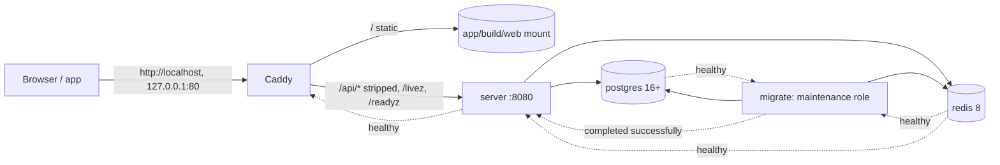
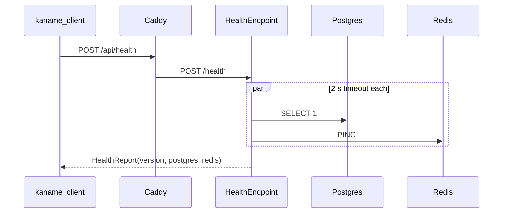

# Design

## Triage

| Trigger | Applies? | Evidence |
|---|---|---|
| T1 Components (new component, or 3+ with directed relationships) | yes | New server, Postgres, Redis, Caddy and a migration step with directed dependencies (proposal What Changes) |
| T2 State (persistent state, caches, 3+ state machine) | yes | Postgres schema and data, Redis, embedded Postgres data directories, generated client files |
| T3 Concurrency (background work, workers/isolates, async, retries) | yes | Compose start ordering and healthchecks; parallel dependency checks with timeouts in the health call |
| T4 Boundaries (data format, migration, shared interface, IPC, external) | yes | First migration; the first generated-client contract (`health`); the `/api/` route; container images |
| T5 Volume (grows without a fixed bound) | yes | Serverpod session logs stored in Postgres; Docker volumes |
| T6 Risk (security, money, data loss, unrecoverable user data) | yes | Database and Redis passwords; published ports on a host |

TIER: FULL

## Context

- The workspace has three members, `app`, `packages/kaname_core` and `tools/kaname_tools` (`pubspec.yaml:8-11`). The workspace check already scans `server/` for packages (`tools/kaname_tools/lib/src/workspace.dart:73-79`), and the format check accepts `server/kaname_<name>` member paths (`…/workspace.dart:230-233`). Purity applies only to `packages/` and `tools/` (`tools/kaname_tools/lib/src/purity.dart:39`), so the Serverpod packages under `server/` are allowed.
- `mise run test` runs only `test:core`, `test:tools` and `test:app` (`mise.toml:66-72`), and `check` runs `test` among its steps (`mise.toml:109-118`). Leaving server tests out of `check` means not adding them to `test`.
- CI jobs today: `check` on three OSes, `build`, `spec`, `licences`, `signoff` (`.github/workflows/ci.yml:37-38,67-68,106-107,120-121,150-151`). The workflow's rules (actions pinned by SHA, read-only token, job names as required checks, no toolchain versions) are in its header (`.github/workflows/ci.yml:6-19`).
- `.gitignore` already ignores Serverpod local state, passwords files and `.env` files except `.env.example` (`.gitignore:20-27`).
- The root workspace includes `app` (`pubspec.yaml:8-11`), which depends on the Flutter SDK (`app/pubspec.yaml:11-18`). Resolving the workspace, even for the server alone, therefore needs Flutter.
- Analysis runs with strict modes (`analysis_options.yaml:6-10`) and excludes only `.claude`, `brand`, `build` and `.dart_tool` (`analysis_options.yaml:11-16`).
- AGENTS.md holds the M0 TODO for the Serverpod MCP entry (`AGENTS.md:15`). `.mcp.json` and `.omp/mcp.json` hold only `dart` and `context7` (`.mcp.json:2-13`, `.omp/mcp.json:3-14`), and `.claude/settings.json` enables and allow-lists only those two (`.claude/settings.json:1-5`). Their commands start at the repository root through `mise exec`, and `mise exec -C <dir>` runs a command as if started in `<dir>` (global `-C, --cd` flag in `mise --help`, mise 2026.11). The root package does not depend on `serverpod_cli` (`pubspec.yaml:13-14`), so S7's entry runs `mise exec -C server/kaname_server -- dart run serverpod_cli mcp-server --server-dir .` (A10).
- Serverpod 4.1 facts (Serverpod docs through Context7, 2026-11-15; installed skills `serverpod-overview`, `serverpod-health-checks`):
  - New projects use embedded Postgres through `database.dataPath` in development and test; external Postgres must be 16 or later.
  - Redis is configured per run mode (`redis.enabled`, `host`, `port`), with its password from `passwords.yaml` or `SERVERPOD_PASSWORD_redis`. The server refuses to start when Redis is enabled and the password is missing.
  - Every config key can be set through `SERVERPOD_*` environment variables.
  - `--apply-migrations` on a normal start logs a failed or mismatched migration and keeps running outside development. `--role maintenance --apply-migrations` applies the migrations and exits 1 on failure or mismatch in every run mode.
  - `/livez`, `/readyz` and `/startupz` sit on the API server (8080); unauthenticated requests get the status only. The Insights server is 8081 and the web server 8082.
- In-force ADRs: 0001 (stack, Compose, one instance, package-local CLI), 0002 (AGPL, clean room), 0003 (`server/`, `deploy/`, mise not melos), 0009 (one process; worker isolates come later).

## Decisions

### D1: Migrations in the stack run as a one-shot step

- **Choice:** A `migrate` Compose service runs the server image with `--mode production --role maintenance --apply-migrations`. It gets the same secrets as `server`, Redis included, and starts once both `postgres` and `redis` are healthy. `server` depends on it with `condition: service_completed_successfully` and itself starts without `--apply-migrations`. One mechanism per run mode:
  - staging, production and the stack: this maintenance step;
  - development: `--apply-migrations` on the runner's start (`mise run server:dev` passes it) or the Serverpod MCP `apply_migrations` tool (installed skill `serverpod-migrations`);
  - test: `serverpod_test` (A8).
- **Rejected:** `server --apply-migrations` in the monolith role, because outside development a failed or mismatched migration only logs and the server keeps serving, which breaks the spec's refusal.
- **Reversal cost:** low
- **Important:** yes, binds future changes (how every install applies migrations)
- **Chosen by:** user

### D2: Same origin, API under `/api/`

- **Choice:** Caddy serves the web build at `/` with an SPA fallback to `index.html`, routes `/api/*` to `server:8080` with the prefix stripped (`handle_path`), and passes `/livez` and `/readyz` through. The `/api/` route never falls back to `index.html`. The client's server URL in the stack is `http://localhost/api/`.
- **Rejected:** a second published port for the API, because it means two origins and CORS for the web app. Serving the app from Serverpod's web server was rejected because ADR 0001 gives the static web app to Caddy.
- **Reversal cost:** medium (every app build's default server URL follows it)
- **Important:** yes, binds future changes (the client URL contract that `app-shell` uses)
- **Chosen by:** user

### D3: Official Redis 8 image, pinned by digest

- **Choice:** `redis:8` with a digest pin, used by the stack and by the server package's development Compose file (which the CI `server` job also starts). The stack's `postgres:16` and `caddy:2` images are digest-pinned the same way. It runs with `--requirepass` from the environment and no published port in the stack. Redis 8 is offered under AGPLv3 among its licences, which fits ADR 0002. The image is pulled, never redistributed.
- **Rejected:** Valkey (BSD; would need a note against ADR 0001's wording); Redis 7.2 (last BSD line, near end of support).
- **Reversal cost:** low (protocol-compatible swap)
- **Important:** yes, binds future changes (the Redis version every install runs)
- **Chosen by:** user

### D4: The health endpoint runs its own checks in parallel

- **Choice:** A `HealthEndpoint` with no sign-in (`requireLogin` false) returns a `HealthReport` model: `version` (String), `postgres` and `redis` (a `DependencyStatus` enum: `up`, `down`). It runs `SELECT 1` and a Redis `PING` concurrently, each under a 2-second timeout. A timeout or exception maps to `down` and is logged server-side only. `version` is a constant that a test checks against `server/kaname_server/pubspec.yaml`'s version.
- **Rejected:** reading Serverpod's built-in health indicators, because the answer would then depend on an internal API's result shape.
- **Reversal cost:** low (the model is additive-first)
- **Important:** yes, binds future changes (the first `.spy.yaml` model and endpoint in the client)
- **Chosen by:** user

### D5: Server image built with mise; web build from the host

- **Choice:** `deploy/server.Dockerfile` is multi-stage.
  - **Build stage:** a Debian image pinned by digest installs mise at the same version CI pins (`.github/workflows/ci.yml`, `version: 2026.11.8`), with its checksum verified. It copies `mise.toml`, `mise.lock` and the workspace pubspecs and runs `mise install flutter` in locked mode. It then runs `flutter pub get --enforce-lockfile` at the root, so the image resolves exactly `pubspec.lock`, and AOT-compiles `server/kaname_server/bin/main.dart` with `mise exec -- dart compile exe`.
  - **Runtime stage:** a slim Debian image pinned by digest, with `curl` installed for the Compose healthcheck. It runs as a non-root user and holds the executable, `config/` and `migrations/`.
  - **No version in the file:** the Dockerfile states no Flutter or Dart version; the toolchain comes only from `mise.toml` and `mise.lock`.
  - **Platform:** `server` and `migrate` set `platform: linux/amd64`, because Flutter's official Linux archive, the one `mise.lock` pins, is x64 only (Dart itself has arm64). arm64 hosts build and run the image under emulation. Native arm64 images are not committed to; they would need the server resolved without the Flutter app.
  - **Build context:** a deny-by-default `deploy/server.Dockerfile.dockerignore` admits only the pubspecs, `pubspec.lock`, `mise.toml`, `mise.lock` and the server packages' sources, and excludes `**/config/passwords*.yaml`, `**/.env*` and `**/.serverpod/`. Docker's build context ignores `.gitignore`, so without it the ignored development secrets would be copied into the image.
  - **Web build:** `mise run build:web` on the host; `caddy` mounts `app/build/web` read-only.
- **Rejected:**
  - A plain `dart:<version>` build stage: it cannot resolve a workspace that includes `app` (review round 1, finding 1).
  - Compiling on the host and copying the executable in: the stack would need a Linux x64 host with mise.
  - A reduced server-only workspace: a generated pubspec step that can drift from the lockfile.
  - A compiled Dart probe for the healthcheck instead of curl (owner's choice: curl).
- **Reversal cost:** low
- **Important:** yes, binds future changes (container images take their toolchain only from mise)
- **Chosen by:** user (round 1 fix; supersedes the earlier plain-Dart-image choice; amd64 platform pin, round 2)

### D6: Development Redis from the server package's Compose file

- **Choice:** `server/kaname_server/docker-compose.yaml` holds Redis only (the D3 image, published on `127.0.0.1:8091`, password from `server/kaname_server/.env`, written by D11). `serverpod start --docker`, `mise run test:server` and the CI `server` job use it. Development and test configs point Redis at `localhost:8091`.
- **Rejected:** a `dev` profile in `deploy/compose.yaml`, because the Serverpod runner's `--docker` looks for the server package's file.
- **Reversal cost:** low
- **Important:** no
- **Chosen by:** user

### D7: Generated-client drift check by regeneration

- **Choice:** `mise run server:generated` runs the package-local `serverpod generate`, then `dart format` over the generated paths, then `git diff --exit-code` over them, failing with the changed paths. It runs in the Linux `server` job. Generated paths (`server/kaname_server/lib/src/generated/**`, `server/kaname_client/lib/src/protocol/**`; A9) are excluded from analysis in `analysis_options.yaml`, and the format check still covers them.
- **Rejected:** no check (stale clients would surface only at run time in `app-shell`); holding generated code to strict analysis (a generator lint would block every OS until an ignore is added).
- **Reversal cost:** low
- **Important:** no
- **Chosen by:** user

### D8: Insights only in development

- **Choice:** The Insights server is on in `development` (used by the runner and the MCP) and off in `test`, `staging` and `production`. The stack never publishes 8081 or 8082; the web server (8082) is off outside development.
- **Rejected:** Insights on everywhere but internal only (an unused, secret-protected listener in every install).
- **Reversal cost:** low
- **Important:** yes, changes what self-hosters run
- **Chosen by:** user

### D9: Stack configuration through environment variables

- **Choice:** The `server` and `migrate` services run in `production` mode, with `config/production.yaml` holding non-secret defaults that suit the stack (`postgres`, `redis` hostnames). Secrets come from `deploy/.env` (`POSTGRES_PASSWORD`, `REDIS_PASSWORD`, `SERVERPOD_SERVICE_SECRET`), mapped to `SERVERPOD_PASSWORD_*`. Compose's `${VAR:?}` form makes a missing secret stop Compose before any service starts. `deploy/.env.example` holds placeholders. The CI `stack` job generates random values.
- **Rejected:** a mounted `passwords.yaml` (a second secret format beside `.env`, and easy to commit by mistake under `deploy/`).
- **Reversal cost:** low
- **Important:** yes, binds future changes (config keys self-hosters set)
- **Chosen by:** user

### D10: Persistent session logs off outside development

- **Choice:** `sessionLogs.persistentEnabled` is true in `development` and false in `test`, `staging` and `production`, with console logging on everywhere. The stack logs to the container's stdout only.
- **Rejected:** persistent logs in every mode, because the log table would grow without a bound until a retention change exists.
- **Reversal cost:** low
- **Important:** yes, changes what self-hosters run (and the T5 bound)
- **Chosen by:** user

### D11: Development and test secrets come from a setup task

- **Choice:** `mise run server:setup` creates the ignored `server/kaname_server/config/passwords.yaml` with random passwords when it is missing: one Redis password shared by `development` and `test` (both use the one development Redis container), and per-mode database passwords and service secrets, and leaves an existing file unchanged. It then rewrites the ignored `server/kaname_server/.env` (the development Redis password for D6's Compose file) from that file on every run, so `passwords.yaml` is the only source. Fresh clones, `test:server` and the CI `server` job run it first.
- **Rejected:** committing fixed development passwords (AGENTS.md: never commit passwords files).
- **Reversal cost:** low
- **Important:** yes, changes what contributors run on a fresh clone
- **Chosen by:** user (round 1 fix; one shared Redis password, round 2)

### D12: Caddy publishes on loopback only

- **Choice:** The stack publishes Caddy as `127.0.0.1:80:80`, so the plain-HTTP local stack is not reachable from the LAN (Docker's published ports bypass host firewalls). A later deployment guide adds TLS and a public bind.
- **Rejected:** publishing on every interface (phones on the LAN could test, but the unauthenticated health endpoint and probes would be exposed over plain HTTP).
- **Reversal cost:** low
- **Important:** yes, changes what self-hosters see
- **Chosen by:** user (round 1 fix)

### D13: Licence exceptions for `serverpod` and `postgres`

- **Choice:** `licence-policy.yaml` gains two owner-approved exceptions (2026-11-15). `serverpod` 4.1.2, the server framework itself, ships the Server Side Public License v1 (SSPL) as its `LICENSE`; the other `serverpod_*` packages, `serverpod_cli` included, are BSD-3-Clause. `postgres` 3.6.0 (through `serverpod_database`) is BSD-3-Clause with an unfilled template, which the check reports as unrecognised. Each exception covers its one exact version, so a Serverpod upgrade puts the licence back to the owner.
- **Rejected:** stopping the change to revisit ADR 0001 (Serverpod as the backend).
- **Reversal cost:** high (the whole server rests on the package)
- **Important:** yes, binds future changes (every Serverpod upgrade re-checks the exception)
- **Chosen by:** user (found in task 1.6, 2026-11-15)

### Decision summary

| # | Decision | Choice | Rejected | Reversal cost | Important | Chosen by |
|---|---|---|---|---|---|---|
| S1 | Health contract | Typed `health` endpoint plus built-in probes | Probes only | medium | yes | user |
| S2 | Postgres per run mode | Embedded in dev/test; container 16+ in stack/prod | Compose Postgres everywhere | low | yes | user |
| S3 | Compose location, what Caddy serves | `deploy/`; placeholder web build plus API proxy on http://localhost | API only; Compose in server package | low | yes | user |
| S4 | CI for the server | Linux `server` and `stack` jobs; `check` lints the server on 3 OSes | Local-only stack check; server tests on 3 OSes | low | yes | user |
| S5 | Redis and server-test OS | Redis on in every server mode; server tests on Linux only | Redis off in dev/test; native Redis on Windows/macOS | medium | yes | user |
| S6 | Serverpod modules | Core only | Keep auth IdP scaffold | low | yes | user |
| S7 | Serverpod MCP entry | Claude and OMP | Claude only | low | yes | user |
| D1 | Stack migrations | One-shot `migrate` maintenance step after Postgres and Redis are healthy; one mechanism per run mode | Monolith `--apply-migrations` | low | yes | user |
| D2 | API routing | Same origin, `/api/` prefix stripped | Second port; Serverpod web server | medium | yes | user |
| D3 | Redis image | Official `redis:8`, digest-pinned | Valkey; Redis 7.2 | low | yes | user |
| D4 | Health checks | Own `SELECT 1` and PING, parallel, 2 s timeout | Built-in indicators | low | yes | user |
| D5 | Images | Build stage installs the toolchain through mise from mise.lock; slim runtime with curl; `linux/amd64`; deny-by-default build context; host web build mounted | Plain Dart image; compile on host; server-only workspace; Dart probe | low | yes | user |
| D6 | Development Redis | Server package Compose file | `deploy/` dev profile | low | no | user |
| D7 | Client drift | Regenerate, format, diff; generated code excluded from analysis | No check; generated code strictly analysed | low | no | user |
| D8 | Insights | Development only | On everywhere, internal | low | yes | user |
| D9 | Stack config | Production mode plus `.env` mapped to `SERVERPOD_*` | Mounted `passwords.yaml` | low | yes | user |
| D10 | Session logs | Persistent only in development | Persistent everywhere | low | yes | user |
| D11 | Dev/test secrets | `server:setup` generates `passwords.yaml` (one Redis password for dev and test), derives `.env` | Commit fixed dev passwords | low | yes | user |
| D12 | Caddy bind | Publish on `127.0.0.1:80` only | All interfaces | low | yes | user |
| D13 | Licence exceptions | Owner-approved exceptions for `serverpod` 4.1.2 (SSPL) and `postgres` 3.6.0 (unfilled BSD-3) | Revisit ADR 0001 | high | yes | user |

## Assumptions

- **A1:** The pinned Serverpod 4.1 CLI's `create` output uses `resolution: workspace` and can be placed as `server/kaname_server` and `server/kaname_client` (repo-scaffold's A3). Not checked because the CLI is not installed yet. Depends on it: tasks 1.1-1.2.
- **A2:** The generated Serverpod client accepts a server URL with a path (`http://localhost/api/`) and appends endpoint paths to it. Not checked against the client code. Depends on it: D2, the `stack` job's assertion.
- **A3:** With Redis enabled but unreachable, the server still starts, `/livez` answers 200 and `/readyz` answers 503. Not checked; Serverpod may instead fail to start. Depends on it: `server-runtime` "Redis unreachable at start" and `server-health` "Dependency lost". If it fails to start instead, the owner decides whether the spec changes.
- **A4:** An endpoint call can complete while Postgres is down, for example when session logging to the database fails without failing the call. Not checked. Depends on it: `server-health` "Postgres down"; the task tests it first.
- **A5:** `--role maintenance --apply-migrations` reports a database holding an unknown migration as a mismatch and exits 1. The docs say "doesn't match the latest migration" but do not name this case. Depends on it: D1 and its test.
- **A6:** mise installs the pinned Flutter (linux-x64, under `platform: linux/amd64`) in locked mode inside a Debian build stage, from the committed `mise.lock`, as it does on the CI Linux runners. Not checked inside a container yet. Depends on it: D5; the first image task builds it.
- **A7:** `serverpod_cli` (a dev dependency with heavy analyzer and build dependencies) resolves in one workspace with the versions the Flutter SDK pins for `flutter_test`. Not checked because the CLI is not added yet. A conflict would block `mise run resolve` on every OS. Depends on it: every task; task 1 checks it first, and a conflict goes to the owner.
- **A8:** `serverpod_test`'s `withServerpod` creates the test database schema from the committed migrations on the embedded test Postgres. Not checked (the installed `serverpod-testing` skill describes the harness, not the schema step). Depends on it: `server-runtime` "Migrations are applied before the server serves" for test mode; the first server test.
- **A9:** Serverpod writes generated code to `lib/src/generated/` in the server and `lib/src/protocol/` in the client. Not checked against the pinned CLI's output. Depends on it: D7's analysis excludes; task 1 adjusts the paths to what the CLI writes.
- **A10:** `dart run serverpod_cli mcp-server --server-dir .` is the package-local form of the MCP bridge command. Partly checked in task 1.4: the package's executable file is `bin/serverpod_cli.dart` (`executables:` maps `serverpod` to it), so `dart run serverpod_cli:serverpod` fails and `dart run serverpod_cli <command>` is the working form (`version` prints 4.1.2); the bridge itself is started in the MCP task. Depends on it: S7's entry; the MCP task starts it and records the result.

## Carried constraints

- **C1:** Redis is enabled in every server run mode; no mode may disable it. Kind: invariant. Destination: spec: specs/server-runtime/spec.md → Requirement: Redis is enabled in every server run mode
- **C2:** The server is supported only as a Linux container, and its tests run only on Linux. Kind: invariant. Destination: spec: specs/server-runtime/spec.md → Requirement: The server is supported only as a Linux container
- **C3:** The API is reached at `/api/` on the web app's origin. Kind: invariant. Destination: spec: specs/self-host-stack/spec.md → Requirement: Caddy is the only published entry point
- **C4:** Stack migrations run only in the one-shot maintenance step; the monolith's `--apply-migrations` keeps serving after a failed migration outside development. Kind: rejected alternative. Destination: doc comment: server/kaname_server/bin/main.dart main
- **C5:** Container images get Flutter and Dart only through mise from `mise.toml` and `mise.lock`; no Dockerfile states a toolchain version. Kind: invariant. Destination: spec: specs/server-runtime/spec.md → Requirement: The server image takes its toolchain from mise
- **C6:** Container image licences (Postgres, Redis, Caddy, Debian) are outside the pub licence check and the SBOM. Kind: deliberate gap. Destination: doc comment: tools/kaname_tools/lib/src/licences.dart LicencesCommand
- **C7:** Insights and persistent session logs run only in development: an unbounded log table and an unused listener otherwise (D8, D10). Kind: invariant. Destination: spec: specs/server-runtime/spec.md → Requirement: Insights and persistent session logs run only in development
- **C9:** Serverpod-generated paths are excluded from analysis but still format-checked (D7). Kind: invariant. Destination: spec: specs/workspace-layout/spec.md → Requirement: Analysis and formatting are clean
- **C8:** `config/passwords.yaml` is the only source of development and test secrets; development and test share one Redis password, and the development Redis `.env` is derived from it (D11). Kind: invariant. Destination: doc comment: server/kaname_server/tool/setup.dart main

## Diagrams (FULL)

Components and start order in the stack (T1, T3):

Health call (T3, T4):

Data at the boundary (T4): `HealthReport { version: String, postgres: DependencyStatus, redis: DependencyStatus }`, `enum DependencyStatus { up, down }`, both in `server/kaname_server/lib/src/health/*.spy.yaml`. Fields are only ever added.

## State & Ownership (FULL)

| State | Owner (sole writer) | Lifetime | Invalidation / rebuild | Authoritative copy |
|---|---|---|---|---|
| Postgres schema | One writer per run mode: `migrate` step (stack, staging, production), the developer's `--apply-migrations` start or MCP call (development), `serverpod_test` (test) | Install lifetime | New migrations only, never edited after merge | `server/kaname_server/migrations/` |
| Stack Postgres data | `server` | Named volume `pgdata` | `docker compose down -v` deletes it | Volume |
| Stack Redis data | `server` | Named volume `redisdata` | Nothing in M0 depends on it | Volume |
| Embedded Postgres data | Serverpod runner / `serverpod_test` | Per checkout and run mode | Delete `.serverpod/<mode>/` | Ignored local directory |
| Generated server and client code | `serverpod generate` | Until the next model or endpoint change | Regenerated; drift check D7 | `.spy.yaml` and endpoint sources |
| Stack secrets | Self-hoster | Until rotated | Edit `deploy/.env`, restart | `deploy/.env` (ignored) |
| Development and test secrets | `server:setup` (creates once) | Per checkout; one Redis password for both modes | Delete `passwords.yaml` and rerun setup; `.env` is rewritten from it every run | `server/kaname_server/config/passwords.yaml` (ignored) |

## Failure & Visibility (FULL)

| Component | Fails / dies mid-operation → | Recovery | Retry safe? | Who finds out |
|---|---|---|---|---|
| `migrate` | Exits 1; `server` never starts | Fix the database or the migrations, rerun `up` | Yes (each migration applied once, in a transaction) | Self-hoster in `docker compose ps` and the `migrate` log; CI `stack` job |
| `server` | Container exits | `restart: unless-stopped` restarts it | Yes | `docker compose ps`; Caddy answers 502 |
| `server` unhealthy (curl on `/readyz` fails, container still running) | Compose marks it unhealthy but does not restart it | By hand: fix the dependency or restart the service | Yes | `docker compose ps` shows `unhealthy` |
| Postgres down at run time | Health answers `postgres: down`; `/readyz` 503 | Compose restarts Postgres | Yes | Health caller; probe |
| Redis down at run time | Health answers `redis: down`; `/readyz` 503 | Compose restarts Redis | Yes | Health caller; probe |
| Caddy | No entry point | `restart: unless-stopped` | Yes | Browser connection refused |
| Missing secret | Compose refuses before starting | Fill in `deploy/.env` | Yes | Compose names the variable |
| CI `stack` job | Ready-wait times out | — | Yes | Job fails and prints every service's logs |

## Resource Bounds (FULL)

| Queue / buffer / cache / transfer | Bound | At the bound | Timeout | At 10x / 100x |
|---|---|---|---|---|
| Health dependency checks | 2 per call, concurrent | — | 2 s each; call under 10 s (spec) | Unauthenticated health is cheap, but each call hits both stores; Caddy rate limiting is not built (ledger) |
| Serverpod session logs in Postgres | Off outside development (D10); in development bounded by the developer's own use | — | — | Turning them on elsewhere waits for a retention change |
| Docker volumes | Disk | Postgres stops accepting writes | — | M0 holds no user data |
| Stack ready-wait (CI) | 5 minutes after a cold build (spec) | Job fails | 5 min | — |
| Request size | Serverpod `maxRequestSize` default | Rejected | — | — |

## Flow & State Gaps (FULL)

- **Partial start:** if `migrate` fails, `server` and `caddy` stay down. Postgres and Redis keep running for inspection.
- **Restart mid-migration:** each migration runs in one transaction, so a killed `migrate` leaves the schema at the previous migration and a rerun applies the rest (A5 covers the mismatch report).
- **Stale web build:** Caddy serves whatever `app/build/web` holds. A missing directory gives a 404 at `/`. The `stack` task runs `build:web` first, and the README says so.
- **Concurrent checkouts:** the development Compose project is named after the server directory (`serverpod-overview` skill), so two checkouts would share one Redis container while each holds its own generated password. Only one checkout at a time runs the development Redis; the server README says so, as Serverpod's guidance for shared Compose stacks does. The stack uses a fixed project name, `kaname`.

## Mechanism Ledger (FULL)

| Mechanism | Built? | Why (harm nobody catches / expensive later) | Evidence that would change the call |
|---|---|---|---|
| One-shot migration step | yes | Monolith keeps serving after a failed migration outside development (Context) | — |
| Toolchain through mise in the image | yes | A second toolchain pin would split CI and images silently | — |
| Dev/test secret setup task | yes | Fresh clones and CI cannot start the server without a Redis password | — |
| Generated-client drift check | yes | Stale client found only at run time | — |
| Health checks with timeouts | yes | A hung dependency would hang the health call and the probes | — |
| Rate limit on `/api/health` | no | One instance, local stack in M0 | Public installs (M27 hardening) |
| TLS in Caddy | no | Local `http://localhost` only (S3) | First deployment guide for a public host |
| Image digest bump automation | no | Dependabot's `docker` ecosystem can be added later cheaply | Digests going stale between milestones |
| Backups of volumes | no | No user data in M0 | M3 adds users (backup drills in M27) |

## Risks / Trade-offs

- [A3 is false: Serverpod refuses to start without Redis] → the first server task tests it, and a mismatch goes to the owner as a spec question before the health tasks.
- [Redis 8 licence terms change again] → digest-pinned; D3's alternatives remain protocol-compatible.
- [The `stack` job is slow (Flutter SDK in the build stage plus Dart AOT)] → mise's install directory and Docker layers cached through the Actions cache; 30-minute job limit.
- [The path prefix confuses Serverpod's generated URLs (A2)] → tested in the `stack` job through the real client.

## ADRs

- **In force, constraining this change:** 0001, 0002, 0003, 0009.
- **To record during apply:** none. The bindings (Redis in every mode, Linux-only server, `/api/` route, migration step) are spec requirements, not cross-module architecture choices.

## Open Questions

- How `serverpod_test` reads the Redis address in test mode (`config/test.yaml` or environment variables) is settled in the first server test, without changing the spec.
