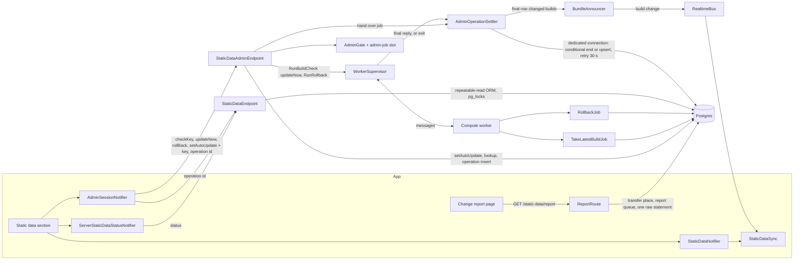
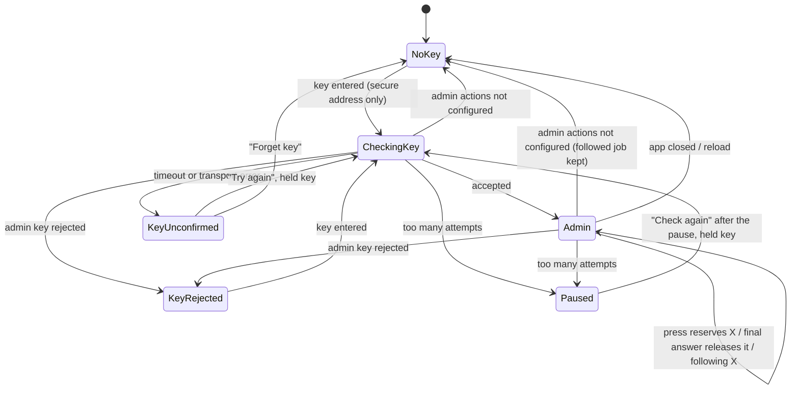
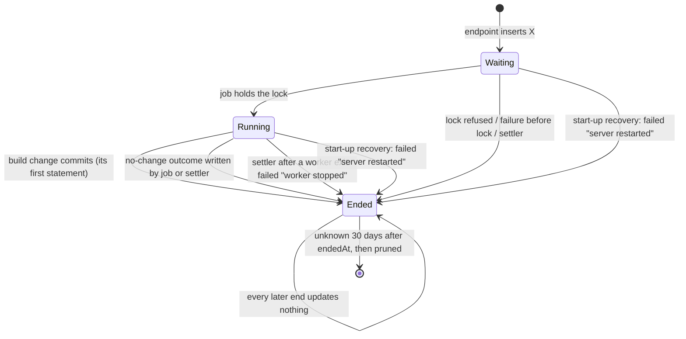

# Design

## Triage

| Trigger | Applies? | Evidence |
|---|---|---|
| T1 Components (new component, or 3+ with directed relationships) | yes | New admin endpoint, a rollback worker request, an admin-operation store, two app notifiers and a report page. The app, the main isolate, the compute worker and Postgres have directed relationships. |
| T2 State (persistent state, caches, 3+ state machine) | yes | New `sde_setting_write`, `sde_admin_operation` and `sde_build_revision` tables, `sde_check.trigger` and `sde_build_diff.reportBytes` columns. The admin session has five states; an admin operation has three. The in-memory wrong-key window, admin-job slot and report-read queue. |
| T3 Concurrency (background work, workers/isolates, async, retries) | yes | Update now runs on the compute worker beside the daily check. A 5 s status poll and a 5 s operation follow. An early "started" reply. Rollback during imports. Worker exits between commit and reply. |
| T4 Boundaries (data format, migration, shared interface, IPC, external) | yes | A migration, new endpoint methods in the generated client, new worker request and reply types, and a new password entry `adminKey`. |
| T5 Volume (grows without a fixed bound) | yes | Report keys, changed fields and stored report bytes; per-file import counts. Admin calls and report reads from any caller. |
| T6 Risk (security, money, data loss, unrecoverable user data) | yes | An auth boundary (the admin key). Public answers built from stored error text. Rollback and update now change which build serves every request. |

TIER: FULL

## Context

See proposal.md for scope (S1-S10). The facts the approach relies on:

- **Worker protocol.**
  - Requests are a sealed `WorkerRequest` with `RunImport`, `RunBuildCheck` (carrying an `ImportSourceSpec`) and `RunBundleRepair` (`server/kaname_server/lib/src/workers/worker_messages.dart:114-226`). Replies are a sealed `WorkerReply` keyed by `requestId` (`worker_messages.dart:229-236`).
  - The supervisor keeps one completer per `requestId` and answers "worker not running" at once when no process runs (`server/kaname_server/lib/src/workers/worker_supervisor.dart:181-191`). `stop()` fails pending requests with "worker stopped" (`worker_supervisor.dart:198-210`).
  - When the worker isolate exits, `_watch` fails every pending request with "worker stopped" on a clean stop and "worker crashed" otherwise, and only then does `_run` end the worker's recorded Postgres sessions and start the lock-aware sweep (`worker_supervisor.dart:255-263`, `218-232`, `306-353`). A killed isolate can leave its session, its open transaction and the advisory lock alive until Postgres notices (`server/kaname_server/lib/src/static_data/terminate_backend.dart:8-24`). So an exit is no proof that the worker's last `COMMIT` has landed or failed. The sweep's retry window counts its one-second waits, not elapsed query time (`worker_supervisor.dart:340-371`).
  - The worker starts each import, check and repair unawaited, so requests run at the same time (`server/kaname_server/lib/src/workers/compute_worker.dart:170-210`). It drops unknown message types with a log line (`compute_worker.dart:206-210`).
  - Each job opens its own Postgres store before the job runs, and returns its "unreachable" result when that fails (`compute_worker.dart:350-355`).
- **Check job.**
  - `TakeLatestBuildJob.run` takes the lock first. When it cannot, it records a failed check "import already running" (`packages/kaname_static_data/lib/src/take_latest_build_job.dart:206-215`).
  - The decision is: older, then up to date, then held (`take_latest_build_job.dart:257-263`). A staged build is reused without a second import (`take_latest_build_job.dart:292`, doc `106-108`). A failed forward switch attempts a `failed` switch record and swallows a failure to store it (`take_latest_build_job.dart:306-318`, `413-419`), so the record may be missing.
  - `_compareAndSwitch` first compares and repairs the bundle outside the switch transaction (the comparison in its own read-only transaction, the bundle in its own write transaction: `postgres_static_data_differ.dart:55-57`, `101-106`; `postgres_static_data_store.dart:577-588`), and then switches in one transaction. Any exception from that transaction, a lost commit acknowledgement included, attempts a `failed` switch record, swallowing a failure to store it, and returns `BuildStaged` (`take_latest_build_job.dart:295-320`). The terminal check record is inserted after that (`take_latest_build_job.dart:217-230`). A worker exit between the switch commit and the check record leaves no record of the check.
  - Auto-update is always on today (C3 at `take_latest_build_job.dart:141-143`).
  - `_compare` stores a failed comparison as a `failed` row, through `_quietly`, so a failed insert leaves no row and the switch still goes on (`take_latest_build_job.dart:323-346`).
  - The job builds the target's bundle before a switch (`take_latest_build_job.dart:295-320`) and, after `_check`, repairs an active build's missing bundle, records the check and prunes, all while still holding the lock (`take_latest_build_job.dart:217-242`), so busy outlasts the build change.
  - The sweep and the next lock-holding job mark running import records failed (`sweep_running_imports.dart:26-55`; `postgres_static_data_store.dart:338-351`, called through `stale_import_work.dart:18-25`), and import records are pruned (`postgres_static_data_store.dart:366-374`).
  - Job connections are `package:postgres` connections opened by the job store with `connectTimeout` and `queryTimeout` (`postgres_static_data_store.dart:234-247`); The deployed Postgres is 16 (`deploy/compose.yaml:34`).
  - The first import becomes active in the import's own transaction through `writer.commitBuild(state: active)` (`packages/kaname_static_data/lib/src/import_build.dart:223-227`, `250-264`). It writes no switch record. That one transaction ingests every file and then commits the build and the succeeded import record (`import_build.dart:229-273`). Any exception from it becomes `ImportFailed` (`import_build.dart:272-277`), and the caller then finishes the record as failed (`import_build.dart:149-155`, `316-340`) with an unconditional update (`_updateRecord`, `postgres_static_data_store.dart:969-983`); the check maps that to a failed check (`take_latest_build_job.dart:272-282`).
  - A check record has `checkedAt`, `latestBuild`, `outcome` and `failureReason` (`packages/kaname_static_data/lib/src/static_data_store.dart:83-104`).
- **Failure text.** Reasons come from `describeFailure`, which leaves out the `path` field of a `FileSystemException` and otherwise falls back to `error.toString()` (`packages/kaname_static_data/lib/src/zip_sde_archive.dart:256-270`). A stored reason can therefore hold paths inside messages, URLs or socket addresses.
- **Rollback.**
  - Only the development task runs `RollbackJob` (`server/kaname_server/lib/src/static_data/sde_dev_tasks.dart:59-91`). Nothing in the server or the worker starts it (C6, `packages/kaname_static_data/lib/src/rollback_job.dart:60-63`).
  - `RollbackJob.run` returns `RollbackFailed` for a lost lock, no previous build, a failed transaction (its catch at `rollback_job.dart:102-107` attempts a `failed` switch record through the writer at `119-136`, whose helper swallows exceptions, `145-152`) and any other error (`rollback_job.dart:86-136`). Any exception from the transaction, a lost commit acknowledgement included, is reported as a failure.
  - `StaticDataWriter.switchTo` and `rollBack` are declared at `static_data_store.dart:428-436` (`server/kaname_server/lib/src/static_data/postgres_static_data_store.dart:716-789`). `switchTo` promotes a staged build to active, makes the old active build previous and deletes the old previous build. `rollBack` swaps the active and previous builds and holds the one it leaves.
  - Switch records are pruned to the newest 100 of any outcome, ordered by `at` then `id` (`postgres_static_data_store.dart:454-456`, `843-855`), also after a failed rollback (`rollback_job.dart:119-136`). A successful switch can therefore be pruned away by newer failed ones.
- **C7** (inherited design intent, which this change must implement, not current behaviour). Every switch and rollback runs in a job that holds the advisory lock, and the settings page is to send its request to the compute worker (`static_data_store.dart:273-280`).
- **The lock.**
  - It is a session-level `pg_try_advisory_lock` on the job store's own connection (`postgres_static_data_store.dart:322-336`), key `staticDataAdvisoryLockKey` (`server/kaname_server/lib/src/static_data/static_data_lock.dart:14`). The job's transactions run on that same connection (`inTransaction`, `postgres_static_data_store.dart:635-646`; ADR 0012), so losing the connection loses the lock too.
  - The sweep also takes the key, in a short transaction (`server/kaname_server/lib/src/static_data/sweep_running_imports.dart:26-37`). It runs for the start hook and for the supervisor's crash mark (`sweep_running_imports.dart:19-23`).
  - The start hook runs detached: it publishes the supervisor in `staticDataRuntime` before its sweep (`server/kaname_server/lib/src/static_data/static_data_start_hook.dart:184-189`), it is launched detached (`static_data_start.dart:48`), and a sweep that cannot take the lock only logs (`static_data_start_hook.dart:184-204`). Detached work opens its own sessions through `pod.withSession` (`static_data_start.dart:29-31`, `58-64`). The start hook's work runs in one `try` whose catch logs and returns (`static_data_start_hook.dart:184-204`, `259-262`), so a failed sweep or check skips everything after it. After a worker exit the supervisor awaits `_terminateBackends()` before it restarts the worker (`worker_supervisor.dart:218-232`, `306-325`).
- **Diffs.**
  - A switch deletes the old previous build's rows, its diff rows included, inside its transaction (the call at `postgres_static_data_store.dart:728`, the statements at `833-837`). The differ reads in a read-only `REPEATABLE READ` transaction (`server/kaname_server/lib/src/static_data/postgres_static_data_differ.dart:101-106`).
  - The differ walks every raw file of both builds and groups every distinct JSON field name that differs, typed or not (`postgres_static_data_differ.dart:80-98`, `209-222`). Changed fields are therefore not bounded by a schema.
  - The report is stored as `jsonb` (`server/kaname_server/lib/src/static_data/sde_build_diff.spy.yaml`). The pair index is not unique, `insertDiff` appends, and `diff()` takes the newest row of a pair by `createdAt DESC, id DESC` (`postgres_static_data_store.dart:459-494`), so a failed row and a later recompare leave two rows.
- **Announcer.** It refreshes on a `BuildCheckFinished` or `BundleRepairFinished` reply (`server/kaname_server/lib/src/static_data/bundle_announcer.dart:379-382`). The daily future call hands it the reply (`server/kaname_server/lib/src/static_data/static_data_check_call.dart:52-88`). The runtime holds the supervisor, the announcer and a log sink (`server/kaname_server/lib/src/static_data/static_data_runtime.dart:11-35`).
- **Report.** The diff report JSON is `{fromBuild, toBuild, files:[{file, status, added|removed|changed:{count, keys, truncated}, changedFields}]}`, at most 1,000 keys per kind (`packages/kaname_static_data/lib/src/build_diff.dart:57-70`, `104-106`, `173-183`, `260`, `272-275`).
- **Import counts.** An import report holds a count per file of the archive, as a map with as many entries as the archive has files (`import_build.dart:232-253`). `SdeImport` has five `jsonb` payload columns: `fileCounts`, `drift`, `badRecords`, `knownIds` and `fieldCheck` (`server/kaname_server/lib/src/static_data/sde_import.spy.yaml:10-24`).
- **Server.**
  - Both endpoints need no sign-in today (`server/kaname_server/lib/src/health/health_endpoint.dart:16-35`, `server/kaname_server/lib/src/static_data/static_data_endpoint.dart:15-17`). No auth module is installed (`server/kaname_server/pubspec.yaml` and `app/pubspec.yaml` name none).
  - Development logs sessions persistently and production logs to the console (`server/kaname_server/config/development.yaml:44-48`, `production.yaml:29-34`).
  - Serverpod's password lookup, session log fields and authentication handler are outside the repository: A3, A4 and A5.
- **App.**
  - The bundle state is sealed: `NoBundle(reason)` and `BundleReady{identity, bundle, index, updating, notice}` (`app/lib/static_data/logic/static_data_state.dart:12-69`). It does not expose the announced build or the next retry.
  - The sync already tells "no announcement yet" (`Starting`) from "stream down" (`ServerUnreachable`) for `NoBundle`, but not for `BundleReady`, and `_refresh` drops a state equal to the last one (`app/lib/static_data/logic/static_data_sync.dart:432-470`). A stream drop schedules a reconnect with a doubling delay and leaves a running download attempt alone (`static_data_sync.dart:218-231`, `365-385`): connection and download are independent.
  - Backoff is 1 minute doubling to 30 (`static_data_sync.dart:71-76`). The sync's public hooks are `start`, `resubscribe` and `dispose` (`static_data_sync.dart:117-135`).
  - The server address is https or http for native clients, and inherits the page's scheme on web (`app/lib/server/data/server_address.dart:74-100`). Nothing refuses plain http to a remote host.
  - The existing client adapter gives up after 10 s, without aborting the HTTP request (`app/lib/server/data/server_health.dart:18-37`). The generated Serverpod client's timeout behaviour is outside the repository: A9.
  - Settings is a fixed column of three sections (`app/lib/settings/ui/settings_screen.dart:49-54`). Settings is a branch of a `StatefulShellRoute.indexedStack`, which keeps branches alive when another is shown (`app/lib/shell/logic/router.dart:28-31` for the persistence rationale, `router.dart:50-68`). Its child routes live inside the same branch (`router.dart:50-76`), so the branch stays selected while a child page is open. The narrow quick search adds the `search` query marker to the current location with `go` (`app/lib/shell/ui/top_bar.dart:290-296`, building it with `withSearchMarker` at `router.dart:101-107`; `router.dart:92-99` only names and detects it). The licences page is opened with `context.go`, not `push` (`app/lib/settings/ui/about_section.dart:44`). How go_router exposes the current location is outside the repository: A10. Providers live in `logic/` only (`docs/guides/riverpod.md:9-17`).
- **Latest migration.** `20261120083015689-sde-bundle` (`server/kaname_server/migrations/migration_registry.txt:7-10`).
- **Announcer deadlines.** The announcer already separates its answer deadline from database work still running, and starts the next refresh only once that work has ended (`bundle_announcer.dart:253-258`, `521-552`). A request coalesces into the running refresh, and a refresh reads the current state when it runs (`bundle_announcer.dart:362-369`, `503-516`, `557-578`). The supervisor's `ready` future completes once, at the first start (`worker_supervisor.dart:128-143`).

## Decisions

### D1: Admin key travels as a method parameter

- **Choice:** each `StaticDataAdminEndpoint` method takes `adminKey` as its first argument. One `AdminGate` on the main isolate checks it: configured, at least 32 characters, constant-time equal, and not paused (D6).
- **Rejected:** a custom Serverpod `AuthenticationHandler` that maps the key to an `admin` scope, because M2's SSO needs that handler (A5) and would have to merge with it.
- **Reversal cost:** medium (the generated client signatures change)
- **Important:** yes (binds future changes: a public interface and an auth boundary)
- **Chosen by:** user

### D2: Status and report are read on the main isolate, in one read-only snapshot

- **Choice:**
  - One access path for every row: a pooled Serverpod session on the main isolate (ADR 0012). `status()` reads in one read-only `REPEATABLE READ` transaction (`TransactionSettings(isolationLevel: repeatableRead)`), as the differ does. Ordinary rows come through the generated ORM with that transaction; the busy sample and the two narrow projections below are raw SQL (`session.db.unsafeQuery` with the same transaction).
  - The shared read owns its own session, made with `pod.withSession` as the start hook's detached work does (`server/kaname_server/lib/src/static_data/static_data_start.dart:29-31`), held from before the transaction until its cleanup has returned, never a calling RPC's session, which ends with that RPC (`.claude/skills/serverpod-endpoints/SKILL.md:52`). So the first caller can time out while later joiners still get the shared answer. The report read (D23) does the same.
  - The calls, in order, sent one at a time:
    - Setup, sent by Serverpod and by the reader: `BEGIN ISOLATION LEVEL REPEATABLE READ`, then `SET TRANSACTION READ ONLY` (the differ also reads read-only, through `package:postgres`'s `accessMode: readOnly`, `postgres_static_data_differ.dart:101-106`; that Serverpod's `TransactionSettings` offers no access mode is A14), then `SET LOCAL statement_timeout = '1s'`.
    - Nine timed data queries: (1) busy sample from `pg_locks`, raw (D13); (2) the newest committed setting write, or none, ORM; (3) the active, previous, staged and held build rows, ORM; (4) the revision row, ORM; (5) the newest check, ORM; (6) the newest check with a `latestBuild`, ORM; (7) the newest import's projection, raw; (8) the newest switch or rollback record, ORM; (9) the report pair's newest diff projection, raw, in either direction (below).
    - Cleanup: `COMMIT`, or `ROLLBACK` after an error.
    - Added from memory, not the database: the settler's `settlementStuck`, start-up recovery's `recoveryStuck`, the start hook's `startupStuck` (D30) and the supervisor's `workerStuck` flags (D26). `workerStuck` is set when the settler's unanswered admin request (below, D26) shows no progress for 5 minutes as seen by the row watch: its row still `waiting` 5 minutes after the request was sent (the job never entered, for example a worker setup that failed and then hung in its close, `server/kaname_server/lib/src/workers/compute_worker.dart:250-275`, `355-379`), or its row `ended` with no reply, and that request's own job backend holding no static-data lock, for 5 minutes from when the row watch first saw both; an `ended` row whose backend still holds the lock (a first activation building its bundle, recording its check or pruning) is post-commit work, shown busy and never stuck (round 26). A `running` row is stuck only when its job no longer holds the lock: the row watch's attempt also samples `pg_locks` (D13), and a `running` row whose own job backend holds no static-data lock for 5 minutes sets the flag; the backend is the one the worker reports for that request (request id, PID and backend start time, `server/kaname_server/lib/src/workers/compute_worker.dart:357-365`, `worker_messages.dart:650-666`), which the supervisor keeps per request, not by PID alone (new: today the supervisor keeps `_backends` by PID only, `worker_supervisor.dart:284-289`, though `JobConnectionOpened` already carries the request id), matched against `pg_locks.pid` and `pg_stat_activity.backend_start`. Another job holding the lock is no progress on X: `busy` stays global and `workerStuck` per request, so both can be true (the job lost its connection and lock, D4, and its final write or cleanup hangs, `compute_worker.dart:350-379`). A `running` row with the lock held is a long import and shows busy, never stuck. It is also set when a build-check or bundle-repair request has had no reply for 30 minutes since it was sent, whoever sent it; that request's reply, or its worker's exit, clears it, and a reply to another request clears nothing. This is one coarse indicator, not a per-phase watchdog: a restart is the recovery (D30, round 42). The app shows "Worker stuck, restart the server"; a restart ends an open row "server restarted" through start-up recovery (D26). An open row is never ended for being old (round 19).
    - Each data query returns at most a few rows (the import projection at most 200 `fileCounts` entries); the database work behind it can be larger, such as the `pg_locks` sample or counting and sorting an import's entries before the cap, and is bounded only by the timeout; the first to reach 1 s is cancelled by Postgres, which aborts the transaction and ends the read with "status unavailable". So each data query the reader dispatches is limited to 1 s by Postgres. That bounds no more than those queries: a query dispatched just before the 12 s owner deadline can run past it, and Serverpod's `BEGIN` and `COMMIT` are outside the timeout (C26).
  - The busy flag (D13) is a sampled hint taken at the start of the snapshot. Work can start just after it, and it stays set while a job repairs, records and prunes after its build change (Context). The app therefore never relies on it alone (D18).
  - Builds, revision and report pair agree inside the snapshot. The newest check, import and switch are each newest in it and need not name one build (Context).
  - CCP's latest build is its own query in the same snapshot: the newest check with a `latestBuild`, ordered by `checkedAt` then `id`, returned with that check's time. A newer failed check that learned nothing does not hide it.
  - The two wide rows are read through narrow raw-SQL projections, not the ORM: the import's build number (nullable, as stored), outcome, times, reason and at most 200 `fileCounts` entries (sorted by file name, with the total number of files), never its other four `jsonb` payloads; and the diff row's outcome, reason and `reportBytes` without its `report` (D23).
  - `status()` answers from a main-isolate single-flight cache. One shared read runs at a time and every call that arrives while it runs joins it. Its answer, a success or "status unavailable", is reused for calls arriving within 1 s after the read ends, as long as no invalidation came between; the 1 s counts from the read's end, so an answer's snapshot is at most 1 s plus one read old, and a call is never promised a snapshot taken after its own arrival.
  - Admission order: a valid cached answer of the current generation is returned at once and takes no waiter place; else the call joins the current read in flight when a waiter place is free, needing no work token; else, on a miss, it starts a read only when a waiter place and a work token are both free; else "status unavailable" at once.
  - At most 256 status calls wait at once across all reads, the current one and any invalidated read still answering its callers (D3): one server-wide waiter budget, a place taken when a call joins or starts a read and released when that call answers or times out. A call arriving with the budget full, and no cached answer applying, fails at once with "status unavailable", so a stalled Postgres holds at most 256 pending status RPCs on the main isolate (rounds 31-32).
  - A call waits for the shared answer at most 5 s from its arrival and then fails with "status unavailable"; a shared read that fails sooner (a failed checkout or connection) gives its failure at once to every joined call.
  - A call answers at the earlier of its own 5 s from arrival and the shared read's answer, so a call joining late gets the shared answer, success or failure, when it comes.
  - **Owner deadline and work tokens.** The shared read is owned by the cache, not by any caller, and has a 12 s owner deadline from its start. Before dispatching each of its own statements (the read-only and timeout settings and the nine data queries) it checks that deadline and dispatches none after it; `BEGIN` and the closing `COMMIT` or `ROLLBACK` are Serverpod's, outside that control and the statement timeout. At the deadline the cache ends the read for its callers with "status unavailable", which is reused for 1 s like any answer; a late answer is dropped. The cache's logical slot frees then; the read's work token is released separately, by D28's rule. A cache miss starts a new read only when the slot is free and a token is available, else it answers "status unavailable" at once, also reused for 1 s.
  - A `StaticDataStatusReader` maps the rows to the new `StaticDataStatus`, `StaticDataChangeReport` and `AdminOperationView` models through the public reasons of D15. Nothing is written.
- **Rejected:** a worker request for the status, because the status would fail while the worker is down, the very time the admin needs it. Also rejected: one hand-written SQL statement for the whole status, because a snapshot gives the same consistency; raw SQL is kept to the two projections that bound memory. Also rejected: no status cache, because polling apps would multiply database reads with no bound. Also rejected (round 8): a dedicated `package:postgres` connection for the status read, because the generated ORM needs a Serverpod session, and closing a connection does not prove the backend stopped; statement timeouts, owner deadlines and work tokens (D28) bound the overlap instead.
- **Reversal cost:** low
- **Important:** yes (binds future changes: the status contract)
- **Chosen by:** user

### D3: Auto-update is a typed row written on the main isolate

- **Choice:** the setting is an append-only write log, a new Serverpod model table `sde_setting_write` (`id` the model's serial id, `writeId uuid` unique, `autoUpdate bool`, `createdAt`). The current setting is the newest committed row by `id`. The setting revision is a sealed `SettingRevision`: `NoWrites` while no write has committed, else `WriteRevision(id)`, the newest committed row's `id`. Both come from committed rows only: a status read that runs while the first insert is still uncommitted sees `NoWrites` with on, the committed truth, and once that insert commits the revision is `WriteRevision(R)`, which differs. Serial ids never repeat and the log is never pruned below its newest 100 rows, so after the first commit the log is never empty and no revision once current becomes current again with another value. Deleting setting writes by hand is not a supported reset: no reset path is offered, and `NoWrites` exists only before the first write (round 23). The serial id comes from Serverpod's own generated schema, so fresh databases (`definition.sql`) and upgraded ones (`migration.sql`) get it alike, with nothing hand-written (`.claude/skills/serverpod-migrations/SKILL.md:41-54`). The log keeps the newest 100 rows; older ones are pruned by each write. `setAutoUpdate(value, expectedRevision, writeId)` is a conditional set: the app sends the `SettingRevision` from its newest status read and a fresh UUID v4 per switch change, reused only by that change's Retry. In one transaction, after `pg_advisory_xact_lock` on a setting key that serialises setting writes: if a row with `writeId` exists, the write already committed and it answers the current value and revision as confirmed; else if the current revision, read under the lock, differs from `expectedRevision`, it changes nothing and answers "setting changed" with the current value and revision; else it inserts the new row, whose `id` is the new revision (round 21). Every confirmed answer, a replay included, carries the stored value and its current revision, and the app sends that revision with its next toggle, so two toggles in a row need no status read between them. So a delayed send, an abandoned original included, can never overwrite a newer accepted write: by then the revision has moved (round 15). "setting changed" is a definite answer: the switch shows the stored value. The server answers "setting not saved" only for a known non-write, a failure before the insert was sent; any database error after it was sent answers the typed "setting not confirmed", since the write may have committed. That answer, or a transport error or timeout after the app sent the call, leaves the result unknown: the app shows "Not confirmed" with "Retry", which resends the same value, and only a definite refusal of a first send ("setting not saved", "admin busy", a gate refusal) restores the previous switch position. A refusal of a Retry proves only that the Retry did not write, so it keeps "Not confirmed" with "Retry" and shows the refusal beside it; the switch is settled only by fencing evidence: a confirmed answer, "setting changed", or a status read whose setting revision is above the revision R the write carried, against which the original can no longer commit. A status read at R updates the shown stored value but keeps "Not confirmed" with "Retry", since the original send may still commit at R (round 17). The server invalidates the status cache after every auto-update write, whatever its answer, before it answers: it bumps a cache generation, so the stored answer is dropped, calls arriving afterwards never join a shared read started before, and that read's answer still reaches the callers it already had but never refills the cache. At invalidation the older read loses the logical slot: it keeps its work token and answers only the callers it already had. A call arriving afterwards never gets the older snapshot; it is admitted in D2's order: a valid cached answer of the current generation is returned at once, without a waiter place; otherwise it joins a current-generation read in flight when a waiter place is free; otherwise, on a miss, it starts a read only when both a waiter place and a status work token are free; else it answers "status unavailable" at once (round 38). Freshness is defined from the server's invalidation, not from the commit: after a confirmed write, a successful status read by a call arriving after the write's invalidation (which runs before the write answers) carries that write's revision or a newer one; one arriving before it, while the acknowledgement is still delayed, may still get the earlier revision. After an unconfirmed write ("setting not confirmed", a commit possibly still in flight) the only guarantee is that a later call neither joins nor reuses the invalidated generation: its snapshot may still show the earlier revision, which the app keeps as "Not confirmed" (D8) (rounds 34-35). The app shows the action's answer, or "Not confirmed", until a status read that began after that answer arrives, and ignores the setting in reads begun earlier (D8). The check job reads the newest row through a new `StaticDataStore.autoUpdate()` once it holds the lock. An empty log means on.
- **Rejected:** a generic `server_setting(key, value)` table, because its values are stringly typed and need parsing on every read. Also rejected: a worker write under the lock, because a toggle would wait for a whole import.
- **Reversal cost:** medium (stored data)
- **Important:** yes (binds future changes: stored schema)
- **Chosen by:** user

### D4: Update now answers once the worker holds the lock, with a closed answer set

- **Choice:**
  - `RunBuildCheck` gains a `trigger` (D10) and, for `updateNow`, the `operationId` (D21). Once the job holds the lock it marks the operation `running` and sends an interim `BuildCheckStarted(requestId)`. A lock failure ends the operation "import running" and records no check. Any failure before the lock (Postgres unreachable, an unexpected error) ends with `BuildCheckFinished` and no `started`.
  - The supervisor's `runUpdateNow` returns `(started, finished)`. It keeps a second completer map for interim replies. When `finished` arrives first, `started` completes with that same finished reply. On a worker exit both complete with "worker stopped" or "worker crashed".
  - The endpoint's 10 s run from the call's arrival and cover admission (D19). The lookup and the store together get at most 5 s; when that runs out before the store started, the call answers "update failed" with "Postgres unreachable"; once the store has started its outcome is unknown and X may already be stored by an earlier call, so the call answers "no answer yet" and the app follows X (D19). Either way nothing is sent to the worker, and the settler ends the id if X is not already ended. The request is sent to the worker only when the store returned within that budget. A stored id is answered from its row before any check of the worker; only a new id is answered "worker not running" when no worker runs, using the supervisor's live state, not its one-shot `ready`. The rest of the 10 s waits for `started`, mapped as:

    | Result | Answer |
    |---|---|
    | started | "started" |
    | a finished `import running` | "import running" |
    | no worker at the call | "worker not running" |
    | worker exit before `started` | "no answer yet"; the operation is settled by D21 |
    | any other finished failure | "update failed" with its public reason (D15) |
    | timeout | "no answer yet" |

  - Whatever the endpoint answered, `finished` stays owned by the supervisor. It hands it to the settler (D26), which settles the operation, triggers the announcer (D25) and frees the admin-job slot (D19). The app follows the operation by its id (D18).
  - A forward switch transaction (`switchTo`, `restoreHeld`) that throws is not proof of failure either. The evidence depends on whether the job still holds the lock:
    - Its connection is still usable, so it still holds the lock and no other job can have changed the builds: the job reads the active build on that connection. The target means committed (`switched`, no `failed` record). Another build means failed: for `switchTo`, a `failed` switch record and `staged`, as today; for `restoreHeld`, the target is still the held previous build, so the job attempts a `failed` switch record and ends "update failed" with the statement's public reason, the check is recorded `failed` with that reason, and the build pair, the hold and the revision are unchanged (round 24).
    - The connection is lost, and with it the lock. For an update now, the job's operation row decides, read through the settler (D26). For a daily or start-up check no row names the attempt, and another job may have switched since, so the job writes no switch record and returns `switchUnconfirmed`: the check is recorded `failed` "switch outcome unknown" on a new connection, as far as storing it succeeds, and the announcer's refresh shows the real state.
    - This replaces the catch-all at `take_latest_build_job.dart:295-320` for every trigger.
  - Every import commit has the same uncertainty, a staged import as much as the first activation. The record's failed finish becomes conditional (`WHERE outcome = 'running'`). After an exception from the import transaction, the importer runs that update on the exact import record, on its own connection when still usable, else on a new one, and then reads the record. An old commit still in flight holds that record's row lock, so the update waits for it. The record then decides: one row updated, or the record found `failed` (a sweep or a later job marked it, which only happens to a running record), confirms the failure, and the failure path goes on as today; the record found `succeeded` proves the commit, and the importer returns `ImportSucceeded` with the state its own transaction chose (`import_build.dart:223-227`, `250-271`), never the build's state read now, which another job may have changed since, and with the stored report. A confirmed staged import goes on to a switch only while the job still holds the lock on a usable connection; once the lock is lost the job switches nothing: the check records `staged` for a daily or start-up check, and an update now's operation ends "update failed" with the reason "connection lost" (D15), the build left staged for the next press. Zero rows updated is never taken as success by itself. This conditional finish can run on a new connection without the static-data lock, which amends `sde_import`'s locking rule (C35) and `StaticDataStore`'s unlocked-write contract (`static_data_store.dart:265-280`, C37), as does the job's own check record written on a new connection after the lock was lost, whose outcome is `switched` or `staged` only when the exact import record confirmed it and `failed` otherwise, and which changes no build state and prunes nothing: it only ever moves a `running` record to `failed`, and the record's row lock orders it against a commit in flight. A missing (pruned) or unreadable record returns `ImportUnconfirmed`. For an update now the operation row stays the authority for the job's outcome (D21, D26). The check records `switched` for a confirmed activation and `staged` for a confirmed staged import, and `failed` "import outcome unknown" for an unconfirmed one, leaving the running import record to the next sweep. For an update now the row decides (D21, D26).
  - Records follow the confirmed outcome. A committed switch has its `succeeded` switch record and, for an admin job, its ended row in the same transaction (D21). The check record is written after, as today; a job that dies before it leaves the operation row as the admin job's record. Work after a commit (bundle repair, check record, pruning) that fails is logged and never changes an outcome already committed, the first activation included (D17).
- **Rejected:** a lock probe in the endpoint and then a fire-and-forget request, because a check that loses the lock in the gap would fail with no record and no answer. Also rejected: an endpoint that blocks until the check ends, because it holds a request open for minutes across every proxy timeout.
- **Reversal cost:** low
- **Important:** yes (binds future changes: an IPC contract)
- **Chosen by:** user

### D5: Admin rollback is a worker request for a confirmed revision

- **Choice:**
  - A new `RunRollback(operationId, expectedRevision)` request runs `RollbackJob` on the compute worker. The revision is D22's.
  - Under the lock the job reads the operation and the revision:
    1. The operation has already ended: answer from it and swap nothing.
    2. The revision differs from `expectedRevision`: end it `buildsChanged`.
    3. No previous build: when an active build exists, attempt the `failed` rollback record as the development task does today, best effort (`rollback_job.dart:94-100`, `119-136`), then end it `noPrevious`.
    4. Otherwise roll back. The same transaction bumps the revision and ends the operation `rolledBack` with the new active build (D21).
  - A transaction exception is not proof of failure, since the commit can succeed and its acknowledgement be lost. The job then runs one new transaction: the conditional end of the row as `failed` with the statement's reason (D21) and the `failed` rollback record. One row updated confirms the failure, since a committed rollback would have ended the row first. No row updated means the rollback committed, and the job answers from the row. When that transaction fails as well, the job replies `unconfirmed`, and the settler ends the row "rollback failed" with the public reason `outcomeUnknown` and writes no record (D26).
  - The reply is `RollbackFinished(outcome, activeBuild, reason?)`, with outcome `rolledBack`, `buildsChanged`, `noPrevious`, `importRunning`, `failed` or `unconfirmed`.
  - The endpoint's 30 s run from the call's arrival and cover admission, as for update now (a 5 s limit answers "rollback failed", "Postgres unreachable" before the store started, and "outcome unknown" once it started, D19). The rest waits for the reply, mapped as:

    | Result | Answer |
    |---|---|
    | `rolledBack` | "rolled back" naming the active build |
    | `buildsChanged`, `noPrevious`, `importRunning` | "builds changed", "no previous build", "import running" |
    | `failed`, or the worker cannot reach Postgres | "rollback failed" with its public reason (D15) |
    | `unconfirmed` | the settler's final row if it ends within the 30 s ("rolled back" or "rollback failed"), else "outcome unknown" |
    | no worker at the call | "worker not running" |
    | timeout, or a worker exit while pending | "outcome unknown" |

  - The supervisor owns `finished` after a timeout, as for update now (C9).
  - The development task keeps running the job with no operation and no revision check. Its failed record follows the same evidence rule as the admin path, with evidence from its own locked session only: a statement before `COMMIT` that failed with a server error on a live connection proves the transaction aborted, so the failed record is attempted; a `COMMIT` error or a lost connection is unconfirmed, the task reports "outcome unknown" and writes no failed record, since a fresh read of the active build cannot tell an aborted rollback from a committed one another job has since reversed. So one rollback never has both a succeeded and a failed record (rounds 20, 21).
- **Rejected:** running `RollbackJob` on the main isolate with its own connection, because it adds a second place that writes build state, which C7 rejected. Also rejected: the confirmed build pair (round 2), because an update now can recreate the same pair, so a late retry would undo it.
- **Reversal cost:** low
- **Important:** yes (binds future changes: an IPC contract)
- **Chosen by:** user

### D6: Wrong-key window in main-isolate memory, global

- **Choice:**
  - `AdminGate` keeps the times of rejected keys in a rolling 60 s window, capped at 10.
  - On the tenth it sets `pausedUntil = now + 60 s` and logs once.
  - Every admin call before `pausedUntil` is refused with "too many attempts", the right key included.
  - The clock is injected for tests.
  - The trade-off is that anyone who can reach the server can keep admin actions paused. It is recorded in ADR 0015: a lock-out is an annoyance, a guessed key is a breach. The status read stays available, and an admin can block the source at the proxy.
- **Rejected:** a Redis counter, because it adds a dependency that must fail closed and one instance in 1.0 (ADR 0001) makes memory enough. Also rejected: a window per client address with a global cap, because behind a proxy all callers share one address unless forwarded headers are trusted.
- **Reversal cost:** low
- **Important:** yes (binds future changes: a security boundary)
- **Chosen by:** user

### D7: The bundle state carries a connection line and a download line

- **Choice:** `StaticDataState` gains `announced` (the bundle identity announced, or none) and two independent sealed values:
  - `ConnectionState`: `AwaitingAnnouncement` ("Waiting for the server"), `Connected`, `StreamDown(nextReconnect)` ("Server unreachable, retrying at T") and `Reconnecting` ("Server unreachable, reconnecting"), from the moment a reconnect subscribes (`static_data_sync.dart:178-187`, `218-231`) until its first announcement (`Connected`) or its failure (`StreamDown` with the next time); a passed reconnect time is never shown (round 35).
  - `DownloadState`: `AwaitingAnnouncement` (no announcement has arrived on this connection or any earlier one: shown as "Waiting for the first bundle", never as up to date and never as "server has no bundle yet", which needs an announcement of none; it maps the sync's `_NoTarget`, `app/lib/static_data/logic/static_data_sync.dart:455-470`), `UpToDate`, `Downloading`, `WaitingToRetry(nextTry, reason)` with `reason` a `DownloadFailure` enum (`network`, `server`, `refused`), `Stopped(reason)`.

    - `LastDownload`: `NoDownloadYet`, `DownloadSucceeded(build, at)`, `DownloadNotSaved(build, at)` (verified and in use, but the save was refused, `BundleNotSaved`, `static_data_sync.dart:390-423`, `bundle_store.dart:92-108`: shown as "in use, not saved on this device", never as stored and never retried) or `DownloadFailed(build, at, reason)`, with `DownloadSaving(build, at)` ("in use, saving") between the swap and the save's result; each value carries its attempt's sequence number, and a save's end, a returned result or a thrown exception (the sync's catch path, `static_data_sync.dart:409-423`, and an exception escaping the native store, `file_bundle_store.dart:108-127`: shown "in use, not saved on this device", the detail only in the log), finalizes the last download only while the shown last download is `DownloadSaving` with that save's sequence number, so a late save of N+1 never replaces a newer N+2 result, and a newer attempt cancelled without a result leaves N+1's save to finish its own `DownloadSaving` (round 31); set when an attempt swaps in a verified bundle or fails, kept in memory for the app's run and kept when the announcement withdraws or replaces the target; the cancelled retry and its "Download now" go with the attempt, the last result stays (S2, round 28).

  `NoBundle` and `BundleReady` both carry them, and their equality includes `announced`, both lines and the last download with their times, so `_refresh` passes on a change of announced identity or retry time even when the held bundle and index stay the same. A stream drop during a download backoff shows both lines and keeps "Download now". `StaticDataSync` gets `downloadNow()`: when its current attempt is in `_Phase.backoff`, it cancels the retry timer and pumps at once, keeping `failures`, so the next wait doubles. Otherwise it does nothing. `StaticDataNotifier.downloadNow()` forwards to it.
- **Rejected:** a separate progress stream and provider, because two providers would describe one sync. Also rejected: one progress value where the connection wins, because it hides "Download now" while the stream is down.
- **Reversal cost:** low
- **Important:** yes (changes what users see)
- **Chosen by:** user

### D8: Two app notifiers for status and admin

- **Choice:**
  - `ServerStaticDataStatusNotifier` owns the status. Its sealed states are `StatusLoading`, `StatusShown(status, refreshing)` and `StatusUnavailable`. It owns the reads and the poll (D18).
  - `AdminSessionNotifier` owns the key and the followed operation. Its states are `NoKey`, `CheckingKey`, `KeyUnconfirmed(reason)`, `Admin(action?, followed?)`, `KeyRejected` and `Paused`. It holds the key in memory only and runs `checkKey`, `updateNow`, `rollBack` and `setAutoUpdate`. It makes a fresh UUID v4 operation id per update now or roll back press, and reuses it to resend that press. The press reserves the job synchronously, before the call is sent, so no second press is offered while the call is out. Every send, first or resend, carries the press that made it (its operation id and a per-press counter); its answer changes the reservation, the follow or the shown answer only while that press still owns them. Once X has ended, timed out or been replaced by a press Y, a late answer to any send of X, final or not, is dropped and leaves Y's state and controls unchanged. A final answer ("import running", "worker not running", "update failed", "builds changed", "no previous build", "rolled back", "rollback failed", "ended" with a stored outcome (D21), "admin busy", or a refusal) to a first send releases the reservation and shows the answer; a refusal of a resend of an id already followed releases nothing (D18); for "ended" that is the stored outcome, as a followed job would show it. After an answer that leaves the job open ("started", "no answer yet", "outcome unknown"), or no answer at all, it follows the id (D18). The followed job is a separate field, kept apart from the key and the last answer, so a rejected key, a pause or a refresh never drops it. While it is set, "Update now" and "Roll back" are not offered and the section shows "Waiting for the last action", so no press can replace it. Following uses the public operation call, so it goes on after the key is forgotten. It offers key entry only on a secure address (D24). A `checkKey` call that times out or loses its transport, at first entry or on "Check again", gives `KeyUnconfirmed` with "Try again" and "Forget key": the key is held, admin controls stay hidden, and it is never treated as rejected. An "admin actions not configured" answer to `checkKey` or any admin call, whatever the last status said, forgets the key, hides the admin controls and gives `NoKey` with "Admin actions are not configured on this server" until a status read says configured; a followed job is kept and still followed through the public operation call (round 25).
  - Both reach the server through `data/` classes that wrap the generated client, as `ClientServerHealth` does (`app/lib/server/data/server_health.dart:18-37`). The admin client waits 15 s for update now and 40 s for roll back, longer than the server's 10 s and 30 s, and is built with a 45 s `connectionTimeout`, since the default 20 s would end a rollback call first. A client timeout or transport error after sending is treated as "no answer yet", never as a refusal.
  - Single flight covers the generated client's call future, not the timeout wrapper: a status or operation read whose wrapper gave up stays outstanding until that future completes, by its answer or by the client's own timeout, and no new read starts meanwhile. A request the transport abandoned can still reach the server; the reads are read-only, and a reply that is no longer the newest is dropped.
  - The auto-update switch keeps its own pending value: definite answers settle it ("setting changed" shows the stored value it carries), an unknown result shows "Not confirmed" with "Retry", which resends the same value, revision and write id (D3). The switch is offered only once a status read has given the setting with its revision, or `NoWrites` before the first write; after that the app keeps the newest revision from any status read or confirmed or "setting changed" answer, preferring the higher. Toggle answers are fenced like job presses. Retry is single-flight on the generated client's call future, as reads are, so one write id never has two sends out; a send carries its write id, and an answer changes the pending value, the "Not confirmed" state, Retry or the shown message only while that write id is still the pending one; a late answer for W1 after W2 has started only offers its revision to the kept-highest rule and changes nothing else (round 23). Each accepted or entered key opens a key session with its own number; every admin call carries the session that sent it, and an "admin key rejected", "too many attempts" or "admin actions not configured" answer changes the key state only while that session is still current, so a late refusal for key A never discards a newer key B. This guard is separate from the press and write fences: the answer still settles its own job or pending write as above (round 38). `Paused` keeps the key. Once the pause time the app was told has passed, the section offers "Check again", which sends `checkKey` with the held key.
- **Rejected:** one notifier owning status, key and actions, because key handling and polling would share one state machine with many combinations.
- **Reversal cost:** low
- **Important:** no
- **Chosen by:** user

### D9: Public reads on the existing endpoint, admin calls on their own

- **Choice:** `status()` and `operation(operationId)` join `StaticDataEndpoint` (no sign-in); the change report is served by the web route `GET /static-data/report` instead (D31). `StaticDataAdminEndpoint` holds `checkKey`, `updateNow(operationId)`, `rollBack(operationId, expectedRevision)` and `setAutoUpdate`. Each admin method answers a typed `AdminAnswer` with an outcome enum, an optional build, an optional public reason and, for "ended", the stored `AdminOperationView`. `operation()` takes one of 4 operation work tokens (D28): each lookup is one indexed ORM read in a transaction under `SET LOCAL statement_timeout = '1s'` with a 2 s owner deadline; a call with no token free, or one past its deadline, gets the typed failure "operation read busy", which the app treats as a failed read to retry at the next poll, never as "unknown operation". M2 can put `requiredScopes` on the admin endpoint alone.
- **Rejected:** every method on `StaticDataEndpoint`, because admin and public calls would mix in one class.
- **Reversal cost:** medium (the generated client)
- **Important:** yes (binds future changes: a public interface)
- **Chosen by:** user

### D10: The check's trigger lives on the request, the job and the record

- **Choice:** the `CheckTrigger` enum (`daily`, `start`, `updateNow`) is passed in `RunBuildCheck`, given to `TakeLatestBuildJob` and stored in a new `sde_check.trigger` column. Existing rows default to `daily`. One migration also adds `sde_check.lookupStarted` and `lookupStartedAt` (D30), `sde_setting_write` (D3), `sde_admin_operation` (D21), `sde_build_revision` (D22) and `sde_build_diff.reportBytes` (D23). Automatic promotion applies only to an import a build check made or reused; a standalone development-task import stays staged with no report, whatever the setting. Once CCP's latest build is learned (`take_latest_build_job.dart:245-263`) it is kept for every terminal check record of that check, the generic failure path of `run()` included (`take_latest_build_job.dart:231-238`), so a failure after CCP answered still records the build (C38). Once it holds the lock, the job decides from trigger, setting and hold:
  - With no active build, the first import becomes active whatever the setting (D17).
  - With `updateNow`, it switches, overriding the setting and the hold (D14 for a held previous build).
  - When CCP's latest is the held previous build, it returns `held` before any import and leaves the previous build untouched, as today (`packages/kaname_static_data/lib/src/take_latest_build_job.dart:257-267`); the setting plays no part.
  - Otherwise, for a newer build, it switches only when `autoUpdate` is on: the setting suppresses promotion of a newer imported build, which then stays staged, and the check records `staged`.
- **Rejected:** a separate `UpdateNow` request and job that wraps the check, because it gives two near-identical check paths.
- **Reversal cost:** medium (stored column, IPC field)
- **Important:** yes (binds future changes: stored schema and an IPC contract)
- **Chosen by:** user

### D11: Change report page is a child route of Settings

- **Choice:** a go_router child route `/settings/static-data/report`, opened from the section with `context.go`, as the licences page is (`about_section.dart:44`). The back control pops when it can, and otherwise goes to `/settings`, so a page opened by its address still returns to Settings. The browser's back button behaves as the browser does. The page reads the report once when opened and on "Try again"; it does not poll. Key lists are built lazily, and each file's counts stay above its keys.
- **Rejected:** a pushed page with no URL, because it has no deep link and the browser's back button may leave Settings. Also rejected: a back control that only pops, because a deep link would have none.
- **Reversal cost:** low
- **Important:** yes (changes what users see)
- **Chosen by:** user

### D12: ADR 0015 records the interim admin key

- **Choice:** during apply, write ADR 0015 "Interim install admin key". It records:
  - the `adminKey` password entry and its 32-character minimum;
  - the parameter transport;
  - the global pause and its trade-off (D6);
  - that the app keeps the key for the session only;
  - that a non-loopback install must put TLS in front of the stack before setting a key, and that the app offers key entry only over https or loopback http (D24);
  - that M2's sign-in and roles supersede it.

  The architecture index gets its row.
- **Rejected:** no ADR, because the boundary binds M2 and must be easy to find.
- **Reversal cost:** low
- **Important:** yes (binds future changes)
- **Chosen by:** user

### D29: The admin key reaches a self-hosted server through one optional variable

- **Choice:** `deploy/compose.yaml` gives the `server` service, and only it, `SERVERPOD_PASSWORD_adminKey: ${KANAME_ADMIN_KEY:-}`, which Serverpod reads as the `adminKey` password: custom passwords come from `SERVERPOD_PASSWORD_`-prefixed variables (`.claude/skills/serverpod-configuration/SKILL.md:66-72`), and the stack test below checks the mapping against the pinned version. Unset or empty means "admin actions not configured". The key never enters the image, the migration service or a committed file; `deploy/.env.example` gains a commented, empty `KANAME_ADMIN_KEY=` line, and `deploy/README.md` describes it beside the three required secrets. A stack test starts the server with and without the variable and asserts `adminConfigured` in the status.
- **Rejected:** documenting a compose override only, because the shipped stack would then never configure admin actions.
- **Reversal cost:** low
- **Important:** yes (changes what users see)
- **Chosen by:** user

### D13: Busy is any holder of the static-data lock, read from `pg_locks`

- **Choice:** `status()` reports `busy` when `pg_locks` holds a granted advisory lock on `staticDataAdvisoryLockKey` in this database (`database = (SELECT oid FROM pg_database WHERE datname = current_database())`), whoever holds it: an import, check, rollback, bundle repair or the sweep. The query takes no lock. The app shows "Static data work running" and hides update now and roll back.
- **Rejected:**
  - the sweep's try-lock probe, because a status read could make a check that starts at that instant fail with "import already running";
  - the newest import row only, because it misses checks, repairs and rollbacks that hold the lock;
  - "import only" semantics, because a press during a repair would be refused with a reason the page did not predict.
- **Reversal cost:** low
- **Important:** yes (changes what users see)
- **Chosen by:** user

### D14: Update now on a held previous build uses a new writer swap

- **Choice:** the job keeps today's order, `older`, then up to date, then held (`take_latest_build_job.dart:257-263`): a held previous build below the active one (after two rollbacks, N held with N+1 active) that CCP names is `older`, and no check, update now included, switches to it. Only when `updateNow` finds CCP's latest equal to the held previous build and newer than the active one, the job first compares the pair again if their diff row is missing or `failed` (D20). It then makes sure the held build's bundle is stored in the current format with bytes that match its size and SHA-256, checked as the dedicated repair checks them (`verifyBytes: true`, `bundle_repair_job.dart:90-97`, `stored_bundle.dart:227-265`), building it under the lock before the swap when it is missing, failed, of another format or its bytes do not match. This is stricter than the forward path, which attempts `_bundle` and switches whatever happens (`take_latest_build_job.dart:295-302`, `348-365`; client-data-bundle spec); `_bundle` returns no result, so the restore uses a bundle step that returns its outcome and swaps only on success. A failed bundle build ends the job "update failed" with the bundle's public reason and swaps nothing. It then calls a new `StaticDataWriter.restoreHeld({at, operationId})` in one transaction under the lock. The swap exchanges active and previous, lifts the hold, inserts a `succeeded` forward `SwitchRecord`, bumps the revision (D22) and ends the operation (D21). There is no import.
- **Rejected:** `rollBack` and then clearing the hold, because the record would say "rollback" for an update now.
- **Reversal cost:** low
- **Important:** no
- **Chosen by:** user

### D15: Public reasons come from an allowlist at read time

- **Choice:**
  - A pure `publicReasonOf(String? stored)` maps stored reasons to a fixed `PublicReason` enum: `ccpUnreachable`, `postgresUnreachable`, `timedOut`, `importAlreadyRunning`, `missingFile`, `comparisonFailed`, `switchFailed`, `workerStopped`, `workerNotRunning`, `serverRestarted`, `outcomeUnknown`, `connectionLost`, `other`. It matches on the fixed prefixes the jobs and the settle step write.
  - Anything unmatched becomes `other`, shown as "failed, see the server log".
  - Status, report, operation and admin answers carry only the enum. Raw text stays in the database and the logs, so old rows are covered too.
- **Rejected:** also changing every job to store reason codes, because it touches each failure path for no gain at read time.
- **Reversal cost:** low
- **Important:** yes (binds future changes: the public answer contract)
- **Chosen by:** user

### D16: The report answer is bounded in keys and fields

- **Choice:** within D23's admission and size check, the report route (D31) walks the stored report file by file and kind by kind, keeping keys until 20,000 in total and at most 200 changed fields per file. Every list it cuts, and every list already stored as `truncated`, is marked cut off; counts and the number of changed fields stay complete. The stored report is not changed.
- **Rejected:** no total cap, because a large patch gives about 180k keys and several MB in one answer. Also rejected: a key cap alone (round 2), because changed fields are not bounded by a schema.
- **Reversal cost:** low
- **Important:** yes (changes what users see)
- **Chosen by:** user

### D17: The first build activates whatever the setting

- **Choice:** auto-update only governs switching away from an active build. The first successful import still becomes active (`import_build.dart:223-227`), recorded `switched`.
- **Rejected:** keeping the first build staged until update now, because a fresh install would serve no static data until the admin acts.
- **Reversal cost:** low
- **Important:** yes (changes what users see)
- **Chosen by:** user

### D18: Polling runs only at `/settings`, and follows the admin's own operation

- **Choice:**
  - The status notifier is told when the router's location path becomes exactly `/settings` or leaves it, and of the app's foreground and background changes. A `logic/` listener reads the current location's path from the router's `routeInformationProvider` on each change, as the shell's top bar does (`app/lib/shell/ui/top_bar.dart:117-124`; A10), so the `search` query marker leaves Settings polling and a child path, opened with `go` as every Settings child is, stops it. Child pages (report, licences) do not poll.
  - A trigger during a read sets a single "read again" flag, so at most one more read is queued. A read sequence number drops stale replies.
  - The status poll ticks every 5 s while the last read said `busy` and every 30 s otherwise, so a visible Settings finds work that started after a non-busy read, even work that stages and announces nothing. Three failed reads in a row stop it and show `StatusUnavailable` with "Refresh".
  - Following an operation is separate: under the same visibility rule, the admin session calls `operation(id)` until the operation has ended or 10 minutes pass, which shows "Outcome unknown, check the builds". One operation read runs at a time; the next starts 5 s after the last one ends, so a slow call never overlaps another. "unknown operation" for 30 s shows "The server has no record of this action yet" with "Try again", which resends the same call and id: absence is all the server knows, since admission may still be pending. A resend that is refused before its lookup ("admin busy", a pause, "worker not running", or any refusal that proves only that the resend did no work) does not release X: following goes on until the operation read gives an outcome or the 10 minutes pass, and the refusal is shown beside "Waiting for the last action". Other work, other admins' operations and busy never end it.
  - The 10 minutes count from the press on the app's monotonic clock, time away from `/settings` or in the background included. On return, if a read is still out, no new read starts: its reply is used when it is for the job still followed (status: when it is the newest read), and only a dropped reply is followed at once by one fresh read. With none out, one read starts at once. The limit is a foreground boundary: no operation read starts at or after 10 minutes, so a poll that would fall due after it never runs. A read already out at the limit, or found out on return, is waited for: an ended reply shows its outcome; any other reply, or a failure, shows "Outcome unknown, check the builds".
- **Rejected:** polling while the Settings branch is selected, because child pages would poll unseen. Also rejected: watching the newest check, busy or the last job (rounds 2 and 3), because other work or another admin ends the watch on a wrong state. Also rejected: no idle poll (round 4), because busy is only a sample and a job can start and stage between two reads.
- **Reversal cost:** low
- **Important:** yes (changes what users see)
- **Chosen by:** user

### D19: One admin job at a time, admitted on the main isolate

- **Choice:**
  - Update now and rollback check, in this fixed order: admin actions configured ("admin actions not configured" otherwise, always first), the gate and key (D6), admission open (D26; "worker not running" while closed), the id, a lookup of the id (D21), then, only for a new id, the admin-job slot (a same-id holder is answered as below; another id answers "import running"), then the admin worker gate (the settler holds no unanswered admin request, D26; "worker not running" otherwise). Before returning either refusal after a lookup miss, the call looks X up once more: X may have been stored and even ended by an earlier call since, and a stored X is answered from its row, never refused for another job; the operation insert and the worker request. The gate concerns admin requests only: daily, start-up and repair requests run beside them as today (`server/kaname_server/lib/src/workers/compute_worker.dart:170-205`), and a check holding the lock still makes the admin job answer "import running" from the worker. So a job settled from its row never sends a request behind an admin request the worker has not answered.
  - Every database call of the admin endpoint (lookup, insert, the insert's conflict read, `setAutoUpdate`) takes one of 2 admin work tokens (D28) before its pool checkout and keeps it until its database future has completed; with none free the call answers "admin busy" at once and touches nothing. The app treats "admin busy" as a final answer with "Try again". The settler and start-up recovery take no admin token: each uses its own dedicated connection, one at a time (D27), outside the pool.
  - The call's admission deadline (D4) is checked again when the lookup returns and before the slot is taken and before the insert is started: a lookup that comes back after the call has answered releases its token, takes no slot, stores nothing and sends nothing. Only a store already started is left to the settler (D26).
  - A known id is answered from its row (D21) whatever holds the slot, unless no admin work token is free, when it answers "admin busy" (D28) and the app keeps following (D18).
  - Refusal precedence is the fixed check order above: the first failing check answers, so "admin busy" (no token) comes before any lookup. For a first send every refusal is definite and releases the press, and a definite "admin busy" or "setting not saved" on a toggle restores the switch; for a resend of an uncertain id the same refusal releases nothing (D18).
  - The endpoint remembers the id, kind and revision that hold the slot while admitting. After the id check and before the lookup, a call with that same id is answered at once from memory, without waiting, looking up or touching the slot, and never sends a worker request: the same kind and revision answer "no answer yet" for update now and "outcome unknown" for rollback, the same answers a stored `waiting` row gives (D21); another kind or revision is refused as malformed. The in-memory answer is retired on observable events only. It holds until the endpoint's insert returns success; from then a same-id call goes through the lookup and answers from the row (`started` once running, "ended" with its outcome once ended, D21), even while the settler still holds the slot. When the insert's commit is unknown (it threw or ran past its budget), the marker stays until the settler has ended the id, and same-id calls keep the memory answer ("no answer yet", "outcome unknown"). A call that missed on lookup and then finds the slot held by its own id looks up once more and answers from the row if it is there, else from memory; it never answers "import running" (round 16). The app follows the id (D18), and `operation()` shows the row once the first call stores it.
  - The lookup and the admission transaction run on a session owned by the admission work, made with `pod.withSession` and held until that transaction's cleanup has returned, never the RPC's session: an admission that outlives its call's answer still commits or aborts on its own session, and a late commit is settled by the settler without any worker request (D4).
  - In the same transaction and before the insert, an expired row for the id (ended over 30 days ago, invisible to every read, D21) is deleted, so expiry releases the id and a resend after expiry starts a new job. The insert is `ON CONFLICT ("operationId") DO NOTHING`; when it inserts nothing, another call stored the id first, so the endpoint frees the slot, reads that row, checks its kind and revision (another kind or revision is refused as malformed) and answers from it. The settler owns the id from just before the insert (D26).
  - When the insert throws or runs past the 5 s lookup-and-store budget (D4), its commit is unknown, and it may have conflicted with an X an earlier call stored and that has since succeeded: the endpoint sends no worker request and answers the nonfinal "no answer yet" (update now) or "outcome unknown" (rollback), so the app follows X and shows its stored outcome; the settler ends the id only when X is not already ended (round 42). The worker request is sent only when the store returned within that budget; a completion after it never dispatches.
  - The slot is freed only when the settler has ended the operation, never at the endpoint's timeout. A new id that finds the slot taken answers "import running" without reaching the worker, so bursts open no worker connections.
- **Rejected:** relying on the static-data lock alone, because every request opens a Postgres connection on the worker before the lock refuses it. Also rejected (round 8): a same-id caller that waits for the first admission and looks up again, because its clocks and late completions need rules of their own while the app's follow gives the same answer.
- **Reversal cost:** low
- **Important:** no
- **Chosen by:** user

### D20: A missing report is reported, and recompared before a held restore

- **Choice:**
  - The report answer distinguishes "no previous build", "comparison failed" (with its public reason), "report missing" (a valid pair with no diff row) and "report too large" (D23).
  - Update now on a held build recompares a pair whose row is missing or `failed` before the swap (D14).
  - Report rows are bounded per pair: each `insertDiff` deletes the other rows of the same pair and direction in its own transaction (`postgres_static_data_store.dart:459-494`), so at most one row per direction is kept and the newest-row contract holds; when the insert fails, the transaction rolls back and the earlier row stays visible. The migration applies the same rule once to existing data: for each pair and direction it keeps the newest row by `createdAt DESC, id DESC` and deletes the rest, as hand-written SQL inside the generated migration's transaction, together with D23's `reportBytes` backfill, before its version update and `COMMIT` (`server/kaname_server/migrations/20261120083015689-sde-bundle/migration.sql:35-52`), so a failure leaves the version unrecorded (rounds 39-41).
  - The existing-row lookup moves inside the best-effort report step (today it runs before `_compare`'s `try`, `take_latest_build_job.dart:323-346`), for forward switches and held restores alike: a lookup that throws is logged and treated as a failed comparison, and the switch goes on only while the job still holds the lock on a usable connection (D4) (round 29).
  - A failed recompare is stored as `failed` as far as storing it succeeds, through the existing best-effort insert, and does not stop the swap. That insert no longer goes through `_quietly`, which drops the exception (`take_latest_build_job.dart:346`, `413-419`): it runs in its own `try` that logs the failure at warning level and goes on, for the switch's comparison and the recompare alike. When even that insert fails, the newest surviving row of the pair decides the answer: "report missing" when there is none, "comparison failed" from the older failed row when there is one. The next update now on that held pair compares it again.
- **Rejected:** "report missing" with no retry, because the held pair would keep no report until the next switch.
- **Reversal cost:** low
- **Important:** yes (changes what users see)
- **Chosen by:** user

### D21: Admin operations live in their own table, settled with the build change

- **Choice:**
  - A new table `sde_admin_operation`: `operationId` (unique), `kind` (`updateNow`, `rollback`), `expectedRevision` (rollback only), `state` (`waiting`, `running`, `ended`), `outcome`, `failureReason`, `activeBuild`, `changedBuilds`, `createdAt`, `endedAt`. Retention counts from `endedAt`: each insert deletes ended rows whose `endedAt` is over 30 days old, and reads treat such a row as unknown even before it is deleted. A row that has not ended is never deleted.
  - The endpoint inserts the row `waiting` before the worker request (D19), in a transaction whose first statement takes `pg_advisory_xact_lock_shared` on a separate admission key, so start-up recovery can wait for it (D26). A call whose id is stored answers from the row: `waiting` gives "no answer yet" (update now) or "outcome unknown" (rollback); `running` gives "started" or "outcome unknown"; `ended` gives "ended" with the row's `AdminOperationView` (outcome, reason, active build, changed builds), whatever the outcome: switched, up to date, held, older, staged, failed, builds changed, no previous build, import running, rolled back or rollback failed. An id stored with another kind or revision is refused as malformed.
  - The job marks it `running` once it holds the lock (`WHERE state = 'waiting'`). Every writer step that changes the active, previous or held build for an operation ends the row in the same transaction: `switchTo`, `restoreHeld`, `rollBack`, and the import transaction that makes the first build active. A staged import changes none of them, so it neither ends X nor bumps the revision, and X stays open for the switch that follows; a worker exit after the staged import committed and before the switch leaves the build staged, and the settler ends X "failed" "worker stopped" with the pair and revision unchanged (round 25). The row is ended by the transaction's first statement, `UPDATE ... WHERE "operationId" = X AND state <> 'ended'`; when it updates no row, the transaction aborts and changes nothing. For the first activation that statement comes before the ingest, not inside `commitBuild`: the import transaction of an update now that will activate ends the row `switched` first, and any later failure rolls the end back with the import. While a long import holds that row lock, a settle attempt waits out its 5 s lock timeout and retries; only a dead worker's settle needs the row, and reads never wait on it. So a committed change always has its ended row, and a row ended first by the settler (D26) can no longer be followed by a build change.
  - Every write that ends a row, by anyone, is that same conditional update, so an ended outcome never changes. Outcomes with no build change (up to date, held, older, staged, failed, builds changed, no previous build, import running) are written by the job after its work; anything left open is ended by the settler (D26).
  - `operation(operationId)` reads the row; an unknown id, or one ended over 30 days ago, answers "unknown operation".
- **Rejected:** an in-memory last-job tracker with record lookups (round 3), because a second admin or a restart replaces it, and a crash between a commit and its record leaves no outcome. Also rejected: ending a row with a plain update, because a late commit and a settle could then each write an outcome.
- **Reversal cost:** medium (stored table, the generated client)
- **Important:** yes (binds future changes: stored schema, a public interface)
- **Chosen by:** user

### D22: The build-state revision is a counter bumped with every build change

- **Choice:** a one-row table `sde_build_revision` (`id = 1`, `revision bigint`, 0 when missing). The Postgres writer bumps it inside `switchTo`, `rollBack`, `restoreHeld` and the import transaction that makes a build active, so no caller can forget it. The status returns it, the app sends the one it showed, and the rollback job compares it under the lock. Pruning never touches it.
- **Rejected:** the newest succeeded switch id (round 3), because switch records are pruned by time with failed rows, so the revision could fall back to an earlier value.
- **Reversal cost:** low
- **Important:** yes (binds future changes: a public contract and stored schema)
- **Chosen by:** user

### D23: Report reads are admitted, size-checked from a stored size and time-limited

- **Choice:**
  - A main-isolate queue lets one report read run and at most 4 wait, each up to 5 s; any more fail at once with "report busy", as does a wait that runs out.
  - A new `sde_build_diff.reportBytes` column holds the report's JSON size, written with the report. The migration fills it for existing rows once, and leaves it null on `failed` rows, which keep their reason. The reader selects outcome, reason and `reportBytes` without `report` (D2), and above 8 MB answers "report too large" with no file list, without reading the report.
  - The whole read is one raw SQL statement (`session.db.unsafeQuery`) on a pooled Serverpod session, in a transaction whose first statement is `SET LOCAL statement_timeout = '10s'`: it selects the active and previous builds, then the newest diff row of that pair in either direction, `(fromBuild, toBuild)` being `(previous, active)` or `(active, previous)` (`createdAt DESC, id DESC`, as `diff()` orders; `diff()` itself is directional, `postgres_static_data_store.dart:474-482`, and a rollback swaps the roles without rewriting the report, `764-788`), and of that one row its outcome, reason and `reportBytes`, and its `report` only when `reportBytes` is at most 8 MB. One statement is also one snapshot, so the pair and the report agree (D2), and Postgres cancels that statement at 10 s; a cancelled read answers "report busy". Serverpod's `BEGIN` and `COMMIT` and the `SET LOCAL` are outside that timeout (C26). The running slot has a 12 s owner deadline from the read's start; the report statement is not dispatched after it, and at the deadline, or at an earlier connection failure, the slot frees and the caller is answered "report busy". The read holds one of 2 report work tokens, released by D28's rule, and a read reaching the front of the queue with no token free answers "report busy" at once. So the server waits on at most two report reads at any time, whatever fails how often; work on Postgres that outlives a token is not capped (C26). The answer names the report's own `fromBuild` and `toBuild`, so added and removed keep their meaning after a rollback, and names the active build separately; the status projection (D2) uses the same rule, so both name the same report. Decoding and cutting the row (D16) run after the transaction, bounded by the 8 MB.
  - The status's import counts are capped at 200 files in its SQL projection (D2), marked cut off, with the number of files.
- **Rejected:** several statements under a per-statement timeout (round 5), because the total could exceed the promised 10 s. Also rejected: measuring the size at read time (round 3), because it renders the whole report in Postgres. Also rejected: releasing the slot at an answer deadline with no statement timeout (round 4), because database work would outlive it and pile up. Also rejected (round 8): a dedicated connection released after its close, because a local close does not prove the backend stopped. Also rejected: Postgres's stored-size figure, because it measures the compressed size. Also rejected: capping the report when the differ writes it, because it changes the stored format for future builds.
- **Reversal cost:** low
- **Important:** yes (changes what users see)
- **Chosen by:** user

### D24: The app offers key entry only over a secure connection

- **Choice:** the section offers key entry only when the resolved server address is https, or http to a loopback host (`127.0.0.1`, `::1`, `localhost`). Otherwise it shows "Admin actions need a secure connection"; public reads stay available. A pure `isSecureForAdmin(Uri)` in `app/lib/server/data/` decides it.
- **Rejected:** a documented TLS requirement alone, because a misconfigured client would still send the key in plain text. The server cannot refuse it, since TLS ends at the proxy.
- **Reversal cost:** low
- **Important:** yes (binds future changes: a security boundary)
- **Chosen by:** user

### D25: A build change found on settling is announced at once

- **Choice:**
  - The settler (D26) calls `announcer.request()`, which coalesces with a refresh already running (`bundle_announcer.dart:362-369`, `503-516`), whenever the final row says `changedBuilds`, whether it learned so from the reply or from the row after a worker exit. The guarantee is the request, not the delivery: the request is made on every settlement whose row says `changedBuilds`, unconditionally, and the refresh announces whatever build is current when it reads, and only once its bytes load, so a change already replaced by a later one is not announced. Each job's own outcome stays readable from its row.
  - The request is not awaited before the slot is freed: a stuck refresh never holds the next admin job.
  - Every `BuildCheckFinished` still reaches `workerReplied` (`bundle_announcer.dart:377-382`), whatever its trigger and outcome, so an `up to date` update now that repairs the active bundle still requests a refresh.
- **Rejected:** leaving a recovered commit to the announcer's periodic refresh, because apps would keep the old bundle until then.
- **Reversal cost:** low
- **Important:** yes (changes what users see)
- **Chosen by:** user

### D26: A settler ends admin operations through the row fence, and start-up recovery opens admission

- **Choice:**
  - A main-isolate `AdminOperationSettler`, owned by the static-data runtime, owns every admin job from just before its row is inserted. It holds the outstanding ones (id and final reply, exit, or an insert of unknown outcome) and works through its own dedicated connections (D27), never the pool or the ended request's session.
  - **Row watch.** A live worker can commit X and then never reply, for example while its connection close hangs in the job's `finally` (`packages/kaname_static_data/lib/src/take_latest_build_job.dart:217-242`, `rollback_job.dart:109-116`, `server/kaname_server/lib/src/static_data/postgres_static_data_store.dart:641-645`; the reply is sent only after the job returns, `server/kaname_server/lib/src/workers/compute_worker.dart:250-275`, `369-379`). So each eligible settler attempt (a 30 s tick with the token free and no orphan outstanding) also reads the row of every outstanding job that has no reply yet. The first such attempt that completes after the row has ended settles it from the row, as authority: the slot is freed and, when it says `changedBuilds`, a refresh is requested (D25), without the reply. The settler keeps the unanswered request itself as the worker's one unanswered admin request until a reply or a worker exit, which then changes nothing in the row (C18) and clears that admin request's own stall, not `workerStuck` as a whole: a stall of another request stays shown (D2). An open row is not settled by the watch; it shows `workerStuck` after 5 minutes without progress (D2) and is ended by recovery after a restart. Nothing is killed (rounds 18, 19).
  - **No wait on exit cleanup.** On a worker exit the settler starts at once; the supervisor's session termination and sweep run beside it. The row fence of D21 makes the final row authoritative whatever the dead session still does, so waiting would add delay and no correctness. The next job may still answer "import running" until the dead session's lock is gone.
  - **Insert of unknown outcome.** The settler ends the id with an upsert: `INSERT ... ON CONFLICT ("operationId") DO UPDATE SET` the ended "failed" "Postgres unreachable" values `WHERE state <> 'ended'`. It runs in its own transaction whose first statement takes `pg_advisory_xact_lock_shared` on the admission key, as the endpoint's insert does (D21), and nothing more is sent until that lock is granted, then deletes X's row only when it ended over 30 days ago, the same expiry rule as the endpoint's insert (D21), so an expired row left by an aborted replacement insert is not taken for the new attempt (round 30); a row that has not expired is never replaced. So every insert-capable write is inside the admission fence: start-up recovery's exclusive lock waits for it, and a transaction of a dead process aborts with its connection before recovery runs. An insert still committing makes the upsert wait on the unique index until it ends, so no open row can appear after the settle.
  - **Settling.** For each outstanding job the settler runs the conditional update of D21 (`state <> 'ended'`) with `SET LOCAL lock_timeout = '5s'`, then reads the row. With a final reply that names an outcome, it ends the row with it. After a worker exit it ends the row "failed" with "worker stopped"; after an `unconfirmed` rollback, a `switchUnconfirmed` or an `ImportUnconfirmed` from a living worker, "failed" with `outcomeUnknown`. If a dead worker's transaction had already ended the row, the update waits on that row's lock until the transaction commits or aborts, and then updates nothing or ends it; if the transaction had not reached the row, its own first statement later updates nothing and it aborts (D21). Either way the row read after the update is final, and the reply, the log line and the announcement (D25) come from it, not from the reply.
  - **Retry.** Each attempt opens its own dedicated connection (D27), never a pooled session, so no attempt ever waits on pool checkout. It takes the settler's single token before opening and keeps it until the attempt has ended: committed, failed, or abandoned after 15 s, connecting included, by closing its connection, after which its futures complete with an error (A11). Abandonment calls `close(force: true)` and waits for it at most 5 s; if it has not returned, the token is released anyway and the connection is kept as the settler's one orphan, logged, until its close returns. While an orphan exists a tick also starts nothing, so at most two settler connections exist at once and the token always returns within 20 s of the attempt's start. The recovery promise is therefore conditional: an attempt starts within 30 s of Postgres being reachable and no orphan being outstanding. An orphan outstanding for over 60 s sets the settler's `settlementStuck` flag, which the status answer carries (D2) and the app shows as "Settlement stuck, restart the server"; a restart drops the orphan and start-up recovery settles every open row (round 16). A tick every 30 s from the start of the last attempt starts one when the token is free and no orphan is outstanding, as long as the server runs, so an attempt becomes eligible within 30 s of Postgres being reachable with no orphan outstanding; the job is settled by the first attempt that completes, which may take longer while an attempt waits on a lock. A late-resuming abandoned attempt only runs its job's conditional end, which an already-ended row ignores. **Not dispatched.** The supervisor's send distinguishes a request it never sent (no worker when the admitted job is dispatched, for example one that exited while the admission insert was pending: today a synthetic `WorkerError('worker not running')`, `worker_supervisor.dart:181-191`) as a typed `NotDispatched` result from a request sent to a worker that then exited. For `NotDispatched` the settler ends X definitively, "update failed" or "rollback failed" with the reason "worker not running", through the same conditional end, and frees the slot once that end has committed; no job ran, so nothing can commit for X. The reason maps to the public `workerNotRunning` (D15), never `other` (rounds 39-40). The admin-job slot (D19) is freed when the row has ended, learned from the reply, the exit or the row watch. A freed slot is not a ready worker: the next job may still answer "worker not running" while the supervisor ends the dead sessions and restarts it, or "import running" until the dead session's lock is gone. On server stop the outstanding jobs are dropped and left to recovery.
  - **Start-up recovery.** Admin admission is closed when the server starts: update now and rollback calls that reach the admission check answer "worker not running"; `checkKey` and `setAutoUpdate` never reach a worker and are answered during recovery. Recovery is its own loop, started by the start hook before its `try`, so a failed sweep or check never skips it. Each attempt opens a dedicated connection (D27) and runs one transaction: `pg_advisory_xact_lock` on the admission key, which waits until every earlier process's admission transaction has committed or aborted (D21), then the conditional end of every open row with "failed" "server restarted"; the commit releases the lock. Statements are sent one at a time, never pipelined. An attempt not done in 15 s is abandoned by closing its connection. One abandoned before its `COMMIT` was sent aborts; one abandoned after may still commit (D27). Either way the next attempt's lock waits until that transaction has ended, so no abandoned attempt can commit after a successor ran; an abandoned commit that lands only ended rows "server restarted", which the successor's conditional end leaves as they are, and admission still opens only after a successor's own commit returned. The close follows the settler's rule: `close(force: true)`, waited for at most 5 s, then the connection is kept as recovery's one logged orphan until its close returns; no recovery attempt starts while it is outstanding, so at most two recovery connections exist. An orphan outstanding over 60 s sets `recoveryStuck`, which the status answer carries (D2) and the app shows as "Recovery stuck, restart the server"; admission stays closed meanwhile, and a restart begins recovery again (round 17). Admission opens only after an attempt's commit has returned. Since no call of this process can insert a row while admission is closed, every open row belongs to an earlier process. Admission opens when none is left and the supervisor is ready. Status and operation reads stay open throughout.
- **Rejected:** settling in the endpoint's continuation (round 4), because a failed settle had no owner. Also rejected: settling only after the supervisor's session cleanup and sweep (round 5), because that wait has no time bound and the row fence already decides the outcome. Also rejected: a process epoch on each row in place of closed admission, because it adds a column and still needs the same retry.
- **Reversal cost:** low
- **Important:** yes (binds future changes: the recovery contract of admin jobs)
- **Chosen by:** user

### D27: Start-up recovery and the settler use dedicated connections, closed when abandoned

- **Choice:**
  - Start-up recovery and the settler (D26) open their own `package:postgres` connections, as jobs do, never a pooled Serverpod session: recovery's ordering needs an abandoned attempt's transaction to end, by abort or by a commit already sent, once its connection is closed, which a pooled transaction cannot be forced into, and a settle attempt waiting on pool checkout could never be ended, holding the settler's token after Postgres came back (round 14). Each connection opens with a 3 s `connectTimeout` (A11), so setup is not counted inside the lock wait and nothing waits on pool checkout. Each owns at most two connection handles, one attempt and one orphan (C30, C32), and neither counts against the pool; a Postgres backend can outlive a local close, so handle counts do not bound backends (C26).
  - When an attempt is abandoned or its connection fails, the owner closes the connection. An attempt abandoned before its `COMMIT` was sent aborts; one abandoned after may still commit. Either way the ordering holds through the lock, not through the close: the next attempt's `pg_advisory_xact_lock` on the admission key is granted only once the abandoned transaction has committed or aborted, so the abandoned attempt can never commit after a successor ran, and admission opens only after a successor's own commit returned (D26).
  - The status, report and operation reads do not use it: they run on pooled sessions under statement timeouts and owner deadlines (D2, D23, D9).
- **Rejected:** a pooled Serverpod transaction for recovery, because an abandoned attempt could still commit later and end rows inserted after admission opened. Also rejected: dedicated connections for the status and report reads (round 8), because the ORM needs a Serverpod session and a local close does not prove the read ended.
- **Reversal cost:** low
- **Important:** no
- **Chosen by:** user

### D28: Pooled reads hold work tokens while the server waits on them

- **Choice:**
  - Each public read path has a fixed number of main-isolate work tokens: status 2 (D2), report 2 (D23), operation 4 (D9). A read takes a token before it asks the pool for a session, and keeps it, whatever its caller or its logical slot does, until its session future has completed (its transaction's commit or rollback included) and, after that, its statement timeout has passed since its last statement was sent (1 s status and operation, 10 s report).
  - With no token free, a read is not started: it fails closed at once with "status unavailable", "report busy" or "operation read busy".
  - **What it promises.** Tokens cap what the server can see: the reads it is waiting on, and with them the pooled connections those reads hold, at most 8 together. Admin endpoint calls have their own 2 admin tokens under the same rule (D19); the settler and recovery hold no pooled connection, at most two dedicated handles each (D27). The grace after completion and the statement timeouts make database work outliving its token unlikely but do not cap it: a statement that reaches Postgres late, and setup and cleanup outside the timeout, can still run after the token is back. That is an accepted gap (C26).
  - The server's database `maxConnectionCount` is set to 20 in every committed config (Serverpod's default is 10), leaving room beyond these 11 for the start hook, the supervisor and other request work; a start-up check refuses a configured value below 16 with a log line and keeps the public reads closed.
  - Pool acquisition applies the driver's `connectTimeout` budget to waiting for its semaphore and opening a connection. The work-token rule does not rely on checkout, setup or cleanup returning by any deadline; a read with a pending session future keeps its token, so a stalled pool makes reads fail closed rather than queue (A13).
- **Rejected:** a hard cap on database work through a check of `pg_stat_activity` before a token is reused (round 10), because a pid names a backend, not the read using it, and the proof failed review several rounds running. Also rejected: freeing a token when the future completes with no grace. Also rejected: a separate read pool through raw SQL, because the ORM needs a Serverpod session (ADR 0012).
- **Reversal cost:** low
- **Important:** no
- **Chosen by:** user

### D30: Start-up work retries a failed pass

- **Choice:** the start hook's work after `supervisor.start()` (the sweep, `scheduleDailyCheck`, the catch-up decision, then the catch-up check or the start-up repair, `static_data_start_hook.dart:184-262`) runs as passes, one at a time, each retried 30 s after it started while the server runs. One rule decides what counts as a check: **a check counts only once it began its CCP lookup.**
  - **Live evidence.** The check reply gains a nullable `lookupStartedAt`, the time the job holding the lock asked CCP, null when it did not, so catch-up compares the noon cutoff with the same time live as stored, even when the check's record write failed. A request not sent ("worker not running" from a worker that exited after `ready`, `worker_supervisor.dart:128-142`, `181-191`, `255-263`), answered `notEntered` (any failure before the job's `run` is invoked, the store open or `store.backend()` included, `compute_worker.dart:250-275`, `347-379`, a new mark on the check and repair replies), refused by `tryLock`, failed before the lookup (the job's pre-lookup sweep, `take_latest_build_job.dart:206-238`, `245-254`), or ended by a worker exit or a `WorkerError`, did not start. A send time alone is never evidence. There is no separate progress message: the reply is the only live evidence (round 42).
  - **Stored evidence.** `sde_check` gains a nullable `lookupStarted bool` and a nullable `lookupStartedAt` timestamp in the same migration (D10): new records store `true` with the lookup's start time when the job asked CCP (the reply's `lookupStartedAt`), and `false` with no time otherwise. Catch-up compares the noon cutoff with the lookup's start time, live and stored alike (`checkedAt` stays the job's start, `take_latest_build_job.dart:208-224`, `374-395`), so a check entered at 11:59:59 that began its lookup at 12:00:01 counts for today. Catch-up takes the greatest qualifying time over all stored records, not the newest row by `checkedAt` as the hook reads today (`static_data_start_hook.dart:205-223`): `lookupStartedAt` of rows with `lookupStarted` `true`, and `checkedAt` of legacy rows that count, so a newer row that never reached CCP cannot hide an earlier valid lookup. A legacy row (`lookupStarted` `null`) counts by its `checkedAt` unless it is `failed` with no `latestBuild`, which may be a pre-lookup failure, so a doubtful legacy row costs at most one extra check and never suppresses one (round 33).
  - **One check at a time.** While any build-check request from the cron or a start-up pass is unanswered, the cron run and the catch-up decision send none; the cron run logs that the previous check is still pending. The pass waits for that reply and then decides again from it, so a pending daily check suppresses a duplicate catch-up check and the start-up repair is sent only after it. The pass ends when its repair replies (entered: done; `notEntered`: retried).
  - **Stuck.** A pass that has not reached its dispatch 60 s after it started (a sweep, scheduling or catch-up read that never completes, D28) sets `startupStuck`, shown as "Start-up stuck, restart the server", is logged and releases the announcer's tick repairs (`static_data_start_hook.dart:170-181`); no second pass starts while it is outstanding, and the flag clears if it completes. A check or repair request with no reply 30 minutes after it was sent sets `workerStuck` (D2), is logged and releases the tick repairs; the announcer keeps its one outstanding repair (`bundle_announcer.dart:389-402`, `480-488`), so no duplicate is sent. A restart is the recovery. Accepted gap: an import still running after 30 minutes also shows worker stuck beside busy, and the flag clears with its reply (round 42).
  - **Ending the loop.** A pass ends the loop only when its catch-up check began its CCP lookup, whatever its result after that (CCP unreachable included), or when catch-up was not due and its repair request entered its job. Any other pass, one that throws included, is logged and retried.
  - The sweep stays first, so no import starts before interrupted records are marked; `scheduleDailyCheck` cancels and reschedules by its identifier (`static_data_check_call.dart:22-30`), so a repeated pass leaves exactly one daily check. A fresh install whose first sweep fails therefore gets its daily check and its bootstrap import once Postgres answers. Start-up recovery of admin operations stays its own loop (D26) (rounds 26-32).
- **Rejected:** scheduling the daily check before the sweep, because a 12:00 UTC check could then import before interrupted records are marked failed.
- **Reversal cost:** low
- **Important:** no
- **Chosen by:** agent (round 26); simplified in round 42 at the owner's request to replace per-request watchdogs with one 30-minute rule

### D31: The report is served by a web route with transfer places

- **Choice:**
  - A Relic middleware route `GET /static-data/report` on the API listener, registered before the server starts, beside the bundle route (`server/kaname_server/lib/server.dart:26-28`, `server/kaname_server/lib/src/static_data/bundle_route.dart`), serves the report answer as JSON with `Cache-Control: no-store`. It replaces `changeReport()`, whose generated response gave the server no bound on answers still being delivered to slow readers (round 40).
  - At most 8 report transfers are in flight. A transfer takes its place at admission, before D23's queue, and gives it back when its body has been written, has failed or was cancelled, or 60 s after admission, whichever comes first. Unlike a bundle, each report body is a newly encoded array, so the body is a stream of 64 KB copies, never views of that array: a chunk the HTTP writer has taken pins only its own 64 KB. At the deadline the transfer drops its reference to the encoded array and gives back its place; its body ends at the next chunk asked for. So at most 8 encoded answers are held, and an expired response keeps at most the one copied chunk the writer holds plus dart:io's socket buffer until the connection closes, the same per-connection cost as any response, bounded on the deployed stack by the proxy's write-idle timeout (`deploy/Caddyfile:7-16`) (rounds 41-42). A request that finds the places taken gets 503 with `Retry-After: 10` and no read. 8 places cover D23's one running and four waiting reads plus three answers being delivered.
  - Inside a place, D23 and D16 run unchanged. Every read outcome, "report busy" included, is a 200 body holding the typed answer serialized by the generated protocol's `toJson`. The body streams independent copies of up to 64 KB and declares the full encoded answer's `Content-Length`. The route encodes one answer at a time after its read, so memory holds at most 8 answers of D16's size.
  - A client that leaves during the read keeps its place until the read ends (the route does not rely on `request.cancelled` firing during the read): at most 5 s queued plus D23's 12 s owner deadline, 17 s, inside the 60 s.
  - The app's report data class sends an HTTP GET with the app's existing `http` client to `static-data/report` resolved against the configured API base (`app/lib/server/data/server_address.dart:74-100`): `/api/static-data/report` on the deployed web app, whose proxy strips `/api/` (`deploy/Caddyfile`), and a native base's own path prefix otherwise, as the bundle downloader does (`app/lib/static_data/data/bundle_downloader.dart`), and decodes the body with the generated protocol's `fromJson`, validating it at the edge. The app gives the whole request, headers and body, a 30 s deadline: at the deadline it aborts the request and completes its result without waiting for the transport's cleanup, as the bundle downloader does (`bundle_downloader.dart:205-257`). A 503, a non-200, an undecodable body, a failed request or the deadline is "The report is unavailable", and "Try again" sends a new request.
- **Rejected:** keeping `changeReport()` on the endpoint with a cap on concurrent calls, because Serverpod writes the response after the method returns and gives the method no sign of delivery's end. Also rejected: relying on the deploy proxy's write-idle timeout, which ends a stalled response but does not cap how many are in flight.
- **Reversal cost:** medium (a public interface moves from the generated client to a route)
- **Important:** yes (binds future changes: a public interface)
- **Chosen by:** user

### Decision summary

| # | Decision | Choice | Rejected | Reversal cost | Important | Chosen by |
|---|---|---|---|---|---|---|
| S1 | Admin gate before sign-in | Install admin key | Read-only page; open | medium | yes | user |
| S2 | Solo half | App bundle status | Server only; on-device import | low | yes | user |
| S3 | Update now | CCP latest only; C4/C10 move later | Server-path zip; upload | low | yes | user |
| S4 | Auto-update off | Import and stage | Record only | low | yes | user |
| S5 | Report and rollback UI | Report + admin rollback | Report only; counts only | low | yes | user |
| S6 | Page placement | Settings section + report page | Own shell screen | low | yes | user |
| S7 | Update now on held build | Overrides the hold | Respect the hold | low | yes | user |
| S8 | Wrong keys | 10 per rolling minute, then a 1-min global pause | No limit | low | yes | user |
| S9 | Key in the app | Session memory | Preferences; secure storage | low | yes | user |
| S10 | Status freshness | Events + 5 s poll while busy | Events and manual only | low | yes | user |
| D1 | Key transport | Method parameter | Auth handler + scope | medium | yes | user |
| D2 | Status read | One pooled repeatable-read ORM transaction, 1 s statement timeout, nine data queries; raw busy sample and projections; 1 s single-flight cache of successes and failures; 5 s call limit; 12 s owner deadline; work tokens (D28) | Worker request; one SQL statement; no cache; successes only | low | yes | user |
| D3 | Setting storage | Append-only `sde_setting_write` log, revision = `NoWrites` or the newest committed serial id, conditional set under a setting lock, main isolate | Key/value table; worker write | medium | yes | user |
| D4 | Update-now protocol | "started" after lock, closed answer set, clock from arrival; ambiguous commits confirmed on the lock-holding connection or by the exact row, else unconfirmed | Endpoint lock probe; blocking call; switch attempt id | low | yes | user |
| D5 | Admin rollback | `RunRollback(operationId, expectedRevision)`; after an exception a conditional failure end with its record, else unconfirmed | Main-isolate connection; confirmed pair; settler writes the record | low | yes | user |
| D6 | Wrong-key window | Main-isolate memory, global, trade-off in ADR 0015 | Redis; per address | low | yes | user |
| D7 | App bundle progress | Connection line + download line, equality on both | Separate provider; one value, connection wins | low | yes | user |
| D8 | App logic | Two notifiers; press reserved before sending; answers fenced by press; "ended" answers final; single flight on the call future; "Check again" after a pause | One notifier; re-enter the key | low | no | user |
| D9 | Endpoint split | Public reads (status, operation, at most 4 operation lookups) + admin endpoint; report on a web route (D31) | All on one endpoint | medium | yes | user |
| D10 | Check trigger | Field on request, job and record; one migration | Separate job | medium | yes | user |
| D11 | Report route | go_router child route; back goes to `/settings` when nothing pops; no poll | Pushed page; pop only | low | yes | user |
| D12 | ADR | ADR 0015 | No ADR | low | yes | user |
| D31 | Report transport | Web route `GET /static-data/report`, 8 transfer places held until the body ends, fails, is cancelled or 60 s pass; 503 with `Retry-After` | Endpoint method with a call cap; proxy timeout | medium | yes | user |
| D30 | Failed start-up pass | Retried every 30 s until its check's reply shows the CCP lookup or its repair's reply shows it entered its job; one check request at a time; one 30-minute worker-stuck rule; restart recovers | Schedule before the sweep | low | no | agent |
| D29 | Admin key in the stack | Optional `KANAME_ADMIN_KEY` mapped to `SERVERPOD_PASSWORD_adminKey` on the server service only | Override file documented only | low | yes | user |
| D13 | Busy flag | Any lock holder, from `pg_locks` | Try-lock; import row; import only | low | yes | user |
| D14 | Held-build update | New writer swap, bumps revision, ends operation | `rollBack` + clear hold | low | no | user |
| D15 | Public reasons | Allowlist at read | Codes at write too | low | yes | user |
| D16 | Report size | 20,000 keys, 200 fields per file, stored marks kept | No total cap; key cap alone | low | yes | user |
| D17 | First build | Activates whatever the setting | Stays staged | low | yes | user |
| D18 | Poll lifecycle | Only at `/settings`; 5 s busy, 30 s idle; follow own id, one read at a time, no read started after 10 min | Branch selected; watch newest check, busy or last job; no idle poll | low | yes | user |
| D19 | Admin admission | Fixed check order; 2 admin tokens, "admin busy"; deadline checked before slot and insert; id lookup, then one slot; same id while admitting answers "no answer yet"; insert conflict answered from the row; freed when settled | Lock alone | low | no | user |
| D20 | Missing report | Say "report missing", recompare before held restore | Say missing, no retry | low | yes | user |
| D21 | Admin operations | `sde_admin_operation` table, ended by a conditional first statement of the build-change transaction; a replayed ended id answers "ended" with its outcome | In-memory tracker + record lookups; plain update | medium | yes | user |
| D22 | Build-state revision | Counter row bumped by the writer | Newest succeeded switch id | low | yes | user |
| D23 | Report read bound | Stored `reportBytes`, 8 MB, 1 + 4 queue, one pooled statement on the newest pair row under a 10 s timeout, 12 s owner deadline, 2 work tokens (D28) | Several statements; size at read time; Postgres stored size; cap at write; slot freed at a deadline | low | yes | user |
| D24 | Key transport | App offers key entry on https or loopback http only | Docs only | low | yes | user |
| D25 | Recovered commits | Announce on settling; every finished check still refreshes | Periodic refresh | low | yes | user |
| D26 | Settlement | Settler owns the id before insert, no wait on exit cleanup, conditional end or upsert, 15 s attempts on 30 s ticks while no orphan is outstanding, one dedicated connection at a time, row watch for jobs without a reply; recovery under the same close rule under an admission lock before admission | Settle in the endpoint; wait for the sweep; process epoch; late-row sweep | low | yes | user |
| D27 | Recovery and settler connections | Dedicated `package:postgres` connections for start-up recovery and the settler, one each at a time, closed when abandoned | Pooled transaction; dedicated connections for reads | low | no | user |
| D28 | Read work tokens | Status 2, report 2, operation 4, admin 2; cap the reads the server waits on, not database work; fail closed; pool 20 | `pg_stat_activity` hard cap; free on completion; separate raw read pool | low | no | user |

## Assumptions

- **A1:** For a bigint key, an advisory lock shows in `pg_locks` with `classid` as the key's high 32 bits, `objid` as its low 32 bits and `objsubid = 1`, for session and transaction locks alike. Not checked because it is Postgres behaviour, not code in this repo. An integration test asserts it against a lock the job store holds and against the sweep's transaction lock, and asserts that the same key held in a second database of the same cluster does not report busy. Depends on it: D13, the status task.
- **A2:** Serverpod's server error paths do not echo call parameters into error answers or console logs. Not checked because it needs a running server. The sentinel test settles it: it sends real HTTP requests to a test server with persistent and console session logging on, one accepted sentinel, one rejected sentinel and one malformed body holding a third, and asserts that none of the three appears in console output, session log rows, stored records or answers. Depends on it: D1, the admin endpoint task.
- **A3:** In Serverpod 4.1.2, `getPassword` is a plain map lookup that returns `null` for a missing entry. Not checked here because the source is in the pub cache, outside the repository. A unit test of the gate with no `adminKey` entry settles it against the pinned version. Depends on it: the "No key configured" scenario.
- **A4:** In Serverpod 4.1.2, session log entries hold endpoint and method but no call parameters. Not checked here for the same reason. A2's sentinel test covers it against the pinned version. Depends on it: C7.
- **A5:** Serverpod 4.1.2 takes one `authenticationHandler` per server, which M2's sign-in will need. Not checked here for the same reason. Apply checks the pinned `Serverpod` constructor before writing ADR 0015; if several handlers can be chained, D1 still stands, and the ADR records the handler as M2's option. Depends on it: D1's rejected alternative.
- **A6:** The import transaction that makes the first build active can also bump the revision and end the operation, since it runs through the same `StaticDataWriter`. Not checked because `commitBuild` gains the parameters during apply. A store test covers it. Depends on it: D21, D22.
- **A8:** An `INSERT ... ON CONFLICT DO UPDATE` waits on a conflicting insert that has not yet committed, and then updates the committed row or inserts its own. Not checked because it is Postgres behaviour. A store test holds an insert open in one session while the upsert waits in another. Depends on it: D26.
- **A9:** The generated Serverpod 4.1.2 client ends a call only by `Future.timeout` with its `connectionTimeout` (20 s by default) and does not abort the request. Not checked here because the source is in the pub cache. A client test with a server that never answers asserts both, and the 45 s admin timeout (D8) is set through that parameter. Depends on it: D8.
- **A10:** The pinned go_router's `routeInformationProvider` notifies on each `go` and on browser Back, and its current `uri.path` is the path of the visible page. Not checked here because it is package behaviour; the shell already relies on it (`top_bar.dart:117-124`). A widget test opens Settings, then `/settings?search`, then the report with `context.go`, then Back, and asserts that the status poll and the operation follow run at `/settings` and `/settings?search`, stop on the report, and resume after Back. Depends on it: D11, D18.
- **A11:** With the pinned `package:postgres` 3.6.0, `Connection.open` takes a `connectTimeout`; task 2.7 checks that 3 s bounds opening when a proxy withholds the handshake. Graceful `close()` waits for the in-flight query; it does not cancel it. Apply verified this with the existing test TCP proxy: the close stayed pending while a query reply was held, and the query succeeded once released. In a separate run `close(force: true)` failed the pending query while the reply was still held. Only forced close is used for abandonment (D26, D27); the local close does not prove the backend stopped. The settlement tests verify token return and retry through a fault, and the recovery tests prove the admission lock orders attempts abandoned before and after `COMMIT` was sent.
- **A12:** On Postgres 16, `statement_timeout` is timed by the backend from the moment it starts a statement and ends it whether or not the client is still connected; `SET LOCAL` keeps it to the transaction on a pooled connection. Not checked because it is Postgres behaviour. A store test runs `pg_sleep(30)` under a 1 s `SET LOCAL` timeout, asserts it ends at 1 s and that the next transaction on that pooled connection has the default timeout; a second test cuts a client's socket mid-statement and asserts from another session that the statement is no longer active within 2 s. Depends on it: D2, D9, D23.
- **A13:** Serverpod 4.1.2 sets the pool's `queryTimeout` to 60 s. In the pinned postgres 3.6.0 driver, an outstanding regular query then starts a best-effort cancellation. If the reply remains withheld, the driver falls back to a hard timeout at 60 s plus its 15 s default `connectTimeout`; this is not a bound on the whole session future. The driver can reuse a connection after a clean cancellation, but Serverpod maps a PostgreSQL query error to `DatabaseQueryException` inside its transaction callback, and the pool discards that connection when the error escapes. Apply observed a replacement backend after a clean client cancellation in a Serverpod transaction. Task 2.9 checks that a later borrower sees a clean replacement after clean cancellation or an unrecoverable timeout. D28 keeps tokens until the session future and grace end, independent of those driver timers. The status scenarios "Repeated lost replies" and "Waiting calls during a stall" (7.3), and report scenario "Repeated connection losses" (8.3), still verify the public-read bounds. Depends on it: D2, D9, D23 and D28, and D3 and D19, which share the pool.
- **A14:** Serverpod 4.1.2's `TransactionSettings` has `isolationLevel` and `deferConstraints` only, no access mode. Not checked here because the source is in the pub cache. Apply checks the pinned class before writing the reader; a store test asserts that a write inside the status transaction fails as read-only. Depends on it: D2.
- **A7:** Under `READ COMMITTED`, an `UPDATE ... WHERE state <> 'ended'` that waits on a row another transaction has updated re-checks its condition against the committed row once that transaction ends. Not checked because it is Postgres behaviour. A store test holds one transaction open on the row while the settler's update waits, then commits it and asserts the settler updated nothing. Depends on it: D21, D26.

## Carried constraints

- **C1:** The admin key is an interim gate. M2's sign-in and roles supersede it, and the admin endpoint is the one place to swap the check for `requiredScopes`. Kind: deliberate gap. Destination: ADR 0015
- **C2:** Public answers carry only allowlisted reasons. Raw stored text never leaves the server. Kind: invariant. Destination: spec: specs/static-data-admin/spec.md → Requirement: Public answers carry only public reasons
- **C3:** Local-zip import for staging and production, and switching to a zip-imported build (the earlier C4 and C10), are still deliberate gaps that move to a later change. Kind: deliberate gap. Destination: doc comment: packages/kaname_static_data/lib/src/take_latest_build_job.dart TakeLatestBuildJob
- **C4:** Status reads take no lock: busy comes from `pg_locks`, never from a try-lock, and is sampled at the start of the snapshot. The row reads share one repeatable-read snapshot on a pooled session, through the ORM except the two narrow projections. Kind: rejected alternative. Destination: doc comment: server/kaname_server/lib/src/static_data/static_data_status_reader.dart StaticDataStatusReader
- **C5:** Only the update-now trigger overrides auto-update and the hold. The daily and start checks never switch to a held build, or away from an active build with auto-update off. Kind: invariant. Destination: spec: specs/static-data-builds/spec.md → Requirement: A newer build is switched to after its import
- **C6:** Rollback from the app runs on the compute worker through `RunRollback` with its operation id and the confirmed revision. The earlier C6 ("nothing in the server or the worker starts this job") no longer holds and its doc comment is rewritten. Kind: invariant. Destination: doc comment: packages/kaname_static_data/lib/src/rollback_job.dart RollbackJob
- **C7:** The admin key is never logged, stored or returned. Kind: invariant. Destination: spec: specs/static-data-admin/spec.md → Requirement: The admin key is never logged
- **C8:** `restoreHeld` runs only inside the update-now check, under the lock, and records a forward switch. Kind: invariant. Destination: doc comment: packages/kaname_static_data/lib/src/static_data_store.dart StaticDataWriter.restoreHeld
- **C9:** After the endpoint has answered, the supervisor owns the update-now and rollback `finished` futures (D26). The settler settles the operation, triggers the announcer when builds changed, and frees the admin-job slot, whatever the endpoint answered. Kind: invariant. Destination: doc comment: server/kaname_server/lib/src/workers/worker_supervisor.dart WorkerSupervisor.runUpdateNow
- **C10:** A non-loopback install sets an admin key only behind TLS, and the app offers key entry only over https or loopback http (D24). The global pause lets any caller block admin actions for a minute at a time. Both are accepted trade-offs. Kind: deliberate gap. Destination: ADR 0015
- **C11:** An admin call looks up its operation id before the slot, takes the slot only for a new id and before any worker request, and frees it only once the operation is settled (D19). Kind: invariant. Destination: doc comment: server/kaname_server/lib/src/static_data/static_data_admin_endpoint.dart StaticDataAdminEndpoint
- **C12:** The report answer is bounded: stored size at most 8 MB, 20,000 keys, 200 changed fields per file, stored cut-off marks kept, one read running and 4 waiting, 2 work tokens, 8 report transfers held until the body ends or 60 s (D31), the report data statement ended by Postgres at 10 s and a 12 s answer deadline (D16, D23, D28). Kind: invariant. Destination: spec: specs/static-data-admin/spec.md → Requirement: The change report answer is bounded
- **C13:** Every writer step that changes the active, previous or held build for an admin operation ends that operation and bumps the revision in the same transaction; staging a build does neither (D21, D22). Kind: invariant. Destination: doc comment: packages/kaname_static_data/lib/src/static_data_store.dart StaticDataWriter
- **C14:** Rollback acts only on the revision the admin confirmed, and no pruning lowers the revision (D5, D22). Kind: invariant. Destination: spec: specs/static-data-admin/spec.md → Requirement: An admin can roll back the builds they confirmed
- **C15:** A stored operation id never starts a second job, and is bound to its kind and revision (D21). Kind: invariant. Destination: spec: specs/static-data-admin/spec.md → Requirement: Each admin job carries an operation id
- **C16:** The status poll runs only in the foreground at exactly `/settings`, every 5 s after a busy read and every 30 s otherwise (D18). Kind: invariant. Destination: spec: specs/static-data-settings/spec.md → Requirement: The server status stays current
- **C17:** Following an operation ends only when it has ended or 10 minutes after the press; one operation read runs at a time, and no press replaces the followed job (D8, D18). Kind: invariant. Destination: spec: specs/static-data-settings/spec.md → Requirement: The section follows the admin's own job
- **C18:** An ended operation never changes. Every write that ends one is conditional on `state <> 'ended'`, a build change ends its row as its transaction's first statement (before the ingest for a first activation), an insert of unknown outcome is ended by an upsert, and admin admission opens only after start-up recovery (D21, D26). Kind: invariant. Destination: doc comment: server/kaname_server/lib/src/static_data/admin_operation_settler.dart AdminOperationSettler
- **C19:** A settled build change requests a refresh at once, and every finished build check still requests one; requests during a refresh join into one more (D25). Kind: invariant. Destination: spec: specs/static-data-builds/spec.md → Requirement: Build changes are announced to apps
- **C22:** Switch, rollback and restore run on the job's own connection, the one that holds the static-data lock; a job that has lost that connection makes no claim about the builds from a fresh read (D4). Kind: invariant. Destination: doc comment: server/kaname_server/lib/src/static_data/postgres_static_data_store.dart PostgresStaticDataStore.inTransaction
- **C23:** Content reads go through the pinned reader; status, change-report and operation calls read metadata from one snapshot instead. Kind: deliberate exception. Destination: spec: specs/static-data-builds/spec.md → Requirement: A request reads one build from start to end
- **C24:** A status, report or operation read holds a work token from before its pool checkout until its session future has completed and its statement timeout has passed since its last statement; with no token free a read fails closed; caller answers and logical slots follow their own deadlines (D2, D9, D23, D28). Kind: invariant. Destination: doc comment: server/kaname_server/lib/src/static_data/read_work_tokens.dart ReadWorkTokens
- **C26:** Work tokens cap the reads the server waits on and the pooled connections they hold, not the work running on Postgres: a late-delivered statement, setup or cleanup can outlive its token (D28). Kind: deliberate gap. Destination: doc comment: server/kaname_server/lib/src/static_data/read_work_tokens.dart ReadWorkTokens
- **C25:** Start-up recovery runs in one transaction on its own connection, under an exclusive admission lock, closes that connection when an attempt is abandoned, and opens admission only after a commit returned (D26, D27). Kind: invariant. Destination: doc comment: server/kaname_server/lib/src/static_data/admission_recovery.dart AdmissionRecovery
- **C27:** Every admin-endpoint database call holds one of 2 admin work tokens until its future completes and answers "admin busy" when none is free; the admission deadline is checked again before the slot and before the insert (D19, D28). Kind: invariant. Destination: doc comment: server/kaname_server/lib/src/static_data/static_data_admin_endpoint.dart StaticDataAdminEndpoint
- **C28:** An auto-update write invalidates the status cache by generation: later calls never join or reuse an older read, and an older read never refills the cache (D2, D3). Kind: invariant. Destination: doc comment: server/kaname_server/lib/src/static_data/static_data_status_reader.dart StaticDataStatusReader
- **C29:** The admin key reaches the stack only through the server service's optional `KANAME_ADMIN_KEY`; never the image, the migration service or a committed file (D29). Kind: invariant. Destination: ADR 0015
- **C30:** The settler holds one token from before it opens its dedicated connection until that attempt has ended, an abandoned attempt ending when its forced close returns or after 5 s, leaving at most one logged orphan connection; a retry tick with the token held, or with an orphan outstanding, starts nothing, and an orphan outstanding over 60 s shows as `settlementStuck` in the status (D26, D27). Kind: invariant. Destination: doc comment: server/kaname_server/lib/src/static_data/admin_operation_settler.dart AdminOperationSettler
- **C31:** `setAutoUpdate` changes the setting only at the revision the caller saw and answers a replay of its stored write id as confirmed, so no delayed send overwrites a newer accepted write (D3). Kind: invariant. Destination: doc comment: server/kaname_server/lib/src/static_data/static_data_admin_endpoint.dart StaticDataAdminEndpoint.setAutoUpdate
- **C32:** Start-up recovery force-closes an abandoned connection, waits at most 5 s, keeps at most one orphan and starts no attempt while it is outstanding; an orphan over 60 s shows as `recoveryStuck` in the status (D26, D27). It owns at most two connection handles; a Postgres backend can outlive a local close, and the admission lock, not the handle count, orders it. Kind: invariant. Destination: doc comment: server/kaname_server/lib/src/static_data/admission_recovery.dart AdmissionRecovery
- **C33:** A pending auto-update write is cleared only by fencing evidence: a confirmed answer, "setting changed", or a status read above the write's revision (D3, D8). Kind: invariant. Destination: doc comment: app/lib/static_data/logic/admin_session_notifier.dart AdminSessionNotifier
- **C36:** A check counts as started only once it began its CCP lookup: live from the check reply's `lookupStartedAt`, stored from `sde_check.lookupStarted` and `lookupStartedAt`, the cutoff compared with the lookup's start time (a legacy `null` row counts by `checkedAt` unless `failed` with no `latestBuild`), taking the greatest qualifying time over all records; a send time alone never counts. At most one build-check request from the cron and start-up is outstanding. A start-up pass is retried every 30 s, sweep first, with exactly one daily check scheduled, until its check reached the lookup or, with no catch-up due, its repair entered its job. A pass not at its dispatch after 60 s sets `startupStuck`; a check or repair request with no reply after 30 minutes sets `workerStuck`; both release tick repairs, and a restart recovers (D30). Kind: invariant. Destination: doc comment: server/kaname_server/lib/src/static_data/static_data_start_hook.dart StaticDataStartHook
- **C37:** A caller without the static-data lock may write only: a skipped import record, a failed check reporting lock contention, its own import record's conditional failed finish, and the job's own check record after it lost the lock, on a new connection, with `switched` or `staged` only when its exact import record confirmed that outcome and `failed` otherwise; none of these changes build state or prunes records (D4). Kind: invariant. Destination: doc comment: packages/kaname_static_data/lib/src/static_data_store.dart StaticDataStore
- **C38:** Once CCP's latest build is known in a check, every terminal check record of that check carries it, the generic failure path included (D10). Kind: invariant. Destination: doc comment: packages/kaname_static_data/lib/src/take_latest_build_job.dart TakeLatestBuildJob
- **C35:** An import record's conditional failed finish (`WHERE outcome = 'running'`) may run without the static-data lock after its job lost the connection; every other update or delete of an import record holds the lock, and an import whose commit landed keeps its build and its `succeeded` record (D4). Kind: invariant. Destination: doc comment: server/kaname_server/lib/src/static_data/sde_import.spy.yaml SdeImport
- **C34:** The settler settles an outstanding job from its row once the row has ended, without waiting for the reply, and no new job is sent to a worker that has not answered its last request; `workerStuck` shows after 5 minutes (D19, D26). Kind: invariant. Destination: doc comment: server/kaname_server/lib/src/static_data/admin_operation_settler.dart AdminOperationSettler
- **C20:** Status reads are shared: one logical read at a time, at most 256 calls waiting across all reads, invalidated ones included, at most 2 with work outstanding (D28), its answer or failure reused for 1 s, a 5 s call limit, each dispatched data query ended by Postgres at 1 s, and no query dispatched after the 12 s owner deadline (D2). Kind: invariant. Destination: spec: specs/static-data-admin/spec.md → Requirement: Status reads are shared and time-limited
- **C21:** The settler owns an admin job from just before its insert until its row has ended; the admin-job slot is freed only then (D19, D26). Kind: invariant. Destination: doc comment: server/kaname_server/lib/src/static_data/static_data_admin_endpoint.dart StaticDataAdminEndpoint

<!-- ===== LIGHT tier ends here. ===== -->

## Diagrams (FULL)

Components (T1, T4):



Update now (T3, T4):

```mermaid
sequenceDiagram
  participant A as App (admin)
  participant E as Admin endpoint
  participant D as Postgres
  participant S as Supervisor
  participant W as Worker / TakeLatestBuildJob
  participant T as Settler
  participant N as Announcer
  A->>E: updateNow(key, operationId X)
  E->>E: configured, AdminGate (key), admission open, id check, same id admitting?
  E->>D: look up X
  alt X stored
    E-->>A: answer from X's row
  else new X
    E->>E: take slot (same id: answer from memory or row; other id: import running)
    E->>E: admin worker gate (no unanswered admin request, else worker not running)
    E->>D: insert X waiting (on conflict: answer from the row)
    E->>S: runUpdateNow(X)
    S->>W: RunBuildCheck(trigger updateNow, X)
    alt lock taken
      W->>D: X running
      W-->>S: BuildCheckStarted
      S-->>E: started
      E-->>A: started
      W->>D: X ended if open (first statement) + switch + revision, one transaction
      W-->>S: BuildCheckFinished(result)
    else lock held or failure before lock
      W-->>S: BuildCheckFinished(failed)
      S-->>E: finished first
      E-->>A: import running / update failed
    else no reply within 10 s
      E-->>A: no answer yet
    end
    alt final reply, exit, or insert of unknown outcome
      S-->>T: final reply, or exit
      loop until X ended, eligible attempts on 30 s ticks
        T->>D: end X if not ended (lock timeout 5 s), read X
      end
    else no reply
      loop eligible attempts on 30 s ticks, read only
        T->>D: read X and pg_locks (never ends X)
        T->>T: X ended: settle from the row; no progress 5 min: workerStuck
      end
    end
    T->>N: request() when final X changed builds
    T->>E: free slot
  end
  loop every 5 s at /settings, up to 10 min
    A->>E: operation(X)
    E-->>A: waiting / running / ended
  end
```

Admin session (T2):



Admin operation (T2, T3):



## State & Ownership (FULL)

| State | Owner (sole writer) | Lifetime | Invalidation / rebuild | Authoritative copy |
|---|---|---|---|---|
| `sde_setting_write` log (newest row is the setting) | Admin endpoint (`setAutoUpdate`) | Persistent | Conditional set on the revision, write id replay; an empty log means on; revisions never repeat; newest 100 rows kept; hand deletion unsupported | Postgres |
| `sde_check.trigger` | `TakeLatestBuildJob` (insert only) | Newest 100 rows | Pruned with the check records | Postgres |
| `sde_admin_operation` row | Admin endpoint inserts; the job marks running and ends it with a build change or a no-change outcome; the settler ends it otherwise; start-up recovery ends rows left open | Open: until ended; ended: 30 days from `endedAt` | Ended exactly once (conditional update); ended rows pruned at each insert | Postgres |
| `sde_build_revision` | The Postgres `StaticDataWriter` (bump only) | Persistent | Each build-state change | Postgres |
| `sde_build_diff.reportBytes` | The differ's report insert; the migration for old rows | With its diff row | Deleted with either build | Postgres |
| Build states, hold | Jobs on the worker under the lock (C7), including `restoreHeld` | Persistent | Switch, rollback, restore | Postgres |
| Wrong-key window, `pausedUntil` | `AdminGate` (main isolate) | Process | Reset on restart | Memory |
| Admin-job slot | Admin endpoint (main isolate) | Process | Freed when the settler sees the row ended | Memory |
| Outstanding settlements | `AdminOperationSettler` | Until the row has ended (learned by reply, exit or row watch) or the server stops; the unanswered admin request until a reply or exit | Eligible attempts on 30 s ticks while no orphan is outstanding | Memory (the row in Postgres is authoritative) |
| Admin admission flag | Start hook | Process | Opens after start-up recovery and supervisor ready | Memory |
| Status cache | Status reader (main isolate) | 1 s after each read | One read in flight on a pooled session; successes and failures shared; slot freed at the read's end or its 12 s owner deadline; 2 work tokens, released by D28's rule (C26) | Memory |
| Report-read queue | Status reader (main isolate) | Per read | Released at the read's end, a connection failure or its 12 s owner deadline; 2 work tokens, released by D28's rule (D23, C26) | Memory |
| Interim `started` completers | `WorkerSupervisor` | Until a reply or exit | Completed with the finished reply, or the exit reason | Memory |
| Admin key in the app | `AdminSessionNotifier` | App session | Forgotten on "admin key rejected", close or reload | Memory |
| Followed operation id in the app | `AdminSessionNotifier` | Until ended or 10 min from the press | Set at a press, which is offered only when none is followed | Memory |
| Server status in the app | `ServerStaticDataStatusNotifier` | While at `/settings` | Re-read on show, announcement, refresh, poll | Server |
| Bundle connection and download lines | `StaticDataSync` (read through `StaticDataNotifier`) | App process | Each sync step | Memory |

## Failure & Visibility (FULL)

| Component | Fails / dies mid-operation → | Recovery | Retry safe? | Who finds out |
|---|---|---|---|---|
| Status read | Postgres down or stalled | The failure is shared for 1 s; calls give up at 5 s; the slot frees at the 12 s owner deadline at the latest; its work token is released by D28's rule: once its session future completed and 1 s passed since its last data query was dispatched | yes | User ("status unavailable"); log |
| `setAutoUpdate` | Postgres down before the write was sent; or a database error after it was sent | Known non-write: "setting not saved", the switch shows the old value. Unknown: "setting not confirmed", "Retry" resends the same value. Either way the status cache is cleared | yes (same write id) | User ("setting not saved" / "Not confirmed"); log |
| Operation read | Postgres down or stalled, or 4 lookups already running | "operation read busy" at once or at the 2 s owner deadline; the statement ends at its 1 s timeout | yes | User (the next poll retries; never "unknown operation") |
| Operation insert | Postgres down, or the insert's acknowledgement lost | Nothing sent to the worker; the call answers "no answer yet" or "outcome unknown" and the app follows X; the settler upserts X ended "failed" "Postgres unreachable" unless X already ended, retrying on 30 s ticks while no orphan connection is outstanding; slot freed then | yes (same id) | User (X's stored outcome through the follow) |
| First activation, acknowledgement lost | Unknown to the importer | Conditional failed finish decides: committed, failed, or unconfirmed ("import outcome unknown") | yes | Check record; X's row |
| Update now, worker down | No `started` | — | yes | User ("worker not running") |
| Update now, failure before the lock | Postgres unreachable on the worker | The settle step ends the operation from the reply | yes | User ("update failed", "Postgres unreachable"); log |
| Update now, no reply within 10 s | The check may still run | Supervisor owns `finished` (C9); app follows X | yes (stored id, slot, lock) | User ("no answer yet", then X's outcome) |
| Update now, late lock refusal | No check record | The job or settle step ends X "import running" | yes | User (X ended "import running") |
| Worker dies during an admin job | Session and lock may outlive the isolate | The settler ends X if open at once, beside the supervisor's session termination and sweep; a commit in flight either ended X first (the settler waits on its row, then updates nothing) or aborts on its first statement; announce from the final row | yes | Log; X's outcome |
| Forward switch, commit acknowledgement lost | Unknown to the job | Only a reread on the original usable connection still holding the lock can distinguish switched from a failed switch that stayed staged. After lock loss, the settler decides an update now from X's operation row. Daily and start-up checks return `switchUnconfirmed` and attempt a check record with "switch outcome unknown"; no failed switch record (D4) | yes | User (X's outcome); check record |
| Worker dies after a staged import, before the switch | Staged build committed; X open | The settler ends X "failed" "worker stopped"; the build stays staged for the next press; pair and revision unchanged | yes | User (X's outcome) |
| Switch commits, check record not written | Builds changed | X already ended in the switch transaction | yes | User (X ended `switched`); a refresh requested at once, publication as D25 |
| Rollback, commit acknowledgement lost | Unknown to the worker | `unconfirmed`; settle reads X | yes | User ("rolled back" or "rollback failed") |
| Rollback, statement fails | Transaction rolled back | The job ends X "rollback failed" with its reason and the failed record in one conditional transaction; when that fails too, the settler ends X with `outcomeUnknown` | yes (new press) | User ("rollback failed", reason) |
| Rollback, no reply within 30 s | May commit later | Supervisor owns `finished`; late commit announced | yes | User ("outcome unknown", then X) |
| Rollback, builds changed | Nothing swapped | The admin reviews and retries | yes | User ("builds changed") |
| Server restart mid-job | Process gone | Start-up recovery ends open operations "server restarted" before admission opens; a commit of the old process that ended X first is kept | yes | User (X ended, "server restarted" or its committed outcome) |
| Settler cannot reach Postgres, or waits on a lock | X stays open, slot held | Retry every 30 s while the server runs and no orphan connection is outstanding; slot freed when X has ended | yes | Log each failed attempt and each orphan; "Settlement stuck" in the status after 60 s of orphan; app follows X up to 10 min |
| Start-up recovery cannot reach Postgres, or waits on an old admission | Admission stays closed | Attempts every 30 s while no orphan connection is outstanding; the admission lock waits for the old transaction | yes | User ("worker not running"; "Recovery stuck" in the status after 60 s of orphan); log |
| Admission store slow | The 5 s admission budget expires | If the store did not start, answer "update failed" or "rollback failed" with "Postgres unreachable". If it started, send no worker request; answer "no answer yet" for update now or "outcome unknown" for rollback, and the app follows X. The settler preserves an unexpired ended X, else applies D26's conditional upsert | yes (same id) | User (X's stored outcome through the follow) |
| Job connection lost around a commit | The lock is gone with it | Exact row on a new connection (operation row, import record); a daily or start-up switch stays unconfirmed | yes | Check record; X's row; the announcer's refresh |
| Post-commit work fails (bundle repair, check record, pruning) | Builds already changed | Logged; the outcome stays; the announcer's refresh or a later check repairs the bundle | yes | Log; status shows the active build |
| Report read | Postgres down, queue full, wait runs out, statement timeout | Postgres cancels the statement at 10 s; the slot frees at the read's end or its 12 s owner deadline; the next read | yes | User ("The report is unavailable") |
| Lost HTTP reply in the app | Unknown answer | Follow X; "unknown operation" for 30 s says the server has no record yet and offers a resend with X | yes (stored id) | User |
| `AdminGate` | Process restarts | Window reset | — | Log of each rejection and each pause |
| App status poll | Three failed reads | "Refresh" | yes | User (unavailable state) |
| `downloadNow` | Download fails again | Backoff doubles | yes | User (download line with time and reason) |

## Resource Bounds (FULL)

| Queue / buffer / cache / transfer | Bound | At the bound | Timeout | At 10x / 100x |
|---|---|---|---|---|
| Wrong-key window | 10 entries | Pause 60 s | Rolling 60 s window | Fixed; more callers only keep it paused (C10) |
| Admin jobs | 1 (slot, D19) | "import running" without reaching the worker | 10 s start, 30 s rollback | Constant: one worker connection at most |
| `sde_admin_operation` | Ended rows of 30 days, plus open ones; at most one admitted job | Expired ended rows pruned at insert, hidden from reads before | — | Admin presses are rare; a burst of new ids is refused by the slot before insert |
| Outstanding settlements | 1 (the slot) | — | 5 s lock timeout per attempt, 30 s between attempts | Constant |
| `checkKey`, `setAutoUpdate` | Gated | — | Serverpod request timeout | Constant per call |
| `operation` reads | At most 4 lookups at once, each one indexed read (D9) | "operation read busy" at once | 1 s `statement_timeout`; 2 s owner deadline | At most 4 pooled connections, held until their work has ended (D28), whatever the callers |
| Interim completer map | 1 (the slot) | — | Until the final reply | Constant |
| Report reads | 1 running, 4 waiting | "report busy" at once | 5 s wait; one statement under a 10 s `statement_timeout`; 12 s owner deadline | At most two report reads the server waits on (D28; database work beyond them is not capped, C26); one report decoded at a time |
| Report transfers | 8 places, from admission until the body is written, fails or is cancelled (D31) | 503 with `Retry-After: 10`, no read | 60 s after admission | At most 8 encoded answers in memory or in delivery, whatever the readers' speed |
| Change report answer | Read only when `reportBytes` ≤ 8 MB (D23); at most 20,000 keys and 200 changed fields per file (D16) | "report too large" with no file list; lists cut and marked | 10 s read | At most 8 MB read and one decoded row in memory; answer about 1 MB of keys plus 200 field names per file |
| Status answer | Newest record of each kind; import counts for at most 200 files, from a projection without the other import payloads | Counts cut and marked | 10 s client timeout | Constant |
| Status reads on the server | One logical read in flight; at most 256 waiting calls across all reads; answers and failures shared for 1 s; nine data queries of 1 s at most; 12 s owner deadline; 2 work tokens | Callers join the read in flight or get the cached answer | 5 s per call | At most about one database read per second whatever the callers, outages included; scenarios assert 2,000 calls in a second cost at most two |
| App status poll | One read in flight plus one queued; 5 s after a busy read, 30 s otherwise; only at `/settings` | The queued flag absorbs more triggers | 10 s per read | 2,000 apps at `/settings`: about 400 calls/s while busy, 67 otherwise, all served by the shared cache |
| App operation follow | One call at a time, 5 s after the last ended, one operation, at most 10 min, only at `/settings` | Stops with "Outcome unknown" | 10 s per call | Only admins follow; constant |

## Flow & State Gaps (FULL)

- **The setting changes during a check:** the job reads it once after it holds the lock, and that value holds for the whole check.
- **Update now and the daily check start together:** whichever takes the lock first runs. A losing update now answers "import running", records no check and ends its operation so. A losing daily check records `failed` "import already running" as today.
- **Rollback while a switch commits:** the revision check under the lock answers "builds changed" (D5).
- **A late start after "no answer yet":** the app follows its own id, so a check that never announces (`up to date`, `staged`, `failed`), or a repair that ends first, does not end the following.
- **Two admins:** each follows its own id; the operation table keeps both outcomes for 30 days.
- **The worker stops after `started`:** the settler ends the row if open and reads it, while the supervisor ends the worker's sessions and sweeps. A committed change had already ended it; a commit still in flight either ended it first or aborts on its first statement. The crash sweep fails the running import record.
- **Postgres goes down while settling:** the settler retries every 30 s while no orphan connection is outstanding and holds the slot; the first attempt to complete after Postgres returns ends the row and frees the slot, with no new admin call needed. An orphan that does not clear shows "Settlement stuck" and needs a restart.
- **A server restart with the old lock still held:** admission stays closed while recovery waits on any row an old transaction still locks; status and operation reads go on.
- **Two calls with one new id at once:** both miss on lookup. If the second finds the slot held by the same id before its lookup, while the first call's insert has not returned, it answers at once from memory ("no answer yet" for update now, "outcome unknown" for rollback). If it finds that only when it comes to claim the slot after its miss, it looks up once more and answers from the row when present (`started`, or "ended" with its outcome, even before the slot frees), else from memory; it never answers "import running" and sends nothing. If it reaches the insert, the conflict sends it to the stored row. The app follows the id either way.
- **A replay of an ended id:** answers "ended" with the stored outcome, whatever it is; the app shows it as final.
- **A status or report read whose connection is lost:** its logical slot frees at the connection failure or the owner deadline; its work token returns by D28's rule, so a new read starts only while a token is free. Work still running on Postgres after that is the accepted gap C26.
- **The insert's acknowledgement is lost:** no worker request is sent. Update now answers "no answer yet" and rollback answers "outcome unknown"; the app follows X. The settler preserves an unexpired ended X, else applies D26's conditional upsert once Postgres answers and frees the slot after settlement.
- **A second press before the first answer:** the press reserved the job, so no second press is offered.
- **Work starts just after a non-busy read:** the 30 s idle poll finds it; an announcement re-reads sooner.
- **The admin presses again while following:** no press is offered until the followed job has ended or its 10 minutes have passed.
- **A commit before the check record:** the operation ended in the switch transaction, so the outcome survives a crash before the check record.
- **A resend after a restore:** the stored operation answers it; a fresh confirmation from before the restore carries an old revision and gets "builds changed".
- **A resend after expiry:** an id ended over 30 days ago answers "unknown operation" to the operation call; an admin call with it starts a new job, which the revision check makes safe for rollback and harmless for update now: expiry releases the id, and the admission transaction deletes the expired row (`DELETE ... WHERE "operationId" = X AND state = 'ended' AND "endedAt" < now() - 30 days`) before its conflict-checked insert, so the insert never conflicts with a hidden row (D21).
- **Stale admin UI:** update now and roll back are hidden while busy or following. A stale press is refused by the slot, the lock or the revision.
- **Out-of-order status reads:** a read sequence number drops a stale reply.
- **The app restarts mid-action:** the key and the followed id are gone, and the action runs on, on the server. The status after restart shows its effect.
- **A switch during a report read:** the repeatable-read snapshot returns the old pair or the new pair, never "no previous build" (spec).

## Mechanism Ledger (FULL)

| Mechanism | Built? | Why (harm nobody catches / expensive later) | Evidence that would change the call |
|---|---|---|---|
| Constant-time key compare | yes | A timing leak is invisible and the boundary is security | — |
| Wrong-key pause | yes | Owner decision S8; guessing on a public install | — |
| Interim `started` reply | yes | Without it a lost lock race fails silently (D4) | — |
| Admin-job slot | yes | Bursts would open a worker connection each before the lock refuses them (D19) | — |
| Durable admin operations | yes | A second admin, a lost reply, a crash after commit or a restart would hide an outcome (D21) | — |
| Row fence, conditional ends and a retrying settler that owns the id before insert | yes | A commit landing after an exit, a lost insert acknowledgement, or a Postgres outage while settling, would record a wrong outcome or block admin jobs until restart (D26) | — |
| Closed admission during start-up recovery | yes | Recovery could end a job the new process just admitted (D26) | — |
| Revision counter | yes | A pruned or recreated history would let a stale confirmation act (D22) | — |
| Public-reason allowlist | yes | Raw error text with URLs or addresses would leak with no sign-in (D15) | — |
| Repeatable-read snapshot | yes | A switch between reads would show a mixed status or a false "no previous build" | — |
| Read-sequence guard and queued re-read | yes | A stale reply or a dropped trigger shows a wrong build with no error | — |
| Report key and field caps | yes | An unbounded public answer (D16) | — |
| Stored report size and read queue | yes | A public call could make Postgres and the main isolate render large reports many times at once (D23) | — |
| App key-entry transport check | yes | A key sent in plain text to a remote host (D24) | — |
| Status cache on the server | yes | Polling apps would multiply database reads with no bound (D2) | — |
| Server push of the status (stream) | no | The announcement stream plus the bounded poll covers it | Admins needing per-second import progress |
| Import progress percentage | no | Not in scope; busy is enough for M1 | Owner asks for it |
| Audit log of admin actions beyond operations | no | Operation rows and check, switch and rollback records already record each action; rejections are logged | M2's roles need a who-did-what trail |
| Key rotation without restart | no | Passwords load at start; rotation means a restart | Owner asks for live rotation |
| Reason codes at write time | no | Read-time allowlist covers old and new rows (D15) | A new job's reasons keep falling into `other` |

## Risks / Trade-offs

- **[Guarantee level, owner decision 2026-11-23]** This change promises correct build state, no lost or reverted settings, true admin outcomes and fixed limits on public reads. Rare internal stalls (a worker or cleanup that hangs, double faults) are covered only by the coarse stuck indicators and a restart; they get no per-case safeguard. A finding of that kind is recorded as an accepted gap, not fixed with a new mechanism.

- **[Risk]** A key sent over plain HTTP can be sniffed. → **Mitigation:** the app offers key entry only over https or loopback http (D24); ADR 0015 and the self-host docs require TLS in front of a non-loopback install (C10). A hand-written client can still send it in plain text.
- **[Risk]** A global pause lets any caller keep admin actions paused. → **Mitigation:** accepted and recorded (D6, C10). The status stays readable, and the admin blocks the source at the proxy.
- **[Risk]** A new failure reason a job writes falls into `other`. → **Mitigation:** unit tests over every fixed reason prefix the jobs write. `other` still shows "see the server log".
- **[Risk]** A writer path that changes build state without the operation or revision. → **Mitigation:** the bump and the settle live in the Postgres writer methods themselves (C13), with a store test per method.
- **[Trade-off]** The session-only key means admins re-enter it after each restart (S9), accepted for an interim gate.

## ADRs

- **In force, constraining this change:**
  - 0001: one instance, so memory suffices for D6, D19 and D23.
  - 0004: settings page and auto-update on by default.
  - 0006: no secrets or personal data in answers.
  - 0009 and 0012: jobs on the compute worker, typed worker messages.
  - 0010: Riverpod in `logic/` only, sealed states.
  - 0013: bundle identity.
  - 0014: only the main isolate publishes.
- **To record during apply:** ADR 0015, "Interim install admin key" (D12), plus its row in `openspec/architecture.md`'s in-force index. Also add `GET /static-data/report` (D31) to the server-app boundary in `openspec/architecture.md`, which lists only the bundle route today.
