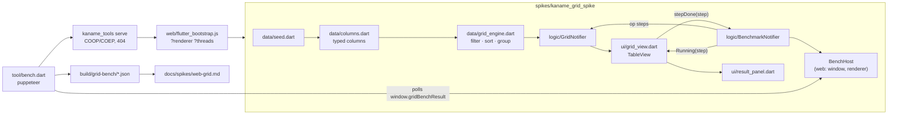
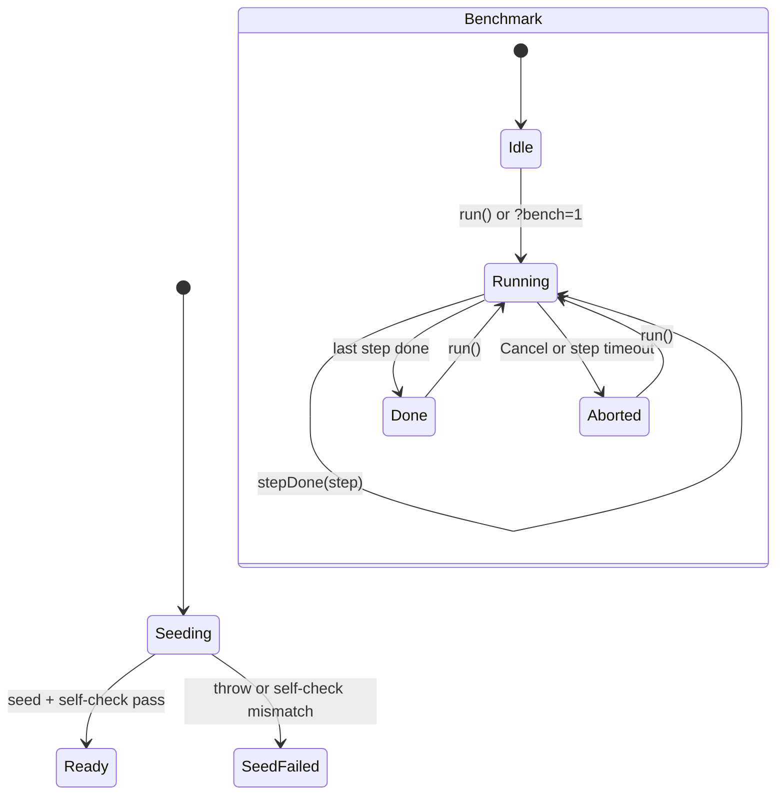

# Design

## Triage

| Trigger | Applies? | Evidence |
|---|---|---|
| T1 Components (new component, or 3+ with directed relationships) | yes | New spike app with a query engine, a grid view, a view-state notifier and a benchmark driver; new `serve` command in `kaname_tools`; a headless runner. |
| T2 State (persistent state, caches, 3+ state machine) | yes | Sealed spike state (seeding, ready, failed) and a benchmark state machine (idle, running, done, aborted); derived index views cached per query. No persistent state. |
| T3 Concurrency (background work, workers/isolates, async, retries) | yes | The benchmark drives scrolling with timers and frame callbacks; the headless runner drives a browser process with timeouts. Queries stay synchronous on the main thread (S2). |
| T4 Boundaries (data format, migration, shared interface, IPC, external) | yes | A new workspace package root (`spikes/`) in the shared tooling contract; URL parameter contracts (`renderer`, `threads`, `bench`); the benchmark result JSON read by the runner and the report; a new `serve` command. |
| T5 Volume (grows without a fixed bound) | no | Rows are fixed at 200,000. Frame samples are capped (see Resource Bounds). |
| T6 Risk (security, money, data loss, unrecoverable user data) | no | Synthetic data only. The dev server binds to loopback by default (D5). |

TIER: FULL

## Context

See proposal.md for the why and the scope decisions S1–S8.

- **Workspace package roots.** `kaname_tools workspace` only discovers packages under `app`, `app_packages`, `packages`, `server` and `tools` (`tools/kaname_tools/lib/src/workspace.dart:74-80`). It also requires every listed member to sit under one of those roots (`workspace.dart:133-138`). A `spikes/` member therefore fails the check until `spikes` is added.
- **Format-dir pattern.** `--format-dirs` refuses any member outside `^(app|(app_packages|packages|server|tools)/kaname_[a-z0-9_]+)$` (`workspace.dart:231-233`), and `format:check` pastes that list into its command (`mise.toml:42-49`).
- **Naming.** Outside `app`, a package sits at `<root>/<name>/`, carries the `kaname_` prefix and has a directory named after the package (`workspace.dart:180-200`). `spikes/kaname_grid_spike` satisfies all three.
- **Purity.** Only `packages` and `tools` must stay pure Dart (`tools/kaname_tools/lib/src/purity.dart:38-39`). A Flutter package under `spikes/` is outside that rule; `kaname_tools` itself must stay pure, so `serve` uses `dart:io` only.
- **Tests and CI.** `mise run test` lists each member's test task explicitly (`mise.toml:71-78`), and Flutter members run `flutter test` on the VM (`mise.toml:61-64`). CI runs `mise run check` after `resolve` (`.github/workflows/ci.yml:66-67`). The web build job compiles only the product app, without `--wasm` (`ci.yml:77`).
- **Product web build.** `build:web` compiles `app` with `--release --no-web-resources-cdn` and then runs `webbuild --check app/build/web` (`mise.toml:122-139`).
  - The product bootstrap loads fallback fonts from an own-origin path (`app/web/flutter_bootstrap.js:4-12`), and Caddy answers that path with a plain 404, not the single-page-app fallback (`deploy/Caddyfile:26-35`).
  - `webbuild --check` takes exactly one build directory (`tools/kaname_tools/lib/src/webbuild.dart:213-221`).
  - It requires a top-level `useLocalCanvasKit: true` in `_flutter.buildConfig` (`webbuild.dart:58-73`) and a `.wasm` file under `canvaskit/` (`webbuild.dart:76-87`).
  - It recognises `fontFallbackBaseUrl` only as an object key followed by a literal (`webbuild.dart:31-33`, `:104-126`).

  Whether `--wasm` output still meets these checks is A7.
- **App state pattern.** Providers live only in `logic/`, `data/` never imports Riverpod (`docs/guides/riverpod.md:9-17`), and there is no code generation (`docs/guides/riverpod.md:25`). A `Notifier` owns a sealed state that widgets switch on exhaustively (`docs/guides/riverpod.md:31-50`).
- **Design system.** Body text is Geist 13px with tabular figures, and rows are at least 30px with Hover and Ember Glow for the current row (`DESIGN.md:287`, `:248`, `:351`). The theme comes from `kaname_ember_ui` (`app_packages/kaname_ember_ui/lib/src/ember_theme.dart`).
- **Web renderers** (Flutter docs through Context7, `/flutter/website`, checked on 2026-11-17):
  - `flutter build web --wasm` emits a dart2wasm + skwasm build and a dart2js + CanvasKit fallback, chosen at startup by feature probes.
  - The `renderer` config field forces `canvaskit` or `skwasm`.
  - skwasm runs single-threaded unless the page is served with `Cross-Origin-Opener-Policy` and `Cross-Origin-Embedder-Policy`, and `forceSingleThreadedSkwasm` forces single-threaded mode.
- **TableView** (`/flutter/packages`, `two_dimensional_scrollables`, checked on 2026-11-17): `TableView.builder` builds cells lazily on both axes, with `pinnedRowCount`, `pinnedColumnCount` and per-span `TableSpan` extents.

## Decisions

### D1: Two-axis virtualisation with `TableView`

- **Choice:** `TableView.builder` from `two_dimensional_scrollables`, a first-party Flutter package under BSD-3:
  - `pinnedRowCount: 1` for the sticky header and `pinnedColumnCount: 1` for the name column;
  - fixed 30px rows;
  - column extents read from the view state, so resizing rebuilds only the spans.

  **Group header rows merge no cells** (owner's choice in review round 1):
  - The pinned name cell shows the group name, its row count and the expand or collapse arrow.
  - The quantity and total value cells show the group's sums, aligned under their headers.
  - The other cells are empty.

  No merge crosses the pinned edge.
- **Rejected:**
  - Our own viewport on `TwoDimensionalScrollView`: far more code, and the spike would measure our viewport rather than the platform's.
  - A vertical `ListView` inside a horizontal scroll with a synced header: columns aren't virtualised, so 25 columns build every cell of every visible row, and pinning is hand-rolled.
  - For the header, merging columns 1–24 into one summary cell: totals no longer line up with their columns.
- **Reversal cost:** low. It is confined to the spike's `ui/` folder.
- **Important:** yes. It adds a dependency (licence check, notices).
- **Chosen by:** user

### D2: Columnar engine with index views

- **Choice:** plain Dart in `spikes/kaname_grid_spike/lib/data/` (no Flutter, no Riverpod, no web-only imports).
  - **Web-portable storage only** (review round 1, C-1):
    - Columns use `Int32List`, `Uint32List`, `Uint8List` or `Float64List`, never `Int64List` or `Uint64List`, which dart2js doesn't support.
    - Integer values stay below 2^31: ids are generated in that range, and dates are epoch seconds, which fit `Int32List` until 2038.
    - Money and volume are `Float64List`.
  - **Dictionaries.** Categorical and text columns are dictionary-encoded: an `Int32List` of codes plus a dictionary of distinct strings with a precomputed sort rank per code.
  - **Filter.** It runs on the dictionary first: case-insensitive substring over the distinct names gives a `Uint8List` mask of matching codes. One pass over the code column then yields the matching row indices. A categorical "equals" filter works the same way.
  - **Sort.** A self-written merge sort of the filtered index `Int32List`, by rank or numeric value, with ties broken by row index. The order is total, so it is identical on the VM, dart2wasm and dart2js (review round 1, M-5).
  - **Group.** By one categorical column, ordered by group rank, then the sort within each group. It produces group runs with a count and the sums of quantity and total value.
  - **View.** One flat `Int32List`: a value ≥0 is a row index, and `-(g+1)` is the header of group `g`. Collapsed groups contribute only their header.
  - **Purity of operations.** Each operation is a pure function `(columns, query) → GridView` that returns its elapsed time from a `Stopwatch`. Rows are never copied.
- **Rejected:**
  - `List<AssetRow>` with `where`, `sort` and `groupBy`: per-row objects and closures allocate heavily under dart2js and dart2wasm GC, so the spike would measure an implementation no real grid should use.
  - A new pure package `packages/kaname_grid_engine`: it promotes spike code into a shared, purity-checked package before any real grid exists (S6 keeps the spike disposable).
  - `List.sort` on the index list: Dart doesn't guarantee its stability, and it differs between compilers.
- **Reversal cost:** low. Moving the folder into a package later is mechanical.
- **Important:** yes. It was chosen on weak evidence: the spike measures it.
- **Chosen by:** user

### D3: View state in a Riverpod `Notifier`

- **Choice:** follow ADR 0010 and `docs/guides/riverpod.md`. `logic/grid_notifier.dart` declares `gridProvider` (`NotifierProvider<GridNotifier, GridState>`). The engine and the seed come from providers that `main()` overrides.
  - `GridState` is sealed: `Seeding`, `Ready` and `SeedFailed(reason)`.
  - `Ready` holds:
    - the columns;
    - the current `GridQuery` (filter text, category filter, sort column and direction, group column, collapsed groups);
    - the `GridView`;
    - the column widths and the current row;
    - the last operation's timing;
    - `lastError`, the failed operation and its message, cleared by the next successful operation.
  - The seed starts after the first frame, so `Seeding` is painted.
  - Widgets call notifier methods (`setFilter`, `sortBy`, `groupBy`, `toggleGroup`, `resizeColumn`, `moveCurrent`) and switch exhaustively.
- **Rejected:** a widget-local `ValueNotifier`. Less code, but it doesn't exercise the provider rebuild path that every later module grid will use.
- **Reversal cost:** low
- **Important:** no
- **Chosen by:** user

### D4: Self-driving benchmark plus a headless runner

- **Choice:** a benchmark that the spike runs on its current renderer, started either by the toolbar's Benchmark control or, without any accessibility tree, by the URL parameter `?bench=1`. The `?bench=1` start is the owner's choice in review round 1 (M-3).

  **Script.** Durations are fixed, and the per-step timeout is 2× the planned duration plus 10s (M-1):
  1. **Calibrate:** run an animation for 2s and take the median time between frames as the display's refresh period.
  2. **Hand-speed scroll:** 20s of vertical scrolling at 3,000 px/s, reversing at the ends. The S4 verdict is judged on this segment (owner's choice in round 1, S-a).
  3. **Stress traversal:** top to bottom in 30s, then back in 30s. This is reported as headroom, not judged.
  4. **Horizontal scroll:** to the last column and back, 5s each way.
  5. **Operations:** apply filter text, a category filter, sort on three columns (text, integer, float), group by two columns, collapse and expand every group, then clear the query. Then, on all 200,000 rows, sort on the same three columns and group by the same two columns, so S4's "filter, group or sort over 200,000 rows" is measured; the filtered steps stay as a smaller comparison (pre-ship review round 2, owner's choice).
  6. **Resize:** resize one column by script.

  **Who drives what** (M-2, owner's choice):
  - `BenchmarkNotifier` (sealed state `Idle`, `Running(step)`, `Done(result)`, `Aborted(reason)`) publishes `Running(step)`.
  - The grid widget listens. For scroll steps it runs `animateTo` on its own controllers and then calls `BenchmarkNotifier.stepDone(step)`.
  - Operation and resize steps call `GridNotifier` methods directly.
  - `logic/` never holds a UI object.
  - User input on the grid is disabled while `Running`, and Cancel aborts the run.

  **Recording:**
  - Times between frames come from `SchedulerBinding.addPersistentFrameCallback` timestamps, and build and raster times from `addTimingsCallback` when the web engine reports them (A1).
  - Each query operation records two figures (round 2, owner's choice):
    - engine time;
    - time until on screen: from the notifier call until the end of the first rendered frame that shows the new view (the next persistent-frame callback after the new state), plus raster time when A1 holds.

    Both figures go in the JSON and the report.
  - The seed time is recorded.
  - The run records the actual renderer and thread mode, the user agent, the window size and the device pixel ratio.

  **Verdict per S4** (judged on the hand-speed segment; round 2, owner's choice):
  - missed frames ≤5%, counted as skipped refreshes: each time between frames adds `max(0, round(interval / period) − 1)` missed frames, with the period from calibration, and the ratio is missed / (missed + intervals);
  - p99 time between frames ≤33ms;
  - when frame timings are reported, build plus raster time p90 ≤16.7ms;
  - every operation's time until on screen ≤300ms.

  **Result.** The result panel shows each figure against its budget and a "Copy JSON" button. The JSON carries `schemaVersion: 1`, the refresh period and every figure above for each segment. The spike also stores it in `window.gridBenchResult`.

  **Web seam.** Web-only access (`window` and the renderer probe) goes through a `BenchHost` interface injected from `main()` by a conditional import. VM tests use a fake (S-d).

  **Runner.** `spikes/kaname_grid_spike/tool/bench.dart` uses the `puppeteer` package, a `dev_dependency` of the spike only.
  - It serves the build through D5 and opens headless Chrome at `/?bench=1&renderer=…&threads=…` for each combination.
  - It polls `window.gridBenchResult`, with a 10-minute timeout per page.
  - It writes `build/grid-bench/<renderer>-<threads>.json`. The report quotes these files.
- **Rejected:**
  - A benchmark with manual runs only: the agent's numbers would depend on a hand run and couldn't be repeated in a later change.
  - DevTools traces by hand: not repeatable, and nothing compares runs.
  - Starting the run through the accessibility tree: Flutter web builds no accessibility tree by default, and turning it on adds per-frame work to the very frames being measured.
  - Keeping the scroll controllers in a provider driven by the notifier: a UI object would live in `logic/`.
- **Reversal cost:** low
- **Important:** yes. The result JSON format binds the report and later reruns, and the headless numbers rest on weak evidence (A3).
- **Chosen by:** user

### D5: `kaname_tools serve`

- **Choice:** a new `serve` command in `kaname_tools`, using `dart:io` only, with no new dependency:

  ```
  serve <dir> [--port 8080] [--host 127.0.0.1] [--no-isolation]
  ```

  - It serves static files from `<dir>` with correct content types, `.wasm` and `.mjs` included.
  - It sends `Cross-Origin-Opener-Policy: same-origin` and `Cross-Origin-Embedder-Policy: require-corp` unless `--no-isolation` is given.
  - It answers any path that isn't a file with a plain 404. There is no `index.html` fallback, so `/font-fallback/*` gets a 404 as it does under Caddy, and a missing asset fails clearly (owner's choice in review round 1, M-7).
  - It serves `index.html` only for `/`.
  - It refuses paths that resolve outside `<dir>`.
  - It binds to loopback by default, so a LAN host must be passed explicitly.

  `mise run serve:spike` serves `spikes/kaname_grid_spike/build/web`. On the Windows clone, the owner builds and serves there with the same tasks.
- **Rejected:**
  - Adding the spike to `deploy/Caddyfile`: it changes the product deployment for a spike.
  - A plain static server without headers: multi-threaded skwasm, the best case, would go unmeasured.
  - An `index.html` fallback for extensionless paths: the spike has no routes, so it buys nothing.
- **Reversal cost:** low
- **Important:** yes. It binds future changes: a new tool command and its flags.
- **Chosen by:** user

### D6: `spikes/` package root; VM tests in CI, Chrome tests in the spike tasks

- **Choice:**
  - Add `spikes` to `WorkspaceCheck.packageRoots` and to the `--format-dirs` pattern, with tests. It is not added to `pureRoots`.
  - Add the mise tasks:
    - `test:spike` (VM, part of `test`);
    - `test:spike:web` (`flutter test --platform chrome --tags web`, over the seed, PRNG and engine tests);
    - `build:spike` (`test:spike:web`, then `flutter build web --wasm --release --no-web-resources-cdn` in the spike, then `webbuild --check spikes/kaname_grid_spike/build/web`);
    - `serve:spike`;
    - `bench:spike` (`build:spike`, then the headless runner).
  - CI analyses, format-checks and runs the VM tests through `check`. It runs no web build or Chrome tests for the spike.
  - The spike also checks itself at startup: after seeding, it compares the PRNG's first outputs and a checksum per column with constants. A mismatch gives `SeedFailed`, which names the check, so a compiler difference is visible on screen (owner's choice in review round 1, C-1).
- **Rejected:**
  - A CI wasm build job for the spike: it adds CI time to every PR for a disposable harness.
  - Chrome tests in CI: they need Chrome on a runner for a disposable harness. The gap is carried as C7.
- **Reversal cost:** low
- **Important:** yes. It binds future changes: the workspace layout contract gains a root.
- **Chosen by:** user

### D7: Seed generated at startup

- **Choice:** `data/seed.dart` builds the 200,000 rows deterministically from a fixed seed.
  - **PRNG.** A small self-written xorshift32 masks every step to 32 bits (`& 0xFFFFFFFF`), so the VM, dart2wasm and dart2js produce the same stream (review round 1, M-6). A golden test of the first 16 outputs runs on the VM and on Chrome.
  - **Dictionaries:** about 4,000 synthetic item names, 40 categories, 300 groups, 60 regions, 1,500 locations, 120 owners, 7 divisions and 20 location flags.
  - **25 columns:** name, category, group, region, location, location flag, owner, division, quantity, unit value, total value, unit volume, total volume, packaged, singleton, blueprint copy, runs, material efficiency, time efficiency, created, last moved, item id, container id, meta level and tech level.

  All names are generated from syllables. No SDE, ESI or third-party schema is used. The seed time is recorded.
- **Rejected:** a pre-generated binary asset written by `kaname_tools`. It commits a multi-megabyte file and settles a bundle format before M1 decides it (ADR 0004).
- **Reversal cost:** low
- **Important:** no
- **Chosen by:** user

### D8: Renderer chosen by URL parameter

- **Choice:** the spike's `web/flutter_bootstrap.js` reads `?renderer=skwasm|canvaskit` and `?threads=single`.
  - It passes `renderer` and `forceSingleThreadedSkwasm` in the `config` object literal of `_flutter.loader.load`.
  - In that same literal it keeps the line `fontFallbackBaseUrl: "/font-fallback/"`, in the exact form `webbuild --check` recognises (`webbuild.dart:31-33`).
  - Without the parameter, the loader's automatic choice applies. An unknown value is ignored and logged to the console.
  - The spike shows the actual renderer (through `BenchHost`, A6) and the thread mode in its toolbar and in the JSON.
- **Rejected:** two separate builds (`--wasm` and plain JS in separate folders). There would be two outputs to keep in step, and the fallback path `--wasm` really serves would never be measured.
- **Reversal cost:** low
- **Important:** no
- **Chosen by:** user

### Decision summary

| # | Decision | Choice | Rejected | Reversal cost | Important | Chosen by |
|---|---|---|---|---|---|---|
| S1 | Where the spike lives | Separate `spikes/kaname_grid_spike` web app | Hidden route; visible module slot | low | yes | user |
| S2 | Data locus | 200k seeded rows in the client; pure-Dart engine on the main thread | Server paging via SQL; both | low | yes | user |
| S3 | Renderer coverage | Spike-only `--wasm` build, both renderers measured | Also switch the product build | low | yes | user |
| S4 | Go budget | ≤5% missed frames (skipped refreshes), p99 ≤33ms, work p90 ≤16.7ms where reported; ops on screen ≤300ms | 30fps and 1s; no budget; work time only; time between frames + margin | low | yes | user |
| S5 | Spec | `skip_specs: true`; the report is the evidence | A grid-spike capability spec | low | no | user |
| S6 | Lifetime | Keep as a benchmark harness until the first real grid | Delete after acceptance | low | no | user |
| S7 | Owner check | `[user]` task in this change | Judge at milestone close | low | yes | user |
| S8 | Extras | Pinned column, keyboard rows, group totals, column resize | Exit-criterion minimum | low | yes | user |
| D1 | Virtualisation | `TableView`; group headers with the label in the pinned cell, totals in their columns, no merges | Own viewport; synced ListViews; merged summary cell | low | yes | user |
| D2 | Engine | Columnar, web-portable typed lists, dictionary codes, merge sort with row-index tie-break, `Int32List` views | Row objects; new pure package; `List.sort` | low | yes | user |
| D3 | View state | Riverpod `Notifier` with sealed states, `lastError`, seed after first frame | Widget-local `ValueNotifier` | low | no | user |
| D4 | Measurement | Benchmark with `?bench=1` autostart, hand-speed + stress segments, widget-run scroll steps, puppeteer runner, JSON v1 | Manual runs only; DevTools; accessibility-tree start; controllers in a provider | low | yes | user |
| D5 | Serving | `kaname_tools serve` with COOP/COEP, loopback default, plain 404 | Caddy in the stack; plain server; extensionless fallback | low | yes | user |
| D6 | Tooling/CI | `spikes/` root; VM tests in CI; Chrome tests in build/bench tasks; startup self-check | CI wasm build job; Chrome tests in CI | low | yes | user |
| D7 | Seed | Deterministic generation at startup, 32-bit-masked xorshift32 | Pre-generated binary asset | low | no | user |
| D8 | Renderer pick | `?renderer=` / `?threads=` in a custom bootstrap | Two separate builds | low | no | user |

## Assumptions

- **A1:** The web engine reports `FrameTiming` through `addTimingsCallback` for both skwasm and CanvasKit. Not checked because the docs found don't say whether web supports it. Depends on it: D4. If not, the work-time criterion is reported as "not available" and the verdict rests on missed frames and p99 (S4).
- **A2:** The Dart `puppeteer` package resolves with the pinned Dart 3.13.7 without changing any existing locked version, carries a licence the licence policy accepts, and can launch Chrome for Testing headless with skwasm. Not checked because nothing is added before apply. Depends on it: D4. If any part fails, the runner is dropped, and the agent's numbers come from a documented manual run of the same `?bench=1` page, recorded in the report.
- **A3:** Headless Chrome in WSL renders on a software GPU, so its frame times are a pessimistic lower bound rather than the owner's experience. Not checked because the GPU path depends on the Chrome flags and the host. Depends on it: the report's wording. The report states the machine, the GPU path and that the owner's laptop run is the deciding one.
- **A4:** `two_dimensional_scrollables` has a release compatible with Flutter 3.47.9. Not checked because no dependency is added before apply. Depends on it: D1.
- **A5:** Multi-threaded skwasm starts in headless Chrome when the page is served with COOP/COEP. Not checked because nothing is built before apply. Depends on it: D4, D5. If not, the runner records the actual thread mode, and the report says so.
- **A6:** `dart:ui_web` exposes whether skwasm or CanvasKit is active. Not checked because nothing is built before apply. Depends on it: D8. Otherwise `BenchHost` records the requested renderer plus `kIsWasm`, which tells the dart2wasm (skwasm) build from the dart2js (CanvasKit) build.
- **A7:** A `--wasm --no-web-resources-cdn` build still writes a top-level `useLocalCanvasKit: true` in `_flutter.buildConfig` and `.wasm` files under `canvaskit/`, so `webbuild --check` passes on it. Not checked because nothing is built before apply. Depends on it: `build:spike`. If not, `build:spike` uses the checker as far as it applies, and the report records the difference for the product decision (C3).
- **A8:** When a forced renderer can't run (for example `renderer=skwasm` on a browser without WasmGC), the loader either falls back to CanvasKit or fails to start. Which one is not checked, because the docs describe only the automatic choice. Depends on it: Failure & Visibility. Either way the recorded actual renderer, or the runner's timeout, makes it visible.

## Carried constraints

- **C1:** The spike is not product code: nothing in `app/`, `app_packages/`, `packages/` or `server/` may import `kaname_grid_spike`, and the first real grid change reuses or replaces it and then deletes `spikes/kaname_grid_spike` (S6). Kind: invariant. Destination: doc comment: spikes/kaname_grid_spike/lib/main.dart library
- **C2:** `spikes/` is a package root outside the purity rule. A package that must stay pure never goes there. Kind: invariant. Destination: doc comment: tools/kaname_tools/lib/src/workspace.dart WorkspaceCheck.packageRoots
- **C3:** Multi-threaded skwasm needs COOP/COEP on the hosting origin. If the report recommends `--wasm` for the product, that change must add the headers to `deploy/Caddyfile` or accept single-threaded skwasm, and must confirm `webbuild --check` on `--wasm` output (A7). Kind: deliberate gap. Destination: doc comment: tools/kaname_tools/lib/src/webbuild.dart WebBuildChecker
- **C4:** `serve` is a development server: it binds to loopback by default and must never be used in the deployed stack. Kind: invariant. Destination: doc comment: tools/kaname_tools/lib/src/serve.dart ServeCommand
- **C5:** Server-side paging and SQL grouping were not measured. A grid over server data must measure them before relying on the client-side numbers. The report's client-side numbers do not move corp-table filtering, grouping or totals off SQL on web (architecture resource bounds; ADR 0005). Kind: rejected alternative. Destination: doc comment: spikes/kaname_grid_spike/lib/data/grid_engine.dart library
- **C6:** The benchmark result JSON is `schemaVersion: 1`. Any change to its fields bumps the version, so reruns compare only like with like. Kind: invariant. Destination: doc comment: spikes/kaname_grid_spike/lib/logic/benchmark_result.dart BenchmarkResult
- **C7:** CI runs only the spike's VM tests. Web-only breakage shows up only in `build:spike` or `bench:spike`, so a rerun or the first real grid change must run them. Kind: deliberate gap. Destination: doc comment: spikes/kaname_grid_spike/lib/main.dart library
- **C9:** `serve` answers every path that is not a file, and `/font-fallback/*` in particular, with a plain 404, mirroring `deploy/Caddyfile`. A later `index.html` fallback must still answer `/font-fallback/*` with 404. Kind: rejected alternative. Destination: doc comment: tools/kaname_tools/lib/src/serve.dart ServeCommand.run
- **C8:** Engine columns use only web-portable typed lists with integers below 2^31, and the sort is total (ties broken by row index), so both compilers give identical results. Kind: invariant. Destination: doc comment: spikes/kaname_grid_spike/lib/data/columns.dart library

## Diagrams (FULL)

Components (T1):



States (T2):



Benchmark run (T3, T4):

```mermaid
sequenceDiagram
  participant R as bench.dart
  participant S as kaname_tools serve
  participant C as headless Chrome
  participant B as BenchmarkNotifier
  participant G as grid widget
  R->>S: start (port, isolation on/off)
  loop renderer × thread mode
    R->>C: open /?bench=1&renderer=X&threads=Y
    C->>S: GET assets (COOP/COEP; unknown → 404)
    C->>B: autostart run()
    loop steps
      B-->>G: Running(scroll step)
      G->>G: animateTo on own controllers
      G->>B: stepDone(step)
      B->>B: op steps via GridNotifier
    end
    B-->>C: Done; window.gridBenchResult = JSON v1
    R->>C: poll window.gridBenchResult (timeout 10 min)
    R->>R: write build/grid-bench/X-Y.json
  end
  R->>S: stop
```

## State & Ownership (FULL)

| State | Owner (sole writer) | Lifetime | Invalidation / rebuild | Authoritative copy |
|---|---|---|---|---|
| Columns (200k rows) | `GridNotifier` (sets them once from the seed) | App session | Never changes; rebuilt only on reload | In-memory typed lists |
| `GridQuery` | `GridNotifier` | App session | Replaced on each user or benchmark action | `Ready.query` |
| `GridView` (index views, groups, totals) | `GridNotifier`, computed by the engine | Until the next query change | Recomputed from columns + query; nothing incremental | `Ready.view` |
| Column widths, current row, `lastError` | `GridNotifier` | App session | Replaced on resize, move or the next operation | `Ready` |
| Scroll offsets | the `TableView`'s `ScrollController`s, owned by the grid widget | Widget lifetime | Reset to top on query change | Controllers |
| Benchmark run and samples | `BenchmarkNotifier` | One run | Cleared at `run()` | `Running`/`Done` |
| Result JSON on `window` | `BenchmarkNotifier` through `BenchHost` (written once at `Done`) | Page lifetime | Overwritten by the next run | `Done.result` |

The benchmark changes the query only through `GridNotifier` methods and scrolls only through the grid widget, so each piece of state has one writer.

## Failure & Visibility (FULL)

| Component | Fails / dies mid-operation → | Recovery | Retry safe? | Who finds out |
|---|---|---|---|---|
| Seed or startup self-check | Throws or mismatches → `SeedFailed(reason)` | Fix, then reload | yes | User: an error state naming the check in place of the grid; console |
| Engine operation | Throws (bug) → the query is not applied, the previous view stays, and `lastError` is set | Fix the bug | yes | User: an inline banner from `lastError` naming the operation; console |
| Benchmark step | Exceeds its timeout (2× planned + 10s) → `Aborted(reason)` | Run again | yes (it resets) | User: the result panel shows the reason; runner: no result before its timeout → that row failed |
| `serve` | Port in use or bind fails → exit 1 with a message | Another port | yes | Developer: stderr |
| `serve` missing file | 404 | n/a | n/a | Browser console; the page fails to start, so the runner times out on that row |
| `bench.dart` | Chrome fails to launch, page error, or timeout → that row is `failed` with the reason, and the others continue; exit 1 if any failed | Rerun | yes | Developer: stderr and the JSON summary |
| Forced renderer unavailable | Falls back or fails to start (A8) | none needed | n/a | The toolbar and JSON show the actual renderer, or the runner times out; a fallback is never reported as skwasm |

## Resource Bounds (FULL)

| Queue / buffer / cache / transfer | Bound | At the bound | Timeout | At 10x / 100x |
|---|---|---|---|---|
| Rows | 200,000 (constant) | n/a | n/a | 2M rows: the columns grow to about 200 MB in memory, more than a browser tab should hold; out of scope, the report notes it. 20M is not viable client-side (C5). |
| Index views | One `Int32List` per active stage (filter, sort, view) ≤ 200k × 4 bytes each, plus one merge-sort scratch buffer of the same size | Replaced, never accumulated | n/a | Linear |
| Frame samples per run | ≤ 100,000 intervals (`Float64List`, about 800 KB, preallocated): 10 minutes at 144 Hz | Further samples are counted but dropped; the JSON records `droppedSamples` | n/a | n/a |
| Benchmark step | n/a | n/a | 2× planned duration + 10s per step; 10 min per page in the runner | n/a |
| Built cells | Visible cells plus the `TableView` cache extent | Virtualised | n/a | Independent of row count |
| `serve` requests | Static files, one response each, streamed from disk | n/a | 30s idle connection timeout | Dev-only |

## Flow & State Gaps (FULL)

- **Query changes during a benchmark.** User input during a run is ignored: grid controls are disabled while `Running`, and the toolbar's Cancel aborts the run.
- **The grid rebuilt mid-step.** If the grid widget is rebuilt during a scroll step, its controllers survive (the widget is stateful). If it is unmounted, the step times out and the run is `Aborted`.
- **Query change while scrolled deep.** The view is recomputed and scroll offsets reset to the top. The current row is kept if it is still visible in the new view, else cleared.
- **Collapsed groups after regrouping.** Collapsed state is keyed by group column and group code, and cleared when the group column changes.
- **Resize during scroll.** The widths update in `Ready`, and only the span extents change. No query rerun.
- **Fallback renderer.** The JSON records the actual renderer, so a skwasm row that fell back is visible.
- **Reload mid-run.** Everything is in memory, so a reload starts clean. The runner treats a missing result as a failure.

## Mechanism Ledger (FULL)

| Mechanism | Built? | Why (harm nobody catches / expensive later) | Evidence that would change the call |
|---|---|---|---|
| Moving queries to a web worker or isolate | no | S2: measure the main thread first. The report says "adjust" if ops exceed 300ms. | Ops over the S4 budget |
| Incremental re-query (reuse the previous filter result) | no | Full recompute is simpler, and its cost is what the budget measures | Ops over budget, with filter as the dominant step |
| Debouncing filter-text input | yes | Without it, each keystroke reruns over 200k rows; cheap to add, and hard to judge typing feel without it | n/a |
| Step and run timeouts in the benchmark and runner | yes | A stalled run would otherwise hang the agent's report step unnoticed | n/a |
| Frame-sample cap | yes | Unbounded growth over long runs (Resource Bounds) | n/a |
| Startup self-check and Chrome-tagged tests | yes | VM tests and CI can't see dart2js-only breakage (C7). Without them a wrong renderer row would reach the report | n/a |
| Path-escape refusal in `serve` | yes | Cheap; a served dev directory must not expose the rest of the disk | n/a |
| SPA `index.html` fallback in `serve` | no | The spike has no routes, and the fallback would mask missing assets and the font-fallback 404 | A routed app served through `serve` |
| Persisting widths or query | no | Spike only | n/a |

## Risks / Trade-offs

- [Headless numbers mislead (A3)] → The report labels the machine and the GPU path, and treats the owner's laptop run as decisive (S7).
- [`puppeteer` unusable or moves shared locked versions (A2)] → Drop it and use a documented manual `?bench=1` run. The JSON format is the same either way.
- [The spike rots after the report] → It stays in `check` (analyze and VM tests), and `build:spike` runs the Chrome tests (S6, D6, C7).
- [`TableView` overhead hides engine speed, or the reverse] → Each operation reports engine time and time until on screen. The budget judges time until on screen.
- [Over-scoping with extras (S8)] → Each extra is a separate task with its own test. The core exit criterion is measured first.

## ADRs

- **In force, constraining this change:**
  - 0003: workspace layout. A new package root is added, and shared pure packages stay pure.
  - 0004: no bundle format is settled here (D7).
  - 0005: solo mode motivates the client-side case.
  - 0010: Riverpod in `logic/` only, sealed states.
- **To record during apply:** none.
  - **ADR 0003.** No superseding ADR is needed for `spikes/` (owner's choice in review round 1). `spikes/` holds disposable harnesses outside the product and the purity rule, so ADR 0003's layout of product, shared and tool packages is unchanged, and C2's doc comment carries the rule.
  - **Later outcomes.** Any outcome that binds later changes (for example `--wasm` for the product, or a worker-based query engine) is a recommendation in the report, and a later change records its ADR.

## Open Questions

- The exact stress-traversal and hand-speed durations may be tuned during apply so a full run fits in about 3 minutes. The values used are recorded in the JSON and the report.
